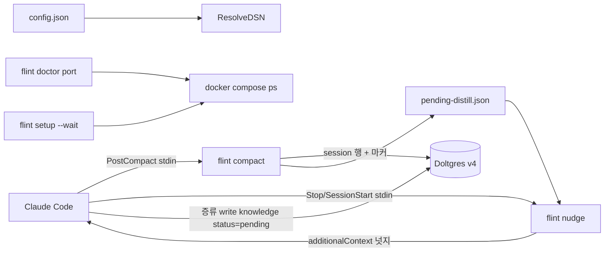
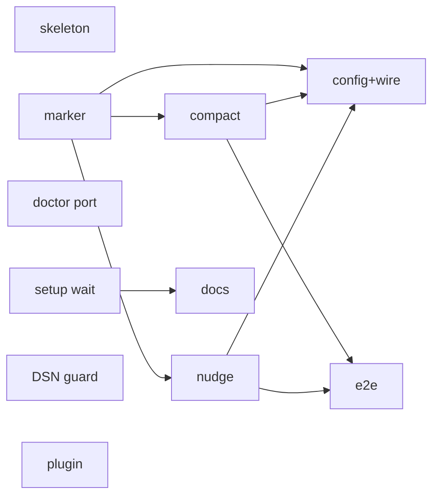

# flint v0.7 머신 플랜 — 적립 자동화·실사용 재개 (2026-10-23)

**Spec:** docs/plans/2026-10-23-flint-v07.spec.md (조사: …v07.research.md) ·
**Detail:** tests · **Target-min:** 11 · **Budget-usd:** 60

**Goal:** 스펙 §1(2계층 적립 자동화 — PostCompact 보존 + Stop/SessionStart 넛지
증류)·§2(설정 파일·doctor port·DSN 가드·setup 보강) 구현.
**Architecture/Tech:** 기존 Go CLI+Doltgres, 신규 스키마 없음(v4 — session·
write 파이프라인·dedup·approve 재사용). 표준 라이브러리·os/exec(docker).
코멘트 한국어.

**전역 제약(스펙 §3):** exit 0/1/2/3 · 한 줄 JSON · 비간섭 — compact·nudge는
어떤 실패에도 exit 0·조용히(플러그인 훅 문자열 `2>/dev/null || true` 이중
가드) · TDD(red→green→commit) · 기존 테스트 수정 금지(예외: FLINT_DSN 가드
lib/db 진입점 최소 수정) · 스키마 v4 불변 · meta 키 우선·무효 값 폴백 · 훅
커맨드 2s 내 완결(DB 대기 없음) · 자동 적립 `--source hook` 고정. 검증:
`go test ./lib/cli/ -run <Test> -count=1`(Doltgres 필요 시 FLINT_DSN).

## 파일 구조

marker.go 마커 생성·판독·소비·configDir · compact.go PostCompact 적립 ·
nudge.go 넛지·--clear · config.go DSN 우선순위 · root.go ResolveDSN 위임·
store-free += nudge · registry.go usageLine += compact·nudge · doctor.go 검사
6종(port) · setup.go compose --wait · lib/db/testutil_test.go TestDSN ·
flint-plugin/hooks/hooks.json 훅 3종 · SKILL.md 증류 지침 · tests/e2e/v07 ·
Makefile·QUICKSTART·TUNING.

```mermaid
%% schedule
gantt
  title Predicted schedule (mm:ss)
  dateFormat X
  axisFormat %M:%S
  section lane 1
  T78 플러그인 훅·스킬 :t78, 0, 127s
  T74 설정 파일·전역 배선 :t74, 204, 151s
  section lane 2
  T0 skeleton :t0, 0, 120s
  T79 e2e 자동화 체인 :t79, 204, 102s
  section lane 3
  T71 마커 헬퍼 :t71, 0, 102s
  T72 flint compact :t72, 102, 102s
  section lane 4
  T75 doctor port 검사 :t75, 0, 102s
  T73 flint nudge :t73, 102, 102s
  section lane 5
  T76 setup 보강 :t76, 0, 102s
  T80 문서 정합 :t80, 102, 102s
  section lane 6
  T77 테스트 DSN 가드 :t77, 0, 102s
```

critical path: T71 → T72 → T74 (5.9 min) · peak width 6 · predicted build 5.9 min · predicted total ≈ 9.4 min

## 태스크

### T0 skeleton · Complexity 1 (O-1) · Est. context 10k
**Owns:** lib/cli/marker.go(스텁), lib/cli/config.go(스텁)
**Components:** 2 · **LOC owned:** 20 · **Tests:** fast · **Kind:** mechanical ·
**Model:** haiku · **Est. time:** 1.5 min
**Produces:** 아래 태스크 Produces 시그니처의 컴파일 스텁(영·nil 반환 — 로직
금지). 패키지 전체 `go build` 통과.
**Notes:** T71·T74가 red→green으로 채움.

### T71 마커 헬퍼 · Complexity 3 · Est. context 22k
**Owns:** lib/cli/marker.go, lib/cli/marker_test.go
**Components:** 1 · **LOC owned:** 60 · **Tests:** fast · **Model:** sonnet ·
**Est. time:** 2 min
**Produces:** configDir() string · MarkerFile() string · WriteMarker(sessionID string, reason string) error · ReadMarker() (*Marker, error) · ClearMarker() error
type Marker — struct { SessionID string `json:"session_id"`; Reason string `json:"reason"`; CreatedAt string `json:"created_at"` }
**계약:** configDir = FLINT_CONFIG_DIR > os.UserConfigDir()/flint(실패 시 "" →
MarkerFile ""). MarkerFile = configDir()/pending-distill.json. WriteMarker =
JSON 마샬+MkdirAll(0700)+기록, CreatedAt=now UTC RFC3339. ReadMarker 부재
(nil, nil)·파손 (nil, err). ClearMarker 부재여도 nil.
e.g. WriteMarker("s1","compact") → ReadMarker() = &Marker{SessionID:"s1",
Reason:"compact"} · ClearMarker() 후 (nil, nil)
**Review Focus:** `test_marker_roundtrip` · `test_marker_absent_nil` ·
`test_marker_corrupt_nil` · 경로는 t.Setenv(FLINT_CONFIG_DIR, t.TempDir())
**Notes:** 개인 단일 에이전트 — 원자성 불요.

### T72 flint compact · Complexity 4 · Est. context 30k
**Owns:** lib/cli/compact.go, lib/cli/compact_test.go
**Components:** 1 · **LOC owned:** 70 · **Tests:** fast · **Model:** sonnet ·
**Est. time:** 2.5 min
**Consumes:** WriteMarker(sessionID string, reason string) error (T71)
**Produces:** runCompact(ctx context.Context, st Store, args []string, stdin
io.Reader, stdout io.Writer) int · init: Register("compact", runCompact)
**계약:** stdin 훅 JSON{hook_event_name, session_id, compact_summary} 파싱.
요약 비빈 → runWrite를 args=["session","--source","hook"], stdin=
`[{"summary":<요약>,"agent":"claude","ts":<now RFC3339>}]`, stdout=io.Discard로
호출. runWrite 반환==0 && session_id 비빈 → WriteMarker(sessionID,"compact").
파싱 실패·빈 요약·st nil → 무동작. 반환 언제나 0.
e.g. {"hook_event_name":"PostCompact","session_id":"s1","compact_summary":
"API 설계 완료"} → exit 0·session 1행·마커 존재 · "not json" → exit 0 무변화
**Review Focus:** `test_compact_writes_session`(fake Store) ·
`test_compact_bad_stdin_exit0` · `test_compact_empty_summary_noop`(적립·마커
없음) · stdout 항상 빈
**Notes:** stderr 1줄 경고 허용(done 패턴). fake은 cli_test 재사용.

### T73 flint nudge · Complexity 5 · Est. context 34k
**Owns:** lib/cli/nudge.go, lib/cli/nudge_test.go
**Components:** 1 · **LOC owned:** 90 · **Tests:** fast · **Model:** sonnet ·
**Est. time:** 3 min
**Consumes:** ReadMarker() (*Marker, error) (T71) · ClearMarker() error (T71)
**Produces:** runNudge(ctx context.Context, st Store, args []string, stdin
io.Reader, stdout io.Writer) int · init: Register("nudge", runNudge)
**계약:** --clear → ClearMarker·exit 0(무출력). 아니면 stdin 파싱:
Stop && stop_hook_active!=true && 마커 → stdout 1줄
`{"hookSpecificOutput":{"hookEventName":"Stop","additionalContext":<지시>}}`.
지시 상수: "flint: 미증류 컴팩트 요약이 있다. 세션에서 지속 지식을 추출해
flint write --source hook(status=pending)로 적립하고 flint nudge --clear 로
마커를 지워라." SessionStart && 마커 → plain 1줄 "flint: 미증류 마커 존재 —
증류 후 flint nudge --clear". 그 외 전부(파손·부재·stop_hook_active·st nil) →
빈 출력 exit 0.
e.g. Stop+마커 → additionalContext 포함 · stop_hook_active:true → 빈 ·
SessionStart+마커 → plain(JSON 아님)
**Review Focus:** `test_nudge_stop_active_guard` · `test_nudge_stop_context_json`
(유효 JSON·hookEventName) · `test_nudge_start_plain` · `test_nudge_clear`(소비
후 nil) · `test_nudge_no_marker_silent` · `test_nudge_bad_stdin_exit0`
**Notes:** 무한 넛지 방어 = stop_hook_active 1차 + 마커 1회성. st 미참조.

### T74 설정 파일·전역 배선 · Complexity 5 · Est. context 34k
**Owns:** lib/cli/config.go, lib/cli/config_test.go, lib/cli/root.go,
lib/cli/registry.go, lib/cli/wire_v07_test.go
**Components:** 3 · **LOC owned:** 90 · **Tests:** fast · **Model:** sonnet ·
**Est. time:** 3 min
**Consumes:** configDir() string (T71) · Lookup·Register (기존) · defaultDSN
(기존 root.go)
**Produces:** ConfigPath() string · LoadConfigDSN() string · ResolveDSN() string
**계약:** ConfigPath = configDir()/config.json. LoadConfigDSN — {"dsn":string}
파싱, 부재·파손·빈값·비문자열 → "". ResolveDSN = FLINT_DSN > LoadConfigDSN >
defaultDSN. root.go: dsnFromEnv 본체 `return ResolveDSN()` 교체(이름 불변)·
Run의 store-free 조건 += "nudge". registry.go usageLine에 compact·nudge 추가
(done| 뒤).
e.g. env+파일 → env · env 없음+{"dsn":"…5434…"} → 파일 · 둘 다 없음 → 기본
**Review Focus:** `test_resolve_precedence`(t.Setenv·TempDir) ·
`test_config_corrupt_fallback` · `test_nudge_store_free`(newStore 시임 미호출) ·
`test_usage_includes_compact_nudge` · `test_lookup_compact_nudge`
**Notes:** 기존 cli_test dsnFromEnv 기대 불변. --dsn 플래그 미도입
(progress.md 룰링).

### T75 doctor port 검사 · Complexity 5 · Est. context 34k
**Owns:** lib/cli/doctor.go, lib/cli/doctor_v07_test.go
**Components:** 1 · **LOC owned:** 100 · **Tests:** fast · **Model:** sonnet ·
**Est. time:** 3 min
**Produces:** portCheck(ctx context.Context, out io.Writer) int ·
DoctorChecks() += "port" · 시임 composePsFn = func(ctx) ([]byte, error)
(기본 exec `docker compose ps --format json`)
**계약:** composePsFn 오류(docker 부재 포함) → skip(exit 영향 없음). 성공 →
json.Decoder 연속 객체 스트리밍 파싱. Name·State·Publishers[].PublishedPort
판정: ① flint 컨테이너 실행 중+5433 매핑 → pass ② flint 없음/정지 →
fail+"docker compose up -d (flint 저장소)" ③ 5433 타 컨테이너 점유 →
fail+점유자 이름+"포트 이동: FLINT_DSN+compose 오버라이드(TUNING §2)".
--list-checks·--check port는 기존 프레임 준수.
e.g. [{Name:"flint-doltgres-1",State:"running",Publishers:[5433]}] → pass ·
branding 컨테이너가 5433 → fail+점유자
**Review Focus:** `test_port_pass` · `test_port_foreign`(점유자 보고) ·
`test_port_docker_missing`(skip·exit 영향 없음) · `test_port_stopped`(fail) ·
JSONL·배열 양쪽
**Notes:** 기대 포트 5433 상수. DSN 파싱은 이연.

### T76 setup 보강 · Complexity 3 · Est. context 22k
**Owns:** lib/cli/setup.go, lib/cli/setup_v07_test.go
**Components:** 1 · **LOC owned:** 40 · **Tests:** fast · **Model:** sonnet ·
**Est. time:** 2 min
**Consumes:** composeUpFn·composeRun·SetupSteps·RunSetup (기존 setup.go)
**Produces:** composeUpFn이 `composeRun(ctx,"up","-d","--wait",
"--wait-timeout","60")` 실행 · composeRun을 var 시임(composeRunFn) 전환 ·
SetupSteps() 갱신 · docker 미설치(exec not found) 안내 "docker 미설치 —
https://docs.docker.com/get-docker/ 설치 후 재실행"
**계약:** 대기·타임아웃 실패는 기존 경고 경로 유지(RunSetup 불변). SetupSteps는
실제 인자와 정합.
e.g. composeRunFn fake 인자 = ["up","-d","--wait","--wait-timeout","60"]
**Review Focus:** `test_setup_wait_args` · `test_setup_docker_missing_hint`
**Notes:** ping 재시도 의미론은 기존 Connect 체계가 담당.

### T77 테스트 DSN 가드 · Complexity 2 · Est. context 18k
**Owns:** lib/db/testutil_test.go, lib/db/pool_test.go, lib/db/repo_test.go
(진입점 최소 편집 — 스펙 §3 예외)
**Components:** 1 · **LOC owned:** 30 · **Tests:** fast · **Model:** sonnet ·
**Est. time:** 1.5 min
**Produces:** TestDSN(tb testing.TB) string
**계약:** FLINT_DSN 비빈 → 반환. 빈 → t.Skip("FLINT_DSN not set; set it to a
test database DSN"). lib/db 내 os.Getenv("FLINT_DSN") 기본값 폴백(5433 시도)
패턴 전수 조사해 TestDSN(t) 전환 — 접속 실패는 기존대로 t.Fatalf.
e.g. FLINT_DSN="…5435…" → 반환 · 미설정 → Skip
**Review Focus:** `test_dsn_returns_env` · 누락 없음(grep os.Getenv)
**Notes:** tests/(regression·e2e)는 자체 처리 유지 — lib/db만.

### T78 플러그인 훅·스킬 · Complexity 3 · Est. context 24k
**Owns:** flint-plugin/hooks/hooks.json,
flint-plugin/skills/flint/SKILL.md, flint-plugin/plugin_v07_test.go
**Components:** 2 · **LOC owned:** 60 · **Tests:** fast · **Model:** sonnet ·
**Est. time:** 2 min
**Produces:** hooks.json — "PostCompact":[{command:"flint compact
2>/dev/null || true", timeout:2}] · "Stop" 배열 두 번째 엔트리 {command:
"flint nudge 2>/dev/null || true", timeout:2} · "SessionStart" 배열 두 번째
엔트리(동일) · SKILL.md "세션 증류" 섹션 — 4연산(NOOP 동일 생략·UPDATE 기존
갱신·ADD 신규·모순 시 구 항목 무효화는 유지보수 경로)·status=pending·approve·
--source hook·`flint nudge --clear` 종결
**계약:** 기존 hot·done 엔트리 바이트 불변. 신규 훅 전부 가드+timeout 2.
e.g. 파싱 시 PostCompact 키 존재·Stop 엔트리 2개
**Review Focus:** `test_hooks_postcompact` · `test_hooks_nudge_guards` ·
`test_hooks_existing_untouched`(hot·done 원문) ·
`test_skill_distill_section`(NOOP·UPDATE·ADD·invalidate·pending·approve)
**Notes:** 훅 명령은 stdin에 훅 JSON 수신 표준. 플러그인 테스트 정적 검사만
(실행 검증 T79).

### T79 e2e 자동화 체인 · Complexity 5 · Est. context 30k · slow
**Owns:** tests/e2e/v07_test.go
**Components:** 1 · **LOC owned:** 90 · **Tests:** slow · **Model:** sonnet ·
**Est. time:** 3 min
**Consumes:** bin/flint compact·nudge·report·approve CLI (T72·T73·기존)
**Produces:** TestV07AutomationChain
**계약:** fresh DSN(v0.6 e2e 패턴)+임시 FLINT_CONFIG_DIR·FLINT_CLAUDE_HOME
(서브프로세스 env 주입): ①훅 JSON→`flint compact` exit 0 ②`flint report
--days 1` write≥1(소스 hook) ③마커 존재 ④Stop JSON→`flint nudge` stdout에
additionalContext ⑤`--clear` 후 소멸 ⑥재 nudge 빈 출력 ⑦`flint write
knowledge --source hook`(pending)→`flint approve`→active ⑧무효 stdin exit 0.
실패 시 t.Fatalf 즉시 종결. 실행은 전부 bin/flint.
**Review Focus:** 순서 의존·환경 격리(마커 오염 방지)
**Notes:** e2e 빌드 태그. 고유 DSN — flock 불필요.

### T80 문서 정합 · Complexity 2 · Est. context 18k
**Owns:** Makefile, docs/QUICKSTART.md, docs/TUNING.md
**Components:** 1 · **LOC owned:** 40 · **Tests:** fast · **Model:** sonnet ·
**Est. time:** 1.5 min
**Consumes:** flint setup --wait 강화 (T76) — 문서가 기술
**Produces:** Makefile `up` = `docker compose up -d --wait --wait-timeout 60` ·
QUICKSTART — flint setup 안내·config.json 재배치 절 · TUNING §2 —
FLINT_CONFIG_DIR·config.json dsn 우선순위(FLINT_DSN > 파일 > 기본)
**Review Focus:** 문서 명령·플래그 실제 구현 정합
**Notes:** 기존 §번호·형식 준수.

## Review Focus

| 패키지 | 유형 | 카테고리·위험 |
|---|---|---|
| lib/cli | CLI | protocol·encoding(훅 stdin·출력 1줄 JSON)·state(마커 부재/파손/경합·stop_hook_active 무한 넛지)·file(config 파손 폴백) |
| lib/db | library | state(Skip/Fatal 구분) |
| flint-plugin | CLI | protocol(훅 3종)·encoding(JSON 가드) |
| tests/e2e | 통합 | 순서 의존·환경 격리 |

**Probe entry:** lib/cli: run=bin/flint nudge · run=bin/flint compact ·
run=bin/flint doctor --check port · lib/db: call=lib/db.Connect ·
flint-plugin: run=bin/flint hot

## Self-review

스펙 §1·§2 → T71-T80 전 매핑(dup 신규 코드 없음=스펙 명시, 병합은 T78 스킬).
플레이스홀더 없음. Consumes↔Produces 일치. 엣지 8개 실행 의존만·사이클 없음·
동시 태스크 파일 미공유(root.go·registry.go는 T74 단독). 전 태스크 필수 필드
기재. Probe entry 전 패키지 배치. 15k 이내·SIZE 밴드 내·prune 완료.
