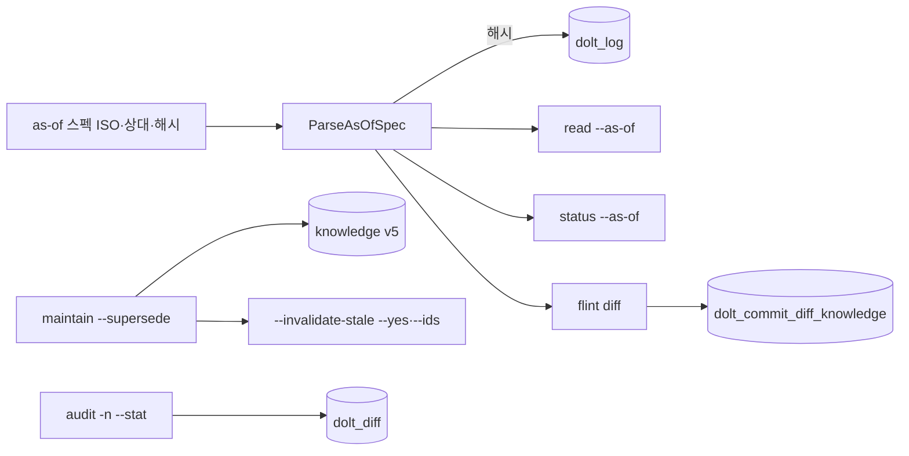
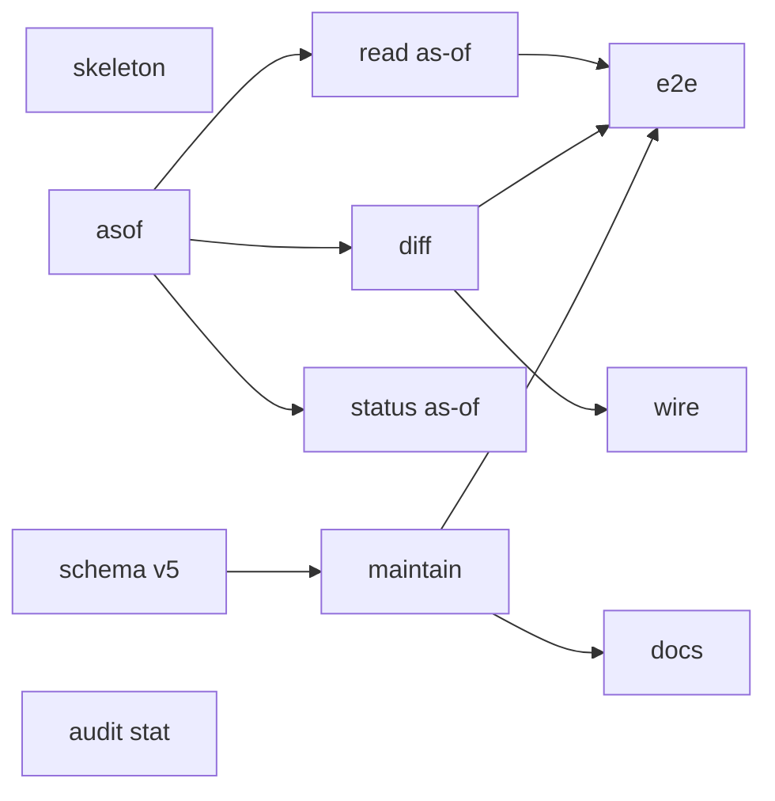

# flint v0.8 머신 플랜 — 시간여행 노출·수명주기 액션 (2026-10-24)

**Spec:** docs/plans/2026-10-23-flint-v08.spec.md (조사: …v08.research.md) ·
**Detail:** tests · **Target-min:** 11 · **Budget-usd:** 60

**Goal:** 스펙 §1(as-of 정규화·read/status --as-of·diff·audit 확장)·§2(배치
무효화 dry-run 기본·--ids 스냅샷·superseded schema v5) 구현.
**Architecture/Tech:** 기존 Go CLI+Doltgres. 스키마 v5(컬럼 1)·기존 뷰·질의·
승격 체인·dolt 시스템 테이블 재사용. 코멘트 한국어.

**전역 제약(스펙 §3):** exit 0/1/2/3 · 한 줄 JSON · 비간섭(유지보수 경로 전부
오프라인 CLI) · TDD(red→green→commit) · 기존 테스트 수정 금지 · 스키마 v5 =
superseded_by 1컬럼(게이트 numeric >=·Retry 기존 체인 재사용) · as-of 무효
스펙 exit 3 · 시간여행 질의는 항상 커밋 해시로 정규화 · 유지보수 쓰기 경로는
40001 Retry 동반. 검증: `go test ./lib/cli/ -run <Test> -count=1`(Doltgres
필요 시 FLINT_DSN).

## 파일 구조

asof.go 스펙 정규화 · read.go --as-of · diff.go 두 시점 비교(신규) · status.go
--as-of · audit.go --stat·상대 시각 · maintain.go dry-run/--ids/supersede ·
lib/db/admin.go EnsureSchemaV5 · lib/sqlfs/schema.sql 신규 설치 컬럼 ·
root.go 승격 게이트 v5 · registry.go usageLine += diff · SKILL.md supersede
절차 · RUNBOOK·TUNING 가이드 · tests/e2e/v08_test.go.

```mermaid
%% schedule
gantt
  title Predicted schedule (mm:ss)
  dateFormat X
  axisFormat %M:%S
  section lane 1
  T82 schema v5 :t82, 0, 127s
  T87 maintain 수명주기 :t87, 127, 102s
  T89 스킬·문서 :t89, 229, 102s
  section lane 2
  T81 as-of 정규화 :t81, 0, 102s
  T83 read --as-of :t83, 102, 102s
  T88 배선 :t88, 204, 102s
  section lane 3
  T86 audit 확장 :t86, 0, 102s
  T84 flint diff :t84, 102, 102s
  T90 e2e v0.8 :t90, 229, 102s
  section lane 4
  T0 skeleton :t0, 0, 96s
  T85 status --as-of :t85, 102, 102s
```

critical path: T82 → T87 → T89 (5.5 min) · peak width 4 · predicted build 5.5 min · predicted total ≈ 9.0 min

## 태스크

### T0 skeleton · Complexity 1 (O-1) · Est. context 10k
**Owns:** lib/cli/asof.go(스텁)
**Components:** 1 · **LOC owned:** 10 · **Tests:** fast · **Kind:** mechanical ·
**Model:** haiku · **Est. time:** 1.5 min
**Produces:** T81 Produces 시그니처의 컴파일 스텁(영·nil). `go build ./...` 통과.
**Notes:** T81이 red→green으로 채움.

### T81 as-of 정규화 · Complexity 4 · Est. context 28k
**Owns:** lib/cli/asof.go, lib/cli/asof_test.go
**Components:** 1 · **LOC owned:** 90 · **Tests:** fast · **Model:** sonnet ·
**Est. time:** 3 min
**Produces:** ParseAsOfSpec(ctx context.Context, st Store, spec string) (string, error) · ParseRelative(spec string) (time.Time, error)
**계약:** 스펙 3종 — ① ISO 시각(RFC3339·`2006-01-02T15:04`) ② 상대
`Nh`·`Nd`(예 72h·7d — d는 h*24 확장, 정수 아님 오류) ③ 16진 해시 접두어
(3자 이상). 해시 접두어는 `SELECT commit_hash FROM dolt_log WHERE
commit_hash LIKE $1||'%' ORDER BY commit_order DESC`로 1건 확정(0건·2건
이상 = err). ISO·상대는 시각 직전 최신 커밋: `ORDER BY commit_order DESC
LIMIT 1` with date 비교(파라미터화 — Go 계산 timestamptz 전달, v0.6 원칙).
에러는 ErrInvalidAsOf(신규 — CLI exit 3).
e.g. ParseRelative("72h") → now-72h(시각) · 해시 "abc"로 시작 커밋 1건 →
전체 해시 반환 · "2 days ago" → err
**Review Focus:** `test_relative_dh`(72h·7d·무효 2.5h·"2 days ago") ·
`test_prefix_unique_ambiguous_zero` · `test_iso_before_first`(첫 커밋
이전 → err, 문구에 첫 커밋 시각 포함) · 해시 LIKE 파라미터화(주입 방지)
**Notes:** dolt_log 접근은 st.Query(fake로 세팅). commit_order 실존 룰링
(progress 참조).

### T82 schema v5 · Complexity 5 · Est. context 32k
**Owns:** lib/db/admin.go, lib/sqlfs/schema.sql, lib/db/admin_v08_test.go,
lib/cli/root.go
**Components:** 2 · **LOC owned:** 80 · **Tests:** fast · **Model:** sonnet ·
**Est. time:** 3 min
**Produces:** (*Repo) EnsureSchemaV5(ctx context.Context) error
**계약:** EnsureSchemaV4 패턴 복제 — meta schema_version numeric <5 게이트 →
`ALTER TABLE knowledge ADD COLUMN IF NOT EXISTS superseded_by int` →
meta schema_version='5'(승격 커밋은 기존 Retry 체인 재사용). root.go
ensureSchemas에 V4→V5 순차 추가(newRealStore 내 게이트 — 기존 v2→v3→v4
배선 패턴 준수). schema.sql 신규 설치 경로에 superseded_by int(기본 NULL)
추가(views 무변경). 멱등(재실행 no-op).
e.g. v4 DB → EnsureSchemaV5 → meta=5·컬럼 존재 · v5 DB 재실행 → no-op ·
신규 DB → schema.sql에 컬럼 포함·meta=5
**Review Focus:** `test_v5_promote_idempotent` · `test_v5_gate_numeric`
(문자열 비교 금지 — v0.6 사고 재발 방지) · `test_fresh_schema_has_column` ·
기존 v4 게이트 회귀(버전 다운그레이드 없음)
**Notes:** Doltgres 40001 — 승격 쓰기 전부 db.Retry 동반(기존 원칙).

### T83 read --as-of · Complexity 3 · Est. context 24k
**Owns:** lib/cli/read.go, lib/cli/read_v08_test.go
**Components:** 1 · **LOC owned:** 50 · **Tests:** fast · **Model:** sonnet ·
**Est. time:** 2 min
**Consumes:** ParseAsOfSpec(ctx, st, spec) (string, error) (T81)
**계약:** args에 --as-of <스펙> → ParseAsOfSpec으로 해시 확정 → 기존
active_knowledge 조회 질의에 ` AS OF '<hash>'` 적용(뷰+AS OF "현재 정의+
과거 행" 규칙 — 문자열 접합은 해시가 16진 한정이라 안전). 출력 JSON에
`as_of:{hash,commit_date}` 추가(미지정 시 기존 필드만). ParseAsOfSpec 오류 →
exit 3 한 줄 JSON. 뷰-컬럼 미호환 오류는 안내 문구로 랩(기본 테이블 힌트).
e.g. --as-of 7d → 해시 질의 → 과거 시점 행만 반환
**Review Focus:** `test_read_as_of_adds_field` · `test_read_as_of_invalid_exit3` ·
기존 인자(--limit 등) 조합 회귀
**Notes:** RankOrder tie-breaker 등 기존 질의 변경 금지 — 접미만.

### T84 flint diff · Complexity 5 · Est. context 34k
**Owns:** lib/cli/diff.go, lib/cli/diff_test.go
**Components:** 1 · **LOC owned:** 120 · **Tests:** fast · **Model:** sonnet ·
**Est. time:** 3.5 min
**Consumes:** ParseAsOfSpec(ctx, st, spec) (string, error) (T81)
**Produces:** runDiff(ctx context.Context, st Store, args []string, stdin
io.Reader, stdout io.Writer) int · init: Register("diff", runDiff)
**계약:** `flint diff <from> <to> [--summary] [--data|--schema]` — from/to는
as-of 스펙(각각 ParseAsOfSpec). 행 상세: `dolt_commit_diff_knowledge`
(diff_type·from_*/to_* 컬럼 — 컬럼명·조인 형식은 구현 시 실측 1회로 확정,
조사 C6, 불일치 시 dolt_diff 축소 구현+인시던트). 요약: dolt_diff
date/테이블별 data_change·schema_change. 한 줄 JSON:
{"from":"<hash>","to":"<hash>","added":N,"modified":N,"removed":N,
"commits":[{hash,date,message,data_change,schema_change}…]}(기본 상한 20).
--summary면 행 없이 수치만. 무효 스펙 exit 3.
e.g. write 1건 전후 두 커밋 diff → added=1
**Review Focus:** `test_diff_added_counts` · `test_diff_summary_shape` ·
`test_diff_invalid_exit3` · 해시 LIKE 파라미터화
**Notes:** 실측 우선 — 문서 컬럼명 불일치 시 축소 구현+인시던트.

### T85 status --as-of · Complexity 3 · Est. context 22k
**Owns:** lib/cli/status.go, lib/cli/status_v08_test.go
**Components:** 1 · **LOC owned:** 40 · **Tests:** fast · **Model:** sonnet ·
**Est. time:** 2 min
**Consumes:** ParseAsOfSpec(ctx, st, spec) (string, error) (T81)
**계약:** --as-of <스펙> → 카운트 질의(pending 등 status 집계)에 AS OF 접합·
출력에 as_of 필드 추가. statusOutput 키 순서 불변(기존 필드 뒤 as_of).
schema_version은 현재 메타 그대로(as-of 대상 아님 — Notes 명시). 무효 →
exit 3.
e.g. --as-of <첫커밋> → pending 0(데이터 없던 시점)
**Review Focus:** `test_status_as_of_counts` · 기존 필드 순서 회귀
**Notes:** v0.7 last_* 필드와 동일 원칙 — 미지정 시 출력 불변.

### T86 audit 확장 · Complexity 3 · Est. context 22k
**Owns:** lib/cli/audit.go, lib/cli/audit_v08_test.go
**Components:** 1 · **LOC owned:** 50 · **Tests:** fast · **Model:** sonnet ·
**Est. time:** 2 min
**계약:** `--stat` — 커밋 목록에 dolt_diff 조인으로 테이블별 변경 요약
(data_change·schema_change) 부록 필드. 상대 시각 표시: date 컬럼을 now 대비
"3h ago"·"2d ago" 자체 포맷(신규 util relTime(t time.Time) string). 기존
--limit·--session 동작 불변. commit_order 정렬 유지.
e.g. relTime(now-3h) → "3h ago" · --stat 출력에 stat 필드 존재
**Review Focus:** `test_relatime_format`(h·d 경계) · `test_audit_stat_field` ·
기존 audit 회귀(출력 키 불변)
**Notes:** -n은 기존 --limit과 동의어가 아님 — 스펙 -n은 기존 --limit 유지로
해석(룰링: 명칭 변경 불필요).

### T87 maintain 수명주기 · Complexity 5 · Est. context 34k
**Owns:** lib/cli/maintain.go, lib/cli/maintain_v08_test.go
**Components:** 1 · **LOC owned:** 130 · **Tests:** fast · **Model:** sonnet ·
**Est. time:** 3.5 min
**Consumes:** EnsureSchemaV5 — 스키마 게이트는 T82 배선 완료 전제(태스크
테스트는 fake Store로 컬럼 무관 검증)
**계약:** ① --stale 출력 강화 — 대상 목록(id·사유 stale|never_read)·요약행
"N to invalidate"(기존 --days·--limit 플래그 불변). ② `--invalidate-stale
[--yes]` — dry-run 기본(①와 동일 출력), --yes 시 대상 전체
UPDATE(status='invalidated'·invalid_at=now)+Commit·Retry. ③ `--invalidate
--ids "1,2,3" --yes` — 지정 id만(기존 --id 단일과 병존·ids 우선),
존재하지 않는 id → 오류 exit 1. ④ `--supersede OLD --by NEW` — OLD가
active일 때만: status='invalidated'·superseded_by=NEW·invalid_at=(SELECT
valid_at FROM knowledge WHERE id=NEW)+Commit·Retry. NEW 부재·OLD==NEW·
OLD 비active → exit 1·3·1. 모든 쓰기 db.Retry 동반.
e.g. --invalidate-stale(마커 없이) → 목록+N to invalidate·exit 0 · --yes →
무효화 커밋·재조회 시 active 감소 · --supersede 3 --by 7 → 3행 invalidated·
superseded_by=7
**Review Focus:** `test_stale_lists_reasons_summary` ·
`test_invalidate_stale_yes_applies`(fake Commit 호출·Retry) ·
`test_invalidate_ids_snapshot`(재평가 무관 id 고정) ·
`test_supersede_sets_fields`(invalid_at=NEW valid_at) ·
`test_supersede_rejects`(부재·자기참조·비active) · 모드 상충 플래그 기존
검증 패턴 준수
**Notes:** dry-run=기본·--yes 게이트만(프롬프트 없음 — 스펙 §2). --ids는
plan-스냅샷 적용 경로.

### T88 배선 · Complexity 2 · Est. context 16k
**Owns:** lib/cli/registry.go, lib/cli/wire_v08_test.go
**Components:** 1 · **LOC owned:** 15 · **Tests:** fast · **Model:** sonnet ·
**Est. time:** 1.5 min
**Produces:** usageLine에 diff 추가(audit| 뒤) — diff.go의 init Register(T84)는
이미 등록, 여기선 usageLine만
**Review Focus:** `test_usage_includes_diff` · `test_lookup_diff` · 기존
usage 문자열 회귀(나머지 불변)
**Notes:** read/status/audit/maintain은 기존 등록 — diff만.

### T89 스킬·문서 · Complexity 3 · Est. context 22k
**Owns:** flint-plugin/skills/flint/SKILL.md, docs/RUNBOOK.md, docs/TUNING.md
**Components:** 1 · **LOC owned:** 50 · **Tests:** fast · **Model:** sonnet ·
**Est. time:** 2 min
**Consumes:** maintain --supersede CLI (T87) — 문서가 기술
**Produces:** SKILL.md — UPDATE/모순 절차를 v0.8 실현으로 갱신(신규 적립 후
`flint maintain --supersede OLD --by NEW` 자동 지시 — v0.7 임시 문구 대체) ·
RUNBOOK — 유지보수 주기 실행 가이드(launchd/cron 예시·저빈도 권장·dry-run
먼저) · TUNING — 시간여행 무리텐션(첫 커밋까지)·as-of 스펙 3종·스키마 v5
키 설명
**Review Focus:** 문서 명령이 실제 CLI와 정합(--supersede 인자·--yes·
--invalidate-stale)
**Notes:** 기존 §번호·형식 준수.

### T90 e2e v0.8 · Complexity 5 · Est. context 30k · slow
**Owns:** tests/e2e/v08_test.go
**Components:** 1 · **LOC owned:** 110 · **Tests:** slow · **Model:** sonnet ·
**Est. time:** 3 min
**Consumes:** bin/flint write·read·status·diff·maintain·audit CLI (T83·T84·T87·기존)
**Produces:** TestV08LifecycleChain
**계약:** fresh DSN+임시 홈: ①write 1건(커밋 A 확보 — audit로 해시 획득)
②write 1건 더(커밋 B) ③`read --as-of A-해시` → 1행(첫 건만) ④`diff A B`
→ added=1 ⑤`status --as-of A` → as_of 해시=A·pending 0 ⑥`maintain
--supersede 1 --by 2` → invalidated·superseded_by ⑦`maintain
--invalidate-stale`(dry-run) → N to invalidate·exit 0 ⑧`audit --stat` →
stat 필드 존재. 실패 시 t.Fatalf. 실행은 전부 bin/flint.
**Review Focus:** 순서 의존·해시 획득 경로(audit 출력 파싱)·환경 격리
**Notes:** e2e 빌드 태그. 고유 DSN.

## Review Focus

| 패키지 | 유형 | 카테고리·위험 |
|---|---|---|
| lib/cli | CLI | protocol(플래그 조합·exit 3)·encoding(한 줄 JSON)·numeric(해시 LIKE·파라미터화·카운트)·state(승격 멱등·Retry·dry-run/yes 게이트) |
| lib/db | library | state(승격 게이트 numeric·다운그레이드 방지) |
| flint-plugin/docs | CLI | protocol(supersede 인자 정합) |
| tests/e2e | 통합 | 순서 의존·해시 획득 |

**Probe entry:** lib/cli: run=bin/flint diff · run=bin/flint read --as-of 1d ·
run=bin/flint maintain --check · lib/db: call=lib/db.Repo.EnsureSchemaV5

## Self-review

스펙 §1·§2 → T81-T90 매핑. 플레이스홀더 없음. Consumes↔Produces 일치(T84
실측 예외는 Notes). 엣지 9개 실행 의존만·사이클 없음·동시 파일 미공유
(root.go는 T82 단독). 필수 필드 전 기재·밴드 내·prune 완료.
