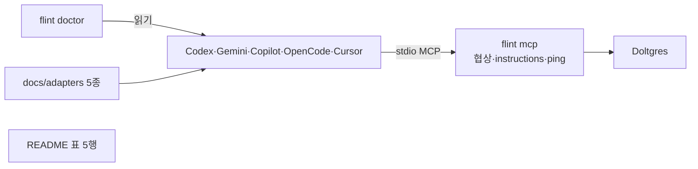
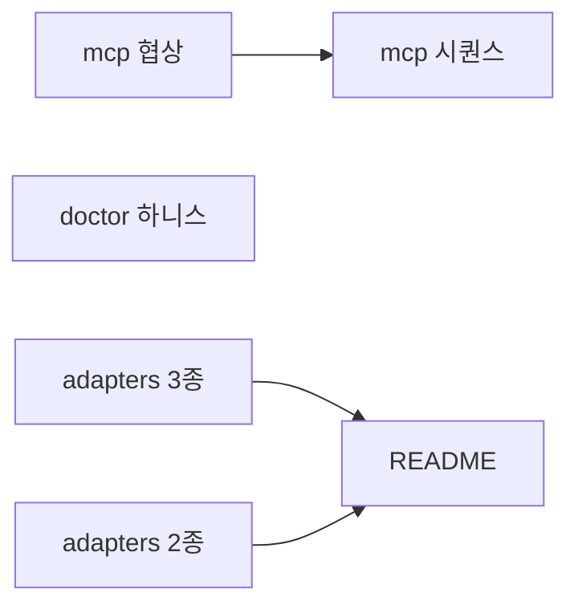

# flint v0.9 플랜 — 하니스 호환 확장 (Codex·Gemini·Copilot·OpenCode·Cursor)

**Spec:** docs/plans/2026-10-24-flint-v09.spec.md
**Detail:** tests · **Target-min:** 10 · 언어 Go, 테스트 `go test ./...`

**전역 제약(스펙 §6):** exit 0/1/2/3 · 한 줄 JSON · 비간섭 — 하니스 설정
파일은 읽기만, 수정 자동화 금지 · TDD red→green→commit · 기존 테스트 함수
수정 금지(신규 함수 추가만) · 기존 라운드트립 불변: params 빈 initialize
응답 protocolVersion "2024-11-05"(serve.go:32 계승) · 스키마 v5 불변 ·
`make ci` 통과.

## 구조



파일: `lib/mcp/serve.go`(협상) · `lib/cli/doctor.go`(하니스 검진) ·
`docs/adapters/{codex,gemini,copilot,opencode,cursor}.md`(참여 가이드) ·
`README.md`·`README.ko.md`(표) · `docs/v09_docs_test.go`·
`docs/v09_docs_b_test.go`·`docs/v09_readme_test.go`(고정) ·
`lib/mcp/protocol_test.go`(통합 시퀀스).

## 태스크 그래프

대상(§1): T3·T4가 어댑터 문서 5종, T2가 설정 감지, T1·T6가 프로토콜.

```mermaid
%% schedule
gantt
  title Predicted schedule (mm:ss)
  dateFormat X
  axisFormat %M:%S
  section lane 1
  T1 MCP 협상·instructions·ping :t1, 0, 102s
  T5 README 지원 현황 갱신 :t5, 102, 102s
  section lane 2
  T2 doctor 하니스 감지 5종 :t2, 0, 102s
  T6 MCP 프로토콜 시퀀스 통합 :t6, 102, 102s
  section lane 3
  T3 어댑터 문서 codex·gemini·copilot :t3, 0, 102s
  section lane 4
  T4 어댑터 문서 opencode·cursor :t4, 0, 102s
```





critical path: T3 → T5 (3.4 min) · peak width 4 · predicted build 3.4 min · predicted total ≈ 6.9 min

## lib/mcp — 프로토콜 서버

앱 유형: stdio 프로토콜 서버. 카테고리: protocol·encoding·state.
위험: echo 협상 오류·ping 무응답·instructions 누락·기존 응답 회귀.
**Probe entry:** run=go run ./cmd/flint mcp

### T1 MCP 협상·instructions·ping
**Owns:** lib/mcp/serve.go, lib/mcp/serve_test.go(신규 func만 추가)
**Components:** 1 · **LOC owned:** 55 · **Tests:** fast · **Model:** sonnet
**Est. time:** 3 min
**Produces:** negotiateVersion(params map[string]any) string ·
serverInstructions() string
e.g. negotiateVersion(map[string]any{"protocolVersion":"2025-06-18"}) -> "2025-06-18"
e.g. negotiateVersion(map[string]any{}) -> "2024-11-05"
**Review Focus:** `TestInitializeEchoesClientProtocolVersion`: params
{"protocolVersion":"2025-06-18"} → 응답 protocolVersion 동일;
`TestInitializeFallbackProtocolVersion`: params {} → "2024-11-05";
`TestInitializeIncludesInstructions`: instructions에 "flint_read"·
"flint_write" 포함(3규칙, 어댑터 문서 문구 재사용);
`TestPingReturnsEmptyResult`: "ping" → result {} error nil.
**Test code (verbatim):**
```go
func TestInitializeEchoesClientProtocolVersion(t *testing.T) {
	res, err := handleRPC("initialize", map[string]any{"protocolVersion": "2025-06-18"})
	if err != nil { t.Fatal(err) }
	if got := res.(map[string]any)["protocolVersion"]; got != "2025-06-18" {
		t.Errorf("echo 실패: %v", got)
	}
}

func TestInitializeFallbackProtocolVersion(t *testing.T) {
	res, err := handleRPC("initialize", map[string]any{})
	if err != nil { t.Fatal(err) }
	if got := res.(map[string]any)["protocolVersion"]; got != "2024-11-05" {
		t.Errorf("fallback 실패: %v", got)
	}
}

func TestInitializeIncludesInstructions(t *testing.T) {
	res, err := handleRPC("initialize", map[string]any{})
	if err != nil { t.Fatal(err) }
	ins := res.(map[string]any)["instructions"].(string)
	if !strings.Contains(ins, "flint_read") || !strings.Contains(ins, "flint_write") {
		t.Errorf("instructions 3규칙 누락: %q", ins)
	}
}

func TestPingReturnsEmptyResult(t *testing.T) {
	res, err := handleRPC("ping", map[string]any{})
	if err != nil { t.Fatal(err) }
	if len(res.(map[string]any)) != 0 { t.Errorf("빈 result 아님: %v", res) }
}
```
**Steps:** 1 테스트 추가(RED) 2 go test ./lib/mcp 3 negotiateVersion·
serverInstructions 구현, initialize·ping 케이스 연결 4 PASS, 커밋.
**Notes:** instructions는 hermes.md §2 문구(3규칙)를 그대로; 핸들러 시그니처 handleRPC 불변 — T6가 의존.

### T6 MCP 프로토콜 시퀀스 통합
**Owns:** lib/mcp/protocol_test.go(신규)
**Components:** 1 · **LOC owned:** 60 · **Tests:** fast · **Model:** sonnet
**Est. time:** 2.5 min
**Consumes:** handleRPC 경유 T1 협상 코드(RunMCPServer 전체 경로)
**Review Focus:** `TestProtocolSequenceModernClient`: 2025-06-18 요청 →
echo·instructions 포함 응답, notifications/initialized(id 없음) 무응답,
ping → 빈 result, tools/list 3종, 응답 줄 수 정확(알림 제외 3).
**Test code (verbatim):**
```go
func TestProtocolSequenceModernClient(t *testing.T) {
	var in, out bytes.Buffer
	in.WriteString(`{"jsonrpc":"2.0","id":1,"method":"initialize","params":{"protocolVersion":"2025-06-18"}}` + "\n")
	in.WriteString(`{"jsonrpc":"2.0","method":"notifications/initialized"}` + "\n")
	in.WriteString(`{"jsonrpc":"2.0","id":2,"method":"ping"}` + "\n")
	in.WriteString(`{"jsonrpc":"2.0","id":3,"method":"tools/list"}` + "\n")
	if code := RunMCPServer(&in, &out); code != 0 { t.Fatalf("exit %d", code) }
	lines := strings.Split(strings.TrimSpace(out.String()), "\n")
	if len(lines) != 3 { t.Fatalf("응답 3줄 예상(알림 무응답), got %d", len(lines)) }
	var init map[string]any
	if err := json.Unmarshal([]byte(lines[0]), &init); err != nil { t.Fatal(err) }
	res := init["result"].(map[string]any)
	if res["protocolVersion"] != "2025-06-18" { t.Errorf("echo 실패: %v", res["protocolVersion"]) }
	if _, ok := res["instructions"].(string); !ok { t.Error("instructions 누락") }
}
```
**Steps:** 1 파일 작성(T1 커밋 후 RED 불가 — T1 완료 상태 기대 PASS 확인)
2 go test ./lib/mcp 3 커밋.

## lib/cli — doctor 하니스 검진

앱 유형: CLI. 카테고리: protocol·file·state.
위험: 미설치 하니스 오탐(fail 노이즈)·flint 문자열 오탐·env 오버라이드 누락.
**Probe entry:** run=bin/flint doctor

### T2 doctor 하니스 감지 5종
**Owns:** lib/cli/doctor.go, lib/cli/doctor_test.go(신규 func만 추가)
**Components:** 1 · **LOC owned:** 90 · **Tests:** fast · **Model:** sonnet
**Est. time:** 4 min
**Produces:** harnessChecks() []doctorCheck
e.g. harnessChecks() -> [doctorCheck{Name:"harness-codex", Status:"fail", Fix:"docs/adapters/codex.md"}] — ~/.codex/config.toml 있고 flint 미등록 시
e.g. harnessChecks() -> [] — 설정 파일 전부 부재 시
**Review Focus:** `TestHarnessChecksSkipWhenAbsent`: 설정 부재 → 빈 슬라이스;
`TestHarnessChecksFailWhenUnregistered`: codex config만 있음 → 1건
Name "harness-codex" Status fail, Fix에 문서 경로;
`TestHarnessChecksOkWhenRegistered`: `"flint"` 포함 → ok;
`TestHarnessChecksCursorProjectScope`: .cursor/mcp.json 프로젝트 경로 우선.
**Steps:** 1 테스트(FLINT_CODEX_HOME 등 env 오버라이드·t.TempDir) 2
harnessRegistry(Name·Rel·EnvOverride 5종 — 스펙 C1~C5 경로)와
harnessChecks·checkHarnessFile 구현, runDoctor 체인에 append 3 PASS, 커밋.
**Notes:** Rel은 절대기준: ~/.codex/config.toml, ~/.gemini/settings.json,
~/.config/opencode/opencode.json, ~/.copilot/mcp-config.json,
.cursor/mcp.json(프로젝트=워킹디렉터리 기준). 등록 판정은 파일 본문에
문자열 "flint" 포함(기존 containsFlintHook 방식 계승, 주석만 있는 경우도
ok — C6 계약). 체크명은 "harness-<name>".

## docs — 어댑터 문서 5종 + 고정

앱 유형: file/encoding. 위험: 설정 포맷 오류(opencode은 command 배열 —
C4a)·지시파일 누락(Copilot은 instructions 미반영 버그)·섹션 누락.

### T3 어댑터 문서 codex·gemini·copilot
**Owns:** docs/adapters/codex.md, docs/adapters/gemini.md, docs/adapters/copilot.md, docs/v09_docs_test.go(신규)
**Components:** 1 · **LOC owned:** 210 · **Tests:** fast · **Model:** sonnet
**Est. time:** 4 min
**Review Focus:** `TestV09AdapterDocsCodex`: 파일 존재 + `[mcp_servers.flint]`·
`requires_approval = "never"`·AGENTS.md 섹션 포함;
`TestV09AdapterDocsGemini`: `mcpServers`·`"trust": true`·GEMINI.md 포함;
`TestV09AdapterDocsCopilot`: `mcp-config.json`·instructions.md·AGENTS.md 포함.
**Steps:** 1 v09_docs_test.go 작성(RED — 파일 부재) 2 문서 3종 작성
(스펙 §2 C1~C3 + §5 형식: 전제·설정 스니펫·지시파일·도구 표·승인 노트·
session agent 필드) 3 PASS, 커밋.
**Notes:** 형식·문체는 hermes.md 승계. 도구 표 3종·인자·상한(50·2,000자)은
기존 표 복제.

### T4 어댑터 문서 opencode·cursor
**Owns:** docs/adapters/opencode.md, docs/adapters/cursor.md, docs/v09_docs_b_test.go(신규)
**Components:** 1 · **LOC owned:** 150 · **Tests:** fast · **Model:** sonnet
**Est. time:** 3.5 min
**Review Focus:** `TestV09AdapterDocsOpencode`: `"type": "local"`·
`"command": ["flint", "mcp"]`(배열 — C4a)·AGENTS.md 포함;
`TestV09AdapterDocsCursor`: `mcp.json`·`mcpServers`·AGENTS.md 포함.
**Steps:** 1 테스트(RED) 2 문서 2종(C4~C5 — cursor는 Claude 동일 JSON,
opencode 글로벌/프로젝트 경로 병기) 3 PASS, 커밋.

### T5 README 지원 현황 갱신
**Owns:** README.md, README.ko.md, docs/v09_readme_test.go(신규)
**Components:** 1 · **LOC owned:** 40 · **Tests:** fast · **Model:** sonnet
**Est. time:** 2 min
**Review Focus:** `TestV09ReadmeAdapterTable`: 두 README 모두
docs/adapters/codex.md 등 5개 링크가 실재 파일을 가리킴.
**Steps:** 1 테스트(RED) 2 에이전트·어댑터 표 5행 추가(기존 3행 유지)·
배지·아키텍처 다이어그램 라벨 갱신 3 PASS, 커밋.

## Review Focus 요약

| 패키지 | 유형 | 카테고리 | 핵심 |
|---|---|---|---|
| lib/mcp | 프로토콜 서버 | protocol·encoding·state | echo·fallback·ping·알림 무응답·기존 회귀 |
| lib/cli | CLI | protocol·file·state | 부재 skip·오탐·env 주입·fail/warn |
| docs | 문서 | file·encoding | 포맷 정확성(C4a)·섹션·링크 |

## Self-review

커버리지: 스펙 §3(T1,T6) §4(T2) §5(T3,T4,T5) — §2는 문서 원천. 자리표시자
없음. Consumes/Produces 일치(T6←handleRPC는 서명 불변 명시). 엣지 3개 모두
실행 의존, 파일 공유 없음. 전 태스크 Components·LOC·Tests·Model 기재.
플랜 약 12k 자(15k 이내).
