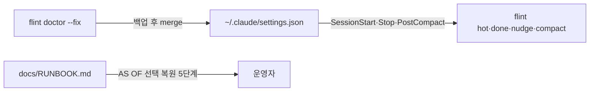
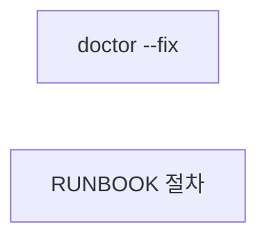

# flint v0.9.4 플랜 — 채택 자가수복(doctor --fix·RUNBOOK)

**Spec:** docs/plans/2026-10-29-flint-v094.spec.md
**Detail:** tests · **Target-min:** 8 · 언어 Go, 테스트 `go test ./...`

**전역 제약(스펙 §4):** exit 0/1/2/3 · 한 줄 JSON · 기존 테스트 함수 수정
금지(신규만) · TDD red→green→commit · `make ci` 통과 · 병렬 태스크 파일 비공유.

**스펙 매핑:** §1 배경·§2 목표 = 전 태스크 공통 전제. R1→T1 · R2→T2.

**Ruling(코디네이터):**
- Ruling: doctor --fix는 hook-file 검사에만 적용 - 다른 검사(port·harness-*)는 사용자 설정·외부 파일이라 자동화 범위 밖 - 확장 필요 시 별도 마일스톤.
- Ruling: 훅 명령은 flint 바이너리 절대경로(os.Executable) - PATH에 flint 부재가 v094 배경 원인 - 상대 해석 실패 시 조용히 죽는 훅 재발.

## 구조



파일: `lib/cli/doctor.go`(T1 --fix·applyHookFix) · `docs/RUNBOOK.md`(T2 절차) ·
신규 테스트 `lib/cli/doctor_v094_test.go`·`docs/runbook_v094_test.go`.

## 태스크 그래프

병렬 2태스크 — 상호 실행 의존 없음.

```mermaid
%% schedule
gantt
  title Predicted schedule (mm:ss)
  dateFormat X
  axisFormat %M:%S
  section lane 1
  T1 R1 doctor 자가수복 — --fix :t1, 0, 102s
  section lane 2
  T2 R2 RUNBOOK 복구 절차 — AS OF 선택 복원 :t2, 0, 102s
```





critical path: T1 (1.7 min) · peak width 2 · predicted build 1.7 min · predicted total ≈ 5.2 min

## lib/cli — doctor 자가수복 (T1)

앱 유형: CLI. 카테고리: protocol·file·state.
위험: 기존 설정 파손·멱등 위반·실사용 설정 오염.
**Probe entry:** run=go run ./cmd/flint doctor

### T1 R1 doctor 자가수복 — --fix
**Owns:** lib/cli/doctor.go, lib/cli/doctor_v094_test.go
**Components:** 1 · **LOC owned:** 90 · **Tests:** fast · **Model:** sonnet
**Est. time:** 3 min
**Produces:** applyHookFix(path string, binPath string) (applied bool, backupPath string, err error) · doctorFixReport(checks []Check) string
e.g. applyHookFix(픽스처, "/x/flint") -> (true, "…/settings.json.flint-bak-20261029-101010", nil) — flint 훅 5개 추가·기존 훅 보존
e.g. applyHookFix(이미훅있는픽스처, "/x/flint") -> (false, "", nil) — 멱등 skip
**Review Focus:** `TestApplyHookFixAddsFlintHooks`: 픽스처(기존 orca 훅 1개)에
flint 5개 추가·orca 잔존·SessionStart/Stop/PostCompact 이벤트 배치;
`TestApplyHookFixIdempotent`: 2회 호출 시 2회째 applied=false·파일 무변경;
`TestApplyHookFixBackupCreated`: 백업 파일이 원본과 동일;
`TestApplyHookFixBrokenJSON`: 파싱 실패 시 err·파일 무변경·백업 없음;
`TestDoctorFixReportFormat`: `{"status":"fixed","hook-file":"ok"}` 형식·
무 --fix 출력 불변.
**Test code (verbatim):**
```go
package cli

import (
	"encoding/json"
	"os"
	"path/filepath"
	"strings"
	"testing"
)

func writeFixture(t *testing.T, hooks map[string]any) string {
	t.Helper()
	dir := t.TempDir()
	os.MkdirAll(filepath.Join(dir, ".claude"), 0o755)
	b, _ := json.Marshal(map[string]any{"hooks": hooks})
	p := filepath.Join(dir, ".claude", "settings.json")
	if err := os.WriteFile(p, b, 0o644); err != nil {
		t.Fatal(err)
	}
	return p
}

func TestApplyHookFixAddsFlintHooks(t *testing.T) {
	p := writeFixture(t, map[string]any{
		"Stop": []any{map[string]any{"hooks": []any{map[string]any{"type": "command", "command": "orca"}}}},
	})
	applied, backup, err := applyHookFix(p, "/x/flint")
	if err != nil || !applied {
		t.Fatalf("applied=%v err=%v", applied, err)
	}
	if backup == "" || !strings.Contains(backup, ".flint-bak-") {
		t.Errorf("백업 경로 이상: %q", backup)
	}
	var got map[string]any
	b, _ := os.ReadFile(p)
	json.Unmarshal(b, &got)
	hooks := got["hooks"].(map[string]any)
	for _, ev := range []string{"SessionStart", "Stop", "PostCompact"} {
		if _, ok := hooks[ev]; !ok {
			t.Errorf("%s 이벤트 누락", ev)
		}
	}
	s := string(b)
	for _, cmd := range []string{"flint hot", "flint nudge", "flint done", "flint compact"} {
		if !strings.Contains(s, "\"/x/flint "+cmd) {
			t.Errorf("%s 명령 누락", cmd)
		}
	}
	if !strings.Contains(s, "orca") {
		t.Error("기존 orca 훅 삭제됨")
	}
}

func TestApplyHookFixIdempotent(t *testing.T) {
	p := writeFixture(t, map[string]any{})
	if _, _, err := applyHookFix(p, "/x/flint"); err != nil {
		t.Fatal(err)
	}
	before, _ := os.ReadFile(p)
	applied, backup, err := applyHookFix(p, "/x/flint")
	if err != nil || applied || backup != "" {
		t.Errorf("멱등 위반: applied=%v backup=%q err=%v", applied, backup, err)
	}
	after, _ := os.ReadFile(p)
	if string(before) != string(after) {
		t.Error("2회째 파일 변형")
	}
}
```
**Steps:** 1 신규 테스트(RED — applyHookFix 부재) 2 doctor.go에
   applyHookFix: 읽기→json.Unmarshal→flint 훅 존재 검사(멱등)→백업
   (타임스탬프)→SessionStart/Stop/PostCompact 배열 append(절대경로
   binPath 명령·timeout 2·`2>/dev/null || true`)→MarshalIndent 쓰기.
   파싱 실패는 즉시 err 반환(파일·백업 무변경) 3 doctor --fix 플래그:
   hook-file fail 시 applyHookFix 호출·재평가·doctorFixReport 출력,
   무 --fix 경로 완전 불변 4 `go test ./lib/cli` PASS 5 commit
**Notes:** 훅 정의 원본은 flint-plugin/hooks/hooks.json — 명령 셋
(hot·nudge/done·nudge/compact)과 matcher("startup|resume|clear|compact")를
그대로 승계하되 bare `flint` 대신 binPath 절대경로. FLINT_CLAUDE_HOME
픽스처로 실사용 ~/.claude 절대 미접촉. binPath는 호출부에서
os.Executable() 해석.

## docs — RUNBOOK 실증 절차 (T2)

앱 유형: 문서+고정 테스트. 카테고리: file.
위험: 절차 오기(실 사고와 불일치).
**Probe entry:** run=go test ./docs

### T2 R2 RUNBOOK 복구 절차 — AS OF 선택 복원
**Owns:** docs/RUNBOOK.md, docs/runbook_v094_test.go
**Components:** 1 · **LOC owned:** 55 · **Tests:** fast · **Model:** sonnet
**Est. time:** 2.5 min
**Produces:** RUNBOOK "실DB 파손 복구 — AS OF 선택 복원" 절차 섹션
**Review Focus:** `TestRunbookHasASOfProcedure`: "INSERT INTO knowledge
SELECT"·"AS OF"·"dolt_revert"·"선택 복원" 키워드 포함;
`TestRunbookHasIncidentReference`: jkfa904·001nnpn 실례 커밋 언급.
**Test code (verbatim):**
```go
package docs

import (
	"os"
	"strings"
	"testing"
)

func runbookStr(t *testing.T) string {
	t.Helper()
	b, err := os.ReadFile("RUNBOOK.md")
	if err != nil {
		t.Fatal(err)
	}
	return string(b)
}

func TestRunbookHasASOfProcedure(t *testing.T) {
	s := runbookStr(t)
	for _, kw := range []string{"INSERT INTO knowledge SELECT", "AS OF", "dolt_revert", "선택 복원"} {
		if !strings.Contains(s, kw) {
			t.Errorf("절차 키워드 누락: %q", kw)
		}
	}
}

func TestRunbookHasIncidentReference(t *testing.T) {
	s := runbookStr(t)
	if !strings.Contains(s, "jkfa904") || !strings.Contains(s, "001nnpn") {
		t.Error("v093 사고 실례 커밋 미언급")
	}
}
```
**Steps:** 1 신규 테스트(RED) 2 RUNBOOK.md에 섹션 추가 — 증상·원인
   (dolt_add --all 흡수)·5단계 절차·실례(jkfa904→001nnpn)·세션 유실 수용·
   정크 미복원 원칙. 기존 섹션 불변 3 `go test ./docs` PASS 4 commit
**Notes:** 절차 문구는 스펙 R2의 5단계 그대로. psql 접속은 기존 RUNBOOK
   DSN 안내 승계.

## Review Focus 요약

| 패키지 | 유형 | 카테고리 | 리스크 |
|---|---|---|---|
| lib/cli | CLI | protocol·file·state | 설정 파손·멱등·실사용 오염 |
| docs | 문서 | file | 절차-사고 불일치 |
