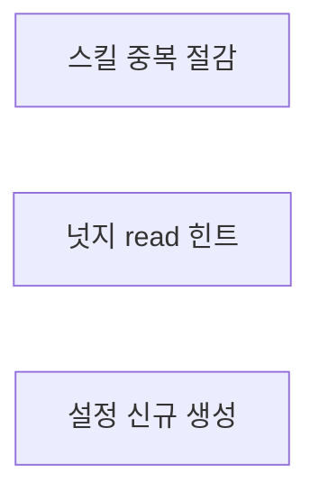

# flint v0.9.5 플랜 — 채택 품질(중복 절감·read 촉진·설정 신규 생성)

**Spec:** docs/plans/2026-10-29-flint-v095.spec.md
**Detail:** tests · **Target-min:** 9 · 언어 Go, 테스트 `go test ./...`

**전역 제약(스펙 §4):** exit 0/1/2/3 · 한 줄 JSON · 기존 테스트 함수 수정
금지(신규만) · TDD red→green→commit · `make ci` 통과 · 병렬 태스크 파일 비공유.

**스펙 매핑:** §1 배경·§2 목표 = 전 태스크 공통 전제. R1→T1 · R2→T2 · R3→T3.

**Ruling(코디네이터):**
- Ruling: nudge 기존 문구(nudgeStopDirective·nudgeStartLine)는 v0.7 고정 계약 - 기존 테스트 정확 일치 시 신규 라인 추가로만 반영 - 문구 훼손 시 v0.7 계약 위반.
- Ruling: SKILL.md 추가는 3규칙 이내 - 프롬프트 토큰 비용 - 규칙 늘어나면 순응도 하락.

## 구조

파일: `flint-plugin/skills/flint/SKILL.md`(T1 규칙) · `lib/cli/nudge.go`(T2 힌트) ·
`lib/cli/doctor.go`(T3 생성) · 신규 테스트 `flint-plugin/plugin_v095_test.go`·
`lib/cli/nudge_v095_test.go`·`lib/cli/doctor_v095_test.go`.

## 태스크 그래프

병렬 3태스크 — 상호 실행 의존 없음.

```mermaid
%% schedule
gantt
  title Predicted schedule (mm:ss)
  dateFormat X
  axisFormat %M:%S
  section lane 1
  T1 R1 스킬 중복 절감 — duplicate id 규칙 :t1, 0, 102s
  section lane 2
  T2 R2 넛지 문구 개선 — read 촉진 힌트 :t2, 0, 102s
  section lane 3
  T3 R3 설정 신규 생성 — doctor --fix 확장 :t3, 0, 102s
```





critical path: T1 (1.7 min) · peak width 3 · predicted build 1.7 min · predicted total ≈ 5.2 min

## flint-plugin — 스킬 중복 절감 (T1)

앱 유형: 문서+고정 테스트. 카테고리: file.
위험: 규칙 인플레이션·기존 구조 훼손.
**Probe entry:** run=go test ./flint-plugin

### T1 R1 스킬 중복 절감 — duplicate id 규칙
**Owns:** flint-plugin/skills/flint/SKILL.md, flint-plugin/plugin_v095_test.go
**Components:** 1 · **LOC owned:** 40 · **Tests:** fast · **Model:** sonnet
**Est. time:** 2 min
**Produces:** SKILL.md 3규칙 추가(duplicate id 재제출 금지·증류 전 사전 read·작업 전 read 강화)
**Review Focus:** `TestSkillHasDuplicateIDRule`·`TestSkillHasPreDistillRead` 키워드 고정.
**Test code (verbatim):**
```go
package flintplugin

import (
	"os"
	"strings"
	"testing"
)

func skillStr(t *testing.T) string {
	t.Helper()
	b, err := os.ReadFile("skills/flint/SKILL.md")
	if err != nil {
		t.Fatal(err)
	}
	return string(b)
}

func TestSkillHasDuplicateIDRule(t *testing.T) {
	s := skillStr(t)
	for _, kw := range []string{"duplicate", "id", "재제출"} {
		if !strings.Contains(s, kw) {
			t.Errorf("dup 규칙 키워드 누락: %q", kw)
		}
	}
}

func TestSkillHasPreDistillRead(t *testing.T) {
	s := skillStr(t)
	if !strings.Contains(s, "증류 전") || !strings.Contains(s, "flint read") {
		t.Error("증류 전 사전 read 규칙 누락")
	}
}
```
**Steps:** 1 신규 테스트(RED) 2 SKILL.md에 3규칙 추가 — ①duplicate 응답
   `{"status":"duplicate","id":N}` 수신 시 그 payload 세션 내 재제출 금지·
   "이미 #N에 있음" 인지 ②증류 전 `flint read <topic>` 근사 중복 확인 후
   신규만 적립 ③"작업 전 read" 기존 규칙에 "관련 주제·파일 작업 시작 시 1회"
   강화 문구. 기존 섹션·헤더 구조 불변 3 `go test ./flint-plugin` PASS
   4 commit
**Notes:** 문장 절제 — 규칙당 1-2줄. 기존 규칙 문구는 수정하지 않고
보강만(라인 추가).

## lib/cli — 넛지 read 힌트 (T2)

앱 유형: CLI. 카테고리: protocol·state.
위험: 고정 문구 계약 훼손·무한 넛지 회귀.
**Probe entry:** run=go run ./cmd/flint nudge

### T2 R2 넛지 문구 개선 — read 촉진 힌트
**Owns:** lib/cli/nudge.go, lib/cli/nudge_v095_test.go
**Components:** 1 · **LOC owned:** 25 · **Tests:** fast · **Model:** sonnet
**Est. time:** 2 min
**Produces:** nudgeReadHint string 상수 — "작업 전 flint read <쿼리> — 기존 지식 확인" 문구의 SessionStart 경로 병합
**Review Focus:** `TestNudgeReadHintConstant`: 상수에 "flint read" 포함;
`TestNudgeStopDirectivePreserved`: 기존 nudgeStopDirective 원문 잔존.
**Test code (verbatim):**
```go
package cli

import (
	"strings"
	"testing"
)

func TestNudgeReadHintConstant(t *testing.T) {
	if !strings.Contains(nudgeReadHint, "flint read") {
		t.Errorf("read 힌트 문구 이상: %q", nudgeReadHint)
	}
}

func TestNudgeStopDirectivePreserved(t *testing.T) {
	if !strings.Contains(nudgeStopDirective, "미증류 컴팩트 요약이 있다") {
		t.Error("기존 Stop directive 훼손")
	}
	if !strings.Contains(nudgeStartLine, "nudge --clear") {
		t.Error("기존 SessionStart 라인 훼손")
	}
}
```
**Steps:** 1 신규 테스트(RED — 상수 부재) 2 nudge.go에 `nudgeReadHint`
   상수 + SessionStart plain 안내 출력 경로에 병합(기존 라인 뒤 1줄).
   nudge_test.go 기존 단언이 정확 일치로 깨지면 병합 대신 별도 줄 출력으로
   변경 — 기존 테스트 함수는 수정 금지 3 `go test ./lib/cli -run TestNudge
   -count=1` PASS 4 commit
**Notes:** Stop directive(nudgeStopDirective)은 절대 수정 금지 — T73 고정
계약. 넛지 조용한 exit 0·마커 소진 계약 불변.

## lib/cli — 설정 신규 생성 (T3)

앱 유형: CLI. 카테고리: file·state.
위험: 기존 merge·멱등·백업 경로 회귀.
**Probe entry:** run=go run ./cmd/flint doctor

### T3 R3 설정 신규 생성 — doctor --fix 확장
**Owns:** lib/cli/doctor.go, lib/cli/doctor_v095_test.go
**Components:** 1 · **LOC owned:** 30 · **Tests:** fast · **Model:** sonnet
**Est. time:** 2 min
**Produces:** applyHookFix 확장 — settings.json 부재 시 {"hooks":{flint 5훈}} 뼈대 생성(applied=true, backup="")
e.g. applyHookFix(부재경로, "/x/flint") -> (true, "", nil) — 파일·부모 디렉터리 생성
**Review Focus:** `TestApplyHookFixCreatesMissingSettings`: 부재 시
applied=true·파일 생성·hooks 키·"/x/flint" 포함·backup="";
기존 경로는 doctor_v094_test.go가 회귀 담보(수정 금지).
**Test code (verbatim):**
```go
package cli

import (
	"encoding/json"
	"os"
	"path/filepath"
	"strings"
	"testing"
)

func TestApplyHookFixCreatesMissingSettings(t *testing.T) {
	dir := t.TempDir()
	p := filepath.Join(dir, ".claude", "settings.json")
	applied, backup, err := applyHookFix(p, "/x/flint")
	if err != nil || !applied {
		t.Fatalf("applied=%v err=%v", applied, err)
	}
	if backup != "" {
		t.Errorf("신규 생성에 백업 불필요: %q", backup)
	}
	b, rerr := os.ReadFile(p)
	if rerr != nil {
		t.Fatalf("파일 미생성: %v", rerr)
	}
	var got map[string]any
	if uerr := json.Unmarshal(b, &got); uerr != nil {
		t.Fatalf("생성 파일 파싱 실패: %v", uerr)
	}
	if _, ok := got["hooks"]; !ok {
		t.Error("hooks 키 누락")
	}
	if !strings.Contains(string(b), "/x/flint") {
		t.Error("flint 훅 미포함")
	}
}
```
**Steps:** 1 신규 테스트(RED) 2 applyHookFix 시작부에 파일 부재 분기 —
   os.MkdirAll(부모)·최소 {"hooks":{}} 생성 후 기존 merge 경로 진입
   (멱등·절대경로·timeout 계약 재사용). 백업은 원본 있을 때만 3
   `go test ./lib/cli -run TestApplyHookFix -count=1` PASS 4 commit
**Notes:** 파손 JSON·멱등·기존 훅 보존은 기존 v094 테스트가 담보 —
그 테스트 전부 재실행 확인.

## Review Focus 요약

| 패키지 | 유형 | 카테고리 | 리스크 |
|---|---|---|---|
| flint-plugin | 문서 | file | 규칙 인플레이션·구조 훼손 |
| lib/cli | CLI | protocol·file·state | 고정 문구 훼손·merge 회귀 |
