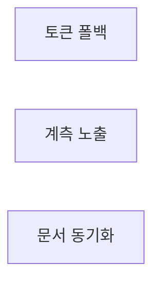

# flint v0.9.6 플랜 — 검색 고도화(토큰 폴백·앱 재랭킹)

**Spec:** docs/plans/2026-10-29-flint-v096.spec.md
**Detail:** tests · **Target-min:** 9 · 언어 Go, 테스트 `go test ./...`

**전역 제약(스펙 §4):** exit 0/1/2/3 · 한 줄 JSON · 스키마 v5 불변 ·
active_knowledge 뷰 강제 · 기존 테스트 함수 수정 금지(신규만) · TDD
red→green→commit · `make ci` 통과 · 병렬 태스크 파일 비공유.

**스펙 매핑:** §1 배경·§2 목표 = 전 태스크 공통 전제. R1→T1 · R2→T2 · R3→T3.

**Ruling(코디네이터):**
- Ruling: 구문 매칭 히트 경로는 완전 불변 - 폴백은 제로히트 시에만 - 기존 랭킹·출력 테스트 다수가 해당 경로를 고정.
- Ruling: 토큰 수 상한 8 - 폴백 OR 스캔 비용 가드 - 초과 토큰은 버림(에러 아님).
- Ruling: n-gram 색인 테이블 기각 - 개인 규모 시퀀셜 수용 ADR(v0.5) 승계·쓰기 비용 - 재론은 데이터 수만 건 도달 시.

## 구조

파일: `lib/query/read.go`(T1 폴백·재랭킹·계측) · `lib/cli/status.go`(T2 노출) ·
`README.md`·`README.ko.md`·`docs/PLAN.md`(T3 문서) · 신규 테스트
`lib/query/read_v096_test.go`·`lib/cli/status_v096_test.go`·`docs/v096_docs_test.go`.

## 태스크 그래프

T2는 T1의 계측 키를 소비(이름 전용 — 예시로 동결, 실행 의존 아님).



## lib/query — 토큰 폴백 (T1)

앱 유형: CLI 검색 계층. 카테고리: protocol·state·encoding.
위험: 구문 경로 회귀·이스케이프·폴백 과다 매칭.
**Probe entry:** run=go run ./cmd/flint read

### T1 R1 토큰 폴백 재랭킹
**Owns:** lib/query/read.go, lib/query/read_v096_test.go
**Components:** 1 · **LOC owned:** 70 · **Tests:** fast · **Model:** sonnet
**Est. time:** 3 min
**Produces:** tokenizeQuery(q string) []string · fallbackMatchCount(tokens []string, topic string, summary string) int · readFallbackCountKey = "read_fallback_calls"
e.g. tokenizeQuery("flint 백업 복구 절차") -> ["flint","백업","복구","절차"]
e.g. tokenizeQuery("read, write!") -> ["read","write"]
e.g. fallbackMatchCount(["백업","복구"], "flint 백업", "복구는 저장소 정지 조건…") -> 2
**Review Focus:** `TestTokenizeQuerySplits`·`TestTokenizeQueryDropsPunct`·
`TestFallbackMatchCount` 순수 함수 고정; `TestReadFallbackOnZeroPhrase`(명명,
fake·실DB): 구문 제로히트 → 토큰 OR 히트·정합수 내림; `TestReadPhraseHitUnchanged`(명명): 구문 히트 시 폴백 미발생.
**Test code (verbatim):**
```go
package query

import (
	"reflect"
	"testing"
)

func TestTokenizeQuerySplits(t *testing.T) {
	if got := tokenizeQuery("flint 백업 복구 절차"); !reflect.DeepEqual(got, []string{"flint", "백업", "복구", "절차"}) {
		t.Errorf("tokenizeQuery = %v", got)
	}
}

func TestTokenizeQueryDropsPunct(t *testing.T) {
	if got := tokenizeQuery("read, write!"); !reflect.DeepEqual(got, []string{"read", "write"}) {
		t.Errorf("구두점 미제거: %v", got)
	}
}

func TestFallbackMatchCount(t *testing.T) {
	if n := fallbackMatchCount([]string{"백업", "복구"}, "flint 백업", "복구는 저장소 정지 조건에서 확인이다"); n != 2 {
		t.Errorf("match count = %d, want 2", n)
	}
	if n := fallbackMatchCount([]string{"없는말"}, "flint 백업", "요약"); n != 0 {
		t.Errorf("무매치 = %d, want 0", n)
	}
}
```
**Steps:** 1 신규 테스트(RED — 함수 부재) 2 tokenizeQuery:
   strings.Fields 후 각 토큰 선행/후행 unicode.IsPunct 제거·빈 제거·상한 8.
   fallbackMatchCount: 각 토큰 lower 부분문자열 포함 여부 합(topic·summary
   대상) 3 runRead 제로히트 분기: tokens 길이 2+일 때 OR WHERE 재쿼리(기존
   필터·뷰·limit 승계) → 결과를 fallbackMatchCount DESC, RankOrder 순으로
   앱 정렬 → 기존 출력 포맷으로 emit. meta `read_fallback_calls` 증분(기존
   계측 패턴·조용히) 4 `go test ./lib/query -count=1` PASS 5 commit
**Notes:** LIKE 이스케이프는 기존 likeEscape 승계. 폴백도 제로히트면 기존
제로히트 출력 그대로(계측은 폴백 시도 기준 1회). 1-토큰 질의는 구문
매칭과 동치라 폴백 생략.

## lib/cli — 계측 노출 (T2)

앱 유형: CLI. 카테고리: protocol·state.
위험: status 필드 순서·기존 필드 회귀.
**Probe entry:** run=go run ./cmd/flint status

### T2 R2 폴백 계측 노출
**Owns:** lib/cli/status.go, lib/cli/status_v096_test.go
**Components:** 1 · **LOC owned:** 20 · **Tests:** fast · **Model:** sonnet
**Est. time:** 2 min
**Consumes:** meta 키 read_fallback_calls(T1) — e.g. 값 "3" → 필드 3, 미설정 → null
**Produces:** status JSON에 read_fallback_calls 필드 추가(기존 필드·순서 불변, 미설정 null)
**Review Focus:** `TestStatusIncludesFallbackField`: 키 "3" → 필드 3;
`TestStatusFallbackFieldNull`: 미설정 → null.
**Test code (verbatim):**
```go
package cli

import "testing"

func TestStatusIncludesFallbackField(t *testing.T) {
	res, code := statusWithMeta(map[string]string{"read_fallback_calls": "3"})
	if code != 0 {
		t.Fatalf("exit=%d", code)
	}
	if res["read_fallback_calls"] != float64(3) {
		t.Errorf("read_fallback_calls = %v, want 3", res["read_fallback_calls"])
	}
}

func TestStatusFallbackFieldNull(t *testing.T) {
	res, code := statusWithMeta(map[string]string{})
	if code != 0 {
		t.Fatalf("exit=%d", code)
	}
	if res["read_fallback_calls"] != nil {
		t.Errorf("미설정 키 = %v, want nil", res["read_fallback_calls"])
	}
}
```
**Steps:** 1 신규 테스트(RED — 필드 부재) 2 status.go의 meta 읽기 목록에
   read_fallback_calls 추가·출력 끝(마지막 기존 필드 뒤)에 필드 추가
   (statusWithMeta 헬퍼·v0.6 last_* 패턴 승계, 미설정 null) 3
   `go test ./lib/cli -run TestStatus -count=1` PASS 4 commit
**Notes:** 기존 필드·순서 불변 — status_v06의 TestStatusLastSeenFieldOrder가
순서 계약을 담보(그 테스트가 끝까지 통과해야 함).

## docs — 문서 동기화 (T3)

앱 유형: 문서+고정 테스트. 카테고리: file.
위험: README 문자열 고정 테스트 충돌.
**Probe entry:** run=go test ./docs

### T3 R3 문서 동기화
**Owns:** README.md, README.ko.md, docs/PLAN.md, docs/v096_docs_test.go
**Components:** 1 · **LOC owned:** 45 · **Tests:** fast · **Model:** sonnet
**Est. time:** 2 min
**Produces:** README read 폴백 1줄(EN/KO)·PLAN.md v0.9.5·v0.9.6 마일스톤
**Review Focus:** `TestReadmeMentionsFallback`·`TestPlanRecordsV095AndV096`.
**Test code (verbatim):**
```go
package docs

import (
	"os"
	"strings"
	"testing"
)

func docStr(t *testing.T, path string) string {
	t.Helper()
	b, err := os.ReadFile(path)
	if err != nil {
		t.Fatal(err)
	}
	return string(b)
}

func TestReadmeMentionsFallback(t *testing.T) {
	for _, p := range []string{"../README.md", "../README.ko.md"} {
		if !strings.Contains(docStr(t, p), "fallback") {
			t.Errorf("%s read 폴백 미언급", p)
		}
	}
}

func TestPlanRecordsV095AndV096(t *testing.T) {
	s := docStr(t, "PLAN.md")
	if !strings.Contains(s, "v0.9.5") || !strings.Contains(s, "v0.9.6") {
		t.Error("PLAN.md v0.9.5·v0.9.6 마일스톤 누락")
	}
}
```
**Steps:** 1 신규 테스트(RED) 2 README Commands·read 설명에 폴백 1줄
   (KO: "구문 미스 시 단어 단위 재검색(fallback)" / EN 대응문) 3 PLAN.md
   §14에 v0.9.5(채택 품질 3종·PR #13)·v0.9.6(검색 고도화) 섹션 4
   `go test ./docs -count=1` PASS 5 commit
**Notes:** 기존 v09_readme·v093_readme 테스트와 충돌 없게 — 기존 문구는
불변, 줄 추가만. README.ko.md에도 영문 "fallback" 단어 포함(테스트 통일).

## Review Focus 요약

| 패키지 | 유형 | 카테고리 | 리스크 |
|---|---|---|---|
| lib/query | 검색 계층 | protocol·state·encoding | 구문 경로 회귀·이스케이프 |
| lib/cli | CLI | protocol·state | 필드 순서 회귀 |
| docs | 문서 | file | 문자열 고정 테스트 충돌 |
