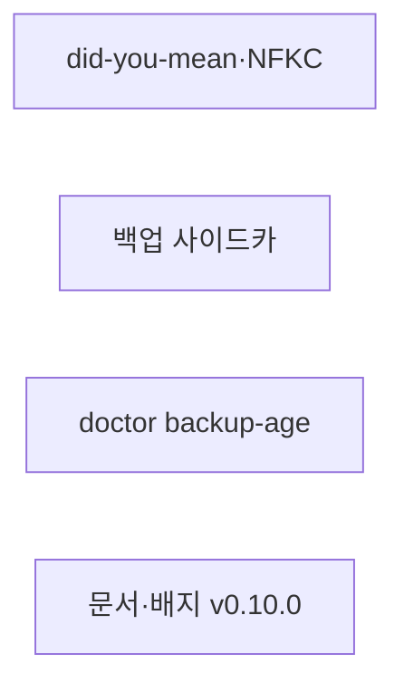

# flint v0.10.0 플랜 — 검색 품질·백업 신뢰성(did-you-mean·NFKC·사이드카·doctor)

**Spec:** docs/plans/2026-10-30-flint-v0100.spec.md
**Detail:** tests · **Target-min:** 9 · 언어 Go, 테스트 `go test ./...`

**전역 제약(스펙 §4):** exit 0/1/2/3 · 한 줄 JSON · 스키마 v5 불변 ·
기존 테스트 함수 수정 금지(예외: T4의 배지 기대값 — 룰링) · TDD
red→green→commit · `make ci` 통과 · 병렬 태스크 파일 비공유.

**스펙 매핑:** §1 배경·§2 목표·§3 요구사항 총칭 = 공통 전제. R1·R2→T1 ·
R3→T2 · R4→T3 · R5→T4.

**Ruling(코디네이터):**
- Ruling: 자동 백업 자체는 이미 존재(flint done 24h 간격·로테이션 keep-14) - 신규 스케줄러(launchd·cron)는 불필요 - R3·R4는 기존 경로의 무결성·관측 갭만 닫는다.
- Ruling: NFKC는 golang.org/x/text(이미 indirect) unicode/norm 사용 - 신규 모듈 0 - pgx-only 의존성 원칙 유지.
- Ruling: suggestions는 as_of 라인과 동일한 별도 JSON 한 줄로 결과 뒤에 추가 - 기존 제로히트 출력 바이트 불변 - additive 경로 승계.
- Ruling: T4는 v097_docs_test 배지 기대값 갱신 허용(release-v0.9.7→v0.10.0) - 버전 전환의 본질적 동반 - 그 외 기존 함수 불변.

## 구조

파일: `lib/query/suggest.go`(T1 신규)·`lib/query/read.go`·`lib/cli/read.go`(T1) ·
`lib/cli/done.go`(T2) · `lib/cli/doctor.go`(T3) · `README.md`·`README.ko.md`·
`docs/PLAN.md`(T4) · 신규 테스트 `lib/query/suggest_v0100_test.go`·
`lib/cli/read_v0100_test.go`·`lib/cli/done_v0100_test.go`·
`lib/cli/doctor_v0100_test.go`·`docs/v0100_docs_test.go`.

## 태스크 그래프

병렬 4태스크 — 실행 의존 없음(모두 기존 코드·신규 파일 위에 독립).

```mermaid
%% schedule
gantt
  title Predicted schedule (mm:ss)
  dateFormat X
  axisFormat %M:%S
  section lane 1
  T1 R1 did-you-mean — 제로히트 근접 후보·R2 NFKC  :t1, 0, 127s
  section lane 2
  T2 R3 자동 백업 사이드카(sha256) :t2, 0, 102s
  section lane 3
  T3 R4 doctor 백업 신선도 검사 :t3, 0, 102s
  section lane 4
  T4 R5 문서 동기화·배지 v0.10.0 :t4, 0, 102s
```





critical path: T1 (2.1 min) · peak width 4 · predicted build 2.1 min · predicted total ≈ 5.6 min

## lib/query+lib/cli — did-you-mean·NFKC (T1)

앱 유형: CLI 검색 계층. 카테고리: protocol·encoding·state.
위험: 구문·폴백 히트 경로 회귀·유사도 과다 매칭.
**Probe entry:** run=go run ./cmd/flint read

### T1 R1 did-you-mean — 제로히트 근접 후보·R2 NFKC 정규화
**Owns:** lib/query/suggest.go, lib/query/read.go, lib/cli/read.go, lib/query/suggest_v0100_test.go, lib/cli/read_v0100_test.go
**Components:** 2 · **LOC owned:** 95 · **Tests:** fast · **Model:** sonnet
**Produces:** nfkc(s string) string · bigramDice(a string, b string) float64 · SuggestSimilar(q string, rows [][]any, topN int) []Suggestion (type Suggestion struct{ ID int; Topic string }) · BuildSuggestScan() (string, []any)
e.g. nfkc(NFD "값") -> "값" (NFC와 바이트 동일)
e.g. bigramDice("백업복구", "백업복구") -> 1 · bigramDice("백업", "복구") -> 0
e.g. SuggestSimilar("백업 복구 절차", scan행[[3,"flint 백업 절차","덤프"],[4,"환영인사","안부"]], 3) -> [{3 "flint 백업 절차"}]
e.g. BuildSuggestScan() -> ("SELECT id, topic, summary FROM active_knowledge", nil)
**Review Focus:** `TestNfkcComposesNFD`·`TestBigramDice`·
`TestSuggestSimilarTopN`(0유사도 제외·내림차순) 순수 함수 고정;
`TestReadZeroHitSuggests`(명명, fake): 구문·폴백 모두 제로히트 →
suggestions 라인 3건; `TestReadPhraseHitNoSuggest`(명명): 히트 시
suggestions 미발생.
**Test code (verbatim):**
```go
package query

import (
	"reflect"
	"testing"
)

func TestNfkcComposesNFD(t *testing.T) {
	decomposed := "한" // "한" NFD(자모 3)
	if got := nfkc(decomposed); got != "한" {
		t.Errorf("nfkc(NFD 한) = %q, want 한", got)
	}
	if got := nfkc("flint 백업"); got != "flint 백업" {
		t.Errorf("NFC 불변 위반: %q", got)
	}
}

func TestBigramDice(t *testing.T) {
	if got := bigramDice("백업복구", "백업복구"); got != 1 {
		t.Errorf("동일 문자열 = %v, want 1", got)
	}
	if got := bigramDice("백업", "복구"); got != 0 {
		t.Errorf("공유 bigram 0 = %v, want 0", got)
	}
	if got := bigramDice("flint", "flint"); got != 1 {
		t.Errorf("동일 라틴 = %v, want 1", got)
	}
}

func TestSuggestSimilarTopN(t *testing.T) {
	rows := [][]any{
		{int32(3), "flint 백업 절차", "덤프 복구"},
		{int32(4), "환영인사", "안부 인사"},
	}
	got := SuggestSimilar("백업 복구 절차", rows, 3)
	want := []Suggestion{{ID: 3, Topic: "flint 백업 절차"}}
	if !reflect.DeepEqual(got, want) {
		t.Errorf("SuggestSimilar = %v, want %v", got, want)
	}
}
```
```go
package cli

import (
	"bytes"
	"context"
	"strings"
	"testing"
)

// suggestQueryFn — 구문·폴백 모두 제로히트, 제안 스캔은 3행.
func suggestQueryFn() func(string, []any) ([][]any, error) {
	return func(sql string, args []any) ([][]any, error) {
		if strings.Contains(sql, "id, topic, summary") {
			return [][]any{
				{int32(7), "flint 백업 절차", "덤프"},
				{int32(8), "환영인사", "인사"},
				{int32(9), "포트 점유 사고", "5433"},
			}, nil
		}
		return nil, nil // 구문·폴백·meta 전부 제로/빈
	}
}

func TestReadZeroHitSuggests(t *testing.T) {
	ctx := context.Background()
	var out bytes.Buffer
	f := &fakeStore{queryFn: suggestQueryFn()}
	if code := runRead(ctx, asofFakeOrReal(t, f), []string{"존재하지않는주제"}, strings.NewReader(""), &out); code != 0 {
		t.Fatalf("exit = %d", code)
	}
	got := out.String()
	if !strings.Contains(got, `"suggestions"`) || !strings.Contains(got, `"topic":"flint 백업 절차"`) {
		t.Errorf("suggestions 라인 미출력: %q", got)
	}
	if strings.Contains(got, `"topic":"환영인사"`) {
		t.Errorf("유사도 0 항목 제안됨: %q", got)
	}
}
```
**Steps:** 1 신규 테스트(RED) 2 suggest.go: nfkc —
   golang.org/x/text/unicode/norm.NFKC.String. bigramDice — rune bigram
   집합 Dice(2·공집합 0·양변 길이 1 룬이면 동등성 1/0). SuggestSimilar —
   rows의 [0]=id·[1]=topic·[2]=summary, score=nfkc(q) 대
   nfkc(topic+""+summary) bigramDice, 0 제외 내림·동률 id 오름, topN.
   BuildSuggestScan 3 runRead: 폴백 후에도 len(rows)==0 && asOfSpec==""면
   scan 발행 → SuggestSimilar(q, scan, 3) → 결과 출력 뒤(FormatRows 후·
   as_of 라인 앞) `{"suggestions":[…]}` 한 줄(빈 슬라이스면 미출력) 4
   fallbackMatchCount에 nfkc 양측 적용(비교 문자열만 — 원문·SQL 불변) 5
   `go test ./lib/query ./lib/cli -run 'TestNfkc|TestBigram|TestSuggest|TestReadZeroHitSuggests|TestRead' -count=1` PASS 6 commit
**Notes:** NFKC는 이미 indirect인 x/text — go.mod 신규 모듈 0(direct
   승격만). `TestReadPhraseHitNoSuggest`는 히트 경로 회귀 고정(기존
   read_v096 phrase 불변 테스트와 별개 신규). 스캔 상한 없음(스펙 §3 R1).

## lib/cli — 자동 백업 사이드카 (T2)

앱 유형: CLI·파일. 카테고리: file·state.
위험: no-op 경로 빈 사이드카·done 훅 블록.
**Probe entry:** run=go run ./cmd/flint done

### T2 R3 자동 백업 사이드카(sha256)
**Owns:** lib/cli/done.go, lib/cli/done_v0100_test.go
**Components:** 1 · **LOC owned:** 30 · **Tests:** fast · **Model:** sonnet
**Produces:** lazyDumpFile 기록 바이트의 sha256 합산(sidecarSum() string) + close 시 backup.WriteSidecar 호출 — 기록 0바이트면 미호출
e.g. lazyDumpFile{dir:tmp}에 "abc" 기록·close -> tmp/<ts>.sql.sha256 존재·VerifyFile 일치
**Review Focus:** `TestLazyDumpWritesSidecar`(기록→close→.sha256 존재·
해시 일치); `TestLazyDumpNoopNoSidecar`(미기록 close→파일·사이드카 부재);
사이드카 실패는 done 반환·exit 불변(경고 로그).
**Test code (verbatim):**
```go
package cli

import (
	"os"
	"path/filepath"
	"strings"
	"testing"

	"flint/lib/backup"
)

func TestLazyDumpWritesSidecar(t *testing.T) {
	dir := t.TempDir()
	lf := &lazyDumpFile{dir: dir}
	if _, err := lf.Write([]byte("dump body")); err != nil {
		t.Fatal(err)
	}
	if err := lf.close(); err != nil && !strings.Contains(err.Error(), "sidecar") {
		t.Fatal(err)
	}
	matches, _ := filepath.Glob(filepath.Join(dir, "*.sql"))
	if len(matches) != 1 {
		t.Fatalf("덤프 파일 수 = %d", len(matches))
	}
	if _, err := backup.VerifyFile(matches[0]); err != nil {
		t.Errorf("사이드카 검증 실패: %v", err)
	}
}

func TestLazyDumpNoopNoSidecar(t *testing.T) {
	dir := t.TempDir()
	lf := &lazyDumpFile{dir: dir}
	if err := lf.close(); err != nil {
		t.Fatalf("no-op close 오류: %v", err)
	}
	if m, _ := filepath.Glob(filepath.Join(dir, "*")); len(m) != 0 {
		t.Errorf("no-op 잔존 파일: %v", m)
	}
}
```
**Steps:** 1 신규 테스트(RED) 2 done.go lazyDumpFile: Write 시
   sha256.New() 동시 갱신(tee), close에서 덤프 close 성공 후
   backup.WriteSidecar(path, hex) — 실패는 경고 로그 후 진행(비차단)·
   0바이트(once 미발동)면 스킵 3 `go test ./lib/cli -run TestLazyDump -count=1` PASS 4 commit
**Notes:** WriteSidecar·VerifyFile은 lib/backup/integrity.go 기존 —
   T2는 done.go만 손댐. rotate.go의 .sha256 짝 삭제는 기존 동작 승계.

## lib/cli — doctor backup-age (T3)

앱 유형: CLI·진단. 카테고리: state·numeric.
위험: stall 오탐(휴면 머신)·fail 과잉.
**Probe entry:** run=go run ./cmd/flint doctor

### T3 R4 doctor 백업 신선도 검사
**Owns:** lib/cli/doctor.go, lib/cli/doctor_v0100_test.go
**Components:** 1 · **LOC owned:** 35 · **Tests:** fast · **Model:** sonnet
**Produces:** checkBackupAge(ctx context.Context, st Store) doctorCheck — last_backup RFC3339 경과 72h+ / 미설정 / 조회 실패 → warn(안내 문구), 72h 미만 → ok. 검사 목록 등록(name "backup-age")
e.g. last_backup=now-73h -> {warn, "자동 백업 73시간 경과 — flint done 훅·수동 backup 확인"}
e.g. last_backup=now-1h -> {ok, ""} · st nil/조회 실패 -> warn
**Review Focus:** `TestBackupAgeFresh`·`TestBackupAgeStale`(72h+ warn)·
`TestBackupAgeMissing`(미설정 warn); 기존 doctor 검사·필드 순서 불변.
**Test code (verbatim):**
```go
package cli

import (
	"context"
	"strings"
	"testing"
	"time"
)

func backupAgeQueryFn(lastISO string, fail bool) func(string, []any) ([][]any, error) {
	return func(sql string, args []any) ([][]any, error) {
		if strings.Contains(sql, "last_backup") {
			if fail {
				return nil, context.DeadlineExceeded
			}
			if lastISO == "" {
				return nil, nil
			}
			return [][]any{{"last_backup", lastISO}}, nil
		}
		return nil, nil
	}
}

func TestBackupAgeFresh(t *testing.T) {
	fresh := time.Now().UTC().Add(-1 * time.Hour).Format(time.RFC3339)
	c := checkBackupAge(context.Background(), &fakeStore{queryFn: backupAgeQueryFn(fresh, false)})
	if c.Status != "ok" {
		t.Errorf("1시간 경과 = %s, want ok (%s)", c.Status, c.Detail)
	}
}

func TestBackupAgeStale(t *testing.T) {
	stale := time.Now().UTC().Add(-73 * time.Hour).Format(time.RFC3339)
	c := checkBackupAge(context.Background(), &fakeStore{queryFn: backupAgeQueryFn(stale, false)})
	if c.Status != "warn" {
		t.Errorf("73시간 경과 = %s, want warn", c.Status)
	}
}

func TestBackupAgeMissing(t *testing.T) {
	c := checkBackupAge(context.Background(), &fakeStore{queryFn: backupAgeQueryFn("", false)})
	if c.Status != "warn" {
		t.Errorf("미설정 = %s, want warn", c.Status)
	}
	c = checkBackupAge(context.Background(), nil)
	if c.Status != "warn" {
		t.Errorf("nil store = %s, want warn", c.Status)
	}
}
```
**Steps:** 1 신규 테스트(RED — 함수 부재) 2 checkBackupAge —
   checkLastSeen 패턴 승계(queryOnce meta last_backup, RFC3339 파싱,
   파손 값 미설정 취급), 경계 72h(72h 미만 ok). doctor 실행 목록 말미
   등록 3 `go test ./lib/cli -run 'TestBackupAge|TestDoctor' -count=1` PASS 4 commit
**Notes:** warn 고정 — fail 아님(스펙 §3 R4: 백업 부재가 동작을 막지
   않음). 임계값 72h 상수(backupAgeWarn=72*time.Hour) — TUNING 이연.

## docs — 문서·배지 (T4)

앱 유형: 문서+고정 테스트. 카테고리: file.
위험: 기존 배지 단언 충돌.
**Probe entry:** run=go test ./docs

### T4 R5 문서 동기화·배지 v0.10.0
**Owns:** README.md, README.ko.md, docs/PLAN.md, docs/v097_docs_test.go, docs/v0100_docs_test.go
**Components:** 1 · **LOC owned:** 35 · **Tests:** fast · **Model:** sonnet
**Produces:** 배지 release-v0.10.0(EN/KO)·read 제안 1줄·백업 무결성 1줄·PLAN §14 v0.10.0 마일스톤
**Review Focus:** `TestReadmeBadgeIsV0100` 신규·
`TestReadmeMentionsSuggest`("suggestions" 포함); v097 배지 단언 갱신
(룰링 예외) 후 docs 전체 통과.
**Test code (verbatim):**
```go
package docs

import (
	"os"
	"strings"
	"testing"
)

func docStrV0100(t *testing.T, path string) string {
	t.Helper()
	b, err := os.ReadFile(path)
	if err != nil {
		t.Fatal(err)
	}
	return string(b)
}

func TestReadmeBadgeIsV0100(t *testing.T) {
	for _, p := range []string{"../README.md", "../README.ko.md"} {
		if !strings.Contains(docStrV0100(t, p), "release-v0.10.0") {
			t.Errorf("%s 배지가 v0.10.0 아님", p)
		}
	}
}

func TestReadmeMentionsSuggest(t *testing.T) {
	for _, p := range []string{"../README.md", "../README.ko.md"} {
		s := docStrV0100(t, p)
		if !strings.Contains(s, "suggestions") {
			t.Errorf("%s read 제안 미언급", p)
		}
		if !strings.Contains(s, "sha256") {
			t.Errorf("%s 백업 무결성 미언급", p)
		}
	}
}
```
**Steps:** 1 v0100_docs_test.go 신규(RED) 2 배지 v0.9.7→v0.10.0(EN/KO)·
   read 설명에 "제로히트 시 근접 후보(suggestions) 제안" 1줄·백업에
   "자동 백업 sha256 사이드카 무결 검증" 1줄 3 PLAN.md §14 말미에
   v0.10.0 마일스톤(검색 제안·NFKC·사이드카·doctor·PR 번호) 4
   v097_docs_test.go 배지 기대값 release-v0.9.7→release-v0.10.0 갱신
   (룰링 예외, 단언 구조 불변) 5 `go test ./docs -count=1` PASS 6 commit
**Notes:** "suggestions"·"sha256" 단어는 EN/KO 공통 포함(테스트 통일).

## Review Focus 요약

| 패키지 | 유형 | 카테고리 | 리스크 |
|---|---|---|---|
| lib/query+lib/cli | 검색 계층 | protocol·encoding·state | 히트 경로 회귀·과다 제안 |
| lib/cli(done) | CLI | file·state | no-op 잔존·훅 블록 |
| lib/cli(doctor) | CLI 진단 | state·numeric | stall 오탐·fail 과잉 |
| docs | 문서 | file | 배지 단언 충돌 |
