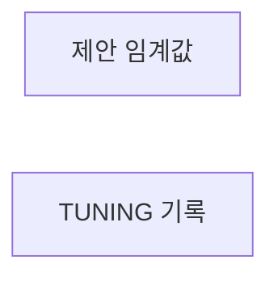

# flint v0.10.1 플랜 — 패치(제안 임계값·TUNING 기록)

**Spec:** docs/plans/2026-10-31-flint-v0101.spec.md
**Detail:** tests · **Target-min:** 9 · 언어 Go, 테스트 `go test ./...`

**전역 제약(스펙 §4):** exit 0/1/2/3 · 한 줄 JSON · 스키마 v5 불변 ·
기존 테스트 함수 수정 금지(신규만) · TDD red→green→commit · `make ci`
통과 · 병렬 태스크 파일 비공유.

**스펙 매핑:** §1 배경·§2 목표·§3 요구사항 총칭 = 공통 전제. R1→T1 ·
R2→T2.

**Ruling(코디네이터):**
- Ruling: 임계값은 상수 suggestMinScore=0.15 - meta 오버라이드는 데이터 부족으로 이연(스펙 §2) - 정상 제안 차단 관측 시 트리거.
- Ruling: 하네스 3건 fail은 이 플랜 밖 운영 작업(실제 MCP 등록) - 코드 변경 없음 - 코디네이터가 별도 수행·보고.

## 구조

파일: `lib/query/suggest.go`(T1) · `docs/TUNING.md`(T2) · 신규 테스트
`lib/query/suggest_v0101_test.go`·`docs/v0101_docs_test.go`.

## 태스크 그래프

병렬 2태스크 — 실행 의존 없음.

```mermaid
%% schedule
gantt
  title Predicted schedule (mm:ss)
  dateFormat X
  axisFormat %M:%S
  section lane 1
  T1 R1 제안 임계값 — 무관 후보 차단 :t1, 0, 102s
  section lane 2
  T2 R2 TUNING 상수 기록 :t2, 0, 102s
```





critical path: T1 (1.7 min) · peak width 2 · predicted build 1.7 min · predicted total ≈ 5.2 min

## lib/query — 제안 임계값 (T1)

앱 유형: CLI 검색 계층. 카테고리: numeric·state.
위험: 과차단(정상 제안 배제)·기존 제안 테스트 회귀.
**Probe entry:** run=go run ./cmd/flint read

### T1 R1 제안 임계값 — 무관 후보 차단
**Owns:** lib/query/suggest.go, lib/query/suggest_v0101_test.go
**Components:** 1 · **LOC owned:** 15 · **Tests:** fast · **Model:** sonnet
**Produces:** suggestMinScore = 0.15 (상수) · SuggestSimilar 필터: score < suggestMinScore 제외
e.g. suggestMinScore -> 0.15
e.g. score 0.09 행 -> 제외 · score 0.29 행("백업 복구 절차"↔"flint 백업 절차") -> 유지
**Review Focus:** `TestSuggestMinScoreFiltersMarginal`(전제 자체 계산:
0 < bigramDice < suggestMinScore인 픽스처만 단언)·
`TestSuggestSimilarKeepsRelevant`(유사 행 유지);
`TestSuggestSimilarTopN`(v0.10.0) 회귀 불변 통과.
**Test code (verbatim):**
```go
package query

import (
	"reflect"
	"testing"
)

func TestSuggestMinScoreFiltersMarginal(t *testing.T) {
	q := "환경설정 초기화 방법"
	// 픽스처 사전 검증 — 이 행의 점수가 0 < s < suggestMinScore인지
	// 스스로 계산해 단언(하드코딩 점수 회피).
	row := [][]any{{int32(11), "flint v0.9.6 방향", "기록"}}
	s := bigramDice(nfkc(q), nfkc("flint v0.9.6 방향"+"기록"))
	if !(s > 0 && s < suggestMinScore) {
		t.Skipf("픽스처 점수 %.3f가 한계 밖 — 픽스처 조정 필요", s)
	}
	if got := SuggestSimilar(q, row, 3); len(got) != 0 {
		t.Errorf("한계 미만 제안 누출: %v (score %.3f)", got, s)
	}
}

func TestSuggestSimilarKeepsRelevant(t *testing.T) {
	rows := [][]any{
		{int32(3), "flint 백업 절차", "덤프 복구"},
		{int32(12), "flint v0.9.6 방향", "기록"},
	}
	got := SuggestSimilar("백업 복구 절차", rows, 3)
	want := []Suggestion{{ID: 3, Topic: "flint 백업 절차"}}
	if !reflect.DeepEqual(got, want) {
		t.Errorf("유사 행 누락 또는 무관 행 누출: %v", got)
	}
}
```
**Steps:** 1 신규 테스트(RED — 상수 부재) 2 suggest.go에
   `const suggestMinScore = 0.15` + SuggestSimilar 루프에 하한 필터
   (기존 0 제외 조건을 suggestMinScore 미만 제외로 확장) 3
   `go test ./lib/query ./lib/cli -run 'TestSuggest' -count=1` PASS
   (v0.10.0 CLI 테스트 포함) 4 commit
**Notes:** TestSuggestMinScoreFiltersMarginal의 Skip은 픽스처 점수가
   밴드 밖이면 수행 불가 판정 — 구현자는 실측 점수로 픽스처를 밴드
   내로 조정한 뒤 Skip 없이 통과시킨다(플랜 픽스처는 관측 사례 기준).

## docs — TUNING 기록 (T2)

앱 유형: 문서+고정 테스트. 카테고리: file.
위험: 기존 절 훼손.
**Probe entry:** run=go test ./docs

### T2 R2 TUNING 상수 기록
**Owns:** docs/TUNING.md, docs/v0101_docs_test.go
**Components:** 1 · **LOC owned:** 25 · **Tests:** fast · **Model:** sonnet
**Produces:** TUNING.md 신규 소절 — backup-age 72h(backupAgeWarn)·제안 임계값 0.15(suggestMinScore) 근거·조정 지침
e.g. TUNING.md -> "backupAgeWarn"·"72"·"suggestMinScore"·"0.15" 문자열 포함 신규 소절 1개
**Review Focus:** `TestTuningRecordsV0101Constants`(4 문자열 포함);
기존 TUNING 절·문서 테스트 불변 통과.
**Test code (verbatim):**
```go
package docs

import (
	"os"
	"strings"
	"testing"
)

func TestTuningRecordsV0101Constants(t *testing.T) {
	b, err := os.ReadFile("TUNING.md")
	if err != nil {
		t.Fatal(err)
	}
	s := string(b)
	for _, want := range []string{"backupAgeWarn", "72", "suggestMinScore", "0.15"} {
		if !strings.Contains(s, want) {
			t.Errorf("TUNING.md에 %q 누락", want)
		}
	}
}
```
**Steps:** 1 신규 테스트(RED) 2 TUNING.md 말미 신규 소절
   "## N. v0.10.1 상수" — 두 상수의 기본값·근거(72h=자동 백업 24h
   주기 3회분 여유·0.15=무관 top 제안 관측 차단)·조정 지침(값 변경은
   코드 상수 — meta 오버라이드는 정상 제안 차단 관측 시 확장) 3
   `go test ./docs -count=1` PASS 4 commit
**Notes:** 기존 절 제목·본문 불변 — 소절 추가만. 절 번호는 기존 말미
   순번.

## Review Focus 요약

| 패키지 | 유형 | 카테고리 | 리스크 |
|---|---|---|---|
| lib/query | 검색 계층 | numeric·state | 과차단·회귀 |
| docs | 문서 | file | 기존 절 훼손 |
