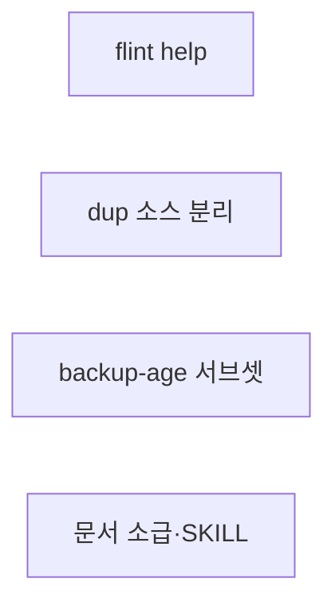

# flint v0.10.2 플랜 — 패치(help·dup 소스 분리·backup-age 서브셋·문서 소급)

**Spec:** docs/plans/2026-10-31-flint-v0102.spec.md
**Detail:** tests · **Target-min:** 9 · 언어 Go, 테스트 `go test ./...`

**전역 제약(스펙 §4):** exit 0/1/2/3 · 한 줄 JSON(help 제외 — usage
텍스트 승계) · 스키마 v5 불변 · 기존 테스트 함수 수정 금지(신규만) ·
TDD red→green→commit · `make ci` 통과 · 병렬 태스크 파일 비공유.

**스펙 매핑:** §1 배경·§2 목표·§3 요구사항 총칭 = 공통 전제. R1→T1 ·
R2→T2 · R3→T3 · R4→T4.

**Ruling(코디네이터):**
- Ruling: help는 store-free fast path(version·nudge 계열)로 등록 - DB 미기동에도 exit 0 - registry 핸들러(store 접속 후)가 아니다.
- Ruling: dup 총계 키는 불변 - dup_<source> 키 추가만(additive) - dup_pct 공식·기존 필드 순서 불별(스펙 §2).
- Ruling: backup-age 서브셋은 doctor.go의 subset 분기에 backup-age 특수경로만 - DoctorChecks() 6종·port 마지막 계약 불변 - harness-*·skill-file 서브셋화는 미확장(수요 미증명).

## 구조

파일: `lib/cli/root.go`(T1) · `lib/cli/write.go`·`lib/cli/report.go`(T2) ·
`lib/cli/doctor.go`(T3) · `docs/PLAN.md`·`flint-plugin/skills/flint/SKILL.md`(T4) ·
신규 테스트 `lib/cli/help_v0102_test.go`·`lib/cli/dup_v0102_test.go`·
`lib/cli/doctor_v0102_test.go`·`docs/v0102_docs_test.go`.

## 태스크 그래프

병렬 4태스크 — 실행 의존 없음.

```mermaid
%% schedule
gantt
  title Predicted schedule (mm:ss)
  dateFormat X
  axisFormat %M:%S
  section lane 1
  T2 R2 dup 소스별 계측 분리 :t2, 0, 127s
  section lane 2
  T1 R1 flint help 서브커맨드 :t1, 0, 102s
  section lane 3
  T3 R3 doctor --check backup-age 단독 실행 :t3, 0, 102s
  section lane 4
  T4 R4 PLAN 소급·SKILL 플래그 문서화 :t4, 0, 102s
```





critical path: T2 (2.1 min) · peak width 4 · predicted build 2.1 min · predicted total ≈ 5.6 min

## lib/cli — flint help (T1)

앱 유형: CLI. 카테고리: protocol.
위험: no-args 동작·store-free 경로 회귀.
**Probe entry:** run=go run ./cmd/flint help

### T1 R1 flint help 서브커맨드
**Owns:** lib/cli/root.go, lib/cli/help_v0102_test.go
**Components:** 1 · **LOC owned:** 25 · **Tests:** fast · **Model:** sonnet
**Produces:** runHelp(w io.Writer) int · helpSummary() string
e.g. runHelp(buf) -> 0, buf에 usageLine JSON 1줄 + helpSummary 1줄
e.g. helpSummary() -> "write 기록 · read 검색 · hot 주입 · status 상태 · doctor 진단 · report 관측 · backup/restore 백업 · maintain/supersede · approve 승격 · done/compact/nudge 훅 · setup/teardown 설치 · audit/diff 시간여행 · mcp 서버 · version" 포함 문자열
**Review Focus:** `TestHelpExitsZeroAndPrintsUsage`(usage JSON 포함·
exit 0·store 불필요); `TestNoArgsUnchanged`(no-args exit 1·기존 문구
바이트 불변).
**Test code (verbatim):**
```go
package cli

import (
	"bytes"
	"strings"
	"testing"
)

func TestHelpExitsZeroAndPrintsUsage(t *testing.T) {
	var out bytes.Buffer
	if code := runHelp(&out); code != 0 {
		t.Fatalf("exit = %d, want 0", code)
	}
	got := out.String()
	if !strings.Contains(got, "usage: flint") {
		t.Errorf("usage 문구 누락: %q", got)
	}
	if !strings.Contains(got, "read") || !strings.Contains(got, "doctor") {
		t.Errorf("명령 요약 누락: %q", got)
	}
}

func TestNoArgsUnchanged(t *testing.T) {
	var out bytes.Buffer
	if code := Run(nil, strings.NewReader(""), &out); code != 1 {
		t.Fatalf("no-args exit = %d, want 1", code)
	}
	if out.String() != usageLine()+"\n" {
		t.Errorf("no-args 출력 변형: %q", out.String())
	}
}
```
**Steps:** 1 신규 테스트(RED) 2 root.go: helpSummary 작성·Run의
   store-free fast path에 `help` 추가(runHelp 호출) 3
   `go test ./lib/cli -run 'TestHelp|TestNoArgs' -count=1` PASS 4 commit
**Notes:** registry 미등록 유지(기존 주석 승계) — help는 store 접속
   전 처리. 인자(`help foo`)도 무시하고 동일 출력.

## lib/cli — dup 소스 분리 (T2)

앱 유형: CLI·집계. 카테고리: state·numeric.
위험: 총계 회귀·일별 파싱.
**Probe entry:** run=go run ./cmd/flint report

### T2 R2 dup 소스별 계측 분리
**Owns:** lib/cli/write.go, lib/cli/report.go, lib/cli/dup_v0102_test.go
**Components:** 2 · **LOC owned:** 45 · **Tests:** fast · **Model:** sonnet
**Produces:** recordDups(ctx context.Context, st Store, source string, n int) — "dup" 총계 + "dup_"+source(hook·manual·mcp) 증분 · DailyRow 필드 DupHook/DupManual/DupMcp(json dup_hook·dup_manual·dup_mcp, 미기록 0) · runReport 출력 말미 "dup_hook":N,"dup_manual":N
e.g. recordDups(ctx, countStore, "hook", 3) -> 카운터 호출 ("dup",3)+("dup_hook",3)
e.g. DailyRow{Write:1, Dup:2, DupHook:2, DupManual:0} -> dup_pct 66(기존 총계 불변)
**Review Focus:** `TestRecordDupsSplitsBySource`(fake UsageCountStore
호출 캡처 — 총계+소스 2건); `TestReportDailyDupHookFields`(fake meta
daily JSON에 dup_hook 포함 → 출력 "dup_hook" 필드); 기존 dupPct·
report 테스트 회귀 없음.
**Test code (verbatim):**
```go
package cli

import (
	"context"
	"encoding/json"
	"strings"
	"testing"
)

type dupCountStore struct {
	fakeStore
	calls []string
}

func (d *dupCountStore) RecordUsageCount(ctx context.Context, kind, entity string, n int) error {
	d.calls = append(d.calls, kind)
	return nil
}

func TestRecordDupsSplitsBySource(t *testing.T) {
	d := &dupCountStore{}
	recordDups(context.Background(), d, "hook", 3)
	if len(d.calls) != 2 || d.calls[0] != "dup" || d.calls[1] != "dup_hook" {
		t.Fatalf("카운터 호출 = %v, want [dup dup_hook]", d.calls)
	}
	recordDups(context.Background(), d, "manual", 2)
	if d.calls[len(d.calls)-1] != "dup_manual" {
		t.Fatalf("manual 소스 키 누락: %v", d.calls)
	}
}

func TestReportDailyDupHookFields(t *testing.T) {
	row := DailyRow{Date: "d", Write: 1, Dup: 4, DupHook: 3, DupManual: 1}
	b, _ := json.Marshal(row)
	s := string(b)
	for _, want := range []string{`"dup_hook":3`, `"dup_manual":1`, `"dup_mcp":0`} {
		if !strings.Contains(s, want) {
			t.Errorf("필드 누락 %q in %s", want, s)
		}
	}
	if p := dupPct([]DailyRow{row}); p != 80 {
		t.Errorf("총계 dup_pct 변형 = %d, want 80", p)
	}
}
```
**Steps:** 1 신규 테스트(RED) 2 write.go recordDups에 source 파라미터
   추가·호출부(write 파이프라인 dedup skip 지점)에서 소스 전달 —
   총계 "dup" 증분 유지 + "dup_"+source 추가 증분 3 report.go
   DailyRow(reportDay)에 3필드·collectDaily 키 매핑 확장·runReport
   출력 말미 합계 2필드 4 `go test ./lib/cli -run 'TestRecordDups|TestReportDaily|TestDupPct' -count=1` PASS 5 commit
**Notes:** 소스 기본값 규칙(미지정 manual)은 기존 write 파이프라인
   승계. 미기록 일(과거) 필드 0 — 누락 키 zero 값 승계.

## lib/cli — backup-age 서브셋 (T3)

앱 유형: CLI·진단. 카테고리: protocol·state.
위험: 기존 --check 계약·서브셋 검증 회귀.
**Probe entry:** run=go run ./cmd/flint doctor --check backup-age

### T3 R3 doctor --check backup-age 단독 실행
**Owns:** lib/cli/doctor.go, lib/cli/doctor_v0102_test.go
**Components:** 1 · **LOC owned:** 20 · **Tests:** fast · **Model:** sonnet
**Produces:** runDoctor의 subset 분기 확장 — subset=="backup-age"면 [checkBackupAge]만 실행·출력(exit 계약 승계), DoctorChecks() 목록은 불변
e.g. runDoctor(st, ["--check","backup-age"]) -> checks 1건(backup-age) · exit 0(ok 시)
e.g. runDoctor(st, ["--check","last-seen"]) -> 기존 동작 불변
**Review Focus:** `TestDoctorSubsetBackupAge`(단독 1건·이름 일치);
`TestDoctorSubsetUnknownStill3`(무효 이름 exit 3 불변); 전체 실행
경로의 검사 수·순서 불변(기존 doctor 테스트 통과).
**Test code (verbatim):**
```go
package cli

import (
	"bytes"
	"context"
	"encoding/json"
	"strings"
	"testing"
	"time"
)

func TestDoctorSubsetBackupAge(t *testing.T) {
	fresh := time.Now().UTC().Format(time.RFC3339)
	var out bytes.Buffer
	code := runDoctor(context.Background(), asofFakeOrReal(t, &fakeStore{queryFn: backupAgeQueryFn(fresh, false)}), []string{"--check", "backup-age"}, &out)
	if code != 0 {
		t.Fatalf("exit = %d (출력 %s)", code, out.String())
	}
	var d struct {
		Checks []struct {
			Name string `json:"name"`
		} `json:"checks"`
	}
	if err := json.Unmarshal(out.Bytes(), &d); err != nil {
		t.Fatal(err)
	}
	if len(d.Checks) != 1 || d.Checks[0].Name != "backup-age" {
		t.Fatalf("서브셋 결과 = %+v, want backup-age 1건", d.Checks)
	}
}

func TestDoctorSubsetUnknownStill3(t *testing.T) {
	var out bytes.Buffer
	code := runDoctor(context.Background(), nil, []string{"--check", "no-such"}, &out)
	if code != 3 {
		t.Fatalf("무효 이름 exit = %d, want 3", code)
	}
	if !strings.Contains(out.String(), "unknown check") {
		t.Errorf("안내 문구 누락: %q", out.String())
	}
}
```
**Steps:** 1 신규 테스트(RED) 2 doctor.go subset 분기에 backup-age
   특수경로(DoctorChecks 검증 전) — 실행은 checkBackupAge 1건,
   --fix·출력 포맷 승계 3 `go test ./lib/cli -run 'TestDoctorSubset|TestDoctor' -count=1` PASS 4 commit
**Notes:** backupAgeQueryFn은 doctor_v0100_test.go 기존 헬퍼 승계.
   runDoctor 시그니처가 다르면 기존 호출부 승계에 맞춰 adapt(인시던트
   기록).

## docs — 문서 소급·SKILL 플래그 (T4)

앱 유형: 문서+고정 테스트. 카테고리: file.
위험: 기존 절 훼손.
**Probe entry:** run=go test ./docs

### T4 R4 PLAN 소급·SKILL 플래그 문서화
**Owns:** docs/PLAN.md, flint-plugin/skills/flint/SKILL.md, docs/v0102_docs_test.go
**Components:** 1 · **LOC owned:** 35 · **Tests:** fast · **Model:** sonnet
**Produces:** PLAN.md §14에 v0.9.4(v0.9.3 직후 — 훅 자가수복 doctor --fix·PR #12)·v0.9.7(v0.9.6 직후 — 스킬 싱크·포트 5434·배지·관측·PR #15) 마일스톤 소급 · SKILL.md 명령 요약 read 줄에 --status·--kind·--limit 문서화
e.g. PLAN.md -> "v0.9.4"·"v0.9.7" 제목 절 2개 신규(시간순 삽입)
e.g. SKILL.md -> "flint read" 줄에 "--status pending(대기 승격 대상 조회)" 포함
**Review Focus:** `TestPlanRecordsV094AndV097`(두 제목 존재·기존 절
불변); `TestSkillDocumentsReadFlags`(SKILL.md에 --status·--kind
포함).
**Test code (verbatim):**
```go
package docs

import (
	"os"
	"strings"
	"testing"
)

func docStrV0102(t *testing.T, path string) string {
	t.Helper()
	b, err := os.ReadFile(path)
	if err != nil {
		t.Fatal(err)
	}
	return string(b)
}

func TestPlanRecordsV094AndV097(t *testing.T) {
	s := docStrV0102(t, "PLAN.md")
	if !strings.Contains(s, "v0.9.4") || !strings.Contains(s, "v0.9.7") {
		t.Error("PLAN.md v0.9.4·v0.9.7 마일스톤 누락")
	}
}

func TestSkillDocumentsReadFlags(t *testing.T) {
	s := docStrV0102(t, "../flint-plugin/skills/flint/SKILL.md")
	if !strings.Contains(s, "--status") || !strings.Contains(s, "--kind") {
		t.Error("SKILL.md read 플래그 미문서화")
	}
}
```
**Steps:** 1 신규 테스트(RED) 2 PLAN.md §14 시간순 위치에 v0.9.4·
   v0.9.7 마일스톤 소급(기존 절 불변) 3 SKILL.md 명령 요약 read 줄
   갱신(--status pending·--kind·--limit) — 3규칙 본문 불변 4
   `go test ./docs -count=1` PASS 5 commit
**Notes:** ~/.claude/skills 싱크는 머지 후 코디네이터 운영
   (`flint setup --update-rules`) — 이 태스크 범위 밖.

## Review Focus 요약

| 패키지 | 유형 | 카테고리 | 리스크 |
|---|---|---|---|
| lib/cli(root) | CLI | protocol | no-args 회귀 |
| lib/cli(write/report) | CLI 집계 | state·numeric | 총계 회귀·파싱 |
| lib/cli(doctor) | CLI 진단 | protocol·state | 서브셋 계약 |
| docs | 문서 | file | 기존 절 훼손 |
