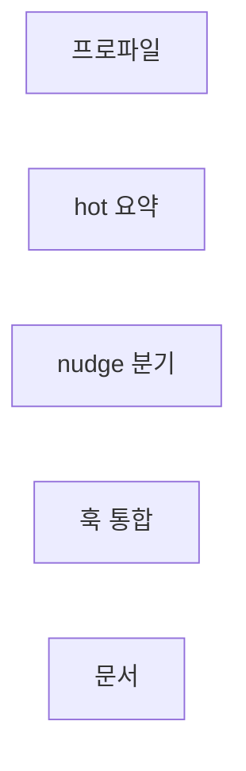

# flint v0.11.0 플랜 — 노출 최소화(프로파일·요약 주입·nudge 분기·훅 통합)

**Spec:** docs/plans/2026-10-31-flint-v0110.spec.md
**Detail:** tests · **Target-min:** 9 · 언어 Go, 테스트 `go test ./...`

**전역 제약(스펙 §4):** exit 0/1/2/3 · 한 줄 JSON(hot 요약 줄·nudge 안내
줄 제외) · 스키마 v5 불변 · 기존 테스트 함수 수정 금지(예외: nudge 문구
고정 단언 갱신 — 룰링) · TDD red→green→commit · `make ci` 통과 ·
병렬 태스크 파일 비공유.

**스펙 매핑:** §1 배경·§2 목표·§3 요구사항 총칭 = 공통 전제. R1→T1 ·
R2→T2 · R3→T3 · R4→T4 · R5→T5.

**Ruling(코디네이터):**
- Ruling: R3-C 정정 - compact가 이미 원문 요약을 pending 적립하므로 minimal nudge는 재적립 없이 마커 자동 종결만 - 중복 해시 방지·적립은 compact 승계.
- Ruling: nudge_v095_test의 nudgeStopDirective·nudgeStartLine 문구 단언 갱신 허용 - 문구 교체의 본질적 동반(단언 구조 불변, 신규 문구로).
- Ruling: hot --full은 프로파일 무관 기존 전체 출력 바이트 불변 - 기존 hot 테스트는 --full 경로로 승계(기존 함수 수정 없이 통과 전제).

## 구조

파일: `lib/cli/profile.go`(T1 신규)·`lib/cli/setup.go`(T1) ·
`lib/cli/hot.go`(T2) · `lib/cli/nudge.go`(T3) ·
`lib/cli/sessionhook.go`(T4 신규)·`lib/cli/doctor.go`(T4)·
`flint-plugin/hooks/hooks.json`(T4) · `README.md`·`README.ko.md`·
`flint-plugin/skills/flint/SKILL.md`·`docs/PLAN.md`(T5) · 신규 테스트
`lib/cli/profile_v0110_test.go`·`lib/cli/hot_v0110_test.go`·
`lib/cli/nudge_v0110_test.go`·`lib/cli/sessionhook_v0110_test.go`·
`docs/v0110_docs_test.go`.

## 태스크 그래프

병렬 5태스크 — T2·T3은 T1의 ExposureProfile 이름만 소비(예시로 stub).

```mermaid
%% schedule
gantt
  title Predicted schedule (mm:ss)
  dateFormat X
  axisFormat %M:%S
  section lane 1
  T1 R1 노출 프로파일 — setup --exposure :t1, 0, 127s
  section lane 2
  T4 R4 session-start·session-end 통합 :t4, 0, 127s
  section lane 3
  T2 R2 hot 요약 헤드라인·--full :t2, 0, 102s
  section lane 4
  T3 R3 nudge 노출 분기·문구 최소화 :t3, 0, 102s
  section lane 5
  T5 R5 문서 동기화 :t5, 0, 102s
```





critical path: T1 (2.1 min) · peak width 5 · predicted build 2.1 min · predicted total ≈ 5.6 min

## lib/cli — 노출 프로파일 (T1)

앱 유형: CLI·설정. 카테고리: state·file.
위험: 무효 값·파손 메타.
**Probe entry:** run=go run ./cmd/flint setup --exposure minimal

### T1 R1 노출 프로파일 — setup --exposure
**Owns:** lib/cli/profile.go, lib/cli/setup.go, lib/cli/profile_v0110_test.go
**Components:** 2 · **LOC owned:** 40 · **Tests:** fast · **Model:** sonnet
**Produces:** ExposureProfile(getKV func(string) (string, error)) string · ExposureKey = "exposure_profile" · runSetup --exposure normal|minimal 분기(기록+한 줄 JSON, 무효 exit 3)
e.g. ExposureProfile(kv) with exposure_profile="minimal" -> "minimal" · ""·파손·에러 -> "normal"
e.g. setup --exposure bogus -> exit 3
**Review Focus:** `TestExposureProfileDefaults`(미설정·파손·에러→normal);
`TestSetupExposureWrites`(minimal 기록·JSON 보고); 무효 값 exit 3.
**Test code (verbatim):**
```go
package cli

import "testing"

func TestExposureProfileDefaults(t *testing.T) {
	cases := map[string]func(string) (string, error){
		"미설정": func(string) (string, error) { return "", nil },
		"에러":  func(string) (string, error) { return "", errFake },
		"파손":  func(string) (string, error) { return "bogus", nil },
	}
	for name, kv := range cases {
		if got := ExposureProfile(kv); got != "normal" {
			t.Errorf("%s = %q, want normal", name, got)
		}
	}
	if got := ExposureProfile(func(string) (string, error) { return "minimal", nil }); got != "minimal" {
		t.Errorf("minimal = %q", got)
	}
}
```
(보조: `var errFake = errors.New("fake")` — 패키지 내 기존 에러 변수 재사용 가능)
**Steps:** 1 신규 테스트(RED) 2 profile.go: ExposureProfile —
   getKV(ExposureKey) 값 "minimal"만 minimal, 그 외 전부 normal 3
   setup.go: --exposure 플래그 파싱·기록·보고·무효 exit 3 4
   `go test ./lib/cli -run 'TestExposure|TestSetup' -count=1` PASS 5 commit
**Notes:** setup 기존 플래그 동작 불변. 스키마 변경 없음(meta 키).

## lib/cli — hot 요약·--full (T2)

앱 유형: CLI·주입. 카테고리: protocol·state.
위험: 기존 전체 출력 회귀·카운트 정합.
**Probe entry:** run=go run ./cmd/flint hot --full

### T2 R2 hot 요약 헤드라인·--full
**Owns:** lib/cli/hot.go, lib/cli/hot_v0110_test.go
**Components:** 1 · **LOC owned:** 55 · **Tests:** fast · **Model:** sonnet
**Consumes:** ExposureProfile(getKV) string (T1) — e.g. "minimal" -> minimal, 그 외 -> normal
**Produces:** hotHeadline(profile string, active int, pending int, recent int) string · runHot --full 플래그(전체 출력)·기본 프로파일 분기
e.g. hotHeadline("normal", 20, 7, 3) -> "[flint] 활성 20 · 대기 7 · 최근 결정 3 — 펼치기: flint hot --full"
e.g. hotHeadline("minimal", 20, 7, 3) -> "[flint] 활성 20 · 대기 7"
**Review Focus:** `TestHotHeadline`(두 프로파일 정확 문구);
`TestHotFullUnchanged`(fake 스토어·--full 시 기존 전체 출력 경로 —
기존 hot 테스트 함수들이 담보, 신규는 --full 플래그 파싱만);
프로파일 미설정=normal 헤드라인.
**Test code (verbatim):**
```go
package cli

import (
	"strings"
	"testing"
)

func TestHotHeadline(t *testing.T) {
	if got := hotHeadline("normal", 20, 7, 3); got != "[flint] 활성 20 · 대기 7 · 최근 결정 3 — 펼치기: flint hot --full" {
		t.Errorf("normal 헤드라인 = %q", got)
	}
	if got := hotHeadline("minimal", 20, 7, 3); got != "[flint] 활성 20 · 대기 7" {
		t.Errorf("minimal 헤드라인 = %q", got)
	}
	if got := hotHeadline("other", 1, 2, 3); !strings.Contains(got, "펼치기") {
		t.Errorf("미확인 프로파일 = normal 취급 아님: %q", got)
	}
}
```
**Steps:** 1 신규 테스트(RED) 2 hotHeadline 순수 함수 3 runHot:
   --full 플래그 파싱(지정 시 기존 경로 그대로)·미지정 시
   ExposureProfile 조회 → 헤드라인 1줄만 출력(기존 데이터 조회로
   카운트 계산 — 전체 조립은 수행 생략) 4 계측·exit·--session 불변 5
   `go test ./lib/cli -run 'TestHot' -count=1` PASS(기존 hot 테스트
   포함 — 기존 함수가 전체 출력을 단언한다면 그 경로는 --full로
   승계됨을 확인, 기존 함수 수정 금지·실패 시 인시던트) 6 commit
**Notes:** 카운트 소스는 기존 hot 조회 SQL 재사용(활성=projects,
   대기=pending, 최근 결정=7일). 기존 hot 테스트가 기본 경로 전체
   출력을 단언하면 충돌 — 그 경우 기존 단언이 --full과 동치가 되도록
   runHot 우선순위(플래그 우선)만 지키고 보고.

## lib/cli — nudge 분기 (T3)

앱 유형: CLI·훅. 카테고리: protocol·state.
위험: 마커 소실·기존 문구 단언 충돌.
**Probe entry:** run=go run ./cmd/flint nudge

### T3 R3 nudge 노출 분기·문구 최소화
**Owns:** lib/cli/nudge.go, lib/cli/nudge_v0110_test.go
**Components:** 1 · **LOC owned:** 45 · **Tests:** fast · **Model:** sonnet
**Consumes:** ExposureProfile(getKV) string (T1) — e.g. "minimal" -> 자동 종결, 그 외 -> 한 줄 안내
**Produces:** nudgeStopShort = "flint: 증류 대기 — flint nudge" · runNudge 프로파일 분기(normal: 짧은 안내/minimal: 출력 없음+마커 자동 종결)
e.g. 마커 존재+normal -> additionalContext "flint: 증류 대기 — flint nudge"
e.g. 마커 존재+minimal -> 출력 0바이트·마커 파일 소멸(ClearMarker)
**Review Focus:** `TestNudgeShortDirectiveNormal`(한 줄·기존 긴 문구
미포함); `TestNudgeMinimalAutoClears`(마커 픽스처→출력 없음·마커
소멸); `flint nudge --clear` 수동 경로 불변.
**Test code (verbatim):**
```go
package cli

import (
	"bytes"
	"os"
	"path/filepath"
	"strings"
	"testing"
)

func TestNudgeShortDirectiveNormal(t *testing.T) {
	if nudgeStopShort != "flint: 증류 대기 — flint nudge" {
		t.Errorf("짧은 문구 = %q", nudgeStopShort)
	}
	if strings.Contains(nudgeStopShort, "flint write knowledge") {
		t.Error("명령문 잔존 — 최소화 위반")
	}
}

func TestNudgeMinimalAutoClears(t *testing.T) {
	dir := t.TempDir()
	t.Setenv("FLINT_CONFIG_DIR", dir)
	mf := MarkerFile()
	if err := os.MkdirAll(filepath.Dir(mf), 0o755); err != nil {
		t.Fatal(err)
	}
	if err := WriteMarker("sess-1", "compact"); err != nil {
		t.Fatal(err)
	}
	var out bytes.Buffer
	code := runNudge(nil, fakeProfileStore("minimal"), nil, strings.NewReader(""), &out)
	if code != 0 || out.Len() != 0 {
		t.Fatalf("출력 있음/exit=%d: %q", code, out.String())
	}
	if _, err := os.Stat(mf); !os.IsNotExist(err) {
		t.Error("마커 미소멸")
	}
}
```
(보조: `fakeProfileStore(p string) Store` — meta exposure_profile 반환
페이크. 패키지 기존 fakeStore 패턴 승계, 신규 헬퍼는 이 테스트 파일 내)
**Steps:** 1 신규 테스트(RED) 2 nudgeStopShort 상수·runNudge에
   ExposureProfile 분기(normal: 기존 출력 경로에 짧은 문구·
   nudgeReadHint 병합 승계 여부는 문구 내 자유)·minimal: 마커 존재 시
   ClearMarker 후 출력 없음(스토어 접속 불필요 — 프로파일 조회 실패는
   normal) 3 기존 nudge_v095_test의 긴 문구 단언 갱신(룰링 — 신규
   짧은 문구로, 단언 구조 불변) 4
   `go test ./lib/cli -run 'TestNudge' -count=1` PASS 5 commit
**Notes:** 마커 자동 종결은 종결만(compact 적립분 승계 — 재적립
   없음, 룰링). ClearMarker 기존 함수 재사용(--clear 경로와 동일).

## lib/cli — 훅 통합 (T4)

앱 유형: CLI·설정. 카테고리: file·protocol.
위험: 훅 교체 단절·doctor 계약.
**Probe entry:** run=go run ./cmd/flint session-start

### T4 R4 session-start·session-end 통합
**Owns:** lib/cli/sessionhook.go, lib/cli/doctor.go, flint-plugin/hooks/hooks.json, lib/cli/sessionhook_v0110_test.go
**Components:** 2 · **LOC owned:** 70 · **Tests:** fast · **Model:** sonnet
**Produces:** runSessionStart(ctx, st, args, stdin, stdout) int — 내부 runHot→runNudge 순서 승계 · runSessionEnd(...) int — runDone→runNudge · hooks.json 3엔트리 재편(SessionStart=session-start·Stop=session-end·PostCompact=compact) · doctor hook 검사·applyHookFix 신규 3엔트리 매칭
e.g. hooks.json SessionStart -> 커맨드 "flint session-start \"$(jq…session_id…)\" ..." 1개
e.g. runSessionStart(fake) -> hot 헤드라인+nudge 출력 승계·exit 0
**Review Focus:** `TestSessionStartRunsHotAndNudge`(출력에 hot·nudge
양쪽 흔적); `TestSessionEndRunsDoneAndNudge`; hooks.json 3엔트리
구조 단언(JSON 파싱); applyHookFix가 기존 5엔트리를 3엔트리로 교체
(기존 훅 보존 규칙 — flint 엔트리만 교체, 타 도구 훅 불변).
**Test code (verbatim):**
```go
package cli

import (
	"bytes"
	"context"
	"encoding/json"
	"os"
	"strings"
	"testing"
)

func TestSessionStartRunsHotAndNudge(t *testing.T) {
	var out bytes.Buffer
	code := runSessionStart(context.Background(), asofFakeOrReal(t, &fakeStore{}), []string{"--session", "s1"}, strings.NewReader(""), &out)
	if code != 0 {
		t.Fatalf("exit = %d (%s)", code, out.String())
	}
	if !strings.Contains(out.String(), "[flint]") {
		t.Errorf("hot 흔적 없음: %q", out.String())
	}
}

func TestHooksJsonThreeEntries(t *testing.T) {
	b, err := os.ReadFile("../flint-plugin/hooks/hooks.json")
	if err != nil {
		t.Fatal(err)
	}
	var h struct {
		Hooks map[string][]struct {
			Hooks []struct {
				Command string `json:"command"`
			} `json:"hooks"`
		} `json:"hooks"`
	}
	if err := json.Unmarshal(b, &h); err != nil {
		t.Fatal(err)
	}
	if len(h.Hooks["SessionStart"]) != 1 || !strings.Contains(h.Hooks["SessionStart"][0].Hooks[0].Command, "session-start") {
		t.Error("SessionStart 미통합")
	}
	if len(h.Hooks["Stop"]) != 1 || !strings.Contains(h.Hooks["Stop"][0].Hooks[0].Command, "session-end") {
		t.Error("Stop 미통합")
	}
	if len(h.Hooks["PostCompact"]) != 1 {
		t.Error("PostCompact 변경됨")
	}
}
```
**Steps:** 1 신규 테스트(RED) 2 sessionhook.go: runSessionStart·
   runSessionEnd — 기존 run 함수 호출 체이닝(stdout 버퍼 공유)·
   Register 3 hooks.json 재편(타임아웃·2>/dev/null || true 패턴 승계)
   4 doctor.go hookSpec/applyHookFix 대상 3엔트리로 갱신(기존
   flint hot·done·nudge 엔트리는 교체, 타 도구 훅·기타 설정 불변·
   백업 승계) 5 `go test ./lib/cli -run 'TestSession|TestApplyHookFix|TestDoctor' -count=1` PASS 6 commit
**Notes:** 기존 flint hot·done 직접 실행 훅을 가진 사용자 설정은
   applyHookFix 교체 시 정리(하위호환: 명령 자체는 존속). 매처
   "startup|resume|clear|compact" 승계.

## docs — 문서 (T5)

앱 유형: 문서+고정 테스트. 카테고리: file.
**Probe entry:** run=go test ./docs

### T5 R5 문서 동기화
**Owns:** README.md, README.ko.md, flint-plugin/skills/flint/SKILL.md, docs/PLAN.md, docs/v0110_docs_test.go
**Components:** 1 · **LOC owned:** 40 · **Tests:** fast · **Model:** sonnet
**Produces:** SKILL.md hot --full 펼침 안내·프로파일 1줄 · README EN/KO 노출 프로파일·훅 통합 1줄씩 · PLAN §14 v0.11.0 마일스톤
e.g. SKILL.md -> "flint hot --full" 포함 · README -> "exposure" 포함
**Review Focus:** `TestSkillMentionsHotFull`·`TestReadmeMentionsExposure`·
`TestPlanRecordsV0110`.
**Test code (verbatim):**
```go
package docs

import (
	"os"
	"strings"
	"testing"
)

func docStrV0110(t *testing.T, path string) string {
	t.Helper()
	b, err := os.ReadFile(path)
	if err != nil {
		t.Fatal(err)
	}
	return string(b)
}

func TestSkillMentionsHotFull(t *testing.T) {
	if !strings.Contains(docStrV0110(t, "../flint-plugin/skills/flint/SKILL.md"), "hot --full") {
		t.Error("SKILL.md 펼침 안내 누락")
	}
}

func TestReadmeMentionsExposure(t *testing.T) {
	for _, p := range []string{"../README.md", "../README.ko.md"} {
		if !strings.Contains(docStrV0110(t, p), "exposure") {
			t.Errorf("%s 프로파일 미언급", p)
		}
	}
}

func TestPlanRecordsV0110(t *testing.T) {
	if !strings.Contains(docStrV0110(t, "PLAN.md"), "v0.11.0") {
		t.Error("PLAN.md v0.11.0 마일스톤 누락")
	}
}
```
**Steps:** 1 신규 테스트(RED) 2 SKILL.md: hot 줄에 "--full 펼침"·
   setup --exposure 1줄 3 README EN/KO: 설정 절에 노출 프로파일·
   훅 3엔트리 1줄씩 4 PLAN §14 말미 v0.11.0 마일스톤 5
   `go test ./docs -count=1` PASS 6 commit
**Notes:** "exposure"·"hot --full"·"v0.11.0" 문자열 EN/KO 공통.

## Review Focus 요약

| 패키지 | 유형 | 카테고리 | 리스크 |
|---|---|---|---|
| lib/cli(profile/setup) | CLI 설정 | state·file | 무효 값·파손 |
| lib/cli(hot) | CLI 주입 | protocol·state | 전체 출력 회귀 |
| lib/cli(nudge) | CLI 훅 | protocol·state | 마커 소실·문구 충돌 |
| lib/cli(sessionhook/doctor) | CLI 설정 | file·protocol | 훅 교체 단절 |
| docs | 문서 | file | 기존 절 훼손 |
