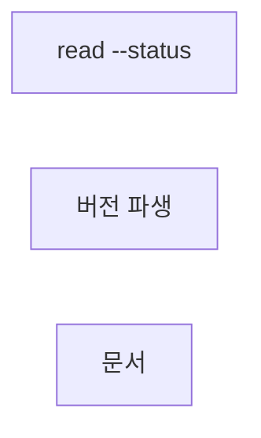

# flint v0.12.0 플랜 — pending 열람 완결·버전 파생(read --status·VERSION 태그)

**Spec:** docs/plans/2026-10-31-flint-v0120.spec.md
**Detail:** tests · **Target-min:** 9 · 언어 Go, 테스트 `go test ./...`

**전역 제약(스펙 §4):** exit 0/1/2/3 · 한 줄 JSON · 스키마 v5 불변 ·
기존 테스트 함수 수정 금지(예외: T3 배지 기대값 — 룰링) · TDD
red→green→commit · `make ci` 통과 · 병렬 태스크 파일 비공유.

**스펙 매핑:** §1 배경·§2 목표·§3 요구사항 총칭 = 공통 전제. R1→T1 ·
R2→T2 · R3→T3.

**Ruling(코디네이터):**
- Ruling: --status 지정 시에만 base 테이블 knowledge + status WHERE 조회 - 미지정 경로는 active_knowledge 뷰 완전 불변 - 폴백·제안은 --status 경로 미발동(상태 필터는 재시도 대상 아님).
- Ruling: --as-of와 --status 병용은 as-of 우선으로 --status 무시(경고 없이) - 시점 정합성 우선 - SKILL에 1줄 문서화(T3).

## 구조

파일: `lib/query/read.go`·`lib/cli/read.go`(T1) · `Makefile`(T2) ·
`README.md`·`README.ko.md`·`flint-plugin/skills/flint/SKILL.md`·
`docs/PLAN.md`(T3) · 신규 테스트 `lib/query/read_v0120_test.go`·
`lib/cli/read_status_v0120_test.go`·`docs/v0120_docs_test.go`.

## 태스크 그래프

병렬 3태스크 — 실행 의존 없음.

```mermaid
%% schedule
gantt
  title Predicted schedule (mm:ss)
  dateFormat X
  axisFormat %M:%S
  section lane 1
  T1 R1 read --status pending|active|inval :t1, 0, 127s
  section lane 2
  T2 R2 버전 파생 — VERSION git 태그 :t2, 0, 102s
  section lane 3
  T3 R3 문서 동기화·배지 v0.12.0 :t3, 0, 102s
```





critical path: T1 (2.1 min) · peak width 3 · predicted build 2.1 min · predicted total ≈ 5.6 min

## lib/query+lib/cli — read --status (T1)

앱 유형: CLI 검색 계층. 카테고리: protocol·state.
위험: 기본 경로(뷰) 회귀·살균·as-of 병용.
**Probe entry:** run=go run ./cmd/flint read --status pending

### T1 R1 read --status pending|active|invalidated
**Owns:** lib/query/read.go, lib/cli/read.go, lib/query/read_v0120_test.go, lib/cli/read_status_v0120_test.go
**Components:** 2 · **LOC owned:** 60 · **Tests:** fast · **Model:** sonnet
**Produces:** Filters.Status string · BuildReadStatus(q string, f Filters) (string, []any) — FROM knowledge + WHERE status·BuildRead의 --status 미지정 경로 바이트 불변 · runRead --status 플래그 파싱·분기(무효 값 exit 3·as-of 병용 시 as-of 우선)
e.g. BuildReadStatus("", Filters{Status:"pending", Limit:20}) -> "SELECT … FROM knowledge WHERE status = $1 …", ["pending"]
e.g. runRead(args=["--status","bogus"]) -> exit 3
**Review Focus:** `TestBuildReadStatusSQL`(base 테이블·WHERE·파라미터)
·`TestReadStatusPending`(fake: pending 2행 반환·출력 승계)·
`TestReadDefaultUnchanged`(미지정 시 기존 SQL 그대로 — 기존 read
테스트 전체가 담보)·`TestReadStatusInvalidExit3`·
`TestReadStatusAsOfPrecedence`(병용 시 as-of 경로·status 무시).
**Test code (verbatim):**
```go
package query

import (
	"strings"
	"testing"
)

func TestBuildReadStatusSQL(t *testing.T) {
	sql, args := BuildReadStatus("", Filters{Status: "pending", Limit: 20})
	if !strings.Contains(sql, "FROM knowledge") || !strings.Contains(sql, "active_knowledge") {
		t.Errorf("base 테이블 미사용: %s", sql)
	}
	if !strings.Contains(sql, "status = $") {
		t.Errorf("status 조건 누락: %s", sql)
	}
	if len(args) == 0 || args[0] != "pending" {
		t.Errorf("파라미터 = %v", args)
	}
}
```
```go
package cli

import (
	"bytes"
	"context"
	"strings"
	"testing"
)

func statusQueryFn() func(string, []any) ([][]any, error) {
	return func(sql string, args []any) ([][]any, error) {
		if strings.Contains(sql, "FROM knowledge") {
			return [][]any{
				fallbackRow(35, "꿀송이방 안내문", "확정"),
				fallbackRow(41, "엔츠 과제", "진행 중"),
			}, nil
		}
		return nil, nil
	}
}

func TestReadStatusPending(t *testing.T) {
	ctx := context.Background()
	var out bytes.Buffer
	f := &fakeStore{queryFn: statusQueryFn()}
	if code := runRead(ctx, asofFakeOrReal(t, f), []string{"--status", "pending"}, strings.NewReader(""), &out); code != 0 {
		t.Fatalf("exit = %d (%s)", code, out.String())
	}
	if !strings.Contains(out.String(), "꿀송이방") || !strings.Contains(out.String(), "엔츠") {
		t.Errorf("pending 행 미출력: %q", out.String())
	}
}

func TestReadStatusInvalidExit3(t *testing.T) {
	var out bytes.Buffer
	if code := runRead(context.Background(), asofFakeOrReal(t, &fakeStore{}), []string{"--status", "bogus"}, strings.NewReader(""), &out); code != 3 {
		t.Fatalf("무효 status exit = %d, want 3", code)
	}
}
```
**Steps:** 1 신규 테스트(RED) 2 lib/query: Filters.Status·
   BuildReadStatus — BuildRead SQL 조립 승계(FROM만 knowledge·WHERE
   status 추가·RankOrder·LIMIT 승계, 컬럼은 뷰와 동일 순서 가정 시
   columnIndexOf 재사용 — 불일치 시 인시던트) 3 lib/cli: runRead
   --status 파싱(valid: pending|active|invalidated)·지정 시
   BuildReadStatus 발행·출력·계측 승계. --as-of 병용 시 as-of 경로
   우선(status 무시) 4 기존 read 전체 회귀 확인 5
   `go test ./lib/query ./lib/cli -run 'TestBuildReadStatus|TestReadStatus|TestRead' -count=1` PASS 6 commit
**Notes:** --status 경로는 폴백·제안 미발동(룰링). fallbackRow·
   fakeStore·asofFakeOrReal 기존 헬퍼 승계.

## 빌드 — 버전 파생 (T2)

앱 유형: 빌드 스크립트. 카테고리: file.
위험: 태그 부재 환경.
**Probe entry:** run=make build

### T2 R2 버전 파생 — VERSION git 태그
**Owns:** Makefile, docs/v0120_makefile_test.go
**Components:** 1 · **LOC owned:** 10 · **Tests:** fast · **Model:** sonnet
**Produces:** VERSION ?= $(shell git describe --tags --abbrev=0 2>/dev/null || echo dev) — make build 시 태그 버전 주입
e.g. 태그 v0.12.0 존재 시 make build -> flint version {"version":"v0.12.0",…}
e.g. 태그 부재 클론 -> dev 폴백
**Review Focus:** `TestMakefileDerivesVersion`(Makefile에 git describe
파생 포함); `make build` 후 bin/flint version이 dev 아님(태그 있는
로컬) — 로컬 확인은 보고로 대체 가능(태그는 머지 후).
**Test code (verbatim):** docs/v0120_makefile_test.go(신규 — T3의
v0120_docs_test.go와 분리 파일):
```go
package docs

import (
	"os"
	"strings"
	"testing"
)

func TestMakefileDerivesVersion(t *testing.T) {
	b, err := os.ReadFile("../Makefile")
	if err != nil {
		t.Fatal(err)
	}
	if !strings.Contains(string(b), "git describe --tags") {
		t.Error("Makefile VERSION 태그 파생 누락")
	}
}
```
**Steps:** 1 신규 테스트(RED) 2 Makefile VERSION 줄 파생으로 교체
   (commit은 기존 GIT_COMMIT 승계) 3 `make build && ./bin/flint
   version` — 태그 부재 시 dev 폴백 확인 4 `go test ./docs -count=1`
   PASS 5 commit
**Notes:** 릴리스 태그는 머지 후 코디네이터가 `git tag v0.12.0 &&
   git push --tags`(운영). v0120_docs_test.go는 T2·T3 공유 — T2가
   파일 생성, T3는 함수 추가만(동시 편집 회피 위해 T3는 T2 커밋 후
   적용 가능하나 병렬 진행 시 서로 다른 함수만).

## docs — 문서 동기화 (T3)

앱 유형: 문서+고정 테스트. 카테고리: file.
위험: 배지 단언 충돌.
**Probe entry:** run=go test ./docs

### T3 R3 문서 동기화·배지 v0.12.0
**Owns:** README.md, README.ko.md, flint-plugin/skills/flint/SKILL.md, docs/PLAN.md, docs/v0100_docs_test.go, docs/v0120_docs_test.go
**Components:** 1 · **LOC owned:** 35 · **Tests:** fast · **Model:** sonnet
**Produces:** 배지 release-v0.12.0(EN/KO)·SKILL pending 안내 read --status pending 갱신·README read --status 1줄·make build 규칙 1줄·PLAN §14 v0.12.0 마일스톤
e.g. SKILL.md -> "read --status pending" 포함 · README -> "release-v0.12.0" 포함
**Review Focus:** `TestReadmeBadgeIsV0120`·`TestSkillDocumentsReadStatus`·
`TestPlanRecordsV0120`; v0100 배지 단언 갱신(룰링 예외) 후 docs 전체
통과.
**Test code (verbatim):** docs/v0120_docs_test.go(T3 단독 소유 — T2의 makefile 테스트와 별개 파일):
```go
func TestReadmeBadgeIsV0120(t *testing.T) {
	for _, p := range []string{"../README.md", "../README.ko.md"} {
		if !strings.Contains(docStrV0110(t, p), "release-v0.12.0") {
			t.Errorf("%s 배지가 v0.12.0 아님", p)
		}
	}
}

func TestSkillDocumentsReadStatus(t *testing.T) {
	s := docStrV0110(t, "../flint-plugin/skills/flint/SKILL.md")
	if !strings.Contains(s, "read --status pending") {
		t.Error("SKILL.md pending 열람 미안내")
	}
}
```
(docStrV0110은 v0110_docs_test.go 기존 헬퍼 승계)
**Steps:** 1 테스트 추가(RED) 2 배지 v0.10.0→v0.12.0(EN/KO)·
   SKILL.md pending 안내 hot 팔→read --status pending(+as-of 병용
   1줄)·README read 설명 1줄·빌드 make build 1줄 3 PLAN §14 말미
   v0.12.0 마일스톤 4 v0100_docs_test.go 배지 기대값 갱신(룰링 예외)
   5 `go test ./docs -count=1` PASS 6 commit
**Notes:** T2와 v0120_docs_test.go 공유 — 서로 다른 함수만 추가
   (T2: TestMakefileDerivesVersion, T3: 나머지). 충돌 시 T3가 T2
   커밋 후 적용.

## Review Focus 요약

| 패키지 | 유형 | 카테고리 | 리스크 |
|---|---|---|---|
| lib/query+lib/cli | 검색 계층 | protocol·state | 뷰 기본 경로 회귀 |
| 빌드 | Makefile | file | 태그 부재 폴백 |
| docs | 문서 | file | 배지 단언·파일 공유 |
