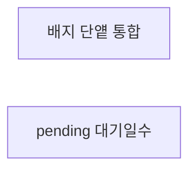

# flint v0.12.1 플랜 — 패치(배지 단얱 통합·pending 대기일수)

**Spec:** docs/plans/2026-10-31-flint-v0121.spec.md
**Detail:** tests · **Target-min:** 9 · 언어 Go, 테스트 `go test ./...`

**전역 제약(스펙 §4):** exit 0/1/2/3 · 한 줄 JSON · 스키마 v5 불변 ·
기존 테스트 함수 수정 금지(예외: T1의 배지 단얱 삭제·통합 — 룰링) ·
TDD red→green→commit · `make ci` 통과 · 병렬 태스크 파일 비공유.

**스펙 매핑:** §1 배경·§2 목표·§3 요구사항 총칭 = 공통 전제. R1→T1 ·
R2→T2.

**Ruling(코디네이터):**
- Ruling: 배지 단얱 5종(v093·v097·v0100·v0102·v0120 내) 폐기·삭제 허용 - 단일 Latest 단얱으로 통합하는 전환의 본질적 동반 - 비배지 단얱(폴백·TUNING 등)은 각 파일에 남김.

## 구조

파일: `docs/v093_docs_test.go`·`docs/v097_docs_test.go`·
`docs/v0100_docs_test.go`·`docs/v0102_docs_test.go`·
`docs/v0120_docs_test.go`·`docs/badge_test.go`(T1 신규) ·
`lib/cli/hot.go`(T2) · 신규 테스트 `lib/cli/hot_v0121_test.go`.

## 태스크 그래프

병렬 2태스크 — 실행 의존 없음.

```mermaid
%% schedule
gantt
  title Predicted schedule (mm:ss)
  dateFormat X
  axisFormat %M:%S
  section lane 1
  T1 R1 배지 단얱 통합 — 단일 Latest 단얱 :t1, 0, 102s
  section lane 2
  T2 R2 pending 팔 대기일수 노출 :t2, 0, 102s
```





critical path: T1 (1.7 min) · peak width 2 · predicted build 1.7 min · predicted total ≈ 5.2 min

## docs — 배지 단얱 통합 (T1)

앱 유형: 문서 테스트. 카테고리: file.
위험: 비배지 단언误损.
**Probe entry:** run=go test ./docs

### T1 R1 배지 단얱 통합 — 단일 Latest 단얱
**Owns:** docs/v093_docs_test.go, docs/v097_docs_test.go, docs/v0100_docs_test.go, docs/v0102_docs_test.go, docs/v0120_docs_test.go, docs/badge_test.go
**Components:** 1 · **LOC owned:** 30 · **Tests:** fast · **Model:** sonnet
**Produces:** TestReadmeBadgeIsLatest — EN/KO 양측에 "release-v" 배지 존재·양측 버전 문자열 동일 단얱(버전 무관) · 배지 단얱 5종 폐기
e.g. badge_test.go -> README EN/KO에서 release-v[0-9.]+ 추출 후 동일 단얱
**Review Focus:** `TestReadmeBadgeIsLatest`(양측 동일); 폐기 후 docs
전체 PASS(비배지 단언 잔존 확인).
**Test code (verbatim):**
```go
package docs

import (
	"os"
	"regexp"
	"testing"
)

func TestReadmeBadgeIsLatest(t *testing.T) {
	re := regexp.MustCompile(`release-v[0-9]+\.[0-9]+\.[0-9]+`)
	var seen string
	for _, p := range []string{"../README.md", "../README.ko.md"} {
		b, err := os.ReadFile(p)
		if err != nil {
			t.Fatal(err)
		}
		m := re.FindString(string(b))
		if m == "" {
			t.Errorf("%s release-v 배지 없음", p)
		}
		if seen != "" && m != seen {
			t.Errorf("EN/KO 배지 불일치: %s vs %s", seen, m)
		}
		seen = m
	}
}
```
**Steps:** 1 badge_test.go 신규(먼저 GREEN 확인) 2 5개 파일의
   배지 단얱 함수만 삭제(룰링 — 비배지 단얱·헬퍼 잔존, 미사용
   import 정리) 3 `go test ./docs -count=1` 전체 PASS 4 commit
**Notes:** 삭제 대상: TestReadmeBadgeIsV093·V097·V0100·V0120 외
   v0102의 배지 관련 잔여(있다면). docStr* 헬퍼는 다른 테스트가
   사용하면 잔존.

## lib/cli — pending 대기일수 (T2)

앱 유형: CLI·주입. 카테고리: state·numeric.
위험: 기존 hot 형식 단얱 충돌.
**Probe entry:** run=go run ./cmd/flint hot --full

### T2 R2 pending 팔 대기일수 노출
**Owns:** lib/cli/hot.go, lib/cli/hot_v0121_test.go
**Components:** 1 · **LOC owned:** 25 · **Tests:** fast · **Model:** sonnet
**Produces:** pendingAgeSuffix(validAt time.Time, now time.Time) string — "·+N일"(0일이면 빈 문자열) · hot --full pending 행 접미
e.g. pendingAgeSuffix(now-30h, now) -> "·+1일"
e.g. pendingAgeSuffix(now-2h, now) -> ""
**Review Focus:** `TestPendingAgeSuffix`(경계 24h 미만/이상·내림);
기존 hot 테스트 전체 통과(형식 단얱 충돌 시 인시던트·룰링).
**Test code (verbatim):**
```go
package cli

import (
	"testing"
	"time"
)

func TestPendingAgeSuffix(t *testing.T) {
	now := time.Date(2026, 10, 31, 12, 0, 0, 0, time.UTC)
	if got := pendingAgeSuffix(now.Add(-30*time.Hour), now); got != "·+1일" {
		t.Errorf("30시간 = %q, want ·+1일", got)
	}
	if got := pendingAgeSuffix(now.Add(-2*time.Hour), now); got != "" {
		t.Errorf("2시간 = %q, want 빈 문자열", got)
	}
	if got := pendingAgeSuffix(now.Add(-49*time.Hour), now); got != "·+2일" {
		t.Errorf("49시간 = %q, want ·+2일", got)
	}
}
```
**Steps:** 1 신규 테스트(RED) 2 pendingAgeSuffix 순수 함수(24h
   미만 빈 문자열·경과 일수 내림) 3 hot --full pending 팔 행 끝에
   접미(valid_at 소스 승계 — 팔 쿼리에 valid_at 포함 확인, 부재 시
   인시던트) 4 `go test ./lib/cli -run 'TestPendingAge|TestHot' -count=1` PASS 5 commit
**Notes:** 헤드라인 경로·다른 팔 미변경. 시간대는 UTC 승계.

## Review Focus 요약

| 패키지 | 유형 | 카테고리 | 리스크 |
|---|---|---|---|
| docs | 문서 테스트 | file | 비배지 단언 오손 |
| lib/cli | CLI 주입 | state·numeric | 형식 단언 충돌 |
