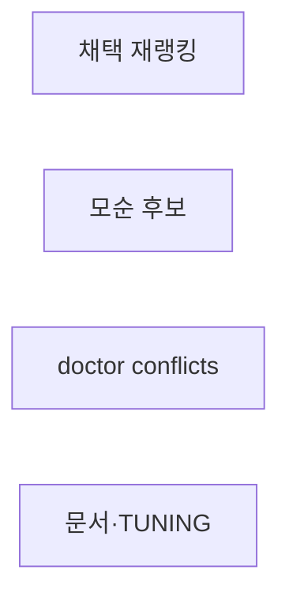

# flint v0.13.0 플랜 — 지능 축(채택 재랭킹·모순 탐지)

**Spec:** docs/plans/2026-10-31-flint-v0130.spec.md
**Detail:** tests · **Target-min:** 9 · 언어 Go, 테스트 `go test ./...`

**전역 제약(스펙 §4):** exit 0/1/2/3 · 한 줄 JSON · 스키마 v5 불변 ·
기존 테스트 함수 수정 금지(R1 랭킹 갱신 — 룰링) · TDD red→green→
commit · `make ci` 통과 · 병렬 태스크 파일 비공유.

**스펙 매핑:** §1 배경·§2 목표·§3 요구사항 총칙 = 공통 전제. R1→T1 ·
R2→T2 · R3→T3 · 문서는 각 태스크에 분산(README 1줄씩·PLAN은 T4).

**Ruling(코디네이터):**
- Ruling: read_count 타이브레이크로 기존 랭킹 테스트 기대값이 깨지면 갱신 허용(단언 구조 불변) - 픽스처 read_count 동률(0) 전제로 통과해야 정상이므로 깨짐은 픽스처에 read_count 차등이 있다는 뜻 - 최종 타이브레이크 추가의 본질적 동반.
- Ruling: 충돌 분류 상수 conflictDupThreshold = 0.6 - 제안 임계값(0.15)과 목적이 다른 독립 상수 - TUNING 기록은 T4.

## 구조

파일: `lib/query/read.go`·`lib/cli/read.go`(T1) ·
`lib/db/admin.go`·`lib/cli/maintain.go`(T2) · `lib/cli/doctor.go`(T3) ·
`docs/PLAN.md`·`docs/TUNING.md`·`README.md`·`README.ko.md`(T4) ·
신규 테스트 `lib/query/rank_v0130_test.go`·`lib/cli/maintain_v0130_test.go`·
`lib/cli/doctor_v0130_test.go`·`docs/v0130_docs_test.go`.

## 태스크 그래프

병렬 4태스크 — T2·T3은 그룹 조회 이름만 공유(실행 의존 없음).

```mermaid
%% schedule
gantt
  title Predicted schedule (mm:ss)
  dateFormat X
  axisFormat %M:%S
  section lane 1
  T1 R1 채택 재랭킹 — read_count 최종 타이브레이크 :t1, 0, 127s
  section lane 2
  T2 R2 모순 후보 탐지 — conflict-suspects :t2, 0, 127s
  section lane 3
  T3 R3 doctor conflicts 검사 :t3, 0, 102s
  section lane 4
  T4 R4 문서·TUNING 기록 :t4, 0, 102s
```





critical path: T1 (2.1 min) · peak width 4 · predicted build 2.1 min · predicted total ≈ 5.6 min

## lib/query+lib/cli — 채택 재랭킹 (T1)

앱 유형: CLI 검색 계층. 카테고리: numeric·state.
위험: 기존 랭킹 회귀·부유 현상.
**Probe entry:** run=./bin/flint read 백업

### T1 R1 채택 재랭킹 — read_count 최종 타이브레이크
**Owns:** lib/query/read.go, lib/cli/read.go, lib/query/rank_v0130_test.go
**Components:** 2 · **LOC owned:** 40 · **Tests:** fast · **Model:** sonnet
**Produces:** RankOrder 말미 `, read_count DESC`(last_read_at 뒤) · classifyConflict는 T2 소유(미접촉) · ReorderByFallbackCount 2차 타이브레이크 readCountOf(rows) DESC(SliceStable)
e.g. RankOrder("백업") -> "…, last_read_at DESC NULLS LAST, read_count DESC"
e.g. 폴백 행 A(정합2·read_count 0)·B(정합2·read_count 5) -> B 먼저
**Review Focus:** `TestRankOrderEndsWithReadCount`(문자열 접미)·
`TestFallbackReorderByAdoption`(2차 타이브레이크·동률 시 기존 순서
보존); 기존 read 랭킹 테스트 전수 통과(룰링 전제).
**Test code (verbatim):**
```go
package query

import (
	"strings"
	"testing"
)

func TestRankOrderEndsWithReadCount(t *testing.T) {
	got := RankOrder("백업")
	if !strings.Contains(got, "last_read_at DESC NULLS LAST, read_count DESC") {
		t.Errorf("read_count 타이브레이크 누락: %s", got)
	}
}
```
**Steps:** 1 신규 테스트(RED) 2 RankOrder 접미 추가(상위 요소
   불변) 3 ReorderByFallbackCount: 정합수 내림 후 read_count DESC
   2차(행에서 read_count 칼럼 읽기 — readColumns 인덱스 확인·부재 시
   인시던트) 4 `go test ./lib/query ./lib/cli -run 'TestRankOrder|TestFallback|TestRead' -count=1` PASS 5 commit
**Notes:** read_count는 최종 타이브레이크 — 상위(주제 정확·confidence·
최신·last_read) 불변. 기존 테스트 깨짐은 룰링 갱신.

## lib/db+lib/cli — 모순 후보 (T2)

앱 유형: CLI·DB 집계. 카테고리: state·numeric.
위험: dup-suspects 회귀·분류 경계.
**Probe entry:** run=./bin/flint maintain --conflict-suspects

### T2 R2 모순 후보 탐지 — conflict-suspects
**Owns:** lib/db/admin.go, lib/cli/maintain.go, lib/cli/maintain_v0130_test.go
**Components:** 2 · **LOC owned:** 55 · **Tests:** fast · **Model:** sonnet
**Consumes:** bigramDice(a string, b string) float64 (lib/query — 패키지 외부 공개 필요 시 소유 룰링 요청)
**Produces:** conflictDupThreshold = 0.6 · classifyConflict(summA string, summB string) bool(유사도<0.6=모순) · DupGroup 확장 또는 신규 ConflictGroup 조회(그룹에 요약 포함) · maintain --conflict-suspects
e.g. classifyConflict("백업은 매일 한다","백업은 매일 한다") -> false
e.g. classifyConflict("포트는 5433이다","포트는 5434다") -> true(판정 실측 기준)
**Review Focus:** `TestClassifyConflictBoundary`(동일→false·이질→
true·경계 실측)·`TestConflictSuspectsFlag`(fake 그룹에서 모순만
리스팅)·기존 --dup-suspects 출력 불변.
**Test code (verbatim):**
```go
package cli

import (
	"strings"
	"testing"
)

func TestClassifyConflictBoundary(t *testing.T) {
	if classifyConflict("flint 백업은 매일 자동이다", "flint 백업은 매일 자동이다") {
		t.Error("동일 요약 = 모순 아님")
	}
	if !classifyConflict("포트 기본값은 5433이다", "환경설정 초기화는 setup이 담당한다") {
		t.Error("이질 요약 = 모순 후보")
	}
}

func TestConflictSuspectsFlag(t *testing.T) {
	var out strings.Builder
	_ = &out
	// runMaintain --conflict-suspects 가짜 스토어 경로 — DupGroup 픽스처 2그룹(동일 요약·이질 요약)에서 이질 1그룹만 출력
	// 구현체 시그니처 확정 후 단얱: 출력에 이질 그룹 topic 포함·동일 그룹 미포함
}
```
(두 번째 테스트는 구현 시그니처에 맞춰 단얱 완성 — 리뷰 포커스 명세)
**Steps:** 1 신규 테스트(RED — classifyConflict 소유 문제로 우선
   lib/query 공개 여부 코디네이터 룰링 대기 없이 유사 순수함수를
   maintain 측에 두는 것도 허용) 2 admin.go 그룹 조회에 요약 포함
  (기존 DupGroups 시그니처 확장 또는 병행 신규 — 기존 호출부 불변
   우선) 3 classifyConflict·--conflict-suspects 플래그 4
   `go test ./lib/cli -run 'TestClassify|TestConflict|TestMaintain' -count=1` PASS 5 commit
**Notes:** bigramDice 재사용 시 lib/query 공개(Exported 래퍼
   BigramDice) 추가 — read.go(T1)과 파일 충돌 없도록 suggest.go가
   아닌 신규 공개는 피하고 동일 패키지 내 require 없이 maintain가
   query.BigramDice 호출(이미 공개 함수로 승격하는 변경은
   lib/query/suggest.go 수정 — T1 Owns 충돌 회피 위해 로컬 유사
   함수 구현 허용).

## lib/cli — doctor conflicts (T3)

앱 유형: CLI 진단. 카테고리: state.
위험: 검사 순서 회귀.
**Probe entry:** run=./bin/flint doctor

### T3 R3 doctor conflicts 검사
**Owns:** lib/cli/doctor.go, lib/cli/doctor_v0130_test.go
**Components:** 1 · **LOC owned:** 30 · **Tests:** fast · **Model:** sonnet
**Produces:** checkConflicts(ctx, st) doctorCheck — 모순 후보 그룹 1+ warn·0 ok·조회 실패 warn. 실행 체인 말미 등록(backup-age 뒤)
e.g. 그룹 2 -> {warn, "모순 후보 2그룹 — maintain --conflict-suspects"}
e.g. 그룹 0 -> ok
**Review Focus:** `TestConflictsZeroOk`·`TestConflictsWarn`(그룹 1+
warn); 기존 doctor 검사·순서 불변.
**Test code (verbatim):**
```go
package cli

import (
	"context"
	"testing"
)

func TestConflictsZeroOk(t *testing.T) {
	c := checkConflicts(context.Background(), &fakeStore{queryFn: func(sql string, args []any) ([][]any, error) {
		return nil, nil // 그룹 0
	}})
	if c.Status != "ok" {
		t.Errorf("0그룹 = %s, want ok", c.Status)
	}
}

func TestConflictsWarn(t *testing.T) {
	c := checkConflicts(context.Background(), &fakeStore{queryFn: func(sql string, args []any) ([][]any, error) {
		return [][]any{{"topic-a"}}, nil
	}})
	if c.Status != "warn" {
		t.Errorf("1그룹 = %s, want warn", c.Status)
	}
}
```
**Steps:** 1 신규 테스트(RED — 조회 SQL은 T2 그룹 쿼리와 동일
   조건 재사용, 중복 구현 허용·인시던트 기록) 2 checkConflicts·
   실행 체인 말미 등록 3 `go test ./lib/cli -run 'TestConflicts|TestDoctor' -count=1` PASS 4 commit
**Notes:** fail 아님(스펙 §3 R3). warn 문구에 안내 포함.

## docs — 문서·TUNING (T4)

앱 유형: 문서+고정 테스트. 카테고리: file.
**Probe entry:** run=go test ./docs

### T4 R4 문서·TUNING 기록
**Owns:** README.md, README.ko.md, docs/PLAN.md, docs/TUNING.md, docs/v0130_docs_test.go
**Components:** 1 · **LOC owned:** 30 · **Tests:** fast · **Model:** sonnet
**Produces:** README read 설명 채택 재랭킹 1줄·maintain conflict-suspects 1줄(EN/KO)·PLAN §14 v0.13.0·TUNING conflictDupThreshold 0.6
e.g. TUNING.md -> "conflictDupThreshold"·"0.6" 포함 소절 갱신(v0.10.1 절 내 추가)
**Review Focus:** `TestPlanRecordsV0130`·`TestTuningRecordsConflictThreshold`·README 단어 포함.
**Test code (verbatim):**
```go
package docs

import (
	"os"
	"strings"
	"testing"
)

func docStrV0130(t *testing.T, path string) string {
	t.Helper()
	b, err := os.ReadFile(path)
	if err != nil {
		t.Fatal(err)
	}
	return string(b)
}

func TestPlanRecordsV0130(t *testing.T) {
	if !strings.Contains(docStrV0130(t, "PLAN.md"), "v0.13.0") {
		t.Error("PLAN.md v0.13.0 마일스톤 누락")
	}
}

func TestTuningRecordsConflictThreshold(t *testing.T) {
	s := docStrV0130(t, "TUNING.md")
	if !strings.Contains(s, "conflictDupThreshold") || !strings.Contains(s, "0.6") {
		t.Error("TUNING.md 모순 임계값 누락")
	}
}

func TestReadmeMentionsAdoption(t *testing.T) {
	for _, p := range []string{"../README.md", "../README.ko.md"} {
		s := docStrV0130(t, p)
		if !strings.Contains(s, "read_count") && !strings.Contains(s, "채택") && !strings.Contains(s, "adoption") {
			t.Errorf("%s 채택 재랭킹 미언급", p)
		}
	}
}
```
**Steps:** 1 신규 테스트(RED) 2 README 1줄씩·PLAN 마일스톤·
   TUNING 소절 갱신 3 `go test ./docs -count=1` PASS 4 commit
**Notes:** TUNING은 기존 v0.10.1 상수 절 내 항목 추가(신규 절 아님).

## Review Focus 요약

| 패키지 | 유형 | 카테고리 | 리스크 |
|---|---|---|---|
| lib/query+lib/cli | 검색 계층 | numeric·state | 랭킹 회귀·부유 |
| lib/db+lib/cli | 집계 | state·numeric | dup-suspects 회귀·경계 |
| lib/cli(doctor) | 진단 | state | 순서 회귀 |
| docs | 문서 | file | 기존 절 훼손 |
