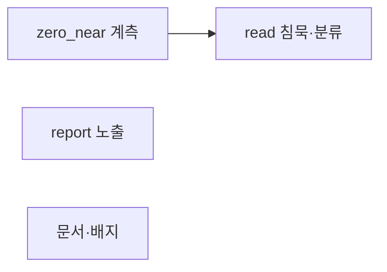

# flint v0.14.0 플랜 — 제로히트 침묵 계약·zero_near 판별 계측

**Spec:** docs/plans/2026-11-04-flint-v0140.spec.md
**Detail:** tests · **Target-min:** 9 · 언어 Go, 테스트 `go test ./...`

**전역 제약(스펙 §4):** exit 0/1/2/3 · 한 줄 JSON · 스키마 v5 불변
(meta 키값 additive만) · 기존 테스트 함수 수정 금지(예외: T2의
TestReadZeroHitSuggests 재작성 — 룰링) · TDD red→green→commit ·
`make ci` 통과 · 병렬 태스크 파일 비공유.

**스펙 매핑:** §1 배경·§2 목표·§3 요구사항 총칭 = 공통 전제. R1 제로히트 침묵 계약→T2 · R2 zero_near 판별 계측→T1+T2 · R3 report 노출·문서 정합→T3+T4.

**Ruling(코디네이터):**
- Ruling: TestReadZeroHitSuggests(v0.10.0) 재작성 허용 - 제안 라인 폐지 계약 변경의 본질적 동반 - 무출력 단얱으로 전환, 파일 내 다른 테스트 함수는 불변.

## 구조

파일: `lib/cli/metrics.go`·`lib/cli/metrics_v0140_test.go`(T1) ·
`lib/cli/read.go`·`lib/cli/read_v0100_test.go`·`lib/cli/read_v0140_test.go`(T2) ·
`lib/cli/report.go`·`lib/cli/report_v0140_test.go`(T3) ·
`README.md`·`README.ko.md`·`docs/PLAN.md`·`docs/TUNING.md`·`docs/v0140_docs_test.go`(T4).

## 태스크 그래프

T2는 T1의 BumpZeroNear만 소비(실행 의존). T3·T4 독립.

```mermaid
%% schedule
gantt
  title Predicted schedule (mm:ss)
  dateFormat X
  axisFormat %M:%S
  section lane 1
  T1 R2 계측 원시체 — read_stats에 zero_near :t1, 0, 102s
  T2 R1+R2 read 와이어링 — 침묵 계약·zero_near 분류 :t2, 102, 102s
  section lane 2
  T3 R3 report — zero_near_pct :t3, 0, 102s
  section lane 3
  T4 R3 문서 정합 — 침묵 계약·v0.14.0 :t4, 0, 102s
```





critical path: T1 → T2 (3.4 min) · peak width 3 · predicted build 3.4 min · predicted total ≈ 6.9 min

## lib/cli — zero_near 계측 원시체 (T1)

앱 유형: CLI 계측 라이브러리. 카테고리: state·numeric.
위험: read_stats 기존 calls/zero 파손.
**Probe entry:** run=go test ./lib/cli -run TestZeroNear

### T1 R2 계측 원시체 — read_stats에 zero_near
**Owns:** lib/cli/metrics.go, lib/cli/metrics_v0140_test.go
**Components:** 1 · **LOC owned:** 25 · **Tests:** fast · **Model:** sonnet
**Produces:** readStatsJSON에 ZeroNear int `json:"zero_near"` 필드 추가 · BumpZeroNear(getKV func(string) (string, error), setKV func(string, string) error) error — read_stats 읽어 zero_near만 1 증분 후 재기록(파손·부재는 0에서 재기작, BumpReadStats 패턴)
e.g. BumpZeroNear 1회 후 read_stats -> {"calls":0,"zero":0,"zero_near":1}
e.g. {"calls":5,"zero":2,"zero_near":1}에서 BumpZeroNear -> {"calls":5,"zero":2,"zero_near":2}
**Review Focus:** `TestBumpZeroNear`(신규 키 생성·기존 필드 보존);
기존 metrics 테스트 전수 통과.
**Test code (verbatim):**
```go
package cli

import (
	"strings"
	"testing"
)

func TestBumpZeroNear(t *testing.T) {
	kv := map[string]string{}
	get := func(k string) (string, error) { return kv[k], nil }
	set := func(k, v string) error { kv[k] = v; return nil }
	if err := BumpZeroNear(get, set); err != nil {
		t.Fatal(err)
	}
	if v := kv["read_stats"]; !strings.Contains(v, `"zero_near":1`) {
		t.Errorf("zero_near 미증분: %s", v)
	}
	kv["read_stats"] = `{"calls":5,"zero":2,"zero_near":1}`
	if err := BumpZeroNear(get, set); err != nil {
		t.Fatal(err)
	}
	v := kv["read_stats"]
	for _, want := range []string{`"calls":5`, `"zero":2`, `"zero_near":2`} {
		if !strings.Contains(v, want) {
			t.Errorf("기존 필드 보존 실패(%s): %s", want, v)
		}
	}
}
```
**Steps:** 1 신규 테스트(RED) 2 readStatsJSON 필드·BumpZeroNear
   구현 3 `go test ./lib/cli -run 'TestBumpZeroNear|TestBumpReadStats|TestLoadReadStats' -count=1` PASS 4 commit
**Notes:** 오류는 반환(와이어링 T2가 조용히 폐기 — §13).

## lib/cli — read 침묵·내부 분류 (T2)

앱 유형: CLI 조회 경로. 카테고리: state.
위험: 히트 경로 오염·제안 라인 잔존.
**Probe entry:** run=bin/flint read 존재하지않는주제

### T2 R1+R2 read 와이어링 — 침묵 계약·zero_near 분류
**Owns:** lib/cli/read.go, lib/cli/read_v0100_test.go, lib/cli/read_v0140_test.go
**Components:** 1 · **LOC owned:** 40 · **Tests:** fast · **Model:** sonnet
**Consumes:** BumpZeroNear(getKV func(string) (string, error), setKV func(string, string) error) error (T1)
**Produces:** suggestLine 타입·출력 블록·sanitize 루프 제거(제로히트 완전 무출력) · bumpZeroNearToMeta(ctx context.Context, st Store) — getKV/setKV 클로저(bumpReadStatsToMeta 패턴)로 BumpZeroNear 호출, 제로히트·eligible 경로에서 내부 스캔 후보 1건 이상 시 1회. suggestions 변수는 계산 후 출력 없이 분류만
e.g. 제로히트·스캔 후보 3건 -> 출력 ""·read_stats zero_near 1 증분
e.g. 제로히트·스캔 후보 0건 -> 출력 ""·미증분
**Review Focus:** `TestReadZeroHitSilent`(무출력·exit 코드)·
`TestReadZeroHitNearCounted`(zero_near 증분)·`TestReadPhraseHitNoSuggest`
(불변 통과); 히트 경로·--status·--as-of 출력 바이트 불변.
**Test code (verbatim):**
```go
package cli

import (
	"context"
	"strings"
	"testing"
)

// v0.14.0 R1: 제로히트는 완전 침묵 — 제안 라인 폐지(룰링 재작성).
func TestReadZeroHitSuggests(t *testing.T) {
	var out strings.Builder
	code := runRead(context.Background(), mustSuggestStore(t, `{"calls":5,"zero":2}`, [][]any{}),
		[]string{"존재하지 않는 주제 아님 구문"}, strings.NewReader(""), &out)
	if code != 1 {
		t.Errorf("exit %d, want 1", code)
	}
	if got := out.String(); got != "" {
		t.Errorf("제로히트 출력 있음: %q", got)
	}
}

func TestReadZeroHitNearCounted(t *testing.T) {
	// mustSuggestStore: 제로히트 픽스처에서 제안 스캔 행(topic 1건)·
	// meta SELECT 응답·INSERT 캡처를 제공하는 헬퍼 — v0100 fake 스토어
	// 패턴 승계. 스캔 후보 1건 이면 zero_near 1 증분 단언.
	st, upserts := nearCountingStore(t, `{"calls":5,"zero":2}`)
	var out strings.Builder
	_ = runRead(context.Background(), st,
		[]string{"쿠버네티스 배포 정책 토큰"}, strings.NewReader(""), &out)
	joined := strings.Join(*upserts, ";")
	if !strings.Contains(joined, `"zero_near":1`) {
		t.Errorf("zero_near 미증분: %s", joined)
	}
}
```
(mustSuggestStore·nearCountingStore 헬퍼는 구현 시그니처에 맞춰
v0100 fakeStore 패턴으로 완성 — 리뷰 포커스 명세)
**Steps:** 1 신규 테스트+TestReadZeroHitSuggests 재작성(RED) 2
   suggestLine 타입·출력 블록·sanitize 루프 제거·bumpZeroNearToMeta
   구현·제로히트 eligible 블록에서 호출 3 `go test ./lib/cli -run
   'TestReadZeroHit|TestReadPhrase|TestRead' -count=1` PASS 4 commit
**Notes:** 제안 스캔(BuildSuggestScan·SuggestSimilar)은 제거하지
   않는다 — 분류 엔진으로 승계(suggestMinScore 0.15 재사용).
   `--` end-of-options·trailing 규약 불변.

## lib/cli — report 노출 (T3)

앱 유형: CLI 리포트. 카테고리: numeric.
위험: 기존 필드·순서 계약.
**Probe entry:** run=bin/flint report

### T3 R3 report — zero_near_pct
**Owns:** lib/cli/report.go, lib/cli/report_v0140_test.go
**Components:** 1 · **LOC owned:** 12 · **Tests:** fast · **Model:** sonnet
**Produces:** reportOutput 말미 ZeroNearPct int `json:"zero_near_pct"` 추가 · collectStats의 read_stats 익명 구조체에 ZeroNear int `json:"zero_near"` 확장 · 산출 zero_near*100/calls 버림(제로 분모 0, fallbackPct 패턴)
e.g. read_stats {"calls":10,"zero":4,"zero_near":3} -> {"zero_pct":40,"zero_near_pct":30}
**Review Focus:** `TestReportZeroNearPct`(30% 산출·출력 포함·기존
zero_pct 40 동시 단얱); 기존 report 테스트 전수 통과.
**Test code (verbatim):**
```go
package cli

import (
	"context"
	"strings"
	"testing"
)

func TestReportZeroNearPct(t *testing.T) {
	st := &fakeStore{queryFn: func(sql string, args []any) ([][]any, error) {
		switch {
		case strings.Contains(sql, "IN ('read_stats','hot_stats')"):
			return [][]any{{"read_stats", `{"calls":10,"zero":4,"zero_near":3}`}}, nil
		case strings.Contains(sql, "daily:"):
			return nil, nil
		case strings.Contains(sql, "count"):
			return [][]any{{"1", "2", "3"}}, nil
		}
		return nil, nil
	}}
	var out strings.Builder
	if code := runReport(context.Background(), st, nil, nil, &out); code != 0 {
		t.Fatalf("exit %d: %s", code, out.String())
	}
	s := out.String()
	for _, want := range []string{`"zero_pct":40`, `"zero_near_pct":30`} {
		if !strings.Contains(s, want) {
			t.Errorf("%s 누락: %s", want, s)
		}
	}
}
```
**Steps:** 1 신규 테스트(RED) 2 익명 구조체 확장·out 필드 말미 추가·
   산입 3 `go test ./lib/cli -run 'TestReport' -count=1` PASS 4 commit
**Notes:** 부재·파손 read_stats는 0(기존 폴백 승계). 신규 meta 조회 없음.

## docs — 문서·배지 (T4)

앱 유형: 문서+고정 테스트. 카테고리: file.
**Probe entry:** run=go test ./docs

### T4 R3 문서 정합 — 침묵 계약·v0.14.0
**Owns:** README.md, README.ko.md, docs/PLAN.md, docs/TUNING.md, docs/v0140_docs_test.go
**Components:** 1 · **LOC owned:** 20 · **Tests:** fast · **Model:** sonnet
**Produces:** README EN 152·KO 157 read 제안 문단 → 침묵 계약 서술(무출력·exit 1·zero_near 내부 계측) 갱신 · TUNING zero_near 소절(임계 0.15 재사용·zero_pct−zero_near_pct=부재 비율 해석) · PLAN §14 v0.14.0 마일스톤 · 배지 release-v0.14.0(EN/KO)
**Review Focus:** `TestPlanRecordsV0140`·`TestTuningRecordsZeroNear`·
`TestBadgeIsV0140`·`TestReadmeSilenceContract`; 기존 배지 Latest 테스트
통과(다음 예정 버전 허용 승계).
**Test code (verbatim):**
```go
package docs

import (
	"os"
	"strings"
	"testing"
)

func docStrV0140(t *testing.T, path string) string {
	t.Helper()
	b, err := os.ReadFile(path)
	if err != nil {
		t.Fatal(err)
	}
	return string(b)
}

func TestPlanRecordsV0140(t *testing.T) {
	if !strings.Contains(docStrV0140(t, "PLAN.md"), "v0.14.0") {
		t.Error("PLAN.md v0.14.0 마일스톤 누락")
	}
}

func TestTuningRecordsZeroNear(t *testing.T) {
	s := docStrV0140(t, "TUNING.md")
	if !strings.Contains(s, "zero_near") {
		t.Error("TUNING.md zero_near 미기록")
	}
}

func TestBadgeIsV0140(t *testing.T) {
	for _, p := range []string{"../README.md", "../README.ko.md"} {
		if !strings.Contains(docStrV0140(t, p), "release-v0.14.0") {
			t.Errorf("%s 배지 v0.14.0 미갱신", p)
		}
	}
}

func TestReadmeSilenceContract(t *testing.T) {
	for _, p := range []string{"../README.md", "../README.ko.md"} {
		if strings.Contains(docStrV0140(t, p), "still hits nothing") ||
			strings.Contains(docStrV0140(t, p), "근접 후보 제안") {
			t.Errorf("%s 제안 문단 잔존", p)
		}
	}
}
```
**Steps:** 1 신규 테스트(RED) 2 README 문단·TUNING·PLAN·배지 갱신 3
   `go test ./docs -count=1` PASS 4 commit
**Notes:** v0.10.0 릴리스 노트(EN 45·KO 49)는 역사 기록이라 수정
   불필요(현행 동작 서술만 갱신). SKILL.md는 제안 미언급 — 불변.

## Review Focus 요약

| 패키지 | 유형 | 카테고리 | 리스크 |
|---|---|---|---|
| lib/cli(metrics) | 계측 원시체 | state·numeric | calls/zero 파손 |
| lib/cli(read) | 조회 경로 | state | 히트 경로 오염·잔존 출력 |
| lib/cli(report) | 리포트 | numeric | 필드 순서 계약 |
| docs | 문서 | file | 기존 절 훼손 |
