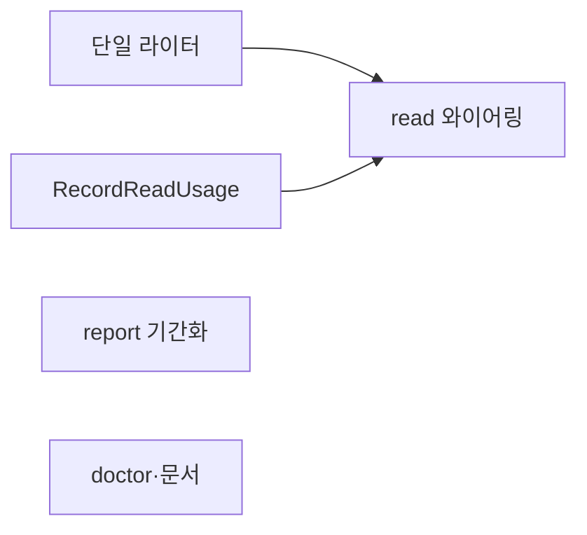

# flint v0.15.0 플랜 — 우아함 축(핫패스 단일화·지표 기간화·진단 폐쇄)

**Spec:** docs/plans/2026-11-05-flint-v0150.spec.md
**Detail:** tests · **Target-min:** 9 · 언어 Go, 테스트 `go test ./...`

**전역 제약(스펙 §4):** exit 0/1/2/3(현행 승계) · 한 줄 JSON · 스키마 v5
불변(daily 키·meta additive만) · 기존 테스트 함수 수정 금지(예외:
스펙 §4 룰링 3건) · TDD red→green→commit · `make ci` 통과 · 병렬
태스크 파일 비공유.

**스펙 매핑:** §1 배경·§2 목표·§3 요구사항 총칭 = 공통 전제. R1 핫패스 계측 단일화→T1+T2 · R2 zero 지표 기간화→T3+T4 · R3 doctor zero_near 검사→T5 · R4 계약 문서화→T5.

## 구조

파일: `lib/cli/metrics.go`·`lib/cli/metrics_v0150_test.go`(T1) ·
`lib/cli/read.go`·`lib/cli/read_v0150_test.go`(T2) ·
`lib/db/usage.go`·`lib/db/usage_v0150_test.go`(T3) ·
`lib/cli/report.go`·`lib/cli/report_v0150_test.go`(T4) ·
`lib/cli/doctor.go`·`README.md`·`README.ko.md`·`docs/PLAN.md`·
`docs/TUNING.md`·`lib/cli/doctor_v0150_test.go`·`docs/v0150_docs_test.go`(T5).

## 태스크 그래프

T2는 T1(시그니처)·T3(RecordReadUsage) 소비. T4·T5는 픽스처 기반(코드 의존 없음).

```mermaid
%% schedule
gantt
  title Predicted schedule (mm:ss)
  dateFormat X
  axisFormat %M:%S
  section lane 1
  T5 R3+R4 doctor zero-near·exit 표·배지 :t5, 0, 127s
  section lane 2
  T1 R1 계측 원시체 — BumpReadStats 통합 :t1, 0, 102s
  T2 R1+R2 read 와이어링 — 분류 일괄 전달·왕복 예산 :t2, 102, 102s
  section lane 3
  T3 R2 계측 확장 — daily zero 키·병합 upsert :t3, 0, 102s
  section lane 4
  T4 R2 report — zero 지표 기간 합산 :t4, 0, 102s
```





critical path: T1 → T2 (3.4 min) · peak width 4 · predicted build 3.4 min · predicted total ≈ 6.9 min

## lib/cli — 단일 라이터 (T1)

앱 유형: CLI 계측 라이브러리. 카테고리: state·numeric.
위험: 기존 calls/zero 보존·와이프 회귀.
**Probe entry:** run=go test ./lib/cli -run TestBumpReadStats

### T1 R1 계측 원시체 — BumpReadStats 통합
**Owns:** lib/cli/metrics.go, lib/cli/metrics_v0150_test.go
**Components:** 1 · **LOC owned:** 40 · **Tests:** fast · **Model:** sonnet
**Produces:** BumpReadStats(zeroHits bool, zeroNear bool, getKV func(string) (string, error), setKV func(string, string) error) error — read_stats 단일 읽기-수정-쓰기로 Calls/Zero/ZeroNear 전부 갱신(loadReadStatsJSON 재사용·getKV 전송 오류 시 미기록 불변) · BumpZeroNear 함수 제거(관련 테스트는 스펙 §4 룰링으로 승계 재작성)
e.g. BumpReadStats(true,true) 1회(빈 meta) -> {"calls":1,"zero":1,"zero_near":1}
e.g. BumpReadStats(false,false) 1회 -> {"calls":1,"zero":0,"zero_near":0}(omitempty로 zero_near 키 생략)
e.g. {"calls":5,"zero":2,"zero_near":1}에서 (false,false) -> {"calls":6,"zero":2,"zero_near":1}
**Review Focus:** `TestBumpReadStatsUnified`(3케이스·보존); 기존 metrics
테스트 전수 통과(룰링 갱신분 포함). getKV 오류 시 setKV 미호출 회귀 유지.
**Test code (verbatim):**
```go
package cli

import (
	"strings"
	"testing"
)

func TestBumpReadStatsUnified(t *testing.T) {
	kv := map[string]string{}
	get := func(k string) (string, error) { return kv[k], nil }
	set := func(k, v string) error { kv[k] = v; return nil }
	if err := BumpReadStats(true, true, get, set); err != nil {
		t.Fatal(err)
	}
	if v := kv["read_stats"]; !strings.Contains(v, `"calls":1`) || !strings.Contains(v, `"zero":1`) || !strings.Contains(v, `"zero_near":1`) {
		t.Errorf("제로히트+근접: %s", v)
	}
	kv["read_stats"] = `{"calls":5,"zero":2,"zero_near":1}`
	if err := BumpReadStats(false, false, get, set); err != nil {
		t.Fatal(err)
	}
	v := kv["read_stats"]
	for _, want := range []string{`"calls":6`, `"zero":2`, `"zero_near":1`} {
		if !strings.Contains(v, want) {
			t.Errorf("보존 실패(%s): %s", want, v)
		}
	}
}
```
**Steps:** 1 신규 테스트+기존 BumpReadStats 호출부 인자 갱신(룰링, RED)
   2 시그니처 확장·BumpZeroNear 제거·관련 테스트 승계 정리 3
   `go test ./lib/cli -run 'TestBump' -count=1` PASS 4 commit
**Notes:** loadReadStatsJSON·metaKV 헬퍼(v0.14.0 fix) 재사용. 와이프
   방지·omitempty 계약 불변.

## lib/db — RecordReadUsage (T3)

앱 유형: DB 계층. 카테고리: state.
위험: daily RMW 경합·doltgres 호환.
**Probe entry:** run=go test ./lib/db -run TestRecordReadUsage

### T3 R2 계측 확장 — daily zero 키·병합 upsert
**Owns:** lib/db/usage.go, lib/db/usage_v0150_test.go
**Components:** 1 · **LOC owned:** 45 · **Tests:** slow · **Model:** sonnet
**Produces:** (r *Repo) RecordReadUsage(ctx context.Context, zero bool, near bool) error — delta {read:1, zero 시 read_zero:1, near 시 read_zero_near:1}·last_read_at upsert·PruneDaily 트리거(RecordUsageCount 내부 공유 경로로 재사용, 중복 제거) · last_read_at 행과 daily 행의 쓰기를 단일 2행 `INSERT INTO meta (key,value) VALUES ($1,$2),($3,$4) ON CONFLICT (key) DO UPDATE SET value=excluded.value`로 병합(계측 왕복 1 절감)
e.g. RecordReadUsage(ctx,true,true) 후 daily:오늘 -> {"read":1,"read_zero":1,"read_zero_near":1,...}·last_read_at 갱신
e.g. RecordReadUsage(ctx,false,false) 후 -> read만 +1
**Review Focus:** `TestRecordReadUsageDaily`(2케이스 — FLINT_TEST_DSN
slow 패턴 승계); 기존 RecordUsage 테스트 불변.
**Test code (verbatim):**
```go
package db

import (
	"context"
	"encoding/json"
	"strings"
	"testing"
	"time"
)

func TestRecordReadUsageDaily(t *testing.T) {
	if testing.Short() {
		t.Skip("slow")
	}
	pool := testPool(t) // 기존 slow 스위트 패턴 승계 — 미존재 시 인시던트
	r := NewRepo(pool)
	ctx := context.Background()
	day := time.Now().UTC().Format("2006-01-02")
	pool.Exec(ctx, `DELETE FROM meta WHERE key IN ($1,'last_read_at')`, "daily:"+day)
	if err := r.RecordReadUsage(ctx, true, true); err != nil {
		t.Fatal(err)
	}
	var v string
	if err := pool.QueryRow(ctx, `SELECT value FROM meta WHERE key=$1`, "daily:"+day).Scan(&v); err != nil {
		t.Fatal(err)
	}
	for _, want := range []string{`"read":1`, `"read_zero":1`, `"read_zero_near":1`} {
		if !strings.Contains(v, want) {
			t.Errorf("%s 누락: %s", want, v)
		}
	}
	if err := r.RecordReadUsage(ctx, false, false); err != nil {
		t.Fatal(err)
	}
	pool.QueryRow(ctx, `SELECT value FROM meta WHERE key=$1`, "daily:"+day).Scan(&v)
	var d map[string]int
	json.Unmarshal([]byte(v), &d)
	if d["read"] != 2 || d["read_zero"] != 1 {
		t.Errorf("증분 부정합: %s", v)
	}
}
```
**Steps:** 1 slow 테스트(RED) 2 RecordReadUsage·병합 upsert 구현 3
   `go test ./lib/db -run 'TestRecordReadUsage|TestRecordUsage' -count=1` PASS 4 commit
**Notes:** RecordUsage(ctx,"read","") 경유가 아니라 내부 공유 — lib/cli
   instrumentReads 인터페이스는 T2가 연결.

## lib/cli — read 와이어링 (T2)

앱 유형: CLI 조회 경로. 카테고리: state·numeric.
위험: 계측 누락·왕복 예산 초과.
**Probe entry:** run=bin/flint read 백업

### T2 R1+R2 read 와이어링 — 분류 일괄 전달·왕복 예산
**Owns:** lib/cli/read.go, lib/cli/read_v0150_test.go
**Components:** 1 · **LOC owned:** 35 · **Tests:** fast · **Model:** sonnet
**Consumes:** BumpReadStats(zeroHits bool, zeroNear bool, getKV func(string) (string, error), setKV func(string, string) error) error (T1) · RecordReadUsage(ctx context.Context, zero bool, near bool) error (T3)
**Produces:** bumpReadStatsToMeta(ctx, st, zeroHits, zeroNear) 시그니처 확장(단일 호출로 통합 — bumpZeroNearToMeta 제거) · instrumentReads(ctx, st, kind, ids, zero, near) — read kind일 때 RecordReadUsage 인터페이스로 전달(비read kind는 기존 RecordUsage 경로 불변) · 제로히트 순서 회피 주석 제거
e.g. eligible 히트 read -> 계측 쿼리 ≤ 5(본 쿼리 제외) — fake store 카운트 단얱
e.g. 제로히트·근접 read -> read_stats 1회 쓰기에 calls/zero/zero_near 반영 + daily 3키
**Review Focus:** `TestReadInstrumentationQueryBudget`(계측 왕복 ≤ 5)
·`TestReadClassifiesZeroNear`(제로히트+근접 -> 단일 read_stats 쓰기에
zero_near 반영); 기존 read 테스트 전수 통과(룰링 갱신분 포함).
**Test code (verbatim):**
```go
package cli

import (
	"context"
	"strings"
	"testing"
)

func TestReadInstrumentationQueryBudget(t *testing.T) {
	count := 0
	st := &fakeStore{queryFn: func(sql string, args []any) ([][]any, error) {
		count++
		switch {
		case strings.Contains(sql, "FROM active_knowledge"):
			return [][]any{{"1", "백업 정책", "매일", ":b:", "", "", "0.9", "active", "0"}}, nil
		case strings.Contains(sql, "read_stats"):
			return [][]any{{`{"calls":5,"zero":2}`}}, nil
		case strings.Contains(sql, "daily:"):
			return nil, nil
		case strings.Contains(sql, "INSERT INTO meta") || strings.Contains(sql, "UPDATE"):
			return nil, nil
		}
		return nil, nil
	}}
	var out strings.Builder
	if code := runRead(context.Background(), st, []string{"백업 정책"}, strings.NewReader(""), &out); code != 0 {
		t.Fatalf("exit %d: %s", code, out.String())
	}
	if count > 6 { // 본 쿼리 1 + 계측 ≤ 5
		t.Errorf("쿼리 왕복 %d회, 본 쿼리 포함 ≤ 6 초과", count)
	}
}
```
**Steps:** 1 왕복 예산 테스트(RED — 현재 8+로 실패) 2 와이어링 통합
   구현 3 `go test ./lib/cli -run 'TestRead|TestBump' -count=1` PASS 4 commit
**Notes:** 임계 6(본 쿼리 포함)은 스펙 R1 "계측 ≤ 5"와 동치. RecordReadUsage
   미구현 Store(fake)는 기존 RecordUsage 경로 폴백 허용(계약 유지).

## lib/cli — report 기간화 (T4)

앱 유형: CLI 리포트. 카테고리: numeric.
위험: 기존 zero_pct 해석 전환.
**Probe entry:** run=bin/flint report

### T4 R2 report — zero 지표 기간 합산
**Owns:** lib/cli/report.go, lib/cli/report_v0150_test.go
**Components:** 1 · **LOC owned:** 30 · **Tests:** fast · **Model:** sonnet
**Produces:** reportDay에 ReadZero int `json:"read_zero"`·ReadNear int `json:"read_zero_near"` 필드 추가 · zero_pct·zero_near_pct 산출을 --days 창 일별 합산(Σread_zero·Σread_near / Σread, 버림 정수%, 제로 분모 0)으로 전환 — 누적 read_stats 의존 제거(status 소비 불별)
e.g. daily 2일 {read:10,read_zero:4,read_zero_near:3}+{read:10,read_zero:0,read_zero_near:0} -> zero_pct 20·zero_near_pct 15
**Review Focus:** `TestReportZeroWindowed`(합산 산출·픽스처 daily 행);
기존 report 테스트 룰링 갱신(픽스처 daily 행 추가) 후 전수 통과.
**Test code (verbatim):**
```go
package cli

import (
	"context"
	"strings"
	"testing"
)

func TestReportZeroWindowed(t *testing.T) {
	st := &fakeStore{queryFn: func(sql string, args []any) ([][]any, error) {
		switch {
		case strings.Contains(sql, "daily:"):
			return [][]any{{"daily:2001-01-01", `{"read":10,"read_zero":4,"read_zero_near":3}`}}, nil
		case strings.Contains(sql, "IN ('read_stats','hot_stats')"):
			return [][]any{{"read_stats", `{"calls":999,"zero":999}`}}, nil
		case strings.Contains(sql, "count"):
			return [][]any{{"1", "2", "3"}}, nil
		}
		return nil, nil
	}}
	var out strings.Builder
	if code := runReport(context.Background(), st, []string{"--days", "1"}, nil, &out); code != 0 {
		t.Fatalf("exit %d: %s", code, out.String())
	}
	s := out.String()
	for _, want := range []string{`"zero_pct":40`, `"zero_near_pct":30`} {
		if !strings.Contains(s, want) {
			t.Errorf("%s 누락(누적 999 오염 무시되어야): %s", want, s)
		}
	}
}
```
**Steps:** 1 기간화 테스트(RED — 누적값 999로 산출돼 실패) 2 필드·산출
   전환·기존 테스트 픽스처 갱신(룰링) 3 `go test ./lib/cli -run 'TestReport' -count=1` PASS 4 commit
**Notes:** zero_near_pct 30 = 3/10. daily 키 부재(구버전 데이터)는 0
   합산 — 창 내 데이터 없으면 0/0 가드로 0.

## lib/cli+docs — doctor 검사·계약 문서 (T5)

앱 유형: CLI 진단+문서. 카테고리: state·file.
위험: 검사 순서 회귀·문서 훼손.
**Probe entry:** run=bin/flint doctor

### T5 R3+R4 doctor zero-near·exit 표·배지
**Owns:** lib/cli/doctor.go, lib/cli/doctor_v0150_test.go, README.md, README.ko.md, docs/PLAN.md, docs/TUNING.md, docs/v0150_docs_test.go
**Components:** 2 · **LOC owned:** 50 · **Tests:** fast · **Model:** sonnet
**Produces:** checkZeroNear(ctx, st) doctorCheck — 최근 7일 daily 합산(직접 meta daily: 조회, ConflictGroups seam 패턴) read ≥ 10 && read_zero_near*100/read ≥ 30 -> warn("zero_near_pct N% — 어휘 불일치 의심·검색 품질 개선 여지"), 아니면 ok, 조회 실패 warn. 실행 체인 말미 등록 · README exit 표(0/1/2/3 — 스펙 R4 문안) EN/KO · TUNING 기간화 지표·임계(표본 10·30%)·왕복 계약 소절 · PLAN §14 v0.15.0 · 배지 release-v0.15.0(EN/KO)
e.g. 7일 {read:20, read_zero_near:8} -> {warn, "zero_near 40%..."}
e.g. 7일 {read:5, read_zero_near:3} -> ok(표본 부족)
**Review Focus:** `TestZeroNearWarn`·`TestZeroNearSampleFloorOk`·
`TestDoctorOrderUnchanged`; docs 테스트 4종(exit 표 문자열·TUNING 임계·
PLAN v0.15.0·배지). 기존 doctor·배지 Latest 테스트 통과.
**Test code (verbatim):**
```go
package cli

import (
	"context"
	"strings"
	"testing"
)

func TestZeroNearWarn(t *testing.T) {
	c := checkZeroNear(context.Background(), &fakeStore{queryFn: func(sql string, args []any) ([][]any, error) {
		if strings.Contains(sql, "daily:") {
			return [][]any{{"daily:2001-01-01", `{"read":20,"read_zero_near":8}`}}, nil
		}
		return nil, nil
	}})
	if c.Status != "warn" {
		t.Errorf("40%% = %s, want warn", c.Status)
	}
}

func TestZeroNearSampleFloorOk(t *testing.T) {
	c := checkZeroNear(context.Background(), &fakeStore{queryFn: func(sql string, args []any) ([][]any, error) {
		if strings.Contains(sql, "daily:") {
			return [][]any{{"daily:2001-01-01", `{"read":5,"read_zero_near":3}`}}, nil
		}
		return nil, nil
	}})
	if c.Status != "ok" {
		t.Errorf("표본 5 = %s, want ok", c.Status)
	}
}
```
(docs 테스트는 TestPlanRecordsV0150·TestTuningRecordsWindowed(문자열
"read_zero_near"·"30")·TestBadgeIsV0150·TestReadmeExitTable(EN/KO에
"exit 3"·read 인자 문구 포함) — 구현 시 완성, 리뷰 포커스 명세)
**Steps:** 1 doctor 2테스트+docs 4테스트(RED) 2 checkZeroNear·체인 말미
   등록·문서 5종 갱신 3 `go test ./lib/cli -run 'TestZeroNear|TestDoctor' -count=1`·`go test ./docs -count=1` PASS 4 commit
**Notes:** 창 계산은 SQL substring 날짜 비교(PruneDaily 패턴)로 7일
   컷. fail 아님.

## Review Focus 요약

| 패키지 | 유형 | 카테고리 | 리스크 |
|---|---|---|---|
| lib/cli(metrics) | 계측 원시체 | state·numeric | 보존 회귀 |
| lib/db | 계층 | state | daily 경합·doltgres |
| lib/cli(read) | 조회 경로 | state·numeric | 왕복 예산·누락 |
| lib/cli(report) | 리포트 | numeric | 해석 전환 |
| lib/cli(doctor)+docs | 진단·문서 | state·file | 순서·훼손 |
