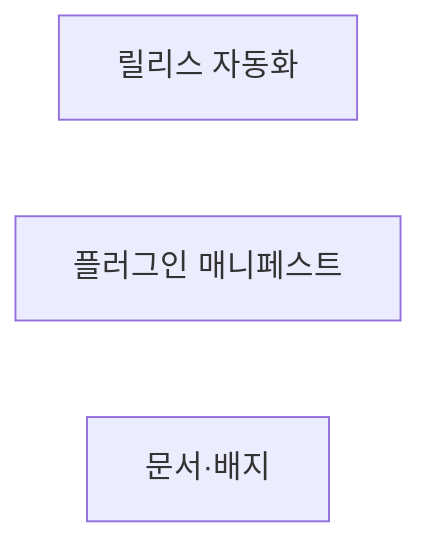

# flint v0.16.0 플랜 — 릴리스 자동화·플러그인 배포

**Spec:** docs/plans/2026-11-05-flint-v0160.spec.md
**Detail:** tests · **Target-min:** 9 · 언어 Go, 테스트 `go test ./...`

**전역 제약(스펙 §4):** exit 0/1/2/3 · 한 줄 JSON · 스키마 v5 불변 · 기존
테스트 함수 수정 금지 · TDD red→green→commit · `make ci` 통과 · 병렬
태스크 파일 비공유.

**스펙 매핑:** §1 배경·§2 목표 = 공통 전제. R1 릴리스 자동화→T1 · R2 플러그인 매니페스트→T2 · R3 문서·검증→T3.

## 구조

파일: `.github/workflows/ci.yml`·`.goreleaser.yml`(T1) ·
`flint-plugin/.claude-plugin/plugin.json`·`.claude-plugin/marketplace.json`·
`lib/../scripts/validate_yaml.py`·`flint-plugin/plugin_v0160_test.go`(T2) ·
`README.md`·`README.ko.md`·`docs/PLAN.md`·`docs/v0160_docs_test.go`(T3).

## 태스크 그래프

병렬 3태스크 — 실행 의존 없음.

```mermaid
%% schedule
gantt
  title Predicted schedule (mm:ss)
  dateFormat X
  axisFormat %M:%S
  section lane 1
  T1 R1 태그 push → 자동 Release :t1, 0, 102s
  section lane 2
  T2 R2 매니페스트 2종·동기 테스트 :t2, 0, 102s
  section lane 3
  T3 R3 설치 문서·배지 v0.16.0 :t3, 0, 102s
```





critical path: T1 (1.7 min) · peak width 3 · predicted build 1.7 min · predicted total ≈ 5.2 min

## CI/릴리스 — 릴리스 자동화 (T1)

앱 유형: 워크플로+goreleaser. 카테고리: file.
위험: 토큰 권한·아카이브 문법.
**Probe entry:** run=python3 scripts/validate_yaml.py

### T1 R1 태그 push → 자동 Release
**Owns:** .github/workflows/ci.yml, .goreleaser.yml
**Components:** 1 · **LOC owned:** 45 · **Tests:** fast · **Model:** sonnet
**Produces:** release 잡(release-notice 대체) — `if: startsWith(github.ref,'refs/tags/v')`, `permissions: contents: write`, goreleaser/goreleaser-action@v6(version: latest, args: release --clean), 릴리스 링크 echo 스텝 · .goreleaser.yml에 files 전용 아카이브(flint_plugin_{{.Version}}.zip — flint-plugin/ 일괄) 추가, 기존 바이너리 아카이브·checksums 불변
e.g. 태그 v0.16.0 push -> Release v0.16.0 자동 생성(바이너리 2종·checksums·flint_plugin_0.16.0.zip)
**Review Focus:** validate_yaml 그린 · 로컬 `goreleaser release --snapshot --clean` 성공(goreleaser 미설치 시 문법 검증만+인시던트) · test 잡 미변경.
**Test code (verbatim):** (워크플로 — 검증은 validate_yaml+snapshot 실행. 신규 go 테스트 없음)
**Steps:** 1 .goreleaser.yml 플러그인 아카이브 추가 2 ci.yml release 잡 전환 3 `python3 scripts/validate_yaml.py` 그린 4 `goreleaser release --snapshot --clean` 검증(가능 시) 5 commit
**Notes:** 기존 release-notice의 "다음 버전 계산" 로직은 제거(자동화로 무의미). 안내 철학 전환은 스펙 §4 기록.

## 플러그인 — 매니페스트·검증 (T2)

앱 유형: JSON 매니페스트+테스트. 카테고리: file.
위험: 스키마 부정합·버전 동기.
**Probe entry:** run=go test ./flint-plugin

### T2 R2 매니페스트 2종·동기 테스트
**Owns:** flint-plugin/.claude-plugin/plugin.json, .claude-plugin/marketplace.json, flint-plugin/plugin_v0160_test.go, scripts/validate_yaml.py
**Components:** 1 · **LOC owned:** 70 · **Tests:** fast · **Model:** sonnet
**Produces:** flint-plugin/.claude-plugin/plugin.json — {"name":"flint","version":"0.16.0","description":"flint 장기기억 — 세션 훅·스킬·명령","repository":"https://github.com/synuns/flint"} · 루트 .claude-plugin/marketplace.json — {"name":"flint","owner":{"name":"synuns"},"plugins":[{"name":"flint","source":"./flint-plugin","description":"flint 장기기억 플러그인"}]} · validate_yaml.py 검사 확장(2종 파싱·source/plugins/name 존재) · 테스트 2종
e.g. plugin.json version == "0.16.0" == README 배지 · marketplace plugins[0].source == "./flint-plugin"
**Review Focus:** `TestPluginManifestSync`(plugin.json version와 README
배지 release-v 일치)·`TestMarketplaceStructure`(name·owner·plugins[
0].source 단얱); 기존 flint-plugin 테스트 전수 통과.
**Test code (verbatim):**
```go
package main

import (
	"encoding/json"
	"os"
	"strings"
	"testing"
)

func readV0160(t *testing.T, path string) map[string]any {
	t.Helper()
	b, err := os.ReadFile(path)
	if err != nil {
		t.Fatal(err)
	}
	var m map[string]any
	if err := json.Unmarshal(b, &m); err != nil {
		t.Fatalf("%s 파싱: %v", path, err)
	}
	return m
}

func TestPluginManifestSync(t *testing.T) {
	p := readV0160(t, ".claude-plugin/plugin.json")
	v, _ := p["version"].(string)
	if !strings.HasPrefix(v, "0.16.0") {
		t.Errorf("plugin.json version=%q, want 0.16.0 계열(배지 동기)", v)
	}
	if p["name"] != "flint" {
		t.Errorf("plugin.json name=%v, want flint", p["name"])
	}
}

func TestMarketplaceStructure(t *testing.T) {
	m := readV0160(t, "../.claude-plugin/marketplace.json")
	if m["name"] != "flint" {
		t.Errorf("marketplace name=%v, want flint", m["name"])
	}
	plugs, _ := m["plugins"].([]any)
	if len(plugs) != 1 {
		t.Fatalf("plugins %d건, want 1", len(plugs))
	}
	e, _ := plugs[0].(map[string]any)
	if e["source"] != "./flint-plugin" || e["name"] != "flint" {
		t.Errorf("plugins[0]=%v (source ./flint-plugin·name flint)", e)
	}
}
```
**Steps:** 1 테스트(RED) 2 매니페스트 2종 작성 3 validate_yaml 확장 4
   `go test ./flint-plugin -count=1`·`python3 scripts/validate_yaml.py` PASS 5 commit
**Notes:** hooks.json·skills·commands 무변경(자동 인식). hooks는 PATH 기반
   `flint` 호출 — 바이너리 선행 설치는 README(T3)에 명시.

## docs — 문서·배지 (T3)

앱 유형: 문서+고정 테스트. 카테고리: file.
**Probe entry:** run=go test ./docs

### T3 R3 설치 문서·배지 v0.16.0
**Owns:** README.md, README.ko.md, docs/PLAN.md, docs/v0160_docs_test.go
**Components:** 1 · **LOC owned:** 30 · **Tests:** fast · **Model:** sonnet
**Produces:** README EN/KO 설치 섹션 갱신 — ①릴리스에서 바이너리 다운로드(goreleaser 자동 Release) ②`/plugin marketplace add synuns/flint` → `/plugin install flint@flint` ③기존 수동 설치(setup) 병기 · 배지 release-v0.16.0(EN/KO) · PLAN §14 v0.16.0
**Review Focus:** `TestPlanRecordsV0160`·`TestBadgeIsV0160`·
`TestReadmePluginInstall`(EN/KO에 "marketplace add synuns/flint" 포함);
기존 배지 Latest 테스트 통과.
**Test code (verbatim):**
```go
package docs

import (
	"os"
	"strings"
	"testing"
)

func docStrV0160(t *testing.T, path string) string {
	t.Helper()
	b, err := os.ReadFile(path)
	if err != nil {
		t.Fatal(err)
	}
	return string(b)
}

func TestPlanRecordsV0160(t *testing.T) {
	if !strings.Contains(docStrV0160(t, "PLAN.md"), "v0.16.0") {
		t.Error("PLAN.md v0.16.0 마일스톤 누락")
	}
}

func TestBadgeIsV0160(t *testing.T) {
	for _, p := range []string{"../README.md", "../README.ko.md"} {
		if !strings.Contains(docStrV0160(t, p), "release-v0.16.0") {
			t.Errorf("%s 배지 v0.16.0 미갱신", p)
		}
	}
}

func TestReadmePluginInstall(t *testing.T) {
	for _, p := range []string{"../README.md", "../README.ko.md"} {
		if !strings.Contains(docStrV0160(t, p), "marketplace add synuns/flint") {
			t.Errorf("%s 플러그인 설치 안내 누락", p)
		}
	}
}
```
**Steps:** 1 테스트(RED) 2 README 설치 섹션·배지·PLAN 갱신(v0152 배지
   테스트 삭제 — 선례) 3 `go test ./docs -count=1` PASS 4 commit
**Notes:** 문구는 현지화(KO 자연어·EN 간결)·설치 섹션 위치는 기존 설치
   안내 인접.

## Review Focus 요약

| 패키지 | 유형 | 카테고리 | 리스크 |
|---|---|---|---|
| ci/goreleaser | 워크플로 | file | 토큰·아카이브 문법 |
| flint-plugin | 매니페스트 | file | 스키마·동기 |
| docs | 문서 | file | 기존 절 훼손 |
