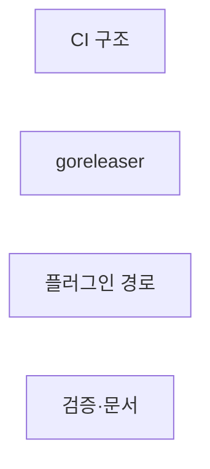

# flint v0.16.1 플랜 — 패치(CI 리뷰 10건·플러그인 배포 결함)

**Spec:** docs/plans/2026-11-05-flint-v0161.spec.md
**Detail:** tests · **Target-min:** 9 · 언어 Go, 테스트 `go test ./...`

**전역 제약(스펙 §4):** exit 0/1/2/3 · 한 줄 JSON · 스키마 v5 불변 · 기존
테스트 함수 수정 금지(예외: 배지·버전 동기 — 선례 룰링) · TDD red→green→
commit · `make ci` 통과 · 병렬 태스크 파일 비공유.

**스펙 매핑:** §1 배경·§2 목표 = 공통 전제. R1 플러그인 배포 결함→T3 · R2 CI 구조→T1 · R3 goreleaser→T2 · R4 검증·문서→T4.

## 구조

파일: `.github/workflows/ci.yml`(T1) · `.goreleaser.yml`(T2) ·
`flint-plugin/.mcp.json`·`flint-plugin/.claude-plugin/plugin.json`·
`flint-plugin/plugin_v0161_test.go`(T3) ·
`scripts/validate_yaml.py`·`README.md`·`README.ko.md`·`docs/PLAN.md`·
`docs/v0161_docs_test.go`(T4).

## 태스크 그래프

병렬 4태스크 — 실행 의존 없음.

```mermaid
%% schedule
gantt
  title Predicted schedule (mm:ss)
  dateFormat X
  axisFormat %M:%S
  section lane 1
  T1 R2 needs·dispatch·타임아웃·digest·psql 가드 :t1, 0, 102s
  section lane 2
  T2 R3 goos linux·테스트 파일 제외 :t2, 0, 102s
  section lane 3
  T3 R1 .mcp.json PATH 통일·plugin.json 0.16 :t3, 0, 102s
  section lane 4
  T4 R4 validate_yaml 확장·배지 v0161 :t4, 0, 102s
```





critical path: T1 (1.7 min) · peak width 4 · predicted build 1.7 min · predicted total ≈ 5.2 min

## CI — 구조 수정 (T1)

앱 유형: 워크플로. 카테고리: file.
위험: 재현성.
**Probe entry:** run=python3 scripts/validate_yaml.py

### T1 R2 needs·dispatch·타임아웃·digest·psql 가드
**Owns:** .github/workflows/ci.yml
**Components:** 1 · **LOC owned:** 30 · **Tests:** fast · **Model:** sonnet
**Produces:** release 잡 `needs: test` · 최상위 `workflow_dispatch:` 트리거 · test 잡 `timeout-minutes: 20`·release 잡 `timeout-minutes: 15` · doltgres `image: dolthub/doltgresql@sha256:3a119bb6726a0be283cfda2a73fa9fbdff58df06c0b850f245cd1828f57281a6`(검증 digest) · psql 대기 루프 실패 시 exit 1(단 CREATE의 "already exists"는 계속) · goreleaser-action의 goreleaser `version:` latest→안정 고정(예: v2.12.0 — snapshot 호환 확인)
e.g. 태그 push -> test 그린 후에만 release 실행
**Review Focus:** validate_yaml 그린 · 기존 test 잡 -p 1·프로비저닝 불변.
**Test code (verbatim):** (워크플로 — 검증은 validate_yaml[T4 확장 전이라 현행]+구조 리뷰. 신규 go 테스트 없음)
**Steps:** 1 수정 2 `python3 scripts/validate_yaml.py` 3 snapshot은 T2와
   연계 확인 4 commit
**Notes:** workflow_dispatch 추가로 실패 재시도 경로 확보(태그 재발사
   불필요).

## goreleaser — linux·zip 정리 (T2)

앱 유형: 빌드 설정. 카테고리: file.
위험: 교차빌드 링크.
**Probe entry:** run=goreleaser release --snapshot --clean

### T2 R3 goos linux·테스트 파일 제외
**Owns:** .goreleaser.yml
**Components:** 1 · **LOC owned:** 10 · **Tests:** fast · **Model:** sonnet
**Produces:** `goos: [darwin, linux]`(linux는 amd64·arm64 — CGO 0 확인) · 플러그인 아카이브 files에서 `*_test.go` 제외(exclude 패턴)
e.g. snapshot 산출물에 flint_..._linux_amd64.tar.gz 추가·zip에 테스트 0건
**Review Focus:** `goreleaser release --snapshot --clean` 실측 — linux
   2종 산출·zip에 *_test.go 부재·기존 darwin 불변(dist 확인 후 삭제).
**Test code (verbatim):** (설정 — snapshot 산출물 목록으로 검증)
**Steps:** 1 수정 2 snapshot 실행·산출 확인·dist 삭제 3 commit
**Notes:** T1의 version 고정과 호환(동일 스키마 v2).

## 플러그인 — MCP 경로·버전 (T3)

앱 유형: JSON+테스트. 카테고리: file.
위험: 버전 동기.
**Probe entry:** run=go test ./flint-plugin

### T3 R1 .mcp.json PATH 통일·plugin.json 0.16.1
**Owns:** flint-plugin/.mcp.json, flint-plugin/.claude-plugin/plugin.json, flint-plugin/plugin_v0161_test.go
**Components:** 1 · **LOC owned:** 25 · **Tests:** fast · **Model:** sonnet
**Produces:** .mcp.json `command: "flint"`(bin/flint→PATH — hooks 기준 통일) · plugin.json version "0.16.1"
e.g. .mcp.json -> {"mcpServers":{"flint":{"command":"flint","args":["mcp"]}}}
**Review Focus:** `TestMcpUsesPathCommand`(command=="flint")·
`TestPluginVersionV0161`(version "0.16.1" == README 배지 prefix).
**Test code (verbatim):**
```go
package flintplugin

import (
	"encoding/json"
	"os"
	"strings"
	"testing"
)

func readV0161(t *testing.T, path string) map[string]any {
	t.Helper()
	b, err := os.ReadFile(path)
	if err != nil {
		t.Fatal(err)
	}
	var m map[string]any
	if err := json.Unmarshal(b, &m); err != nil {
		t.Fatal(err)
	}
	return m
}

func TestMcpUsesPathCommand(t *testing.T) {
	m := readV0161(t, ".mcp.json")
	srv, _ := m["mcpServers"].(map[string]any)["flint"].(map[string]any)
	if srv == nil || srv["command"] != "flint" {
		t.Errorf("mcp command=%v, want flint(PATH)", srv)
	}
}

func TestPluginVersionV0161(t *testing.T) {
	p := readV0161(t, ".claude-plugin/plugin.json")
	v, _ := p["version"].(string)
	if !strings.HasPrefix(v, "0.16.1") {
		t.Errorf("plugin.json version=%q, want 0.16.1", v)
	}
}
```
**Steps:** 1 테스트(RED) 2 .mcp.json·plugin.json 수정 3
   `go test ./flint-plugin -count=1` PASS 4 commit
**Notes:** 배지 prefix 검증은 느슨 동기(HasPrefix) — docs Latest 테스트와
   보완.

## 검증·문서 (T4)

앱 유형: 검증 스크립트+문서. 카테고리: file.
**Probe entry:** run=go test ./docs

### T4 R4 validate_yaml 확장·배지 v0161
**Owns:** scripts/validate_yaml.py, README.md, README.ko.md, docs/PLAN.md, docs/v0161_docs_test.go
**Components:** 1 · **LOC owned:** 40 · **Tests:** fast · **Model:** sonnet
**Produces:** validate_yaml 3) 섹션 강화 — release 잡 존재·`needs: test` 포함·`contents: write` 존재·hooks.json 파싱(Hooks 키·3엔트리) · 배지 release-v0.16.1(EN/KO) · PLAN §14 v0.16.1 · docs 테스트 3종
**Review Focus:** `TestPlanRecordsV0161`·`TestBadgeIsV0161`·
`TestReadmePathRequirement`(EN/KO에 PATH 요구 문구 존재); validate_yaml이
T1 구조 통과.
**Test code (verbatim):**
```go
package docs

import (
	"os"
	"strings"
	"testing"
)

func docStrV0161(t *testing.T, path string) string {
	t.Helper()
	b, err := os.ReadFile(path)
	if err != nil {
		t.Fatal(err)
	}
	return string(b)
}

func TestPlanRecordsV0161(t *testing.T) {
	if !strings.Contains(docStrV0161(t, "PLAN.md"), "v0.16.1") {
		t.Error("PLAN.md v0.16.1 마일스톤 누락")
	}
}

func TestBadgeIsV0161(t *testing.T) {
	for _, p := range []string{"../README.md", "../README.ko.md"} {
		if !strings.Contains(docStrV0161(t, p), "release-v0.16.1") {
			t.Errorf("%s 배지 v0.16.1 미갱신", p)
		}
	}
}

func TestReadmePathRequirement(t *testing.T) {
	for _, p := range []string{"../README.md", "../README.ko.md"} {
		s := docStrV0161(t, p)
		if !strings.Contains(s, "PATH") {
			t.Errorf("%s 바이너리 PATH 요구 미기록", p)
		}
	}
}
```
**Steps:** 1 테스트(RED) 2 validate_yaml 확장·문서·배지 갱신(v0160 배지
   테스트 삭제 — 선례) 3 `go test ./docs -count=1`·`python3
   scripts/validate_yaml.py` PASS 4 commit
**Notes:** PATH 문구는 기존 설치 섹션 승계(있으면 통과).

## Review Focus 요약

| 패키지 | 유형 | 카테고리 | 리스크 |
|---|---|---|---|
| ci.yml | 워크플로 | file | 재현성 |
| .goreleaser.yml | 빌드 설정 | file | 교차빌드 |
| flint-plugin | JSON+테스트 | file | 동기 |
| docs+검증 | 문서 | file | 훼손 |
