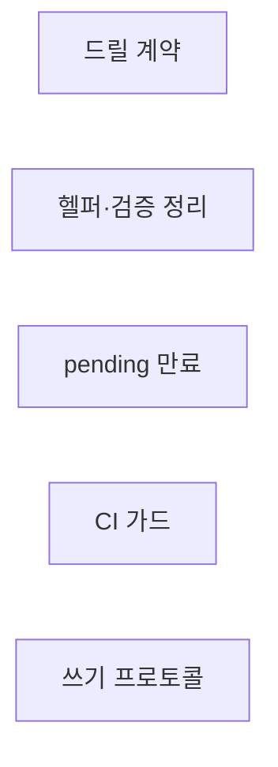

# flint v0.16.2 플랜 — 패치(드릴 계약 완결·pending 만료·쓰기 프로토콜)

**Spec:** docs/plans/2026-11-05-flint-v0162.spec.md
**Detail:** tests · **Target-min:** 9 · 언어 Go, 테스트 `go test ./...`

**전역 제약(스펙 §4):** exit 0/1/2/3 · 한 줄 JSON · 스키마 v5 불변 ·
기존 테스트 함수 수정 금지(예외: T1 regression 단얱·T2 헬퍼 호출부 —
룰링) · TDD red→green→commit · `make ci` 통과 · 병렬 태스크 파일 비공유.

**스펙 매핑:** §1 배경·§2 목표 = 공통 전제. R1 드릴 계약 완결→T1+T3 · R2 CI 가드→T4 · R3 헬퍼·검증 정리→T2 · R4 pending 만료→T3 · R5 쓰기 프로토콜→T5.

## 구조

파일: `lib/backup/drill.go`·`tests/regression/drill_test.go`(T1) ·
`docs/*_test.go`·`flint-plugin/*_test.go`·`scripts/validate_yaml.py`(T2) ·
`lib/cli/maintain.go`·`lib/cli/doctor.go`·`lib/cli/maintain_v0162_test.go`·
`lib/cli/doctor_v0162_test.go`(T3) · `.github/workflows/ci.yml`(T4) ·
`flint-plugin/skills/flint/SKILL.md`·`docs/PLAN.md`·`README.md`·
`README.ko.md`·`docs/v0162_docs_test.go`(T5).

## 태스크 그래프

T1은 drill.go·regression 양쪽 소유(동일 계약). T2~T5 독립.

```mermaid
%% schedule
gantt
  title Predicted schedule (mm:ss)
  dateFormat X
  axisFormat %M:%S
  section lane 1
  T1 R1 DROP 검증·ctx 독립·regression 단얱 :t1, 0, 127s
  section lane 2
  T2 R3 docStr 통합·validate_yaml 재사용 :t2, 0, 102s
  section lane 3
  T3 R4 maintain --expire-pending :t3, 0, 102s
  section lane 4
  T4 R2 flint_test 생성 실패 구분 :t4, 0, 102s
  section lane 5
  T5 R5 SKILL 쓰기 우선순위·문서 :t5, 0, 102s
```





critical path: T1 (2.1 min) · peak width 5 · predicted build 2.1 min · predicted total ≈ 5.6 min

## lib/backup+tests — 드릴 계약 완결 (T1)

앱 유형: 백업 드릴·회귀. 카테고리: state.
위험: 정상 엔진 오탐.
**Probe entry:** run=go test ./lib/backup -run TestDrill

### T1 R1 DROP 검증·ctx 독립·regression 단얱
**Owns:** lib/backup/drill.go, tests/regression/drill_test.go, lib/backup/drill_v0162_test.go
**Components:** 2 · **LOC owned:** 60 · **Tests:** fast+slow · **Model:** sonnet
**Produces:** dropDrillDB 검증 — DROP 실행 후 `SELECT count(*) FROM pg_database WHERE datname='flint_drill_db'` 잔존 시 명시적 에러(문구에 "잔존 — 수동 DROP 필요") · 지연 정리 DROP 경로 `context.Background()`+`context.WithTimeout(30s)`(재생 ctx 분리) · tests/regression/drill_test.go 132·195·223 부근 flint_drill 스키마 단얱 4곳 → pg_database flint_drill_db 부재 검사·173·211 죽은 DROP SCHEMA 선행 정리 제거
e.g. DROP이 no-op로 잔존 -> RunDrill err(잔존 명시)·maintenance_runs 미기록
**Review Focus:** `TestDropDBVerifiesResidue`(주입 시임으로 DROP nil 반환 후
잔존 시 에러)·`TestCleanupUsesIndependentContext`(재생 ctx 만료 상황
시임); 기존 드릴 테스트 전수·regression slow 통과.
**Test code (verbatim):**
```go
package flintplugin

import (
	"context"
	"testing"
)

// 실제 시임 주입은 구현 시그니처에 맞춰 완성 — 리뷰 포커스 명세:
// 1. TestDropDBVerifiesResidue: dropDrillDBFn이 nil을 반환해도 pg_database에
//    flint_drill_db 잔존하면 RunDrill이 잔존 에러를 반환(기록 미발생).
// 2. TestCleanupUsesIndependentContext: 재생 경로가 ctx 만료를 반환한
//    경우에도 지연 정리 DROP은 독립 ctx로 실행됨(주입 카운터 단얱).
```
**Steps:** 1 lib/backup 신규 테스트 2종(RED — 시임 확장 후) 2 검증·
   독립 ctx 구현 3 regression 단얱 갱신(룰링) 4 `go test ./lib/backup
   -run TestDrill -count=1` + slow regression PASS 5 commit
**Notes:** dropDrillDBFn 시임 확장은 기존 주입 2종과 동일 패턴.

## docs+plugin — 헬퍼 통합·검증 정리 (T2)

앱 유형: 테스트 리팩터·스크립트. 카테고리: file.
위험: 기존 단얱 변형.
**Probe entry:** run=go test ./docs ./flint-plugin

### T2 R3 docStr 통합·validate_yaml 재사용
**Owns:** docs/helper_test.go, docs/v0151_docs_test.go, docs/v0152_docs_test.go, docs/v0160_docs_test.go, docs/v0161_docs_test.go, flint-plugin/helper_test.go, flint-plugin/plugin_v0160_test.go, flint-plugin/plugin_v0161_test.go, scripts/validate_yaml.py
**Components:** 1 · **LOC owned:** 40 · **Tests:** fast · **Model:** sonnet
**Produces:** docs 패키지 공유 `docStr(t *testing.T, path string) string`(helper_test.go 신규) — v0151~v0161 파일의 로컬 docStrV016x 정의 제거·호출명 승계 갱신(룰링: 함수 본문 단얱 불변, 헬퍼명만) · flint-plugin 동일(readV016x→공유 readDoc) · validate_yaml 매니페스트 파싱 1회화(결과 재사용)
e.g. grep -r "func docStrV016" docs/ -> 0건
**Review Focus:** `go test ./docs ./flint-plugin -count=1` 전수 불변
통과(리팩터 무변형)·validate_yaml 출력 동일.
**Test code (verbatim):** (리팩터 — 신규 테스트 없음. 전수 통과가 검증)
**Steps:** 1 공유 헬퍼 신규 2 각 파일 로컬 정의 제거·호출 갱신 3
   전수 PASS·validate_yaml OK 4 commit
**Notes:** v0162 docs 테스트(T5)는 공유 docStr 사용.

## lib/cli — pending 만료 (T3)

앱 유형: CLI 유지보수. 카테고리: state.
위험: 오삭제.
**Probe entry:** run=bin/flint maintain --expire-pending 7

### T3 R4 maintain --expire-pending
**Owns:** lib/cli/maintain.go, lib/cli/doctor.go, lib/cli/maintain_v0162_test.go, lib/cli/doctor_v0162_test.go
**Components:** 1 · **LOC owned:** 60 · **Tests:** fast · **Model:** sonnet
**Produces:** `maintain --expire-pending <days> [--commit]` — valid_at 경과 N일 초과 pending 행 나열(id|topic|+경과일 한 줄 JSON 배열 또는 표 형식 승계)·기본 dry-run·--commit 시 `UPDATE knowledge SET status='invalidated', invalid_at=now() WHERE ...`(기존 무효화 경로 승계 — 신규 상태 없음·스키마 불변) · doctor pending-age 검사 detail에 만료 명령 안내 추가
e.g. --expire-pending 5 (dry) -> 나열만 exit 0 · --commit -> invalidated 전환 건수 출력
**Review Focus:** `TestExpirePendingDryRun`(나열·미변경)·
`TestExpirePendingCommit`(invalidated 전환 단얱)·`TestDoctorMentionsExpire`(안내 문구); 기존 maintain·doctor 테스트 불변.
**Test code (verbatim):**
```go
package cli

import (
	"context"
	"strings"
	"testing"
)

func TestExpirePendingDryRun(t *testing.T) {
	// fakeStore: pending 행 2건(경과 7일·2일) — days=5 나열 시 1건만,
	// UPDATE 미호출 단얱. 구현 시그니처에 맞춰 완성(리뷰 포커스 명세).
}

func TestExpirePendingCommit(t *testing.T) {
	// fakeStore: UPDATE 캡처 — status='invalidated'·invalid_at NOT NULL
	// 설정·대상 id 일치 단얱.
}

func TestDoctorMentionsExpire(t *testing.T) {
	// pending-age 검사 detail에 "expire-pending" 포함 단얱(기존 검사
	// fixture 승계).
}
```
**Steps:** 1 테스트 3종(RED) 2 플래그 파싱·조회·전환·doctor 안내 3
   `go test ./lib/cli -run 'TestExpire|TestDoctor|TestMaintain' -count=1` PASS 4 commit
**Notes:** days 필수(기본값 없음 — 오삭제 방지). exit 규약 승계.

## CI — CREATE 가드 (T4)

앱 유형: 워크플로. 카테고리: file.
**Probe entry:** run=python3 scripts/validate_yaml.py

### T4 R2 flint_test 생성 실패 구분
**Owns:** .github/workflows/ci.yml
**Components:** 1 · **LOC owned:** 6 · **Tests:** fast · **Model:** sonnet
**Produces:** CREATE DATABASE 출력 캡처 후 `already exists` 포함 시 계속, 그 외 실패 시 exit 1(진단 위치 보존)
e.g. 일시 오류 -> "flint_test 생성 실패: <출력>" exit 1
**Review Focus:** validate_yaml 그린·구문(YAML). 신규 go 테스트 없음.
**Test code (verbatim):** (워크플로 — validate_yaml+셸 구문 검증)
**Steps:** 1 수정 2 `python3 scripts/validate_yaml.py`·`bash -n` 논리
   검토 3 commit
**Notes:** 기존 프로브 대기 exit 1(v0.16.1)과 대칭.

## docs+skill — 쓰기 프로토콜 (T5)

앱 유형: 스킬 문서+테스트. 카테고리: file.
**Probe entry:** run=go test ./docs

### T5 R5 SKILL 쓰기 우선순위·문서
**Owns:** flint-plugin/skills/flint/SKILL.md, docs/PLAN.md, README.md, README.ko.md, docs/v0162_docs_test.go
**Components:** 1 · **LOC owned:** 30 · **Tests:** fast · **Model:** sonnet
**Produces:** SKILL.md 쓰기 지침에 우선순위 3계층 명시(①같은 주제 기존 행 갱신 done/supersede 우선 ②새 기록 최소화 ③write 전 flint read 선행 — dup_pct 과다% 근거 주석) · PLAN §14 v0.16.2 · 배지 release-v0.16.2(EN/KO) · docs 테스트 3종(공유 docStr 사용 — T2 소속 파일이나 T2와 무관하게 신규 파일은 자체 import 없이 docs 패키지 공유 활용)
**Review Focus:** `TestSkillWriteProtocol`(SKILL.md에 "갱신 우선"·"최소화"
포함)·`TestPlanRecordsV0162`·`TestBadgeIsV0162`; 기존 docs 전수.
**Test code (verbatim):**
```go
package docs

import (
	"strings"
	"testing"
)

func TestSkillWriteProtocol(t *testing.T) {
	b := docStr(t, "../flint-plugin/skills/flint/SKILL.md")
	for _, want := range []string{"갱신 우선", "최소화", "flint read"} {
		if !strings.Contains(b, want) {
			t.Errorf("SKILL.md 쓰기 프로토콜 누락(%s)", want)
		}
	}
}

func TestPlanRecordsV0162(t *testing.T) {
	if !strings.Contains(docStr(t, "PLAN.md"), "v0.16.2") {
		t.Error("PLAN.md v0.16.2 마일스톤 누락")
	}
}

func TestBadgeIsV0162(t *testing.T) {
	for _, p := range []string{"../README.md", "../README.ko.md"} {
		if !strings.Contains(docStr(t, p), "release-v0.16.2") {
			t.Errorf("%s 배지 v0.16.2 미갱신", p)
		}
	}
}
```
**Steps:** 1 테스트(RED — T2 공유 docStr 완료 전이면 자체 임시 정의
   금지, T2 커밋 후 실행 순서 코디네이터 조율) 2 SKILL·PLAN·배지
   갱신(v0161 배지 함수 삭제 — 선례) 3 `go test ./docs -count=1` PASS 4 commit
**Notes:** 로컬 ~/.claude/skills/flint/SKILL.md 동기는 코디네이터가
   머지 후 수행(배포 자산과 동일문).

## Review Focus 요약

| 패키지 | 유형 | 카테고리 | 리스크 |
|---|---|---|---|
| lib/backup+regression | 드릴 | state | 정상 엔진 오탐 |
| docs+plugin+script | 리팩터 | file | 단얱 변형 |
| lib/cli | 유지보수 | state | 오삭제 |
| ci.yml | 워크플로 | file | 구문 |
| docs+skill | 문서 | file | 훼손 |
