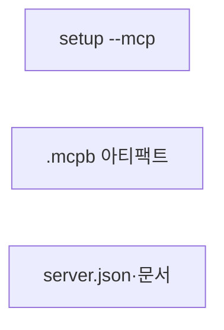

# flint v0.16.5 플랜 — setup --mcp·MCP Registry 준비

**Spec:** docs/plans/2026-11-05-flint-v0165.spec.md
**Detail:** tests · **Target-min:** 9 · 언어 Go

**전역 제약(스펙 §4):** exit 0/1/2/3 · 한 줄 JSON · 스키마 v5 불변 · 기존 테스트 함수 수정 금지 · TDD · `make ci` 통과.

**스펙 매핑:** R1 setup --mcp→T1 · R2 .mcpb→T2 · R3 server.json·문서→T3.

## 구조

파일: `lib/cli/setup.go`·`lib/cli/setup_mcp_test.go`(T1) ·
`.goreleaser.yml`·`scripts/make_mcpb.sh`(T2) ·
`mcp-registry/server.json`·`README.md`·`README.ko.md`·`docs/PLAN.md`·
`docs/v0165_docs_test.go`(T3).

## 태스크 그래프

병렬 3태스크 — 실행 의존 없음.

```mermaid
%% schedule
gantt
  title Predicted schedule (mm:ss)
  dateFormat X
  axisFormat %M:%S
  section lane 1
  T1 R1 하네스 자동 등록 :t1, 0, 102s
  section lane 2
  T2 R2 .mcpb 번들·Release 자산화 :t2, 0, 102s
  section lane 3
  T3 R3 server.json·문서·배지 v0165 :t3, 0, 102s
```





critical path: T1 (1.7 min) · peak width 3 · predicted build 1.7 min · predicted total ≈ 5.2 min

## lib/cli — setup --mcp (T1)

앱 유형: CLI 설정. 카테고리: state.
**Probe entry:** run=bin/flint setup --mcp

### T1 R1 하네스 자동 등록
**Owns:** lib/cli/setup.go, lib/cli/setup_mcp_test.go
**Components:** 1 · **LOC owned:** 60 · **Tests:** fast · **Model:** sonnet
**Produces:** `runSetupMCP(stdout io.Writer) int` — harnessRegistry 순회·exec.LookPath 탐지·네이티브 CLI 실행·결과 JSON `{"status":"ok","registered":[...],"skipped":[...]}` · exit 0(전부 스킵도 ok)
e.g. codex+gemini 설치·opencode 미설치 -> {"status":"ok","registered":["codex","gemini"],"skipped":["opencode","cursor","copilot"]}
**Review Focus:** `TestSetupMcpRegisters`(exec.LookPath 시임 — 명령 실행 단얱)·`TestSetupMcpSkipsUninstalled`(전부 미설치 ok); 기존 setup 테스트 불변.
**Test code (verbatim):**
```go
package cli

import (
	"os/exec"
	"strings"
	"testing"
)

// 시임: exec.LookPath를 오버라이드해 설치/미설치 시나리오 테스트.
var lookPathFn = exec.LookPath

func TestSetupMcpDetectsInstalled(t *testing.T) {
	// codex·gemini 설치, opencode·cursor·copilot 미설치 가짜 환경
	saved := lookPathFn
	lookPathFn = func(name string) (string, error) {
		if name == "codex" || name == "gemini" {
			return "/usr/bin/" + name, nil
		}
		return "", exec.ErrNotFound
	}
	defer func() { lookPathFn = saved }()
	var out strings.Builder
	code := runSetupMCP(&out)
	if code != 0 {
		t.Errorf("exit %d, want 0", code)
	}
	s := out.String()
	if !strings.Contains(s, `"registered":["codex","gemini"]`) {
		t.Errorf("등록 목록: %s", s)
	}
	if !strings.Contains(s, `"skipped":["opencode","cursor","copilot"]`) {
		t.Errorf("스킵 목록: %s", s)
	}
}

func TestSetupMcpAllUninstalled(t *testing.T) {
	saved := lookPathFn
	lookPathFn = func(string) (string, error) { return "", exec.ErrNotFound }
	defer func() { lookPathFn = saved }()
	var out strings.Builder
	if code := runSetupMCP(&out); code != 0 {
		t.Errorf("전부 미설치 exit %d, want 0(무해)", code)
	}
}
```
(실제 CLI 실행부도 시임 — 테스트는 탐지 로직 중심, 실행은 통합에서)
**Steps:** 1 테스트(RED — runSetupMcp 부재) 2 구현: harnessRegistry
   기반 탐지·`--mcp` 플래그 파싱(runSetup에 추가)·exec.Command로
   각 CLI 실행(에러는 스킵 사유 기록) 3 `go test ./lib/cli -run
   'TestSetupMcp' -count=1` PASS 4 commit
**Notes:** CLI 실행 에러(이미 등록 등)는 스킵 처리(등록 실패 ≠ 치명).

## 빌드 — .mcpb 아티팩트 (T2)

앱 유형: 빌드 스크립트·goreleaser. 카테고리: file.
**Probe entry:** run=bash scripts/make_mcpb.sh --help

### T2 R2 .mcpb 번들·Release 자산화
**Owns:** scripts/make_mcpb.sh, .goreleaser.yml
**Components:** 1 · **LOC owned:** 40 · **Tests:** fast · **Model:** sonnet
**Produces:** scripts/make_mcpb.sh — `<os>_<arch>` 인자 → `flint_<ver>_<os>_<arch>.mcpb` 생성(zip: manifest.json + 바이너리) · .goreleaser.yml에 mcpb 아카이브 추가(files: [mcp-registry/manifest.json] + 바이너리 — meta:true 방식으로는 바이너리 참조 불가, post-build 스텝 또는 archive builds 방식 검토)
e.g. goreleaser snapshot -> flint_0.16.5_darwin_arm64.mcpb 산출
**Review Focus:** snapshot 실행 — .mcpb 파일 존재·내부 manifest.json
   검증·기존 자산 불변(dist 확인 후 삭제).
**Test code (verbatim):** (스크립트 — snapshot 산출물 검증)
**Steps:** 1 make_mcpb.sh 작성 2 .goreleaser.yml 통합 3 snapshot
   실행·검증·dist 삭제 4 commit
**Notes:** manifest.json 스키마: `{"name":"flint","version":"<ver>",
   "description":"...","tools":["flint_read","flint_write","flint_hot"],
   "transport":"stdio","command":"flint","args":["mcp"]}`.

## docs — server.json·발행 안내 (T3)

앱 유형: 문서+JSON+테스트. 카테고리: file.
**Probe entry:** run=go test ./docs

### T3 R3 server.json·문서·배지 v0165
**Owns:** mcp-registry/server.json, README.md, README.ko.md, docs/PLAN.md, docs/v0165_docs_test.go
**Components:** 1 · **LOC owned:** 40 · **Tests:** fast · **Model:** sonnet
**Produces:** mcp-registry/server.json (MCP Registry 등록 메타데이터 — name·description≤100자·mcpb 패키지·Release URL 플레이스홀더) · README EN/KO: `flint setup --mcp` 사용법·MCP Registry 발행 3단계 안내·배지 release-v0.16.5 · PLAN §14 v0.16.5 · docs 테스트 3종
**Review Focus:** `TestServerJsonValid`(name·description 길이·mcpb 타입)·`TestReadmeSetupMcp`(사용법 포함)·`TestBadgeIsV0165`.
**Test code (verbatim):**
```go
package docs

import (
	"encoding/json"
	"os"
	"strings"
	"testing"
)

func TestServerJsonValid(t *testing.T) {
	b, err := os.ReadFile("../mcp-registry/server.json")
	if err != nil {
		t.Fatal(err)
	}
	var m map[string]any
	if err := json.Unmarshal(b, &m); err != nil {
		t.Fatal(err)
	}
	if m["name"] != "io.github.synuns/flint" {
		t.Errorf("name=%v", m["name"])
	}
	if d, _ := m["description"].(string); len(d) > 100 {
		t.Errorf("description %d자, want ≤100", len(d))
	}
}

func TestReadmeSetupMcp(t *testing.T) {
	for _, p := range []string{"../README.md", "../README.ko.md"} {
		b, _ := os.ReadFile(p)
		if !strings.Contains(string(b), "setup --mcp") {
			t.Errorf("%s setup --mcp 미기록", p)
		}
	}
}

func TestBadgeIsV0165(t *testing.T) {
	for _, p := range []string{"../README.md", "../README.ko.md"} {
		b, _ := os.ReadFile(p)
		if !strings.Contains(string(b), "release-v0.16.5") {
			t.Errorf("%s 배지 v0.16.5 미갱신", p)
		}
	}
}
```
**Steps:** 1 테스트(RED) 2 server.json·README·PLAN·배지 갱신 3
   `go test ./docs -count=1` PASS 4 commit
**Notes:** v0164 배지 테스트 삭제(선례). plugin.json 0.16.5 동기.

## Review Focus 요약

| 패키지 | 유형 | 카테고리 | 리스크 |
|---|---|---|---|
| lib/cli | 설정 | state | CLI 문 버전 변동 |
| 빌드 | 스크립트 | file | .mcpb 스키마 |
| docs | 문서 | file | 기존 절 훼손 |
