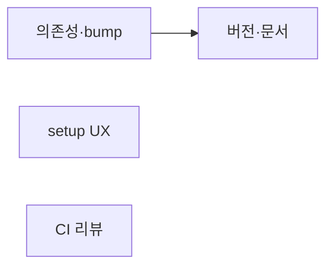

# flint v0.17.0 플랜 — 의존성 관리·setup UX·CI 리뷰

**Spec:** docs/plans/2026-11-06-flint-v0170.spec.md
**Detail:** tests · **Target-min:** 9 · 언어 Go

**전역 제약(스펙 §4):** exit 0/1/2/3 · 한 줄 JSON(--json) · 스키마 v5 · 기존 테스트 불변 · TDD · `make ci` 통과.

**스펙 매핑:** R1 의존성→T1 · R2 setup UX→T2 · R3 CI 리뷰→T3(문서) · R4 버전·문서→T4.

## 구조

파일: `.github/dependabot.yml`·`.github/workflows/ci.yml`·`scripts/bump_version.sh`(T1) ·
`lib/cli/setup.go`·`lib/cli/setup_ux.go`·`lib/cli/setup_ux_test.go`(T2) ·
`docs/CI_REVIEW.md`(T3) · `VERSION`·`README.md`·`README.ko.md`·`docs/PLAN.md`·`docs/v0170_docs_test.go`(T4).

## 태스크 그래프

T2가 T1의 bump_version.sh 사용(버전 동기) — 나머지 독립.

```mermaid
%% schedule
gantt
  title Predicted schedule (mm:ss)
  dateFormat X
  axisFormat %M:%S
  section lane 1
  T1 R1 Dependabot·mcp-publisher 고정·bump 스 :t1, 0, 102s
  T4 R4 VERSION·배지·PLAN v0170 :t4, 102, 102s
  section lane 2
  T2 R2 setup 시각적 프로그레스 :t2, 0, 102s
  section lane 3
  T3 R3 CI 파이프라인 진단·개선점 문서화 :t3, 0, 102s
```





critical path: T1 → T4 (3.4 min) · peak width 3 · predicted build 3.4 min · predicted total ≈ 6.9 min

## CI/도구 — 의존성 관리 (T1)

앱 유형: 설정 파일·스크립트. 카테고리: file.
**Probe entry:** run=python3 scripts/validate_yaml.py

### T1 R1 Dependabot·mcp-publisher 고정·bump 스크립트
**Owns:** .github/dependabot.yml, .github/workflows/ci.yml, scripts/bump_version.sh
**Components:** 1 · **LOC owned:** 50 · **Tests:** fast · **Model:** sonnet
**Produces:**
- `.github/dependabot.yml` — gomod+github-actions 주간
- ci.yml: mcp-publisher 다운로드 URL latest→v1.8.7 고정(재현성)
- `scripts/bump_version.sh <new_version>` — VERSION·README EN/KO 배지·plugin.json· PLAN 마지막 항목 일괄 범프 (배지 누락 방지 자동화)
e.g. `./scripts/bump_version.sh 0.17.1` → 4파일 갱신·git diff 표시
**Review Focus:** validate_yaml 그린·bump 스크립트 dry-run(git diff 출력).
**Steps:** 1 dependabot.yml 2 ci.yml mcp-publisher 고정 3 bump_version.sh 4 실행 권한·dry-run 5 commit

## lib/cli — setup UX 고도화 (T2)

앱 유형: CLI UX. 카테고리: state·encoding.
위험: 기존 동작 불변.
**Probe entry:** run=bin/flint setup --json

### T2 R2 setup 시각적 프로그레스
**Owns:** lib/cli/setup.go, lib/cli/setup_ux.go, lib/cli/setup_ux_test.go
**Components:** 1 · **LOC owned:** 80 · **Tests:** fast · **Model:** sonnet
**Produces:**
- `setupUX` 구조체 — `Step(name)`·`Success(detail)`·`Fail(err)`·`Summary(next []string)` 메서드
- ANSI 색상(✓ 그린·✗ 레드·세부 딤)·스텝 인디케이터
- TTY 감지(`os.Stdout` Stat)로 비인터랙티브면 자동 plain 모드
- `--json` 플래그 시 기존 JSON 출력 완전 불변
- `flint setup` 출력을 setupUX 경유로 교체(동작 계약 불변)
e.g. TTY: `  ◯ Doltgres…  ✓ :5434` / non-TTY: `Doltgres: ok (:5434)`
**Review Focus:** `TestSetupUXSteps`(Step/Success 요소 렌더)·
`TestSetupUXNonTTY`(색상 코드 부재)·`TestSetupJSONMode`(기존 JSON 불변);
기존 setup 테스트 전수 통과.
**Test code (verbatim):**
```go
package cli

import (
	"os"
	"strings"
	"testing"
)

func TestSetupUXRenders(t *testing.T) {
	var b strings.Builder
	ux := newSetupUX(&b, true) // forceColor for test
	ux.Step("Doltgres 연결")
	ux.Success(":5434 (12ms)")
	ux.Step("마이그레이션")
	ux.Success("v5")
	s := b.String()
	for _, want := range []string{"Doltgres", "5434", "v5"} {
		if !strings.Contains(s, want) {
			t.Errorf("출력에 %q 부재:\n%s", want, s)
		}
	}
}

func TestSetupUXNonTTY(t *testing.T) {
	var b strings.Builder
	ux := newSetupUX(&b, false)
	ux.Step("테스트")
	ux.Success("완료")
	if strings.Contains(b.String(), "\033[") {
		t.Error("non-TTY에 ANSI 코드 존재")
	}
}
```
**Steps:** 1 테스트(RED) 2 setup_ux.go(구조체·ANSI·TTY 감지) 3 runSetup
   통합(동작 불변 확인) 4 `go test ./lib/cli -count=1` PASS 5 commit
**Notes:** ANSI 구현은 stdlib fmt만 사용(외부 의존성 없음). 색상 코드:
그린 `\033[32m✓\033[0m`·레드 `\033[31m✗\033[0m`·딤 `\033[2m…\033[0m`.

## docs — CI 설계 리뷰 (T3)

앱 유형: 문서. 카테고리: file.
**Probe entry:** run=go test ./docs

### T3 R3 CI 파이프라인 진단·개선점 문서화
**Owns:** docs/CI_REVIEW.md
**Components:** 1 · **LOC owned:** 60 · **Model:** sonnet
**Produces:** CI_REVIEW.md — 현재 구조 다이어그램·각 잡 역할·만족/개선점 표·이행 제안
**Review Focus:** 내용 정합(현행 ci.yml과 일치)·개선점 실행 가능성.
**Steps:** 1 ci.yml 읽고 진단 작성 2 commit

## docs — 버전·문서 (T4)

앱 유형: 문서+테스트. 카테고리: file.
**Probe entry:** run=go test ./docs

### T4 R4 VERSION·배지·PLAN v0170
**Owns:** VERSION, README.md, README.ko.md, docs/PLAN.md, docs/v0170_docs_test.go
**Components:** 1 · **LOC owned:** 20 · **Tests:** fast · **Model:** sonnet
**Produces:** VERSION=0.17.0·배지 v0.17.0(EN/KO)·plugin.json 0.17.0·PLAN §14 v0.17.0·docs 테스트 2종
**Review Focus:** TestVersion0170·TestBadgeV0170; 기존 docs 통과.
**Steps:** 1 bump_version.sh 사용 2 docs 테스트 3 `go test ./docs` PASS 4 commit
