# flint v0.34.1 — 패치 루프: v0.34.0(brief·ADR-0015) 사후 감사

- **날짜**: 2026-11-11 · **상태**: 진행 · **오케스트레이터**: AI(루프 사전 승인)
- **범위**: main 6441b0f→0dcc22f diff(12파일)의 사후 감사 — 계약·엣지·
  문서 정합. 발견은 회귀 테스트 동반 수정(리뷰어 자가 수정).
- **비목표**: 신규 기능·원격 표면(ADR-0015 재론 조건 불충족)·리팩터링.
- **Budget-usd:** 3

```mermaid
%% taskgraph
T1 --> T3
T2 --> T3
```

```mermaid
%% schedule
gantt
  title Predicted schedule (mm:ss)
  dateFormat X
  axisFormat %M:%S
  section lane 1
  T1 brief 코드 사후 감사 — 계약 엣지·마스킹·예산·노출 :t1, 0, 102s
  T3 v0.34.1 버전 동기 — VERSION·배지·PLAN 체인지로그 :t3, 102, 102s
  section lane 2
  T2 문서 주장≠동작 감사 — 브리지 절·ADR-0015·TUNING § :t2, 0, 102s
```



critical path: T1 → T3 (3.4 min) · peak width 2 · predicted build 3.4 min · predicted total ≈ 6.9 min

- T1: 코드 표면 감사·수정 — brief 커맨드·등록/usage 노출
- T2: 문서 정합 스윕 — README EN/KO·ADR-0015·TUNING 주장≠동작 점검
- T3: 버전·체인지로그 — v0.34.1 동기(배지·하이라이트·plugin.json)

## 코드 표면 감사 (T1)

앱 유형: Go CLI. 카테고리: audit+fix.
**Probe entry:** run=bin/flint brief

### T1 brief 코드 사후 감사 — 계약 엣지·마스킹·예산·노출
**Owns:** lib/cli/brief.go, lib/cli/brief_v0340_test.go, lib/cli/brief_v0341_test.go, lib/cli/registry.go, lib/cli/root.go, lib/cli/wire_v08_test.go
**Components:** 1 · **LOC owned:** 180 · **Tests:** fast · **Model:** sonnet
**Produces:** 감사 발견의 수정 + 회귀 테스트(brief_v0341_test.go 등 Owns 내)
**Review Focus:** 계약 누락 엣지 — `flint brief --limit`(값 누락 trailing 시 read의
N10 규칙 exit 3과 불일치 여부), `--` 가드 후 플래그 문자열 질의, 빈 쿼리 전체
조회 의도성, 마스킹→중립화 순서의 우회 경로(비문자열 셀·tags 배열 원소),
ClampHot 절단이 [flint] 헤더를 잘라 0행처럼 보이는 경우, FormatRows 필드
매핑(topic,summary,tags 위치 fallback), usageLine/helpSummary 정합, 계측
recordUsage 스킴과 기존 metrics 분류 호환. 감사 기준은 커밋 0dcc22f 실제
동작 — 문서 주장이 아니라 코드 계약. 발견 0건이면 무수정 DONE.
**Adapter:** none (직접 Go).

## 문서 정합 스윕 (T2)

앱 유형: 문서. 카테고리: docs-sweep.
**Probe entry:** run=bin/flint help

### T2 문서 주장≠동작 감사 — 브리지 절·ADR-0015·TUNING §5
**Owns:** README.md, README.ko.md, docs/adr/0015-bridge-surface.md, docs/TUNING.md
**Components:** 1 · **LOC owned:** 60 · **Tests:** fast · **Model:** sonnet
**Produces:** 문서 수정(모순·누락 해소) — 회귀 테스트는 docs/*_test.go 게이트 호환 유지
**Review Focus:** README 브리지 절 명령·플래그·exit 주장 vs 구현, KO/EN
번역 정합(같은 사실), ADR-0015 결정 5항 vs 구현·문서 상호 모순, TUNING §5
brief_budget 계약(기본 3,000·무효 폴백·"절단 접미" 표기) vs brief.go. **README의
배지·하이라이트(> v0.3x) 줄은 T3 소유 — 손대지 않는다.** 발견 0건이면 무수정 DONE.
**Adapter:** none.

## 버전·체인지로그 (T3)

앱 유형: 버전 동기. 카테고리: version.
**Probe entry:** run=bin/flint version

### T3 v0.34.1 버전 동기 — VERSION·배지·PLAN 체인지로그
**Owns:** VERSION, docs/PLAN.md, flint-plugin/.claude-plugin/plugin.json, README.md, README.ko.md
**Components:** 1 · **LOC owned:** 30 · **Tests:** fast · **Model:** sonnet
**Produces:** VERSION 0.34.1·plugin.json·README 배지/하이라이트 v0.34.1·
PLAN.md v0.34.1 패치 엔트리(T1·T2 발견 요약 반영 — 커밋 로그 기준)
**Review Focus:** 3방향 동기(VERSION=plugin.json=README 양측 배지·하이라이트),
체인지로그 형식(v0.32.1 패치 엔트리 승계), versions_test 게이트 통과.
T1·T2 완료 후에만 착수(발견 요약이 입력).
**Adapter:** none.
