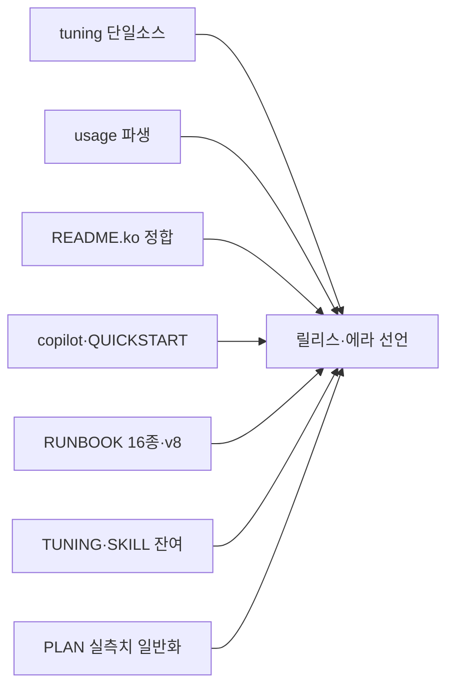

# flint v0.34.2 — 리뷰 긴급 잔여 + 문서 따라잡기 플랜

**Goal:** 2026-11-11 전면 리뷰의 즉시 수정 분류 잔여(코드 2건)와 문서
드리프트 8건을 하나의 패치로 수선하고, 구조 수렴 에라(v0.37+)를 PLAN에
선언한다.
**Architecture:** 기존 flint 단일 바이너리·lib/cli 패키지 구조 무변경.
tuning 키 목록과 usage 문장의 '단일 소스 파생 + 동질 테스트'만 도입.
**Tech stack:** Go(pgx·embed) · 기존 테스트 관례 승계.
**Spec:** docs/plans/2026-11-11-flint-v0342.spec.md, docs/plans_email_scan_test.go
**Detail:** tests · **Target-min:** 16

**Global constraints (전 태스크 공통):**
- 테스트는 `go test ./... -count=1` 직접 실행(superlite run_tests는 Go를
  수집 못함 — v0.34.1 룰링 승계). 최종 게이트 `make ci`(check_personal 포함).
- 커밋 작성자는 noreply 고정(CLAUDE.local.md §3 — 커밋 전
  `git log -1 --format='%ae'` 확인), 메시지 말미에는 Claude Code
  Co-Authored-By 트레일러를 붙인다(주소 리터럴은 커밋 시점에만 —
  문서에 이메일 주소를 적지 않는다, check_personal 기준).
- 개인 데이터·운영 실측치 금지 — 문서 수치는 "16종"류 구조 수치만.
- 문서 계약 테스트(docs/*_test.go)가 깨지면 해당 태스크가 계약 의미
  불변 범위에서 함께 갱신. VERSION·배지·plugin.json 동기는 T8 전담.
- Ruling(2026-11-11 세션 간 조정): v0.35.0(프로파일 판정, 완료 대기)·
  v0.36.0(report-html #118)은 기존 트랙 존중 — 구조 수렴 시리즈는
  v0.37.0부터 착수. 진행 중 2건 외 신규 신기능 동결.

```mermaid
%% schedule
gantt
  title Predicted schedule (mm:ss)
  dateFormat X
  axisFormat %M:%S
  section lane 1
  T3 README.ko 정합 :t3, 0, 102s
  T8 릴리스  버전 동기 + 구조 수렴 에라 선언 :t8, 102, 102s
  section lane 2
  T4 Copilot 안내·QUICKSTART 검사 수 :t4, 0, 102s
  section lane 3
  T5 RUNBOOK 검사 표·스키마 버전 :t5, 0, 102s
  section lane 4
  T6 TUNING 키·SKILL 도구·잔여 문서 :t6, 0, 102s
  section lane 5
  T7 PLAN 실측치 일반화 :t7, 0, 102s
  section lane 6
  T2 usage 문장 레지스트리 파생 :t2, 0, 100s
  section lane 7
  T1 tuning 키 단일 소스화 :t1, 0, 99s
```





critical path: T3 → T8 (3.4 min) · peak width 7 · predicted build 3.4 min · predicted total ≈ 6.9 min

**File structure:**
- lib/cli/tuning.go — meta 키 all 목록 파생 헬퍼로 교체(191·401행)
- lib/cli/registry.go — usage 문장 usageOrder 파생 생성
- README.ko.md / docs/QUICKSTART.md / docs/adapters/copilot.md — Copilot 자동 등록 정정
- docs/RUNBOOK.md — 검사 16종·표 6행·schema v8
- docs/TUNING.md · flint-plugin/skills/flint/SKILL.md · docs/CONTENT.md · lib/cli/brief.go(주석) — 키 2종·MCP 5종·exit1·참조
- docs/PLAN.md · lib/sqlfs/views.sql — 실측치 일반 서술화 + 에라 선언
- VERSION · README.md · plugin.json — 버전 동기(T8)

---

### T1 tuning 키 단일 소스화 · Complexity 4 (O-1) · Est. context 24k
**Owns:** lib/cli/tuning.go, lib/cli/tuning_meta_v0342_test.go, lib/cli/tuning_keys_single_source_test.go
**Components:** 1 · **LOC owned:** 75 · **Tests:** fast · **Model:** sonnet
**Est. time:** 2.5 min (1 component, 75 LOC, fast tests)
**Produces:** tuningKeyAll() []string — thresholdsKeys()와 tuningMetaKeys() 키의 정렬 합집합(중복 제거)
- e.g. tuningKeyAll() -> ["backup_encrypt", "backup_interval_h", …, "vocab_domains"] (backup_encrypt 포함이 핵심 계약)
**Review Focus:** `TestTuningKeyAllContainsBackupEncrypt`: 파생 목록에
"backup_encrypt" 존재·길이는 thresholdsKeys+tuningMetaKeys 합집합과 동일.
`TestTuningResetAllCoversAllKeys`: reset --all 경로(tuningResetAll)가
하드코딩 리터럴 없이 tuningKeyAll()을 순회 — 소스에 6키 리터럴 부재를
grep 수준으로 입증하는 회귀.
**Test code (verbatim):**
```go
func TestTuningKeyAllContainsBackupEncrypt(t *testing.T) {
	all := tuningKeyAll()
	want := map[string]bool{}
	for _, k := range thresholdsKeys() {
		want[k] = true
	}
	for _, tk := range tuningMetaKeys() {
		want[tk.Key] = true
	}
	for _, k := range all {
		if !want[k] {
			t.Fatalf("unexpected key %q", k)
		}
		delete(want, k)
	}
	if !slices.Contains(all, "backup_encrypt") {
		t.Fatal("backup_encrypt missing — R1 regression")
	}
	if len(want) != 0 {
		t.Fatalf("missing keys: %v", want)
	}
}
```
**Steps:** 1 실패 테스트 작성, 2 run: FAIL, 3 tuningCurrent·tuningResetAll의
인라인 6키 리터럴을 tuningKeyAll()로 교체, 4 run: PASS.
**Notes:** tuningCurrent는 list 표기, tuningResetAll은 삭제 순회 — 둘 다
같은 파생 목록 사용. 기존 thresholdsKeys↔tuningKeys 동질 테스트 관례 승계.

### T2 usage 문장 레지스트리 파생 · Complexity 4 (O-1) · Est. context 24k
**Owns:** lib/cli/registry.go, lib/cli/cli_test.go, lib/cli/usage_registry_v0342_test.go, lib/cli/wire_v08_test.go, docs/versions_test.go
**Components:** 1 · **LOC owned:** 85 · **Tests:** fast · **Model:** sonnet
**Est. time:** 2.5 min (1 component, 85 LOC, fast tests)
**Produces:** usageLine() string — usageOrder 슬라이스 순서로 조립한 현행 계약 동일 JSON
- e.g. usageLine() -> `{"error":"usage: flint <write|read|hot|brief|…|import> [args]"}` (이제 "pending" 포함)
**Review Focus:** `TestUsageLineListsAllRegistered`: usage 문장이 registry
등록 24커맨드 전부를 포함(집합 동치 — pending 포함 입증).
`TestUsageOrderMatchesRegistry`: usageOrder 집합 == registry 키 집합
(신규 Register 시 누락하면 FAIL — 영구 드리프트 가드).
**Test code (verbatim):**
```go
func TestUsageLineListsAllRegistered(t *testing.T) {
	line := usageLine()
	for name := range registry {
		if !strings.Contains(line, name) {
			t.Fatalf("usage missing registered command %q", name)
		}
	}
	if !strings.Contains(line, "pending") { t.Fatal("pending missing — R2") }
}
```
**Steps:** 1 실패 테스트, 2 run: FAIL(현재 pending 누락), 3 usageOrder
선언+조립+동질 테스트, 4 run: PASS. 기존 usage 단언(cli_test.go) 갱신.
**Notes:** JSON 문자열 리터럴은 제거 — usageLine이 조립만 담당. helpSummary(root.go:117)는 이번 무변경(본문 서술형).

### T3 README.ko 정합 · Complexity 2 (O-0) · Est. context 14k
**Owns:** README.ko.md, docs/badge_test.go
**Components:** 1 · **LOC owned:** 30 · **Tests:** fast · **Model:** haiku · **Kind:** mechanical
**Est. time:** 1.5 min (docs, fast tests)
**Review Focus:** `badge_ko_sync`(기존): 배지 무변경·VERSION 동기 유지.
**Steps:** 1) :81 "수동 설정입니다" → EN 대응 자동 등록 서술로 정정(setup.go:278
기준 — "설치된 경우 자동으로 MCP 서버를 등록합니다"). 2) EN README
"Install via go install" 절을 KO에 대응 추가(모듈 경로 github.com/synuns/flint·
ReadBuildInfo 설명 번역). 3) harnesses-8 배지 아래 1줄 — "8종은 A급 자동
등록 하니스, 전체 지원은 아래 표(18종)" 취지 명시. 4) go test ./... 통과.
**Notes:** 배지 버전 숫자는 건드리지 않는다(T8 소유).

### T4 Copilot 안내·QUICKSTART 검사 수 · Complexity 2 (O-0) · Est. context 14k
**Owns:** docs/adapters/copilot.md, docs/QUICKSTART.md, docs/copilot_auto_registration_test.go
**Components:** 1 · **LOC owned:** 25 · **Tests:** fast · **Model:** haiku · **Kind:** mechanical
**Est. time:** 1.5 min (docs, fast tests)
**Steps:** 1) copilot.md:9-10 "자동 등록 대상이 아니다(수동 설정 안내만
출력)" → v0.21.0 이후 자동 등록(A급·MCPAdd 보유, setup.go:278) 서술로
정정 — 수동 절차는 "자동 등록이 불가한 환경용 대체"로 강등. 2)
QUICKSTART.md:63 "Copilot은 수동 설정" → 자동 등록 서술. 3)
QUICKSTART.md:43 "검사 10종" → "검사 16종". 4) go test ./... 통과.
**Notes:** copilot.md의 수동 절차 자체는 삭제하지 않는다(폴백 가치) —
서두 위치·성격만 정정.

### T5 RUNBOOK 검사 표·스키마 버전 · Complexity 4 (O-1) · Est. context 26k
**Owns:** docs/RUNBOOK.md, docs/runbook_test.go
**Components:** 1 · **LOC owned:** 60 · **Tests:** fast · **Model:** sonnet
**Est. time:** 3 min (docs+표, fast tests)
**Steps:** 1) :66 "검사 13종" → 16종. 2) 검사 표에 6종 추가 —
backup-key·meta-hygiene·update·recall-starved·secrets·event-volume:
각 1행(이름·한 줄 설명·수정 명령·warn/fail)은 lib/cli/doctor.go 실구현에서
확인해 기술(추측 금지). 3) :73 "현재 v7" → v8. 4) runbook_test.go 정합
갱신 후 go test ./... 통과.
**Notes:** 표 순서는 doctor 실행 체인 순서(코어→tail)를 따른다.

### T6 TUNING 키·SKILL 도구·잔여 문서 · Complexity 3 (O-1) · Est. context 16k
**Owns:** docs/TUNING.md, flint-plugin/skills/flint/SKILL.md, docs/CONTENT.md, lib/cli/brief.go, docs/tuning_test.go
**Components:** 1 · **LOC owned:** 45 · **Tests:** fast · **Model:** haiku · **Kind:** mechanical
**Est. time:** 2 min (docs+주석 1줄, fast tests)
**Steps:** 1) TUNING §2 표에 pending_promote_days(기본 3)·
pending_promote_min_runes(기본 40) 행 추가(기존 행 양식 승계). 2)
brief.go:18 주석 "TUNING.md §1" → "§5". 3) SKILL.md "MCP 세션"절 도구
3종 → 5종(flint_pending·flint_approve 설명 1줄씩 추가). 4) SKILL.md exit
code 서술에 1줄 — "exit 1은 재시도 소진 외에 read 제로히트(침묵)·doctor
fail에서도 쓰인다". 5) CONTENT.md 서두 "7종" → 8종. 6) go test ./... 통과.

### T7 PLAN 실측치 일반화 · Complexity 3 (O-1) · Est. context 20k
**Owns:** docs/PLAN.md, lib/sqlfs/views.sql
**Components:** 1 · **LOC owned:** 30 · **Tests:** fast · **Model:** sonnet
**Est. time:** 2 min (치환 3곳, fast tests)
**Steps:** 1) PLAN.md v0.33.0 엔트리의 실측치 나열("active 54건·…·90커밋·
pending 0"·"meta-audit 26키·prune 5일 dry 5건") → 관측 일반 서술로 치환
(v0.27.2 전례: "active·invalidated·meta 키·커밋이 쌓여 이력 위생 도구가
다음 병목" 취지). 2) views.sql:29 주석 "domain='decision'은 실사용
0건…공회전이었다" → "실사용 관측에서 decision domain 관례는 채택되지
않았다" 취지로 치환. 3) make ci(check_personal) 통과 확인.
**Notes:** 수치·건수 표현 전부 제거 — 구조 수치(16종 등)는 무관·유지.

### T8 릴리스: 버전 동기 + 구조 수렴 에라 선언 · Complexity 4 (O-1) · Est. context 30k
**Owns:** VERSION, README.md, README.ko.md, flint-plugin/.claude-plugin/plugin.json, docs/PLAN.md, docs/plans/2026-11-11-flint-v0342.md, docs/plans/2026-11-11-flint-v0342.spec.md, docs/plans_email_scan_test.go
**Components:** 1 · **LOC owned:** 70 · **Tests:** fast · **Model:** sonnet
**Est. time:** 3.5 min (changelog+로드맵 표, fast tests)
**Consumes:** T1~T7 산출(체인지로그 기술 대상)
**Produces:** v0.34.2 릴리스 상태 — VERSION·배지 EN/KO·plugin.json "0.34.2" 동기 + PLAN §14 v0.34.2 엔트리 + 구조 수렴 에라 로드맵
**Review Focus:** `versions_test`(기존): VERSION==배지==plugin.json.
`badge_*`(기존): EN/KO 동기.
**Steps:** 1) VERSION 0.34.2·배지·plugin.json 동기. 2) PLAN §14 v0.34.2
엔트리 — 스펙 R1~R10 요약(리뷰 39건 중 즉시 분류 잔여 처리 완료 명시). 3)
같은 엔트리에 구조 수렴 에라 선언: 로드맵 표 5행(v0.37 render·meta·util
수렴 / v0.38 패키지 3분할 cliwire·knowledge·ops / v0.39 스키마 진실·상태
전이·Store 읽기전용 / v0.40 계측·튜닝 단일 원천 / v0.41~v0.42 seam 동질화·
PLAN 재무장·표면 계약 6종 → v1.0 게이트) + "신규 신기능은 병인 해소
우선, 트리거 대기 원칙 전면 적용(진행 중 v0.35.0 프로파일·v0.36.0
report-html은 예외)" 1줄. 4) PLAN 헤더:5 "다음 마일스톤 미정" →
"구조 수렴 에라(v0.35~, 2026-11-11 리뷰)". 5) make ci 통과.
**Notes:** 로드맵 표의 병인 5개(복제 시행·산문 계약·seam 파편화·계측 침식·
기획 문서 사망)는 표 위 1문장으로만 — 상세는 리뷰 보고 세션 기록.

---

**Review Focus (패키지별):**
- lib/cli(CLI): protocol(usage·tuning 계약)·state(list/reset 원자성) —
  T1·T2. `Probe entry: run=go test ./lib/cli -run 'Tuning|Usage' -count=1`
- docs(문서 게이트): file(계약 테스트 동치) — T3~T8.
  `Probe entry: run=go test ./... -count=1`

**Self-review:** 스펙 전 절 매핑(§1.1→T1·§1.2→T2·§2.1→T3,T4·§2.2→T4,T5·
§2.3→T5·§2.4·§2.5·§2.8→T6·§2.6→T7·§2.7→T3·§3 릴리스→T8·비목표는 T8
로드맵·룰링에 경계로 반영). Consumes/Produces 형식 일치·주기 없음·동시
실행 태스크 파일 미공유(T8만 후행). 자리표시자 없음. 15k 이내.
