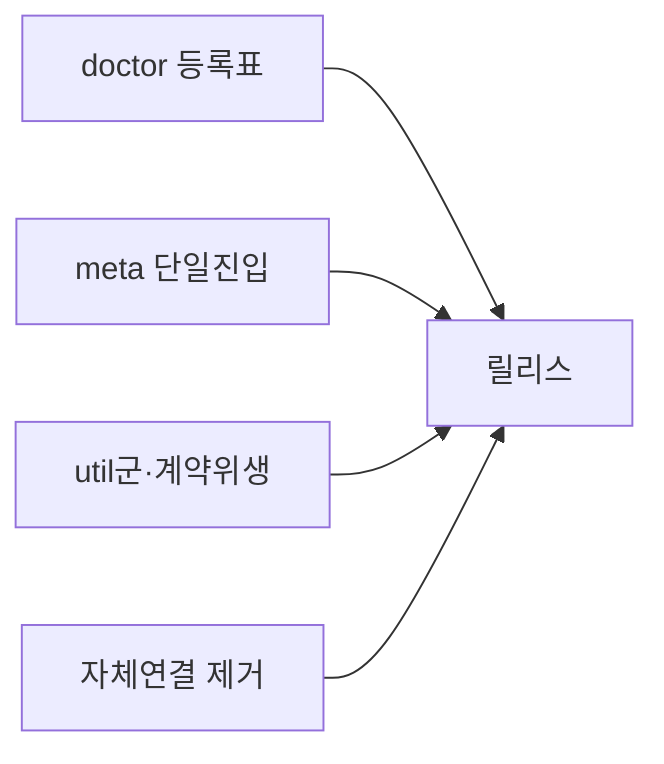

# flint v0.34.3 — 리뷰 잔여 구조 스윕 1차 플랜

**Goal:** 리뷰 미처리 항목 중 v0.35/v0.36 트랙과 무충돌인 4건(doctor
등록표·meta 단일 진입·util군·자체 연결)을 '단일 소스화+동질 가드'
패턴으로 수선한다.
**Architecture:** lib/cli 패키지 내부 정리만 — 계층 이동 없음. 기존
Store 인터페이스 확장은 realStore 위임 최소선.
**Tech stack:** Go(기존 관례 승계).
**Spec:** docs/plans/2026-11-11-flint-v0343.spec.md
**Detail:** tests · **Target-min:** 12

**Global constraints (전 태스크 공통):**
- 테스트는 `go test ./... -count=1` 직접 실행(승계 룰링). 최종 게이트
  `make ci`(개인 데이터 스캔 포함).
- 신규 테스트 파일·함수는 행위명만(버전 접두 금지 — v0.34.2 원칙).
- 문서·플랜 본문에 이메일 리터럴 금지(check_personal) — 커밋 트레일러
  서술로만 지칭.
- report.go·profile.go는 무결(v0.35/v0.36 트랙).
- Ruling: v0.35.0 선행 머지 시 v0.35.1 리넘버(4곳 기계 교체).

```mermaid
%% schedule
gantt
  title Predicted schedule (mm:ss)
  dateFormat X
  axisFormat %M:%S
  section lane 1
  T2 meta 접근 단일 진입점 :t2, 0, 127s
  T5 릴리스  v0.34.3 버전 동기 :t5, 127, 102s
  section lane 2
  T3 util 복제군·계약 위생 (maintain 중심) :t3, 0, 127s
  section lane 3
  T1 doctor 체크 등록표 통합 :t1, 0, 102s
  section lane 4
  T4 approve·done·backup Store 재배선 :t4, 0, 102s
```

critical path: T2 → T5 (3.8 min) · peak width 4 · predicted build 3.8 min · predicted total ≈ 7.3 min

**File structure:**
- lib/cli/doctor.go(+doctor_check_registry_test.go) — 체크 등록표·list 전량·nil 가드
- lib/cli/meta_kv.go(신규) — getMetaKV/setMetaKV; 채택 metrics·tuning·setup·hot·read
- lib/cli/textutil.go(신규) — truncateRunes·countPending; 채택 import·maintain·pending·status·nudge·sessionhook
- lib/cli/approve.go·done.go·backup.go — Store 재배선·내부 중복 제거
- VERSION·README·plugin.json·PLAN(T5)

---

### T1 doctor 체크 등록표 통합 · Complexity 5 (O-1) · Est. context 34k
**Owns:** lib/cli/doctor.go, lib/cli/doctor_check_registry_test.go, lib/cli/doctor_test.go
**Components:** 1 · **LOC owned:** 170 · **Tests:** fast · **Model:** sonnet
**Est. time:** 4 min (등록표 재구성+가드 테스트, fast tests)
**Produces:** doctorChecks() []CheckSpec — name·fn·chain("core"|"tail")·onStoreNil("fail"|"warn") 속성의 단일 등록표. 전체 실행 체인·runDoctorCheck 디스패치·--check 허용 목록·--list-checks가 전부 여기서 파생.
- e.g. doctorChecks() -> [{name:"db",fn:checkDB,chain:"core",onStoreNil:"fail"},…,{name:"secrets",…,chain:"tail",onStoreNil:"warn"}] (16종)
**Review Focus:** `TestDoctorRegistryCoversChain`: 등록표 이름 집합 == 전체 실행 체인 조립 집합(코어6+tail10). `TestDoctorListChecksShowsAll`: --list-checks가 16종 전량 출력(구 6종만 내던 회귀). `TestDoctorStoreNilSeverity`: onStoreNil 속성이 기존 행동(tail=warn·코어 db/schema/integrity/lastseen=fail)과 동일.
**Steps:** 1 등록표 스펙 테스트 3종 작성(現状 FAIL), 2 doctor.go 재구성 — DoctorChecks·doctorTailChecks는 등록표 필터 파생으로 잔존(공개 표면 유지), 3 runDoctor·runDoctorCheck·--list-checks 파생 전환, 4 go test ./lib/cli -run Doctor.
**Notes:** harness 체크 14종·skill-file 3곳은 등록표 밖 별도 체인(주석 명시) — 통합 대상 아님(동적 하네스 감지). 기존 doctor_test.go의 체인·체크 단언은 무변경 통과가 목표.

### T2 meta 접근 단일 진입점 · Complexity 4 (O-1) · Est. context 28k
**Owns:** lib/cli/meta_kv.go, lib/cli/meta_kv_test.go, lib/cli/metrics.go, lib/cli/tuning.go, lib/cli/setup.go, lib/cli/hot.go, lib/cli/read.go
**Components:** 2 · **LOC owned:** 110 · **Tests:** fast · **Model:** sonnet
**Est. time:** 3 min (헬퍼+5개 채택, fast tests)
**Produces:** getMetaKV(ctx, st, key) (string, bool) · setMetaKV(ctx, st, key, value) error — ON CONFLICT 원자 upsert 단일 구현.
- e.g. setMetaKV(ctx, st, "k", "v") → INSERT…ON CONFLICT DO UPDATE 1회 · getMetaKV(ctx, st, "없는키") -> ("", false)
**Review Focus:** `TestMetaKVRoundtrip`(fake store로 set→get). `TestBumpFallbackAtomic`: read.go bumpReadFallbackToMeta가 SELECT→INSERT 2회에서 setMetaKV 증분 경로로(비원자 창 제거 — 호출부 조립, upsert 원자).
**Steps:** 1 meta_kv 테스트, 2 구현, 3 채택: metrics metaKV·tuningSet/tuningMetaUpsert·setup 노출 설정·hot metaGetKV·read bump — 전부 위임으로 교체(출력·exit 불변), 4 go test ./lib/cli.
**Notes:** done.go·backup.go 채택은 T4 소관(파일 소유). metaGetKV 공개 함수(hot.go) 시그니처는 유지 — 내부만 getMetaKV 위임(외부 사용자 호환).

### T3 util 복제군·계약 위생 (maintain 중심) · Complexity 4 (O-1) · Est. context 30k
**Owns:** lib/cli/textutil.go, lib/cli/textutil_test.go, lib/cli/import.go, lib/cli/maintain.go, lib/cli/pending.go, lib/cli/status.go, lib/cli/nudge.go, lib/cli/sessionhook.go, lib/cli/import_test.go, lib/cli/maintain_test.go, lib/cli/maintain_v08_test.go, lib/cli/nudge_v0110_test.go, lib/cli/nudge_v0181_test.go, lib/cli/nudge_v0182_test.go, lib/cli/nudge_v095_test.go
**Components:** 2 · **LOC owned:** 130 · **Tests:** fast · **Model:** sonnet
**Est. time:** 3.5 min (다수 소형 편집, fast tests)
**Produces:** truncateRunes(s string, n int) string · countPending(ctx, st) (int, error) — textutil.go 단일 구현.
- e.g. truncateRunes("가나다라", 3) -> "가나…" 관례 승계(기존 3종 구현의 동일 동작) · countPending -> 활성 pending 행 수
**Review Focus:** `TestTruncateRunesSingleSource`: 3종 구현 제거 후 동일 결과(import 500룬·maintain 접두·pending 1줄 각 관례 값). `TestUnknownFlagExitContract`: maintain·import unknown flag → exit 3(구 1 회귀). `TestSupersedeZeroRowsFails`: maintainSupersede UPDATE 0행 → 오류(경합 무음 성공 차단).
**Steps:** 1 테스트 3종(現 FAIL), 2 textutil 구현+채택(truncate 3곳·countPending 3곳 — report.go 제외), 3 unknown flag exit 3 통일(maintain·import)·import 주석 정합, 4 maintain 죽은 가드 제거·nudge 상수 병합·supersede rows 검사, 5 go test ./lib/cli.
**Notes:** maintain.go:825 UPDATE에 rows-affected 검사 — approve supersedeAfterApprove 후견사 패턴 승계. exit 3 사유 문구는 기존 errLine 관례.

### T4 approve·done·backup Store 재배선 · Complexity 5 (O-1) · Est. context 32k
**Owns:** lib/cli/approve.go, lib/cli/done.go, lib/cli/backup.go, lib/cli/wire_approve_store_test.go, lib/cli/done_test.go
**Components:** 1 · **LOC owned:** 130 · **Tests:** fast · **Model:** sonnet
**Est. time:** 4 min (재배선+중복 제거, fast tests)
**Produces:** storeInbox 연산의 Store 경유 배선 — approveFn·maybeAutoBackup·dumpFn이 주어진 st/Repo 사용(자체 db.NewRepo/db.Connect 폐지).
**Review Focus:** `TestApproveUsesInjectedStore`: fake st 주입 시 db.NewRepo 미호출(연결 카운트 0)·승격 정상. `TestDoneAutoBackupNoExtraPool`: maybeAutoBackup이 자체 풀 미개방. `TestQuoteJSONSingle`: quoteJSON 1구현로 수렴(approve 위임). `TestThresholdsLoaderSingle`: doneThresholds 제거·writeThresholds 공용.
**Steps:** 1 4종 테스트(現 FAIL), 2 approveFn·done/backup 자체 연결 제거 — Store 인터페이스 최소 확장 메서드(realStore 위임, fake도 간단 구현), 3 quoteJSON·thresholds 로더 통합, 4 done metaGet 클로저→getMetaKV(T2) 채택, 5 go test ./lib/cli.
**Notes:** Store 확장은 메서드 1-2개 상한(덤프 경로 등) — 초과 시 코디네이터 룰링 요청. mcp 장기 프로세스 누수 방어가 목적.

### T5 릴리스: v0.34.3 버전 동기 · Complexity 3 (O-1) · Est. context 24k
**Owns:** VERSION, README.md, README.ko.md, flint-plugin/.claude-plugin/plugin.json, docs/PLAN.md, docs/plans/2026-11-11-flint-v0343.md, docs/plans/2026-11-11-flint-v0343.spec.md
**Components:** 1 · **LOC owned:** 55 · **Tests:** fast · **Model:** sonnet
**Est. time:** 2.5 min (changelog, fast tests)
**Consumes:** T1~T4 산출(체인지로그 기술 대상)
**Produces:** v0.34.3 릴리스 상태 — VERSION·배지 EN/KO·plugin.json 동기 + PLAN §14 v0.34.3 엔트리
**Review Focus:** `TestVersionArtifactsSync`·`TestReadmeHighlightMatchesVersion`(기존).
**Steps:** 1 VERSION 0.34.3·배지·plugin.json, 2 PLAN §14 엔트리 — R11~R14 요약(doctor 등록표·meta 단일진입·util군·exit 통일·자체연결 제거·supersede 경합) + 무충돌 선별·v0.35/0.36 제외 룰링 명시, 3 make ci 통과.
**Notes:** 리넘버 룰링(v0.35.1) 시 4곳 교체 후 동일 게이트.

---

**Review Focus (패키지별):**
- lib/cli(CLI): protocol(등록표·exit 계약)·state(nil 가드·경합) —
  T1~T4. `Probe entry: run=go test ./lib/cli -count=1`
- docs(문서 게이트): file — T5. `Probe entry: run=make test`

**Self-review:** 스펙 전 절 매핑(§1.1→T1·§1.2→T2·§1.3→T3·§1.4→T4·
§2 릴리스→T5·비목표는 룰링 반영). Consumes/Produces 형식 일치·주기
없음·동시 실행 태스크 파일 미공유(T5만 후행). 자리표시자 없음.
report.go·profile.go 무결 확인.
