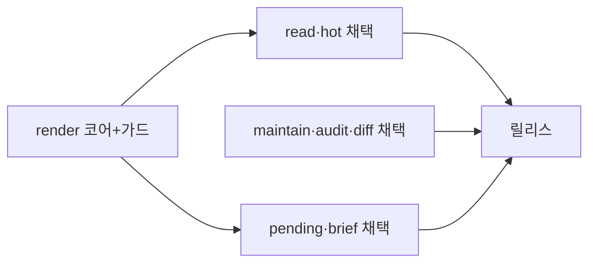

# flint v0.37.0 — 출력 살균 조크포인트 플랜

**Goal:** 출력 경로 살균 16곳(cli)을 render 단일 출구로 수렴하고 소스
스캔 가드로 우회를 영구 차단한다 (구조 수렴 1막).
**Architecture:** lib/cli 내 render.go 신규 — 패키지 분할 없음. 위임만
(출력 바이트 불변).
**Tech stack:** Go(기존 관례 승계).
**Spec:** docs/plans/2026-11-12-flint-v0370.spec.md
**Detail:** tests · **Target-min:** 14

**Global constraints (전 태스크 공통):**
- 테스트 `go test ./... -count=1` 직접 · 최종 `make ci`.
- 행위명 테스트만(버전 접두 금지) · 이메일 리터럴 금지.
- 출력 바이트 불변 — render 위임은 동등성 유지(기존 스냅숏 단언 통과).
- Ruling: render 함수 시그니처는 T1 e.g. 확정 — 소비 태스크가 변경
  요구 시 코디네이터 룰링先行.

```mermaid
%% schedule
gantt
  title Predicted schedule (mm:ss)
  dateFormat X
  axisFormat %M:%S
  section lane 1
  T1 render 코어·조크포인트 가드 :t1, 0, 102s
  T2 read·hot 채택 :t2, 102, 102s
  T5 릴리스  v0.37.0 + 가드 활성화 :t5, 204, 102s
  section lane 2
  T3 maintain·audit·diff 채택 :t3, 0, 102s
  T4 pending·brief 채택 :t4, 102, 102s
```





critical path: T1 → T2 → T5 (5.1 min) · peak width 2 · predicted build 5.1 min · predicted total ≈ 8.6 min

**File structure:**
- lib/cli/render.go(+render_test.go) — Text·Masked·Rows·Cells·가드
- lib/cli/read.go·hot.go — 셀 루프 채택
- lib/cli/maintain.go·audit.go·diff.go — 구조체 필드 채택
- lib/cli/pending.go·brief.go — Text·Masked 채택
- VERSION·README·plugin.json·PLAN(T5)

---

### T1 render 코어·조크포인트 가드 · Complexity 4 (O-1) · Est. context 26k
**Owns:** lib/cli/render.go, lib/cli/render_test.go
**Components:** 1 · **LOC owned:** 90 · **Tests:** fast · **Model:** sonnet
**Est. time:** 3 min (코어+소스스캔 가드, fast tests)
**Produces:** render.Text(s string) string · render.Masked(s string) string · render.Rows(rows [][]any, fields string, jsonMode bool) string · render.Cells(rows [][]any) [][]any
- e.g. render.Text("a[flint]b") -> "a b" · render.Cells([[1,"x[flint]y"]]) -> [[1,"x y"]] · render.Rows(그 행들, "id,topic", false) -> "1|x y\n" 관례(FormatRows 포맷)
**Review Focus:** `TestRenderDelegates`: Text/Masked/Cells가 store.SanitizeText·MaskSecrets와 동등(마스킹→살균 순서 포함). `TestSanitizeTextChokepoint`: lib/ 비테스트 소스에서 SanitizeText 직접 호출이 허용 파일(render.go·write.go·import.go·done.go·lib/store/sanitize.go·lib/store/pipeline.go)에만 존재 — 위반 파일명·줄 보고와 FAIL.
**Test code (핵심 골격):**
```go
func TestSanitizeTextChokepoint(t *testing.T) {
	allow := map[string]bool{
		"lib/cli/render.go": true, "lib/cli/write.go": true,
		"lib/cli/import.go": true, "lib/cli/done.go": true,
		"lib/store/sanitize.go": true, "lib/store/pipeline.go": true,
	}
	// filepath.WalkDir lib/ — *_test.go 제외 — 정규 `SanitizeText(` 검출
	// allow 밖 발견 시 t.Errorf("%s:%d — render 우회: render.Text/Rows/Cells 사용", …)
}
```
**Steps:** 1 동등성 테스트(TestRenderDelegates) + 가드 테스트(TestSanitizeTextChokepoint — 첫 줄에 `t.Skip("activated at T5 — T2~T4 채택 전 위반 예상")`, T5가 해제), 2 render.go 구현(Text·Masked·Rows·Cells), 3 go test ./lib/cli -run 'Render'.
**Notes:** 가드의 Skip 해제는 T5 소관(render_test.go 소유 이관) — 채택 전 16곡 위반이 예상되므로 T1~T4 동안은 Skip으로 유지하고 T5가 해제·위반 0을 확인한다(룰링).

### T2 read·hot 채택 · Complexity 3 (O-1) · Est. context 24k
**Owns:** lib/cli/read.go, lib/cli/hot.go, lib/cli/readhot_render_output_test.go
**Components:** 1 · **LOC owned:** 55 · **Tests:** fast · **Model:** sonnet
**Est. time:** 2.5 min (셀 루프 2곳 교체, fast tests)
**Consumes:** render.Rows(rows [][]any, fields string, jsonMode bool) string (T1) · render.Cells(rows [][]any) [][]any (T1)
**Review Focus:** `TestReadOutputUnchanged`: 살균 대상 픽스처 행이 render 경로와 구 경로 동일 출력(스냅숏). hot --full 주입 경로 포함.
**Steps:** 1 동등성 테스트, 2 read.go:380-386 루프 → render.Cells(또는 Rows 직접), hot.go:~308 루프 → 동일, 3 go test ./lib/cli -run 'Read|Hot' 후 전체.
**Notes:** hot --full 접미·ClampHot 순서 불변 — Cells가 원 슬라이스를 갱신하는 현행 의존성(hotSuffixedLines가 rows 참조) 유지.

### T3 maintain·audit·diff 채택 · Complexity 3 (O-1) · Est. context 28k
**Owns:** lib/cli/maintain.go, lib/cli/audit.go, lib/cli/diff.go, lib/cli/maintain_outputs_sanitized_test.go
**Components:** 1 · **LOC owned:** 60 · **Tests:** fast · **Model:** sonnet
**Est. time:** 3 min (구조체 필드 9곳 교체, fast tests)
**Consumes:** render.Text(s string) string (T1)
**Review Focus:** `TestMaintainOutputsSanitized`(기존 재살균 단언 승계 — dup/conflict/stale/expire 그룹 JSON), `TestAuditDiffMessagesSanitized`.
**Steps:** 1 기존 단언 확인(신규는 최소), 2 maintain.go 6곳·audit.go 1곳·diff.go 2곳 store.SanitizeText → render.Text, 3 go test ./lib/cli -run 'Maintain|Audit|Diff' 후 전체.

### T4 pending·brief 채택 · Complexity 2 (O-0) · Est. context 20k
**Owns:** lib/cli/pending.go, lib/cli/brief.go, lib/cli/pending_fields_sanitized_test.go, lib/cli/brief_mask_order_test.go
**Components:** 1 · **LOC owned:** 35 · **Tests:** fast · **Model:** sonnet
**Est. time:** 2 min (필드 4곳 교체, fast tests)
**Consumes:** render.Text(s string) string (T1) · render.Masked(s string) string (T1)
**Review Focus:** `TestBriefMaskOrder`(기존 — 마스킹→살균 순서·[REDACTED] 흔적 생존), `TestPendingFieldsSanitized`.
**Steps:** 1 기존 단언 확인, 2 pending.go 3곳 → render.Text·brief.go:93 → render.Masked, 3 go test ./lib/cli -run 'Pending|Brief' 후 전체.

### T5 릴리스: v0.37.0 + 가드 활성화 · Complexity 4 (O-1) · Est. context 26k
**Owns:** VERSION, README.md, README.ko.md, flint-plugin/.claude-plugin/plugin.json, docs/PLAN.md, docs/plans/2026-11-12-flint-v0370.md, docs/plans/2026-11-12-flint-v0370.spec.md, lib/cli/render_test.go(가드 Skip 해제 1줄)
**Components:** 1 · **LOC owned:** 60 · **Tests:** fast · **Model:** sonnet
**Est. time:** 3 min (가드 활성+릴리스, fast tests)
**Consumes:** T1~T4 산출
**Produces:** v0.37.0 릴리스 상태 + 활성화된 TestSanitizeTextChokepoint(위반 0)
**Review Focus:** `TestSanitizeTextChokepoint`: Skip 제거 후 통과(전 소스 스캔 위반 0). `TestVersionArtifactsSync`(기존).
**Steps:** 1 render_test.go 가드 t.Skip 라인 제거 → go test ./... 전체(위반 0·녹색 확인), 2 VERSION 0.37.0·배지·plugin.json, 3 PLAN §14 v0.37.0 엔트리(구조 수렴 1막 이행 — 로드맵 v0.37 행 체크, 병인 ① 출력 부분 해소 서술), 4 make ci.
**Notes:** 가드가 위반을 잡으면 T5 착수 불가 — 소유 태스크(T2~T4)로 반송 룰.

---

**Review Focus (패키지별):**
- lib/cli(CLI): encoding(살균 동등성·출력 바이트)·protocol(포맷) —
  T1~T4. `Probe entry: run=go test ./lib/cli -count=1`
- docs: file — T5. `Probe entry: run=make test`

**Self-review:** 스펙 전 절 매핑(§1 현황은 §2의 근거 배경 — 전수 조사
좌표가 태스크 Steps에 반영됨·§2.1→T1·§2.3 read·hot→T2·§2.3
maintain·audit·diff→T3·§2.3 pending·brief→T4·§2.2 가드 활성화+§3→T5·
비목표=무결). Consumes/Produces 형식 일치·주기 없음·동시 실행 태스크
파일 미공유(T5만 후행, render_test.go는 T5 시점에만 편집 — T1 완료 후
T2~T4와 동시 실행 시점에 T1 소유 확정이라 무충돌). 자리표시자 없음.
