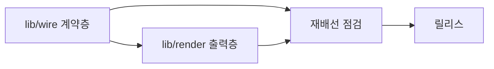

# flint v0.38.0 — wire·render 패키지 추출 플랜

**Goal:** lib/cli에서 계약층(lib/wire)·출력층(lib/render)을 추출해
패키지 3분열(v0.39·v0.40)의 기반을 만든다. 동작·출력·exit 전부 불변.
**Architecture:** 이동+별칭만 — 시그니처 변경 없음. 의존 방향:
cli→wire·render, render→wire(단방향). realStore는 cli 잔류.
**Tech stack:** Go(모듈 github.com/synuns/flint).
**Spec:** docs/plans/2026-11-12-flint-v0380.spec.md
**Detail:** tests · **Target-min:** 14

**Global constraints (전 태스크 공통):**
- 테스트 `go test ./... -count=1` 직접 · 최종 `make ci`.
- 동작·출력 바이트·exit 코드 전부 불변 — 이동과 별칭만.
- 행위명 테스트만 · 이메일 리터럴 금지 · 커밋 금지.
- 별칭 파일(cliwire_alias.go·render_alias.go)의 var 별칭은 테스트
  seam 교체(소문자 var) 호환 유지.

```mermaid
%% schedule
gantt
  title Predicted schedule (mm:ss)
  dateFormat X
  axisFormat %M:%S
  section lane 1
  T1 lib/wire 계약층 추출 :t1, 0, 127s
  T3 재배선 점검·별칭 최소화 :t3, 127, 102s
  T4 릴리스  v0.38.0 :t4, 229, 102s
  section lane 2
  T2 lib/render 출력층 추출 :t2, 0, 127s
```

critical path: T1 → T3 → T4 (5.5 min) · peak width 2 · predicted build 5.5 min · predicted total ≈ 9.0 min

**File structure:**
- lib/wire/(신규 패키지): store.go(인터페이스·queryOnce)·run.go(Run·errLine·dsn)·registry.go(Register·usage)·meta.go — wire_test.go·usage 테스트 이동분
- lib/render/(신규 패키지): render.go(Text·Masked·Cells·Rows)·text.go(truncateRunes·countPending) — render 테스트 이동분(가드 포함)
- lib/cli/: root.go(realStore만 잔류)·cliwire_alias.go(신규)·render_alias.go(신규) — registry/meta_kv/config/render/textutil 원본 제거
- VERSION·PLAN 등(T4)

---

### T1 lib/wire 계약층 추출 · Complexity 5 (O-1) · Est. context 34k
**Owns:** lib/wire/, lib/cli/root.go, lib/cli/registry.go, lib/cli/meta_kv.go, lib/cli/config.go, lib/cli/usage_wire.go, lib/cli/cliwire_alias.go(신규), lib/cli/cli_test.go, lib/cli/meta_kv_test.go, lib/cli/usage_registry_v0342_test.go
**Components:** 2 · **LOC owned:** 420 · **Tests:** fast · **Model:** sonnet
**Est. time:** 5 min (이동+별칭, fast tests)
**Produces:** wire.Store(인터페이스 7메서드) · wire.Run(args []string, stdin io.Reader, stdout io.Writer, newStore func(ctx context.Context, dsn string) (Store, error)) int · wire.Register(name string, h Handler) · wire.ErrLine(err error) string · wire.QueryOnce(ctx, st Store, sql string, args []any) ([][]any, error) · wire.GetMetaKV/wire.SetMetaKV/wire.BumpMetaKV
- e.g. wire.Run(args, in, out, cliFactory) → 기존 cli.Run과 동일 exit/출력 · wire.Register("write", h) → wire.Lookup("write") == h
**Review Focus:** `TestWireRunDispatch`(이동·갱신 — store-free/soft/quiet 3경로), `TestUsageOrderMatchesRegistry`(이동 — 집합 동질 가드), `TestAliasCompat`: cli 별칭(type Store=wire.Store·var errLine=wire.ErrLine 등)로 잔여 cli 파일 무편집 컴파일·cli.Run 위임 동등.
**Steps:** 1 wire 패키지에 인터페이스·Run·registry·dsn·errLine·queryOnce·meta 이동(원본 root.go에서 realStore·ensureSchemas는 잔류) 2 cli 별칭 파일 작성·cli.Run = wire.Run 위임(공장 주입) 3 usage·meta 테스트 이동·이동분 녹색 4 `go build ./...` 후 `go test ./... -count=1`.
**Notes:** registry 초기 등록(write·read·hot·status·backup·restore — registry.go init)도 wire로. 기존 root.go의 newStore seam(cli var)은 잔류 — Run이 공장 파라미터로 받으므로 테스트 교체 관례 불변.

### T2 lib/render 출력층 추출 · Complexity 4 (O-1) · Est. context 28k
**Owns:** lib/render/, lib/cli/render.go, lib/cli/textutil.go, lib/cli/render_alias.go(신규), lib/cli/render_test.go, lib/cli/textutil_test.go, lib/cli/pending.go
**Components:** 2 · **LOC owned:** 220 · **Tests:** fast · **Model:** sonnet
**Est. time:** 4 min (이동+가드 경로 갱신, fast tests)
**Produces:** render.Text(s string) string · render.Masked(s string) string · render.Cells(rows [][]any) [][]any · render.Rows(rows [][]any, fields string, jsonMode bool) string · render.TruncateRunes(s string, n int) string · render.CountPending(ctx, st wire.Store) (int, error)
- e.g. render.Text("a[flint]b") -> "a b" (기존과 동일)
**Review Focus:** `TestSanitizeTextChokepoint`(이동 — 화이트리스트 경로 갱신 lib/render/* + 기존 5파일, 위반 0), `TestRenderDelegates`(이동), `TestAliasCompat`(T1 패턴 — cli 소비 파일 무편집).
**Steps:** 1 render.go·textutil(truncateRunes·countPending)를 lib/render로 이동·통합(countPending은 wire.Store) 2 cli 별칭 파일 3 가드·위임 테스트 이동·화이트리스트 갱신 4 `go test ./... -count=1`.
**Notes:** lib/cli/readhot_render_output_test.go 등 소비 테스트는 무편집(별칭 경유 동등).

### T3 재배선 점검·별칭 최소화 · Complexity 3 (O-1) · Est. context 26k
**Owns:** lib/cli/usage_wire.go, docs/versions_test.go, lib/wire/registry.go, lib/wire/registry_test.go, lib/cli/usage_bridge_test.go, lib/cli/update.go, lib/cli/asof.go, lib/cli/brief.go, lib/cli/profile.go, lib/cli/rules_sync.go, lib/cli/cliwire_alias.go, lib/wire/meta_kv_test.go, lib/wire/wire_test.go
**Components:** 1 · **LOC owned:** 40 · **Tests:** fast · **Model:** sonnet
**Est. time:** 2.5 min (점검·미세 정리, fast tests)
**Consumes:** wire 전 표면(T1) · render 전 표면(T2)
**Review Focus:** `TestFacadeCompile`(go build ./... · go vet ./...), 전체 스위트 11/0/0, cmd/flint/main.go 무변경 확인(git diff 대상 외).
**Steps:** 1 `grep -rn "queryOnce\|errLine\|getMetaKV" lib/cli/*.go | grep -v _test | grep -v alias` — 별칭 경유 잔여 조사, 직접 wire.X 전환이 안전한 상위 5곳만 전환(나머지 별칭 유지 — v0.39/0.40 이동 시 자연 해소) 2 `go vet ./...` 3 전체 스위트·인시던트 없음 확인.
**Notes:** 대규모 재배선 금지 — 이번 릴리스는 기반 조성이 목적.

### T4 릴리스: v0.38.0 · Complexity 4 (O-1) · Est. context 26k
**Owns:** VERSION, README.md, README.ko.md, flint-plugin/.claude-plugin/plugin.json, docs/PLAN.md, docs/plans/2026-11-12-flint-v0380.md, docs/plans/2026-11-12-flint-v0380.spec.md
**Components:** 1 · **LOC owned:** 60 · **Tests:** fast · **Model:** sonnet
**Est. time:** 3 min (changelog+로드맵, fast tests)
**Consumes:** T1~T3 산출
**Produces:** v0.38.0 릴리스 상태 + PLAN 로드맵 표 갱신(3분산 룰링: v0.39 knowledge·v0.40 ops·v0.41 스키마·v0.42 계측·v0.43 seam·v0.44 PLAN/표면 → v1.0)
**Review Focus:** `TestVersionArtifactsSync`(기존)·가드 위반 0.
**Steps:** 1 VERSION 0.38.0·배지·plugin.json 2 PLAN §14 v0.38.0 엔트리(wire·render 추출·별칭 호환·3분산 룰링·갱신 로드맵 표 — 기존 v0.37 엔트리의 로드맵 표 대체) 3 make ci.
**Notes:** 배지 3종 회전(v0.36.1·v0.37.0·v0.38.0).

---

**Review Focus (패키지별):**
- lib/wire(CLI): protocol(디스패치·usage)·state(공장 주입) —
  T1. `Probe entry: run=go test ./lib/wire -count=1`
- lib/render(CLI): encoding(살균·마스킹 순서) — T2.
  `Probe entry: run=go test ./lib/render -count=1`
- lib/cli: protocol — T3. `Probe entry: run=go test ./lib/cli -count=1`
- docs: file — T4. `Probe entry: run=make test`

**Self-review:** 스펙 전 절 매핑(§1→T1·§2→T2·§3→T4·재배선 점검=§1·§2
호환 확정→T3·비목표 무결). Consumes/Produces 형식 일치·주기 없음·동시
실행 파일 미공유(T1·T2 병렬 — wire/와 render/ 디렉터리 상이, T3·T4
후행). 자리표시자 없음.
