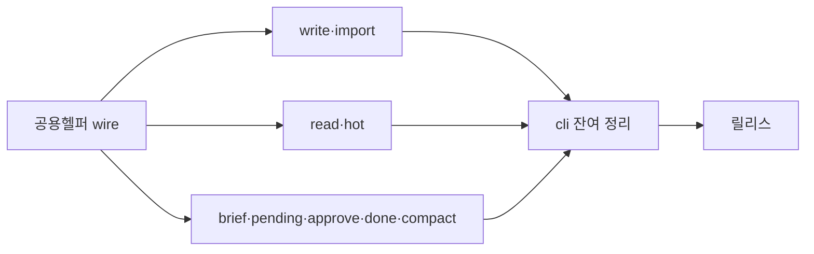

# flint v0.39.0 — knowledge 패키지 분리 플랜

**Goal:** 유입→심사→승격→세션 커맨드 9종을 lib/knowledge로 이동.
동작·출력·exit 불변. 의존: knowledge→wire·render / cli→knowledge.
**Architecture:** v0.38 패턴 승계 — 이동+내보내기+별칭. realStore
메서드는 cli 추출 파일로.
**Tech stack:** Go(모듈 github.com/synuns/flint).
**Spec:** docs/plans/2026-11-12-flint-v0390.spec.md
**Detail:** tests · **Target-min:** 18

**Global constraints (전 태스크 공통):**
- 테스트 `go test ./... -count=1` 직접 · 최종 `make ci`.
- 동작·출력 바이트·exit 불변 · 행위명 테스트 · 이메일 리터럴 금지 ·
  커밋 금지.
- knowledge가 cli를 임포트하면 사이클 — 절대 금지(cli→knowledge만).

```mermaid
%% schedule
gantt
  title Predicted schedule (mm:ss)
  dateFormat X
  axisFormat %M:%S
  section lane 1
  T1 공용 헬퍼 wire 이동 :t1, 0, 127s
  T2 knowledge 1탄 — write·import :t2, 127, 127s
  T5 cli 잔여 정리·등록 활성화 :t5, 253, 102s
  T6 릴리스  v0.39.0 :t6, 355, 102s
  section lane 2
  T3 knowledge 2탄 — read·hot :t3, 127, 127s
  section lane 3
  T4 knowledge 3탄 — brief·pending·approve· :t4, 127, 127s
```

critical path: T1 → T2 → T5 → T6 (7.6 min) · peak width 3 · predicted build 7.6 min · predicted total ≈ 11.1 min

**File structure:**
- lib/wire/: thresholds.go(loadThresholds·Fn seam·bumpReadStats)·session.go(ReadSessionLabel)
- lib/knowledge/(신규): write.go·import.go·read.go·hot.go·brief.go·pending.go·approve.go·done.go·compact.go(+동반 테스트)·knowledge.go(패키지 문서·init 등록)
- lib/cli/: realstore_write.go·realstore_read.go·realstore_curation.go(신규 — 메서드 이관)·knowledge_alias.go(별칭) — 이동 원본 파일 9종 삭제
- VERSION·PLAN(T6)

---

### T1 공용 헬퍼 wire 이동 · Complexity 4 (O-1) · Est. context 26k
**Owns:** lib/wire/thresholds.go, lib/wire/session.go, lib/wire/thresholds_test.go, lib/cli/maintain.go, lib/cli/metrics.go, lib/cli/marker.go, lib/cli/cliwire_alias.go
**Components:** 2 · **LOC owned:** 130 · **Tests:** fast · **Model:** sonnet
**Est. time:** 3 min (3함수 이동+별칭, fast tests)
**Produces:** wire.LoadThresholds(ctx, st wire.Store) (store.Thresholds, error) · wire.LoadThresholdsFn var(교체 seam) · wire.BumpReadStatsToMeta(ctx, st, zero, near bool) · wire.ReadSessionLabel() (string, bool)
- e.g. wire.ReadSessionLabel() -> (라벨, true)|("", false) 기존 동일
**Review Focus:** `TestLoadThresholdsFallback`(조회 실패 시 DefaultThresholds 폴백 — 기존 관례), 이동 후 doctor·tuning·marker(ops 잔류) 무편집 컴파일(cliwire_alias var 별칭).
**Steps:** 1 maintain.go의 loadThresholds·loadThresholdsFn·metrics.go bumpReadStatsToMeta·marker.go ReadSessionLabel(저장 함수 잔류)을 wire로 이동·내보내기 2 cli 별칭 추가 3 `go test ./... -count=1`.
**Notes:** loadThresholdsFn seam은 wire var — 기존 테스트 교체 관례 유지(cli 별칭 경유).

### T2 knowledge 1탄 — write·import · Complexity 5 (O-1) · Est. context 34k
**Owns:** lib/knowledge/(write.go·import.go·knowledge.go·동반 테스트), lib/cli/write.go, lib/cli/import.go, lib/cli/write_test.go, lib/cli/import_test.go, lib/cli/realstore_write.go(신규), lib/cli/knowledge_alias.go(신규), lib/render/render_test.go(가드 화이트리스트 경로 갱신)
**Components:** 2 · **LOC owned:** 380 · **Tests:** fast · **Model:** sonnet
**Est. time:** 5 min (이동+내보내기, fast tests)
**Consumes:** wire.LoadThresholds (T1) · wire 전 표면(v0.38)
**Produces:** knowledge 패키지 초기 — RunWrite·RunImport 핸들러(wire.Register), 내보내기 식별자(RecordUsage 등 knowledge 내부 공용)
**Review Focus:** write 5단계 파이프라인 테스트 이동 녹색(dedup·레이스 재확인·경고 병합)·import 파서 테스트 이동 녹색·realstore_write.go에 realStore 메서드 2종 이관(write.go 소유분)·cli 잔류 파일 무편집(knowledge_alias).
**Steps:** 1 lib/knowledge 생성·write.go·import.go(+테스트) 이동·패키지문·내보내기 2 realStore 메서드(DupRowByHash·DupRowByHash 랩퍼 등 write.go 내 2종)를 cli/realstore_write.go로 추출 3 knowledge.go init 등록 4 knowledge_alias.go(recordUsage 등 잔류 소비자용) 5 `go test ./... -count=1`.
**Notes:** writeThresholds·sanitizePayload·recordUsage는 knowledge 내부로 함께 이동(소비자: hot·read·done — 이후 탄 이동 전까지 knowledge_alias로 cli 잔류 호환… 아니면 hot/read가 아직 cli면 별칭 필요 — knowledge_alias에 var 제공).

### T3 knowledge 2탄 — read·hot · Complexity 5 (O-1) · Est. context 34k
**Owns:** lib/knowledge/read.go, lib/knowledge/hot.go, lib/knowledge/(동반 테스트), lib/cli/read.go, lib/cli/hot.go, lib/cli/read_test.go, lib/cli/readhot_render_output_test.go, lib/cli/realstore_read.go(신규), lib/render/text.go, lib/cli/meta_kv_test.go, docs/tuning_test.go, lib/knowledge/knowledge.go, lib/cli/knowledge_alias.go, lib/cli/render_alias.go, lib/render/text_test.go
**Components:** 2 · **LOC owned:** 420 · **Tests:** fast · **Model:** sonnet
**Est. time:** 5 min (이동+부채 수렴, fast tests)
**Consumes:** knowledge.RecordUsage 등 1탄 내보내기 (T2) · wire.BumpReadStatsToMeta·ReadSessionLabel (T1)
**Produces:** knowledge.RunRead·RunHot 핸들러·테스트 이동
**Review Focus:** read 계약 테스트(제로히트 침묵 exit 1·--session 자동 라벨·as-of)·hot --full 스냅숏·**cellToInt 부채 수렴**(read.go 이동 후 render/text.go 단일 구현 사용 — read 측 복제 삭제)·realstore_read.go 3종 이관.
**Steps:** 1 read·hot(+테스트) 이동·내보내기 2 realStore 메서드 3종(read.go BumpReads·RecordReadUsage·RecordReadEvent + hot 1종) cli 추출 3 cellToInt 수렴 4 `go test ./... -count=1`.
**Notes:** readSuggestEligible·idsCSV 등 read 내부는 비내보내기 유지(패키지 내 소비만).

### T4 knowledge 3탄 — brief·pending·approve·done·compact · Complexity 5 (O-1) · Est. context 36k
**Owns:** lib/knowledge/(brief·pending·approve·done·compact.go+동반 테스트), lib/cli/brief.go, lib/cli/pending.go, lib/cli/approve.go, lib/cli/done.go, lib/cli/compact.go, lib/cli/pending_fields_sanitized_test.go, lib/cli/brief_mask_order_test.go, lib/cli/realstore_curation.go(신규), lib/cli/knowledge_curation_alias.go(신규), lib/render/text.go, lib/cli/render_alias.go, lib/knowledge/import.go, lib/knowledge/knowledge.go, lib/cli/done_test.go, lib/cli/wire_approve_store_test.go, lib/cli/backup_integrity_test.go, lib/cli/meta_kv_test.go, lib/cli/approve_test.go, lib/cli/brief_v0340_test.go, lib/cli/brief_v0341_test.go, lib/cli/done_v0100_test.go, lib/cli/done_v0270_test.go, lib/cli/pending_v0290_test.go, lib/cli/render_test.go
**Components:** 2 · **LOC owned:** 480 · **Tests:** fast · **Model:** sonnet
**Est. time:** 5 min (5파일 이동, fast tests)
**Consumes:** knowledge 1·2탄 내보내기 (T2·T3)
**Produces:** knowledge.RunBrief·RunPending·RunApprove·RunDone·RunCompact 핸들러·CountPending 내보내기
**Review Focus:** brief 마스킹 순서(ADR-0015)·pending 필드 살균·approve supersede 후견사·done 비간섭 exit 0·compact 무동작 경로 — 전부 이동 테스트 녹색·realstore_curation.go(approve·done 메서드) 이관·ops 잔류(status·nudge·sessionhook)의 countPending 별칭(cli/knowledge_curation_alias.go — T2 소유 파일과 별개).
**Steps:** 1 5파일(+테스트) 이동·내보내기 2 realStore 메서드(approve 1·done 2) cli 추출 3 knowledge_alias.go에 CountPending 별칭 추가 4 `go test ./... -count=1`.
**Notes:** done의 maybeAutoBackup·maybeSessionKnowledge 등 내부 유틸 동반 이동(autoBackupFn seam 포함 — done_test 이동과 함께).

### T5 cli 잔여 정리·등록 활성화 · Complexity 4 (O-1) · Est. context 30k
**Owns:** lib/cli/cliwire_alias.go, lib/cli/knowledge_alias.go, lib/cli/root.go
**Components:** 1 · **LOC owned:** 60 · **Tests:** fast · **Model:** sonnet
**Est. time:** 2.5 min (정리, fast tests)
**Consumes:** T2~T4 산출
**Review Focus:** `TestRegisteredMatchesUsage`(bridge 가드 — 9커맨드 등록 knowledge 이관 후에도 녹색)·전체 스위트·`go vet`·빈 별칭 정리(이동으로 소비자 0 된 별칭 제거).
**Steps:** 1 root.go(또는 cli 메인 와이어링 지점)에 knowledge 사이드이펙트 임포트 추가(등록 활성화) 2 사용 0 별칭 제거·gofmt 3 `go test ./... -count=1`·`go vet ./...`.
**Notes:** cli 패키지가 빈 커맨드만 남으면 그대로(ops는 v0.40) — 이번은 최소 정리만.

### T6 릴리스: v0.39.0 · Complexity 4 (O-1) · Est. context 26k
**Owns:** VERSION, README.md, README.ko.md, flint-plugin/.claude-plugin/plugin.json, docs/PLAN.md, docs/plans/2026-11-12-flint-v0390.md, docs/plans/2026-11-12-flint-v0390.spec.md
**Components:** 1 · **LOC owned:** 55 · **Tests:** fast · **Model:** sonnet
**Est. time:** 3 min (changelog, fast tests)
**Consumes:** T1~T5 산출
**Produces:** v0.39.0 릴리스 상태(PLAN §14 엔트리 — 로드맵 v0.39 행 체크 표시)
**Review Focus:** `TestVersionArtifactsSync`·가드 위반 0·bridge 가드.
**Steps:** 1 VERSION 0.39.0·배지(회전 v0.37.0·v0.38.0·v0.39.0)·plugin.json 2 PLAN 엔트리(9커맨드 이동·공용 헬퍼 wire·cellToInt 수렴·별칭 호환·불변 서술·spec 링크) 3 make ci.

---

**Review Focus (패키지별):**
- lib/wire: state·protocol — T1. `Probe entry: run=go test ./lib/wire -count=1`
- lib/knowledge: protocol(계약 이동 불변)·encoding(살균)·state(판정) —
  T2~T4. `Probe entry: run=go test ./lib/knowledge -count=1`
- lib/cli: protocol(등록 bridge) — T5. `Probe entry: run=go test ./lib/cli -count=1`
- docs: file — T6. `Probe entry: run=make test`

**Self-review:** 스펙 전 절 매핑(§1→T1·§2 1·2·3탄→T2·T3·T4·§2
별칭·부채→각 탄·§3→T6·비목표 무결). 동시 실행 파일 미공유(T2·T3·T4
병렬 — 파일 상호 배타, knowledge_alias.go만 T2 신설·T4 추가 소유
선언으로 순서 명시). 자리표시자 없음.
