# flint v0.40.0 — ops 패키지 분리 플랜

**Goal:** 진단·정리·관측 커맨드를 lib/ops로 이동해 3분할 완결.
동작·출력·exit 불변.
**Architecture:** v0.39 패턴 승계 — 3탄 직렬·별칭 호환·realStore
메서드 cli 추출. 의촌: ops→wire·render / cli→ops.
**Tech stack:** Go. **Spec:** docs/plans/2026-11-13-flint-v0400.spec.md
**Detail:** tests · **Target-min:** 20

**Global constraints:** go test ./... -count=1 직접·make ci 최종·동작
불변·행위명 테스트·이메일 리터럴 금지·커밋 금지. ops→cli 임포트 금지.

```mermaid
%% schedule
gantt
  title Predicted schedule (mm:ss)
  dateFormat X
  axisFormat %M:%S
  section lane 1
  T1 ops 1탄 — doctor·audit·diff·status·tun :t1, 0, 127s
  T2 ops 2탄 — maintain·metrics·marker·nudg :t2, 127, 127s
  T3 ops 3탄 — report·backup·sigverify·rule :t3, 253, 127s
  T4 wire 공용 유틸 + cli 종착 정리 :t4, 380, 127s
  T5 릴리스  v0.40.0 :t5, 506, 102s
```

critical path: T1 → T2 → T3 → T4 → T5 (10.1 min) · peak width 1 · predicted build 10.1 min · predicted total ≈ 13.6 min

**File structure:**
- lib/ops/(신규): 1탄 doctor·audit·diff·status·tuning / 2탄 maintain·metrics·marker·nudge·sessionhook / 3탄 report·report_html·backup·sigverify·rules_sync (+ops.go 등록·테스트)
- lib/wire/: asof.go·profile.go 이동
- lib/cli/: realstore_diag·care·supply.go(신규)·ops_alias_1~3.go(신규) — 이동 원본 제거·잔여 별칭 정리(T4)

---

### T1 ops 1탄 — doctor·audit·diff·status·tuning · Complexity 5 (O-1) · Est. context 36k
**Owns:** lib/ops/(doctor.go·audit.go·diff.go·status.go·tuning.go·ops.go+동반 테스트), lib/cli/doctor.go, lib/cli/audit.go, lib/cli/diff.go, lib/cli/status.go, lib/cli/tuning.go, lib/cli/realstore_diag.go(신규), lib/cli/ops_alias_1.go(신규), lib/cli/doctor_test.go, lib/cli/doctor_check_registry_test.go, lib/cli/runbook 관련 cli 테스트(이동분)
**Components:** 2 · **LOC owned:** 400 · **Tests:** fast · **Model:** sonnet · **Est. time:** 5 min
**Produces:** ops.RunDoctor·RunAudit·RunDiff·RunStatus·RunTuning 핸들러(등록)·Diagnose 계열 내보내기
**Review Focus:** doctor 등록표 4경로 파생 녹색·tuningKeyAll 가드·unknown flag exit 3·status pending count(ops_alias 경유)·realstore_diag 추출 완전.
**Steps:** 1 이동+내보내기(패키지문·식별자 대문자화) 2 realStore 메서드(이동 파일 내) cli/realstore_diag.go 추출 3 ops.go init 등록·ops_alias_1.go(미이동 파일 호환 소문자 var) 4 go test ./... -count=1.
**Notes:** 이동 테스트는 동반, 행위명 유지(버전접두 이동분은 이름 보존 — v0.39 관례).

### T2 ops 2탄 — maintain·metrics·marker·nudge·sessionhook · Complexity 5 (O-1) · Est. context 36k
**Owns:** lib/ops/(maintain.go·metrics.go·marker.go·nudge.go·sessionhook.go+테스트), lib/cli/maintain.go, lib/cli/metrics.go, lib/cli/marker.go, lib/cli/nudge.go, lib/cli/sessionhook.go, lib/cli/realstore_care.go(신규), lib/cli/ops_alias_2.go(신규), lib/cli/maintain 관련 테스트(이동분)
**Components:** 2 · **LOC owned:** 450 · **Tests:** fast · **Model:** sonnet · **Est. time:** 5 min
**Consumes:** T1 내보내기(stall·meta 위생 등 doctor 계열)
**Produces:** ops.RunMaintain 핸들러·WriteTypedMarker·세션 훅 진입점 내보내기
**Review Focus:** maintain supersede 후견사·expire-pending dry-run·marker(WriteTypedMarker — knowledge seam 주입 호환)·sessionhook session-start/end 등록·metrics meta 위임.
**Steps:** T1 패턴 반복(이동·추출·등록·ops_alias_2)·go test 전체.
**Notes:** knowledge의 WriteTypedMarkerFn seam이 ops 내보내기 함수 주입받도록 cli init 갱신 — init 갱신은 T4 집중(임시 ops_alias_2 경유).

### T3 ops 3탄 — report·backup·sigverify·rules_sync · Complexity 5 (O-1) · Est. context 36k
**Owns:** lib/ops/(report.go·report_html.go·backup.go·sigverify.go·rules_sync.go+테스트), lib/cli/report.go, lib/cli/report_html.go, lib/cli/backup.go, lib/cli/sigverify.go, lib/cli/rules_sync.go, lib/cli/realstore_supply.go(신규), lib/cli/ops_alias_3.go(신규), lib/cli/backup 관련 테스트(이동분)
**Components:** 2 · **LOC owned:** 430 · **Tests:** fast · **Model:** sonnet · **Est. time:** 5 min
**Consumes:** T1·T2 내보내기
**Produces:** ops.RunReport·RunBackup·RunRestore 핸들러·Dump 위임
**Review Focus:** report 효과 지표 산출 불변·backup 3층 방어·restore 가드·sigverify 임베드 키·dumpStore 위임(realstore_supply).
**Steps:** 패턴 반복·go test 전체.

### T4 wire 공용 유틸 + cli 종착 정리 · Complexity 4 (O-1) · Est. context 32k
**Owns:** lib/wire/asof.go, lib/wire/profile.go, lib/wire/asof_test.go, lib/cli/asof.go, lib/cli/profile.go, lib/cli/cliwire_alias.go, lib/cli/ops_alias_1.go, lib/cli/ops_alias_2.go, lib/cli/ops_alias_3.go, lib/cli/knowledge_alias.go, lib/cli/knowledge_curation_alias.go, lib/cli/root.go, lib/cli/usage_wire.go
**Components:** 2 · **LOC owned:** 140 · **Tests:** fast · **Model:** sonnet · **Est. time:** 4 min
**Consumes:** T1~T3 산출
**Produces:** wire.ParseAsOfSpec·wire 노출 프로파일 내보내기·cli composition root 수렴(별칭 최소화·knowledge/ops seam init 최종 주입)
**Review Focus:** bridge 가드(TestRegisteredMatchesUsage — 전 커맨드 이관 후 녹색)·전체 스위트·vet·gofmt·`go list` 의존 방향(ops→cli 0).
**Steps:** 1 asof·profile wire 이동+별칭 2 사용 0 별칭 제거·seam init 최종 정리(root.go) 3 go test ./...·go vet.
**Notes:** cli 잔여 = root·realstore_*·setup·setup_ux·update·version·mcp·별침 최소 — 이 이상 축소는 v0.43.

### T5 릴리스: v0.40.0 · Complexity 4 (O-1) · Est. context 26k
**Owns:** VERSION, README.md, README.ko.md, flint-plugin/.claude-plugin/plugin.json, docs/PLAN.md, docs/plans/2026-11-13-flint-v0400.md, docs/plans/2026-11-13-flint-v0400.spec.md
**Components:** 1 · **LOC owned:** 55 · **Tests:** fast · **Model:** sonnet · **Est. time:** 3 min
**Consumes:** T1~T4 산출
**Produces:** v0.40.0 릴리스(PLAN 엔트리 — 3분할 완결 선언·로드맵 v0.40 체크)
**Review Focus:** TestVersionArtifactsSync·bridge 가드·가드 위반 0.
**Steps:** 버전 동기(회전 v0.38.0·v0.39.0·v0.40.0)·PLAN 엔트리(15파일 이동·3탄·wire 유틸·composition root 수렴·불변·spec 링크)·make ci.

---

**Review Focus (패키지별):**
- lib/ops: protocol·state·encoding — T1~T3. `Probe entry: run=go test ./lib/ops -count=1`
- lib/wire·lib/cli: protocol — T4. `Probe entry: run=go test ./... -count=1`
- docs: file — T5. `Probe entry: run=make test`

**Self-review:** 스펙 매핑(§1 1·2·3탄→T1·T2·T3·§2·§3→T4·§4→T5). 직렬
엣지(상호 참조). 파일 미공유·자리표시자 없음.
