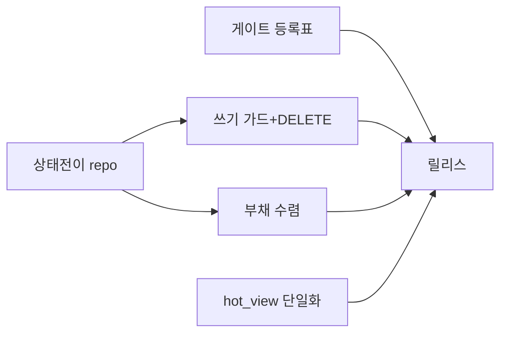

# flint v0.41.0 — 스키마 진실·쓰기 repo 집중 플랜

**Goal:** 게이트 등록표·상태 전이 단일화·쓰기 Query 폐지·부채 수렴·
hot_view 단일 정의. 동작·출력·exit 불변.
**Architecture:** lib/db 등록표·Repo 메서드 확장·realStore 위임·wire
유틸. 패키지 구조 무변경(v0.40 완성분 승계).
**Spec:** docs/plans/2026-11-13-flint-v0411.spec.md
**Detail:** tests · **Target-min:** 20

**Global constraints:** go test ./... -count=1 직접·make ci·동작 불변·
행위명 테스트·이메일 리터럴 금지·커밋 금지.

```mermaid
%% schedule
gantt
  title Predicted schedule (mm:ss)
  dateFormat X
  axisFormat %M:%S
  section lane 1
  T2 knowledge 상태 전이 repo 단일화 :t2, 0, 127s
  T3 쓰기 가드+나머지 DELETE :t3, 127, 102s
  T6 릴리스  v0.41.0 :t6, 229, 102s
  section lane 2
  T1 승격 게이트 등록표 :t1, 0, 102s
  T4 순수함수·meta 수렴 (wire) :t4, 127, 102s
  section lane 3
  T5 hot_view 평행 정의 제거 :t5, 0, 102s
```

critical path: T2 → T3 → T6 (5.5 min) · peak width 3 · predicted build 5.5 min · predicted total ≈ 9.0 min

**File structure:**
- lib/db/: schema_gates.go(등록표)·repo.go(Invalidate·Supersede·Prune·MetaDelete)
- lib/cli/root.go(ensureSchemas 파생)·realstore_care.go(위임 추가)
- lib/ops/maintain.go(3 UPDATE+DELETE 위임)·tuning.go(2 DELETE 위임)
- lib/knowledge/: approve.go(갱신 위임)·hot.go(동반 질의 폐지)·pending.go·lib/ops/report.go·backup.go(부채 별칭)
- lib/wire/util.go(CellToTime·QuoteJSON)
- lib/sqlfs/views.sql(주석 갱신만)
- VERSION·PLAN(T6)

---

### T1 승격 게이트 등록표 · Complexity 4 (O-1) · Est. context 26k
**Owns:** lib/db/schema_gates.go(신규), lib/db/schema_gates_test.go(신규), lib/db/admin.go, lib/cli/root.go, lib/cli/realstore_care.go(최신버전 표시 위임 필요시)
**Components:** 1 · **LOC owned:** 120 · **Tests:** fast · **Model:** sonnet · **Est. time:** 3 min
**Produces:** db.SchemaGates() []SchemaGate{Version int, Ensure func(ctx, *Repo) error} · db.LatestSchemaVersion int — ensureSchemas·doctor schema 표시 파생
- e.g. SchemaGates() -> [{2,EnsureSchemaV2},…,{8,EnsureSchemaV8}] 연속·LatestSchemaVersion -> 8
**Review Focus:** TestSchemaGatesContiguous(버전 2..8 연속·중복 없음)·TestEnsureSchemasUsesGates(순차 호출 파생 — 게이트 누락 시 컴파일 수준 노출).
**Steps:** 1 등록표 테스트 2 admin.go 함수들 등록표로 구성 3 root.go ensureSchemas 파생 전환 4 전체 스위트.

### T2 knowledge 상태 전이 repo 단일화 · Complexity 5 (O-1) · Est. context 34k
**Owns:** lib/db/repo.go, lib/db/repo_transition_test.go(신규), lib/cli/realstore_care.go, lib/ops/maintain.go, lib/knowledge/approve.go, lib/ops/maintain 관련 테스트(갱신분)
**Components:** 2 · **LOC owned:** 180 · **Tests:** fast · **Model:** sonnet · **Est. time:** 4.5 min
**Produces:** Repo.Invalidate(ctx, ids []int, reason string) (int64, error) · Repo.Supersede(ctx, oldID, newID int, at time.Time) (int64, error) — status·invalid_at·superseded_by 병기·rows-affected 후견사 내장(0행 → ErrNoRows 랩). realStore 위임(AuthorizeStore류 capability).
- e.g. Invalidate(ids) -> 갱신 행 수·동시 경합 0행 시 오류(기존 후견사 계약 승계)
**Review Focus:** TestInvalidateSupersedeSingleSource(위임 후 maintain 637·743·809·approve 갱신 경로 전부 Repo 경유 — 소스에 UPDATE knowledge 리터럴 잔여 0)·TestSupersedeRecordsLineage(superseded_by 병기 — Merge 텍스트 마커 이중 모델 폐지).
**Steps:** 1 repo 전이 테스트(fake repo 레벨·SQL 문자열 단언) 2 구현 3 realStore 위임 4 maintain·approve 호출 전환 5 전체.

### T3 쓰기 가드+나머지 DELETE · Complexity 4 (O-1) · Est. context 28k
**Owns:** lib/ops/maintain.go(DELETE분), lib/ops/tuning.go, lib/db/repo.go(메타 삭제 메서드), lib/ops/writes_through_repo_test.go(신규), lib/cli/realstore_care.go
**Components:** 1 · **LOC owned:** 110 · **Tests:** fast · **Model:** sonnet · **Est. time:** 3 min
**Consumes:** T2 위임 패턴
**Produces:** Repo.PruneInvalidated(ctx, before time.Time) (int64, error)·Repo.MetaDelete(ctx, keys []string) (int64, error) + TestWritesThroughRepoOnly — lib/{ops,knowledge} 비테스트 소스에서 Query/queryOnce 호출부에 UPDATE|DELETE|INSERT 토큰 탐지 시 FAIL(가드).
**Review Focus:** 가드 위반 0(전소스)·prune dry-run/commit 계약 불변·tuning reset --all 전량 삭제 유지.
**Steps:** 1 가드 테스트(현 maintain·tuning DELETE로 RED) 2 Repo 메서드+위임 3 호출 전환 4 전체.

### T4 순수함수·meta 수렴 (wire) · Complexity 3 (O-1) · Est. context 24k
**Owns:** lib/wire/util.go(신규), lib/wire/util_test.go(신규), lib/knowledge/pending.go, lib/ops/report.go, lib/knowledge/approve.go(별칭행만), lib/ops/backup.go, lib/knowledge/done.go
**Components:** 1 · **LOC owned:** 90 · **Tests:** fast · **Model:** sonnet · **Est. time:** 2.5 min
**Produces:** wire.CellToTime(v any) (time.Time, bool)·wire.QuoteJSON(s string) string — 소비 4곳 위임(로컬 정의 삭제), backupEncryptOn·done metaKV 래퍼는 wire.GetMetaKV/SetMetaKV 직접 사용.
**Review Focus:** TestCellToTimeQuoteJSONSingle(로컬 복제 삭제·wire 단일)·전체 스위트.
**Steps:** 1 wire 유틸+테스트 2 소비자 위임(복제 정의 제거) 3 전체.

### T5 hot_view 평행 정의 제거 · Complexity 4 (O-1) · Est. context 30k
**Owns:** lib/knowledge/hot.go, lib/knowledge/hot 관련 테스트(갱신분), lib/sqlfs/views.sql, lib/query/hot.go, lib/cli/readhot_v06_test.go, lib/cli/hot_v0110_test.go, lib/cli/hot_v0121_test.go, lib/cli/hot_v0132_test.go, lib/cli/hot_v0200_test.go, lib/cli/hot_full_guard_test.go, lib/cli/knowledge_alias.go
**Components:** 1 · **LOC owned:** 100 · **Tests:** fast · **Model:** sonnet · **Est. time:** 3.5 min
**Produces:** hot_view 단일 정의 기반 증분 — hotKnowledgeIDsSQL·pendingValidAtsSQL 동반 질의 폐지(뷰 id·valid_at·ingested_at 노출 활용, tie-break ", id DESC" 유지).
**Review Focus:** 기존 hot --full 스냅숏·증분 집합 정합 테스트 녹색(동반 질의 제거 후에도 주입=증분)·views.sql 3팔은 단일 정의.
**Steps:** 1 뷰에서 id·valid_at·ingested_at 팔별 조회로 대체 쿼리 1개화 2 동반 질의 제거 3 hot 스냅숏·계측 정합 테스트 4 전체.
**Notes:** 픽스처로 ts 매칭·tie-break 동등성 우선 확인 — 동등하지 않은 케이스 발견 시 보고(룰링).

### T6 릴리스: v0.41.0 · Complexity 4 (O-1) · Est. context 26k
**Owns:** VERSION, README.md, README.ko.md, flint-plugin/.claude-plugin/plugin.json, docs/PLAN.md, docs/plans/2026-11-13-flint-v0411.md, docs/plans/2026-11-13-flint-v0411.spec.md
**Components:** 1 · **LOC owned:** 55 · **Tests:** fast · **Model:** sonnet · **Est. time:** 3 min
**Consumes:** T1~T5 산출
**Produces:** v0.41.0 릴리스(로드맵 v0.41 체크 — 게이트 등록표·상태 전이 단일화·쓰기 repo 전용 가드·부채 4종 수렴·hot_view 단일 정의)
**Steps:** 버전 동기(회전 v0.39.0·v0.40.0·v0.41.0)·PLAN 엔트리·make ci.

---

**Review Focus (패키지별):**
- lib/db: state(전이·게이트 연속성) — T1·T2·T3. `Probe entry: run=go test ./lib/db -count=1`
- lib/ops·knowledge: protocol(쓰기 가드)·encoding — T2~T5. `Probe entry: run=go test ./lib/ops ./lib/knowledge -count=1`
- lib/wire: encoding — T4. `Probe entry: run=go test ./lib/wire -count=1`
- docs: file — T6. `Probe entry: run=make test`

**Self-review:** 스펙 매핑(§1→T1·§2a→T2·§2b→T3·§3→T4·§4→T5·§5→T6).
T1·T4·T5 병렬(파일 미공유 — repo.go는 T2·T3 직렬만). 자리표시자 없음.
