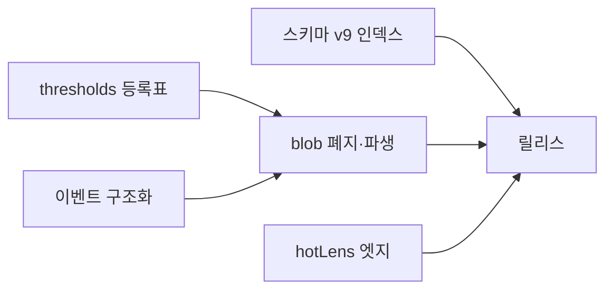

# flint v0.42.0 — 계측·튜닝 단일 원천 플랜

**Goal:** blob 폐지·파생 산출·thresholds 등록표·이벤트 구조화·v9
인덱스. 지표 수치·보고 불변.
**Architecture:** wire(등록표·파생)·db(Repo·스키마 v9)·knowledge·ops
소비 전환. 패키지 구조 무변경.
**Spec:** docs/plans/2026-11-13-flint-v0422.spec.md
**Detail:** tests · **Target-min:** 20

**Global constraints:** go test ./... -count=1 직접·make ci·지표
동등성(같은 픽스처→같은 수치)·행위명 테스트·이메일 리터럴 금지·커밋 금지.

```mermaid
%% schedule
gantt
  title Predicted schedule (mm:ss)
  dateFormat X
  axisFormat %M:%S
  section lane 1
  T1 thresholds 키 등록표 :t1, 0, 127s
  T2 blob 폐지·파생 산출 :t2, 127, 127s
  T6 릴리스  v0.42.0 :t6, 253, 102s
  section lane 2
  T3 RecordReadEvent 구조체화 :t3, 0, 102s
  section lane 3
  T4 스키마 v9 인덱스 :t4, 0, 102s
  section lane 4
  T5 hotLens/hotPersisted 엣지 수선 :t5, 0, 102s
```

critical path: T1 → T2 → T6 (5.9 min) · peak width 4 · predicted build 5.9 min · predicted total ≈ 9.4 min

**File structure:**
- lib/wire/: thresholds.go(등록표 재구성·LoadReadStats 폐지)·threshold_meta.go(신규)
- lib/db/: usage.go(ReadEvent 구조체·파생 산출 쿼리·Prune 파생)·admin.go(EnsureSchemaV9 인덱스)
- lib/knowledge/read.go(쓰기 4→2·구조체 호출)·lib/ops/report.go·doctor.go(파생 소비)
- VERSION·PLAN(T6)

---

### T1 thresholds 키 등록표 · Complexity 4 (O-1) · Est. context 30k
**Owns:** lib/wire/threshold_meta.go(신규), lib/wire/threshold_meta_test.go(신규), lib/wire/thresholds.go, lib/store/thresholds.go(구조체만 공유 확인), lib/ops/maintain.go(thresholdsKeys 파생), lib/ops/tuning.go(tuningKeys 파생), lib/db/usage.go(Prune 파생)
**Components:** 2 · **LOC owned:** 200 · **Tests:** fast · **Model:** sonnet · **Est. time:** 4 min
**Produces:** ThresholdMeta{Field, Key string, Default any, Desc string} 등록표 — DefaultThresholds·ParseThresholds·thresholdsKeys·tuningKeys 전부 파생
- e.g. ThresholdMetas() -> 29개 키 메타(기존 키 집합과 동일 집합 단언)
**Review Focus:** TestThresholdRegistrySingleSource(등록표 키 집합 == 기존 키 집합·Parse 인식·tuningKeys·TUNING 표 노출 4곳 동질)·TestNewKeyPropagates(가상 키 1건 등록 시 4경로 동시 반영 — 등록 후 제거).
**Steps:** 1 등록표+동질 테스트(RED) 2 파생 전환(상수·switch 제거) 3 PruneReadEvents·PruneDaily 파생 경로 4 전체.

### T2 blob 폐지·파생 산출 · Complexity 5 (O-1) · Est. context 36k
**Owns:** lib/wire/thresholds.go(LoadReadStats·BumpReadStats 폐지분), lib/knowledge/read.go, lib/ops/report.go, lib/ops/doctor.go, lib/ops/metrics_test.go, lib/ops/report 관련 테스트(갱신)
**Components:** 2 · **LOC owned:** 260 · **Tests:** fast · **Model:** sonnet · **Est. time:** 5 min
**Consumes:** T1 파생 경로 · T3 ReadEvent 구조체
**Produces:** read_stats blob 폐지 — read 1회 쓰기 4→2(BumpReads·RecordReadEvent)·report 효과·doctor zero-near는 daily·read_events 파생 산출(Repo 파생 쿼리).
- e.g. 동일 픽스처에서 report effect hit_pct·near_pct·doctor zero_near 판정이 기존 blob 경로와 동일 수치(동등성 테스트)
**Review Focus:** TestEffectParity(픽스처: read 10회 중 zero 3·near 1 → blob 경로 값 == 파생 경로 값)·TestReadWritesReduced(read 호출 후 meta 쓰기 — read_stats 키 부재 단언).
**Steps:** 1 파생 쿼리+동등성 테스트 2 소비자 전환 3 blob 쓰기·로더 폐지(마이그레이션 안내 주석) 4 전체.
**Notes:** 운영 DB 잔존 blob은 무해 — 읽지 않음. hot_stats도 동일 패턴 적용(소비자 hot_lens만 있으면 범위 포함, 없으면 read_stats만).

### T3 RecordReadEvent 구조체화 · Complexity 3 (O-1) · Est. context 26k
**Owns:** lib/db/usage.go, lib/knowledge/read.go(인터페이스·호출), lib/cli/realstore_read.go
**Components:** 1 · **LOC owned:** 80 · **Tests:** fast · **Model:** sonnet · **Est. time:** 2.5 min
**Produces:** db.ReadEvent{Hits int, Zero, Near, Fallback bool, Session, IDs string, FirstRank int} — Repo.RecordReadEvent(ctx, ev ReadEvent)·인터페이스 동시 갱신.
**Review Focus:** 기존 read 이벤트 회귀(hits·ids CSV·firstRank) 녹색·전체.
**Steps:** 1 구조체 시그니처 2 호출부 전환 3 전체.

### T4 스키마 v9 인덱스 · Complexity 3 (O-1) · Est. context 24k
**Owns:** lib/db/admin.go(EnsureSchemaV9), lib/db/schema_gates.go(등록), lib/db/admin 관련 테스트, lib/sqlfs/schema.sql(주석)
**Components:** 1 · **LOC owned:** 70 · **Tests:** fast · **Model:** sonnet · **Est. time:** 2.5 min
**Produces:** EnsureSchemaV9 — CREATE INDEX IF NOT EXISTS: read_events(ts)·hot_events(ts)·session_starts(ts)·knowledge partial(status='pending' WHERE invalid_at IS NULL).
**Review Focus:** 게이트 등록표 v9 연속성 가드 자동 FAIL→녹색·additive(기존 DB 무손상)·인덱스 존재 단언.
**Steps:** 1 v9 게이트+등록 2 인덱스 DDL 3 전체(실DB 가용 시 REAL).

### T5 hotLens/hotPersisted 엣지 수선 · Complexity 3 (O-1) · Est. context 24k
**Owns:** lib/ops/metrics.go, lib/ops/metrics 관련 테스트
**Components:** 1 · **LOC owned:** 50 · **Tests:** fast · **Model:** sonnet · **Est. time:** 2 min
**Produces:** hotLens 절단 시 hotPersisted 재계산(또는 절단 불변 보장) — fr-v0400 기록 엣지.
**Review Focus:** TestHotLensTruncateConsistency(상한 초과 세션에서 lens·persisted 정합).
**Steps:** 1 엣지 재현 테스트 2 수선 3 전체.

### T6 릴리스: v0.42.0 · Complexity 4 (O-1) · Est. context 26k
**Owns:** VERSION, README.md, README.ko.md, flint-plugin/.claude-plugin/plugin.json, docs/PLAN.md, docs/plans/2026-11-13-flint-v0422.md, docs/plans/2026-11-13-flint-v0422.spec.md
**Components:** 1 · **LOC owned:** 55 · **Tests:** fast · **Model:** sonnet · **Est. time:** 3 min
**Consumes:** T1~T5 산출
**Produces:** v0.42.0 릴리스(로드맵 v0.42 체크)
**Steps:** 버전 동기(회전 v0.40.0·v0.41.0·v0.42.0)·PLAN 엔트리(등록표·blob 폐지·구조체·v9 인덱스·엣지 수선)·make ci.

---

**Review Focus (패키지별):**
- lib/wire: state(등록표) — T1. `Probe entry: run=go test ./lib/wire -count=1`
- lib/db·knowledge·ops: numeric(지표 동등성)·state — T2~T5.
  `Probe entry: run=go test ./lib/db ./lib/knowledge ./lib/ops -count=1`
- docs: file — T6. `Probe entry: run=make test`

**Self-review:** 스펙 매핑(§1→T2·§2→T1·§3→T3·§4→T4·§5→T5·§6→T6).
T1·T3 선행 후 T2(파생+구조체 소비)·T4·T5 병렬. read.go는 T2·T3
공유 — T3를 T2 앞 엣지로 직렬. 자리표시자 없음.
