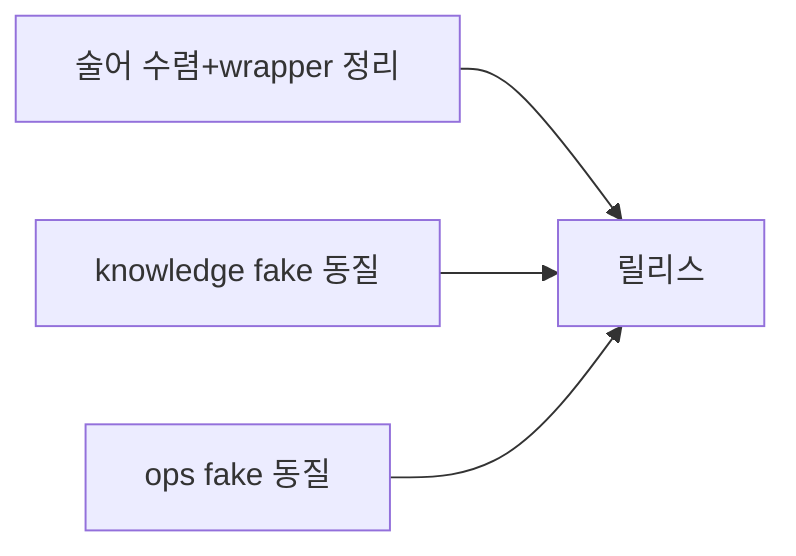

# flint v0.43.0 — seam 동질화 플랜

**Goal:** fake-capability 컴파일 동질 가드·술어 수렴·wrapper seam
정리. 프로덕션 동작 불변.
**Architecture:** 테스트 인프라 중심(패키지별 fake_parity_test.go)
·wire에 술어 1건 이동.
**Spec:** docs/plans/2026-11-13-flint-v0433.spec.md
**Detail:** tests · **Target-min:** 14

**Global constraints:** go test ./... -count=1 직접·make ci·프로덕션
코드 동작 불변(술어 이동·주석 제외)·행위명 테스트·이메일 리터럴
금지·커밋 금지.

```mermaid
%% schedule
gantt
  title Predicted schedule (mm:ss)
  dateFormat X
  axisFormat %M:%S
  section lane 1
  T1 knowledge fake 동질 가드 :t1, 0, 102s
  T4 릴리스  v0.43.0 :t4, 102, 102s
  section lane 2
  T2 ops fake 동질 가드 :t2, 0, 102s
  section lane 3
  T3 술어 수렴+wrapper 정리 :t3, 0, 102s
```

critical path: T1 → T4 (3.4 min) · peak width 3 · predicted build 3.4 min · predicted total ≈ 6.9 min

**File structure:**
- lib/knowledge/fake_parity_test.go(신규)·lib/ops/fake_parity_test.go(신규)
- lib/wire/util.go(BackupEncryptOn)·lib/knowledge/done.go·lib/ops/backup.go·lib/cli/{root,ops_alias_3}.go
- VERSION·PLAN(T4)

---

### T1 knowledge fake 동질 가드 · Complexity 4 (O-1) · Est. context 30k
**Owns:** lib/knowledge/fake_parity_test.go(신규), lib/knowledge/각 fake 정의 _test 파일(메서드 추가분)
**Components:** 1 · **LOC owned:** 140 · **Tests:** fast · **Model:** sonnet · **Est. time:** 4 min
**Produces:** knowledge 패키지 전 capability 인터페이스(11종: approveStore·supersedeStore·readBumper·ReadEventStore·UsageStore·DupIDStore·DupMetaStore·UsageCountStore·staleSessionStore·usageStore(done)·sessionSummaryStore)의 컴파일 시점 fake 단언 전수.
- e.g. `var _ supersedeStore = (*fakeApprove)(nil)` 11종 전부 — 미구현 메서드는 canned 구현(호출 기록 슬라이스·선택적 오류 필드).
**Review Focus:** `TestFakeParityKnowledge`(단언 전수는 컴파일 자체 — 가드는 인터페이스 발견 목록과 단언 목록 동질 리플렉션/소스 스캔)·기존 테스트 전부 녹색(폴백 분기 미도달로 일부 기대치 변화 시 — 실경로 기대치로 갱신, 동작 의미 불변).
**Steps:** 1 인터페이스 목록 추출(grep) 2 fake_parity_test.go 단얍+미구현 canned 3 영향 테스트 갱신 4 go test ./... -count=1.

### T2 ops fake 동질 가드 · Complexity 3 (O-1) · Est. context 26k
**Owns:** lib/ops/fake_parity_test.go(신규), lib/ops/각 fake 정의 _test 파일(메서드 추가분)
**Components:** 1 · **LOC owned:** 100 · **Tests:** fast · **Model:** sonnet · **Est. time:** 3 min
**Produces:** ops 패키지 capability 5종(dumpStore·MaintStore·ConflictStore·conflictStore·metaDeleteStore) 컴파일 단언 + canned.
**Review Focus:** TestFakeParityOps·기존 테스트 녹색.
**Steps:** T1 패턴.

### T3 술어 수렴+wrapper 정리 · Complexity 3 (O-1) · Est. context 28k
**Owns:** lib/wire/util.go, lib/wire/util_test.go, lib/knowledge/done.go, lib/ops/backup.go, lib/cli/root.go, lib/cli/ops_alias_3.go, lib/cli/ops_alias_1.go, lib/cli/ops_alias_2.go
**Components:** 1 · **LOC owned:** 90 · **Tests:** fast · **Model:** sonnet · **Est. time:** 3 min
**Produces:** wire.BackupEncryptOn(v string) bool 단일 구현 — knowledge/done.go 로컬 복제 삭제·ops.BackupEncryptOn 위임·cli 별칭 유지. wrapper seam 중 불필요분 직접 참조 전환(각 1줄 사유 주석).
**Review Focus:** TestBackupEncryptOnSingle(로컬 정의 잔여 0 소스 스캔)·기존 테스트 녹색.
**Steps:** 1 wire 술어+테스트 2 소비 3곳 위임 3 wrapper 조사·전환 4 전체.

### T4 릴리스: v0.43.0 · Complexity 4 (O-1) · Est. context 26k
**Owns:** VERSION, README.md, README.ko.md, flint-plugin/.claude-plugin/plugin.json, docs/PLAN.md, docs/plans/2026-11-13-flint-v0433.md, docs/plans/2026-11-13-flint-v0433.spec.md
**Components:** 1 · **LOC owned:** 50 · **Tests:** fast · **Model:** sonnet · **Est. time:** 3 min
**Consumes:** T1~T3 산출
**Produces:** v0.43.0 릴리스(로드맵 v0.43 체크 — 병인 ③ seam 파편화 해소 완결)
**Steps:** 버전 동기(회전 v0.41.1·v0.42.0·v0.43.0)·PLAN 엔트리·make ci.

---

**Review Focus (패키지별):**
- lib/knowledge·lib/ops: state(fake 동질) — T1·T2.
  `Probe entry: run=go test ./lib/knowledge ./lib/ops -count=1`
- lib/wire·cli: encoding(술어)·protocol — T3.
  `Probe entry: run=go test ./lib/wire ./lib/cli -count=1`
- docs: file — T4. `Probe entry: run=make test`

**Self-review:** 스펙 매핑(§1→T1·T2·§2·§3→T3·§4→T4). T1·T2·T3
병렬(파일 미공유). 자리표시자 없음.
