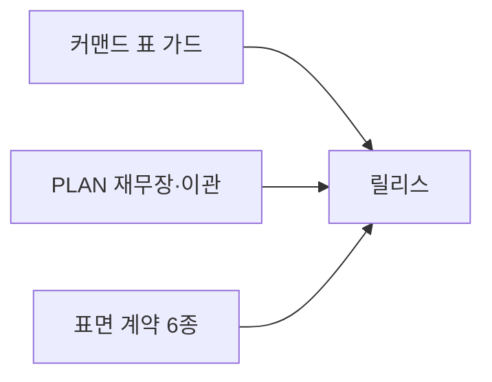

# flint v0.44.0 — PLAN 재무장·표면 계약 플랜

**Goal:** PLAN 2페이지 재무장·HISTORY 이관 완결·표면 계약 6종·
커맨드 표 가드. 코드 무변경(테스트 1건 신규만).
**Architecture:** 문서 재구성 + 문서-코드 동기 가드.
**Spec:** docs/plans/2026-11-13-flint-v0444.spec.md
**Detail:** tests · **Target-min:** 16

**Global constraints:** go test ./... -count=1·make ci·기록 보존(이관
·삭제 구분)·행위명 테스트·이메일 리터럴 금지·커밋 금지·실측치 금지.

```mermaid
%% schedule
gantt
  title Predicted schedule (mm:ss)
  dateFormat X
  axisFormat %M:%S
  section lane 1
  T1 PLAN 재무장·HISTORY 이관 :t1, 0, 102s
  T4 릴리스  v0.44.0 :t4, 102, 102s
  section lane 2
  T2 표면 계약 문서 6종 :t2, 0, 102s
  section lane 3
  T3 커맨드 표 동기 가드 :t3, 0, 102s
```

critical path: T1 → T4 (3.4 min) · peak width 3 · predicted build 3.4 min · predicted total ≈ 6.9 min

**File structure:**
- docs/PLAN.md(2페이지 재작성)·docs/HISTORY.md(§14 이관분)
- docs/contracts/{cli,mcp,hooks,plugin,registry,bridge}.md(신규)
- docs/commands_table_test.go(신규)
- VERSION·README·plugin.json(T4)

---

### T1 PLAN 재무장·HISTORY 이관 · Complexity 4 (O-1) · Est. context 32k
**Owns:** docs/PLAN.md, docs/HISTORY.md
**Components:** 1 · **LOC owned:** 220 · **Tests:** fast · **Model:** sonnet · **Est. time:** 4.5 min
**Produces:** PLAN ≤150줄(현행 구조·원칙·비목표·v1.0 마일스톤 1개·에라 요약 표) — §14 전 엔트리 HISTORY 이관(시간순·머리글 갱신).
**Review Focus:** runbook_test·versions_test 등 문서 계약 테스트 갱신 통과·PLAN 모순 소멸(구 본문 4개 모순 지점 재검)·실측치 부재.
**Steps:** 1 HISTORY에 §14 전체 이관(관례 양식) 2 PLAN 본문 재작성 3 문서 테스트 갱신·go test ./... 4 wc -l PLAN ≤150 확인.

### T2 표면 계약 문서 6종 · Complexity 3 (O-1) · Est. context 30k
**Owns:** docs/contracts/(전 6파일)
**Components:** 1 · **LOC owned:** 240 · **Tests:** fast · **Model:** sonnet · **Est. time:** 4 min
**Produces:** 계약 6종 각 1페이지 — 스펙 §2 목록 그대로(코드·ADR 원천 인용·실측치 없음).
**Review Focus:** 각 문서가 코드 실체와 정합(도구 5종·명령·훅 3종·exit 코드 — grep 대조).
**Steps:** 6문서 작성·go test ./... (영향 없음 확인).

### T3 커맨드 표 동기 가드 · Complexity 3 (O-1) · Est. context 26k
**Owns:** docs/commands_table_test.go(신규), README.md, README.ko.md, flint-plugin/skills/flint/SKILL.md
**Components:** 1 · **LOC owned:** 120 · **Tests:** fast · **Model:** sonnet · **Est. time:** 3 min
**Produces:** TestCommandTableMatchesRegistry — README EN/KO 커맨드 나열 == wire.Registered 집합(hiddenFromUsage 제외)·TestSkillToolListMatchesMCP — SKILL 도구 == lib/mcp 5종.
**Review Focus:** 신규 가드 RED(현 불일치 — SKILL 5종은 v0.34.2 수정됨·README 표 확인)→GREEN.
**Steps:** 1 가드 테스트(불일치 발견 시 문서 갱신) 2 go test ./....

### T4 릴리스: v0.44.0 · Complexity 4 (O-1) · Est. context 26k
**Owns:** VERSION, flint-plugin/.claude-plugin/plugin.json, docs/PLAN.md(엔트리), docs/plans/2026-11-13-flint-v0444.md, docs/plans/2026-11-13-flint-v0444.spec.md
**Components:** 1 · **LOC owned:** 45 · **Tests:** fast · **Model:** sonnet · **Est. time:** 2.5 min
**Consumes:** T1~T3 산출
**Produces:** v0.44.0 릴리스(병인 ⑤ 해소 — 재무장 완결·v1.0.0 게이트 준비 선언). 배지 회전은 T3가 README 소유하므로 T4도 README 소유(회전 v0.42.0·v0.43.0·v0.44.0).
**Steps:** 버전 동기·PLAN 엔트리(T1 재작성본에 부합)·make ci.

---

**Review Focus (패키지별):**
- docs: file(문서-코드 정합·계약 테스트) — T1~T4.
  `Probe entry: run=go test ./docs -count=1`

**Self-review:** 스펙 매핑(§1→T1·§2→T2·§3→T3·§4→T4). T1·T2·T3 병렬
(파일 미공유 — PLAN은 T1·T4 공유로 T4 후행 엣지). 자리표시자 없음.
