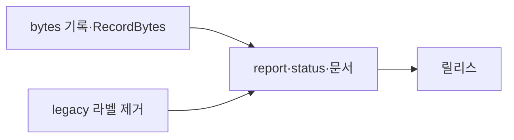

# flint v1.1.0 — 토큰(바이트) 관측·legacy 라벨 제거 플랜

**Goal:** G5 바이트 계측(표면 3종)·legacy 라벨 제거·문서. 동작·출력
불변(신규 필드·카운터 additive).
**Architecture:** daily 카운터 증가종·wire/session legacy 분기 제거.
스키마 무변경.
**Spec:** docs/plans/2026-11-13-flint-v1110.spec.md
**Detail:** tests · **Target-min:** 14

**Global constraints:** go test ./... -count=1·**make lint**(v1.0.13 관례
추가)·make ci·행위명 테스트·이메일 리터럴 금지·커밋 금지·개인정보
무수집(바이트 수만).

```mermaid
%% schedule
gantt
  title Predicted schedule (mm:ss)
  dateFormat X
  axisFormat %M:%S
  section lane 1
  T1 바이트 계측 — RecordBytes·표면 3종 기록 :t1, 0, 127s
  T3 집계·보고·문서 :t3, 127, 127s
  T4 릴리스  v1.1.0 :t4, 253, 102s
  section lane 2
  T2 legacy 세션 라벨 제거 :t2, 0, 102s
```

critical path: T1 → T3 → T4 (5.9 min) · peak width 2 · predicted build 5.9 min · predicted total ≈ 9.4 min

**File structure:**
- lib/db/usage.go(RecordBytes)·lib/knowledge/{read,hot,brief}.go(기록 호출)·lib/ops/report.go·status.go(bytes 집계)
- lib/wire/session.go(legacy 제거)·lib/ops/marker.go(Clear legacy 분기)
- docs/METRICS.md·TUNING.md·PLAN.md·HISTORY.md·VERSION(T4)

---

### T1 바이트 계측 — RecordBytes·표면 3종 기록 · Complexity 4 (O-1) · Est. context 30k
**Owns:** lib/db/usage.go, lib/db/usage_bytes_test.go(신규), lib/knowledge/read.go, lib/knowledge/hot.go, lib/knowledge/brief.go(+ 각 기존 테스트 갱신)
**Components:** 2 · **LOC owned:** 130 · **Tests:** fast · **Model:** sonnet · **Est. time:** 4 min
**Produces:** Repo.RecordBytes(ctx, kind string, n int) error — kind=read|hot|brief, daily:<date> JSON에 <kind>_bytes 증분·last 없음(횟수 last_<kind>_at 준용). wire 경유가 아니라 repo 직속(유입 계측과 동일 계층) — realStore 위임 또는 능력 인터페이스(knowledge 소비 패턴 승계).
- e.g. RecordBytes("hot", 1180) → daily:2026-11-13 JSON의 hot_bytes +1180
**Review Focus:** TestRecordBytesDaily(증분·파손 재기작·무효 kind 거부). read는 제로히트 0바이트도 기록(호출 수 분모 정합). hot은 ClampHot '후' 길이·brief는 ClampHot '후' 길이(예산 실측 — before 아님). 기록 실패 조용히(계측 원칙 §13).
**Steps:** 1 RecordBytes+테스트 2 read/hot/brief 출력 직후 len 측정·기록(각 회귀: bytes 키 증분 단언) 3 전체.
**Notes:** byteLen = len(최종 출력 문자열)(UTF-8 바이트 — io.Writer에 쓴 총량과 동일).

### T2 legacy 세션 라벨 제거 · Complexity 3 (O-1) · Est. context 24k
**Owns:** lib/wire/session.go, lib/wire/session_test.go, lib/ops/marker.go(ClearSessionLabel legacy 분기), lib/ops/sessionlabel 관련 테스트
**Components:** 1 · **LOC owned:** 80 · **Tests:** fast · **Model:** sonnet · **Est. time:** 3 min
**Produces:** legacy 폴백 제거 — ReadSessionLabel은 session-*.label만, ClearSessionLabel(session)은 자기 파일만(legacy 청산 라인 제거). 잔존 session-current 파일은 무시(미삭제 — 사용자 디스크).
**Review Focus:** 기존 세션별 파일 테스트 녹색·legacy 관련 테스트 제거/갱신·워크트리 잔존 파일 무시 단언.
**Steps:** 1 legacy 분기 제거 2 테스트 정리 3 전체.

### T3 집계·보고·문서 · Complexity 4 (O-1) · Est. context 30k
**Owns:** lib/ops/report.go, lib/ops/status.go, docs/METRICS.md, docs/TUNING.md, docs/PLAN.md, 관련 테스트
**Components:** 2 · **LOC owned:** 160 · **Tests:** fast · **Model:** sonnet · **Est. time:** 4 min
**Consumes:** T1 카운터·T2 무관
**Produces:** report effect.bytes{read,hot,brief 각 bytes_14d·avg_bytes}·status `hot_bytes_14d`(v0180 구조체 말미 additive)·METRICS G5 행+§4 정의·TUNING 1줄·PLAN §6 v1.1.0 체크.
**Review Focus:** TestReportBytes(픽스처 daily bytes → 집합 정합)·avg 분모 0 가드·METRICS 금지조항(토큰 환산 배제) 서술·문서 계약 테스트 갱신.
**Steps:** 1 집계·출력 2 문서 3 전체·make lint.

### T4 릴리스: v1.1.0 · Complexity 4 (O-1) · Est. context 26k
**Owns:** VERSION, README.md, README.ko.md, flint-plugin/.claude-plugin/plugin.json, docs/PLAN.md(엔트리), docs/HISTORY.md, docs/plans/2026-11-13-flint-v1110.md, docs/plans/2026-11-13-flint-v1110.spec.md
**Components:** 1 · **LOC owned:** 55 · **Tests:** fast · **Model:** sonnet · **Est. time:** 3 min
**Consumes:** T1~T3
**Produces:** v1.1.0 마이너(G5 토큰 관측·legacy 제거·마일스톤 잔여 판정 기록)
**Steps:** 버전 동기(v1.0.13→v1.0.14 아님 — 마이너 1.1.0)·HISTORY·PLAN 체크·make lint+ci+e2e(전 게이트 — 릴리스 파이프라인 v1.0.13 복구 준수: deploy가 자동 발행).

---

**Review Focus (패키지별):**
- lib/db·knowledge: numeric(바이트 정합)·state — T1. `Probe entry: run=go test ./lib/db ./lib/knowledge -count=1`
- lib/wire·ops: state(legacy)·numeric(집계) — T2·T3. `Probe entry: run=go test ./lib/wire ./lib/ops -count=1`
- docs: file — T3·T4. `Probe entry: run=make lint`

**Self-review:** 스펙 매핑(§1→T1·T3·§2→T2·§3→T3·T4). T1·T2 병렬(파일
미공유), T3 후행. 자리표시자 없음.
