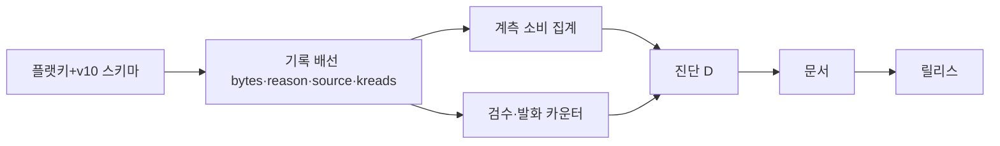

# flint v1.2.0 — 관측 고도화 플랜 (저장 수선·계측·진단)

**Goal:** 저장 원자화(S1)·스키마 v10(S2)·계측 6종(G4 정합·제로히트
분해·토큰 회계·검수·발화·회상 운명)·규칙 진단 D. E는 defer.
**Architecture:** additive v10 게이트·플랫 키 전환(폴백 승계)·
knowledge_reads 신규 테이블·순수 함수 진단.
**Spec:** docs/plans/2026-11-13-flint-v1200.spec.md
**Detail:** tests · **Target-min:** 26

**Global constraints:** go test ./... -count=1·make lint(v1.0.13 관례)·
make ci·행위명 테스트·이메일 리터럴 금지·커밋 금지·개인정보 무수집
(카운터·바이트만)·동작·출력 불변(additive만).

```mermaid
%% schedule
gantt
  title Predicted schedule (mm:ss)
  dateFormat X
  axisFormat %M:%S
  section lane 1
  T1 플랫 키 전환 + v10 스키마 :t1, 0, 127s
  T2 기록 배선 — bytes·zero_reason·source·know :t2, 127, 127s
  T3 집계 소비 — report cost·curation·zero 분해· :t3, 253, 127s
  T5 진단 D — 순수 함수 규칙 엔진 :t5, 380, 127s
  T6 문서 — METRICS·RUNBOOK·TUNING :t6, 506, 102s
  T7 릴리스  v1.2.0 :t7, 608, 102s
  section lane 2
  T4 검수·발화 카운터 :t4, 253, 127s
```

critical path: T1 → T2 → T3 → T5 → T6 → T7 (11.8 min) · peak width 2 · predicted build 11.8 min · predicted total ≈ 15.3 min

**File structure:**
- lib/db/usage.go(플랫 키·RecordBytes 원천 열)·admin.go(v10)·schema_gates.go
- lib/sqlfs/schema.sql(v10 주석)·lib/knowledge/{read,hot}.go(기록 배선)
- lib/ops/report.go(집계·cost·curation)·status.go·doctor.go(발화)·done.go
·nudge·sessionhook(발화 카운터)
- lib/ops/diagnosis.go(신규·순수 함수)
- docs/{METRICS,TUNING,RUNBOOK,PLAN,HISTORY}.md·VERSION(T7)

---

### T1 플랫 키 전환 + v10 스키마 · Complexity 5 (O-1) · Est. context 34k
**Owns:** lib/db/usage.go, lib/db/admin.go, lib/db/schema_gates.go, lib/sqlfs/schema.sql, lib/db/usage_flatkey_test.go(신규), lib/db/admin_v10_test.go(신규)
**Components:** 2 · **LOC owned:** 320 · **Tests:** fast(slow 실DB 병행) · **Model:** sonnet · **Est. time:** 5 min
**Produces:** bumpDailyFlat(원자 단일문 증분·`daily:<kind>:<date>` int 값)·EnsureSchemaV10(read_events 3열·knowledge_reads 테이블·인덱스)·readDailyFlat(플랫 키 우선·구 JSON 키 승계 폴백)·PruneDaily 양쪽 정리.
- e.g. bumpDailyFlat("2026-11-13","hot_bytes",1180) → `daily:hot_bytes:2026-11-13` = 기존+1180 (단일 UPSERT)
**Review Focus:** TestFlatKeyAtomicIncrement(증분·파손 0 재기작·구 JSON 폴백 읽기)·TestV10GateAdditive(기존 DB 무손상·멱등 승격·read_events 열 존재·knowledge_reads 인덱스)·PruneDaily 양쪽 키 정리·last_brief_at metaKnownKeys 즉치.
**Steps:** 1 테스트(플랫키·v10) 2 구현·게이트 등록(v10·연속성 가드) 3 폴백 읽기·Prune 4 실DB 승격 회귀·전체.
**Notes:** hot_stats blob 폐지도 T1에서(읽는 곳 T3에서 파생 전환 — 파일 소유는 T1·소비 전환은 T3).

### T2 기록 배선 — bytes·zero_reason·source·knowledge_reads · Complexity 4 (O-1) · Est. context 30k
**Owns:** lib/knowledge/read.go, lib/knowledge/hot.go, lib/db/reads.go(또는 usage.go의 kreads 기록), lib/db/usage.go(ReadEvent 확장), lib/knowledge/brief.go(source 라벨), 기존 테스트 갱신
**Components:** 2 · **LOC owned:** 200 · **Tests:** fast · **Model:** sonnet · **Est. time:** 4 min
**Consumes:** T1 스키마 열·kreads 테이블
**Produces:** RecordReadEvent 확장(bytes·zero_reason·source 기록)·RecordKnowledgeReads(ids·session·kind) — hot 헤드라인(비 --full) 포함. zero_reason 산출: zero=1 && active<floor → 'unowned', zero=1 && active≥1 → 'owned_miss'(임계 thresholds zero_owned_floor).
**Review Focus:** TestReadEventColumns(bytes=출력 len·source 라벨·zero_reason 분기)·TestKnowledgeReadsHotHeadline(헤드라인 id 전수·kind=hot)·--full 계약 불볕.
**Steps:** 1 회귀 2 배선 3 전체.
**Notes:** read_count/last_read_at 캐시 경로 유지(BumpReads 불볕).

### T3 집계 소비 — report cost·curation·zero 분해·운명·p95 · Complexity 5 (O-1) · Est. context 36k
**Owns:** lib/ops/report.go, lib/ops/status.go, lib/ops/report_v1200_test.go(신규), lib/ops/metrics.go(hot_stats 파생 전환)
**Components:** 2 · **LOC owned:** 300 · **Tests:** fast · **Model:** sonnet · **Est. time:** 5 min
**Consumes:** T1 플랫 키·T2 이벤트 열·kreads
**Produces:** report effect.`cost`{read,hot,brief 각 bytes_14d·avg·p95·savings_lower_bound(dup×평균기록바이트·라벨 '하한')·hit_injection_cost}·`curation`{approve·maintain·import 건수/실패}(T4 카운터 소비)·`zero_unowned_pct`·`zero_owned_miss_pct`·`survived_pct`·`bad_recall_pct`(kreads×knowledge 7일 조인)·`hot_read_chain_pct`(kreads 주입→30분 내 read). status에 read_bytes_p95/hot_bytes_p95 additive.
**Review Focus:** TestReportCost(픽스처: dup N×기록바이트 → savings 정확·hit_cost 라벨)·TestZeroDecompose(unowned/owned_miss 분기)·TestRecallFate(픽스처: 회상 id → 7일 후 superseded → bad_recall_pct)·p95 계산(빈·1건 가드)·hot_stats 파생 전환(기존 값 정합).
**Steps:** 1 회귀(픽스처 기반) 2 집계 구현 3 hot_stats 소비 전환 4 전체.
**Notes:** p95은 최근 창 이벤트 기반(nearest-rank·분모<5는 0). savings 라벨 문구 계약("절약 하한 추정").

### T4 검수·발화 카운터 · Complexity 3 (O-1) · Est. context 26k
**Owns:** lib/knowledge/approve.go(카운터만), lib/ops/maintain.go(카운터만), lib/knowledge/import.go(카운터만), lib/ops/doctor.go(경고 카운터), lib/knowledge/done.go(stale 경고 카운터), lib/ops/nudge.go(발화 카운터), lib/ops/sessionhook.go(발화 카운터), lib/db/usage.go(kind 확장)
**Components:** 2 · **LOC owned:** 150 · **Tests:** fast · **Model:** sonnet · **Est. time:** 3.5 min
**Produces:** daily 카운터 신규: approve_done/approve_not_found/approve_supersede_err·maintain_supersede/expire/prune_rows·import_added/import_skipped·fired_nudge_distill/recall/update·fired_done_stale·fired_doctor_<check> 종류별(과도시 상한 명세). RecordUsageCount kind 화이트리스트 확장.
**Review Focus:** TestCurationCounters(각 경로 1회 → 카운터)·TestFiredCounters(경고 발화 시 증분·미발화 0)·기존 계약 불변.
**Steps:** 1 회귀 2 카운터 배선 3 전체.

### T5 진단 D — 순수 함수 규칙 엔진 · Complexity 4 (O-1) · Est. context 30k
**Owns:** lib/ops/diagnosis.go(신규), lib/ops/diagnosis_test.go(신규), lib/ops/report.go(diagnosis 배열 노출), lib/store/thresholds.go(diag_* 키 등록), docs/TUNING.md
**Components:** 2 · **LOC owned:** 220 · **Tests:** fast · **Model:** sonnet · **Est. time:** 4 min
**Consumes:** T3 effect·counts·T4 카운터
**Produces:** Diagnose(effect·counts·daily·th) []DiagnosisItem — 구조화 항목(signal·value·basis·action·tuning_key)·규칙 7종. **v1.2.0 사용자 원칙 확정: 진단은 단일 데이터 모델 — text(문장 렌더)·--json(배열 노출)·--html(카드) 세 뷰가 같은 ReportOutput.Diagnosis에서 렌더(뷰 간 데이터 분열 금지).**: A계층(hot avg/budget ≥0.8·≤0.2·bytes 추세 ±50%·hit_cost vs savings 비교)·B계층(zero_near·stale·pending 승계 읽기)·C계층(recall_led < 기본목표 50 '기본 목표' 라벨). 문장 계약: 신호+수치+기준 출처+행동. 정상 침묵(빈 배열). diag_* 키: diag_hot_budget_high/low=0.8/0.2·diag_trend_pct=50·diag_recall_led_goal=50·diag_zero_near_warn=30(기존 doctor 값 승계 원칙 — 중복 키 방지).
**Review Focus:** TestDiagnoseRules(각 규칙 트리/비트리거·정상 침묵)·TestDiagnosisSentenceContract(기준 출처 포함)·thresholds 등록표 가드.
**Steps:** 1 규칙 테스트 2 엔진·키 등록 3 report 노출 4 전체.
**Notes:** TUNING §2 표 갱신 포함. LLM 0개.

### T6 문서 — METRICS·RUNBOOK·TUNING · Complexity 3 (O-1) · Est. context 28k
**Owns:** docs/METRICS.md, docs/RUNBOOK.md, docs/TUNING.md, docs/PLAN.md
**Components:** 1 · **LOC owned:** 120 · **Tests:** fast · **Model:** sonnet · **Est. time:** 3 min
**Consumes:** T3·T5 산출
**Produces:** METRICS — G5 cost 갱신(bytes p95·savings 하한·hit 원가 라벨)·G6 '회상 운명' 신설(survived/bad_recall·Tier 2)·§4 정의·금지조항 유지(토큰/달러 환산 금지). RUNBOOK — v10·플랫 키 1줄. TUNING — diag_*·zero_owned_floor·knowledge_reads_retention_days 표. PLAN §6 v1.2.0 체크.
**Review Focus:** 문서 계약 테스트 갱신 통과·METRICS 지표 정의가 구현과 정합.
**Steps:** 1 문서 2 테스트 갱신 3 make lint·docs 테스트.

### T7 릴리스: v1.2.0 · Complexity 4 (O-1) · Est. context 26k
**Owns:** VERSION, README.md, README.ko.md, flint-plugin/.claude-plugin/plugin.json, docs/PLAN.md(엔트리), docs/HISTORY.md, docs/plans/2026-11-13-flint-v1200.md, docs/plans/2026-11-13-flint-v1200.spec.md
**Components:** 1 · **LOC owned:** 55 · **Tests:** fast · **Model:** sonnet · **Est. time:** 3 min
**Consumes:** T1~T6
**Produces:** v1.2.0 마이너 릴리스(관측 고도화 — 파이프라인 자동 발행)
**Review Focus:** 버전 4종 동기·make lint+ci+e2e 전 게이트(v1.0.13 관례).
**Steps:** 버전(1.2.0·배지·plugin.json·README 하이라이트 양문)·HISTORY 엔트리(모듈 요약·레퍼런스 인용은 일반 서술)·PLAN 체크·전 게이트.

---

**Review Focus (패키지별):**
- lib/db: state(원자 증분·게이트)·numeric — T1. `Probe entry: run=go test ./lib/db -count=1`
- lib/knowledge·ops: numeric(집계 정합)·state — T2~T5. `Probe entry: run=go test ./lib/knowledge ./lib/ops -count=1`
- docs: file — T6·T7. `Probe entry: run=make lint`

**Self-review:** 스펙 매핑(§1→T1·§2.1-2.3→T2·T3·§2.4-2.5→T4·§2.6→T3·
§3→T5·§4→T6·T7). T1→T2→(T3·T4)→T5→T6 직렬-병렬 혼합(파일 미공유
검증). E defer·비목표 스펙 일치. 자리표시자 없음.
