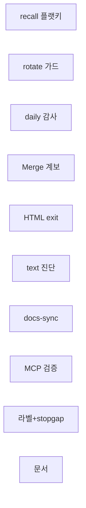

# flint v1.2.3 — R17 감사 발견 수정

**Goal:** R17 3각도 감사(정확성·보안성·계약) 발견 12건 수정. 기능 사망
1건(A1)·데이터 손실 위험 1건(B1) 포함.
**Architecture:** 기존 패키지 구조 불변 — lib/knowledge·lib/backup·lib/ops·
lib/db·lib/wire 내 수정. 신규 패키지 없음.
**Tech stack:** Go(단일 바이너리), Doltgres, 표준 라이브러리만.
**Spec path:** docs/plans/2026-11-13-flint-v1230.spec.md
**Detail:** contracts
**Target-min:** 10

**Global constraints:**
- 모든 태스크 TDD: 실패 테스트 먼저 작성·실증 후 구현(#114 계약).
- 튜닝값 신규 없음(기존 thresholds 등록표만 참조).
- 개인 데이터·실측 수치 금지(합성 데모만).
- exit code·출력 형식 기존 계약 준수(변경은 명시된 것만).

## 발견→태스크 매핑

| 발견 | 심각도 | 태스크 |
|---|---|---|
| A1 recallStarved 사망 | 높음 | T1 |
| B1 rotate 무차별 삭제 | 중상 | T2 |
| A3 daily 감사 플랫 키 미탐 | 중간 | T3 |
| A2 Merge superseded_by 미기록 | 중간 | T4 |
| C2 HTML exit 비정합 | 중간 | T5 |
| C3 text 뷰 진단 미배선 | 중간 | T6 |
| C4+C5 docs-sync 미배선·표기 | 중간 | T7 |
| B2·B5·B6 registry·MCP 검증 | 중간 | T8 |
| A4+A5 라벨 mtime·stopgap | 낮음 | T9 |
| C1+C6+C7+C8 문서 정합 | 문서 | T10 |

```mermaid
%% schedule
gantt
  title Predicted schedule (mm:ss)
  dateFormat X
  axisFormat %M:%S
  section lane 1
  T3 daily 나이 감사 플랫 키 지원 :t3, 0, 127s
  section lane 2
  T8 registry 잔재·MCP 입력 검증 :t8, 0, 127s
  section lane 3
  T9 세션 라벨 mtime·kreads stopgap 제거 :t9, 0, 127s
  section lane 4
  T1 recallStarvedToday 플랫 키 전환 :t1, 0, 102s
  section lane 5
  T2 Rotate flint 생성 파일만 대상 :t2, 0, 102s
  section lane 6
  T4 Merge superseded_by 기록 :t4, 0, 102s
  section lane 7
  T5 report --html exit 코드 정합 :t5, 0, 102s
  section lane 8
  T6 text 뷰 진단 배선 :t6, 0, 102s
  section lane 9
  T7 docs-sync 배선·표기 통일 :t7, 0, 102s
  section lane 10
  T10 문서 정합 4건 :t10, 0, 102s
```

critical path: T3 (2.1 min) · peak width 10 · predicted build 2.1 min · predicted total ≈ 5.6 min (target ✓)

모든 태스크 독립(공유 파일 없음) — 전량 병렬.

### T1 recallStarvedToday 플랫 키 전환 · Complexity 5 · Est. context 34k
**Owns:** lib/knowledge/done.go, lib/knowledge/done_flatkey_test.go, lib/cli/done_v0180_test.go(구폴백 테스트 원천 갱신 — 소유 확장 룰링)
**Components:** 1 · **LOC owned:** 45 · **Tests:** fast · **Model:** sonnet
**Consumes:** wire.Store.Exec/QueryRow(기존) · store.Thresholds.RecallWarnWrites
**Produces:** recallStarvedToday(ctx, st, th) (writes int, starved bool) — 시그니처 불변, 내부 원천만 교체
**계약:**
- write 카운터: meta `daily:write:<YYYY-MM-DD>` 플랫 키 int 직접 읽기
  (구 `daily:<date>` JSON 폴백 제거 — v1.2.0 T1 폐지 계약 준수).
- read 카운터: `read_events` 당일(UTC) COUNT 파생 — lib/ops/report.go
  mergeDerivedReadDaily와 동일 일자 절단. 조회 실패·파손 값은 기존대로
  조용히 false(§13 종료 경로 불변).
- 회상부족 판정식 불변: read==0 && write >= RecallWarnWrites.
**Test code:**
- `TestRecallStarvedFlatKey`: `daily:write:2026-11-13`=5 저장 + read_events 0행 → (5, true). 구 JSON 키 `daily:2026-11-13` 무시 확인.
- `TestRecallStarvedReadEventsToday`: read_events에 오늘(TZ=UTC) 2행 + 내일 1행 → read는 오늘 2행만 → (writes, false).
- `TestRecallStarvedCorruptValue`: `daily:write:...`=“abc” → (0, false) 조용.
**Review Focus:** 자정 경계(UTC일자), read_events 시간대 컷오프.

### T2 Rotate flint 생성 파일만 대상 · Complexity 3 · Est. context 22k
**Owns:** lib/backup/rotate.go, lib/backup/rotate_guard_test.go, lib/backup/rotate_test.go(기존 파일명 패턴 갱신)
**Components:** 1 · **LOC owned:** 20 · **Tests:** fast · **Model:** sonnet
**Produces:** Rotate(dir string, keep int) ([]string, error) — 시그니처 불변
**계약:**
- 로테이션 대상은 flint 생성 파일명 패턴만:
  `^flint-\d{8}-\d{6}-\d+\.(sql|age)$` (done.go lazyDumpFile 조립 형식).
- 패턴 외 .sql/.age(사용자 파일)·사이드카는 대상에서 제외 — keep 집계에도
  세지 않는다(사용자 파일이 keep 슬롯을 차지해 flint 백업이 보존되는
  일 방지).
**Test code:**
- `TestRotateSkipsForeignDumps`: flint-20260101-000000-1.sql(구), flint-20260102-000000-2.sql(신), mine.sql(더 구) 배치 → Rotate(dir,1) → removed=[flint-20260101...], mine.sql 존재 확인.
- `TestRotateForeignOnlyNoop`: mine.sql만 → removed=nil, 에러 없음.
**Review Focus:** 파일명 정규식 경계(8자리·6자리·PID), 디렉터리 미존재.

### T3 daily 나이 감사 플랫 키 지원 · Complexity 4 · Est. context 26k
**Owns:** lib/ops/maintain.go, lib/ops/doctor.go, lib/ops/daily_age_test.go
**Components:** 2 · **LOC owned:** 30 · **Tests:** fast · **Model:** sonnet
**계약:**
- maintain --meta-audit의 oldest-daily 산출과 doctor staleDaily가
  `daily:<kind>:<date>` 3세그먼트 플랫 키를 인식: 세그먼트 분해 후
  마지막 날짜 세그먼트로 나이 판정. 구 2세그먼트 `daily:<date>`도
  계속 인식(마이그레이션 잔존 대응).
- last_*_at 키 등 비-daily 키는 기존처럼 제외.
**Test code:**
- `TestOldestDailyFlatKey`: `daily:write:2026-01-01`·`daily:hot:2026-02-01`·구 `daily:2025-12-01`·`last_write_at` 배치 → oldest=2025-12-01(가장 오래된 날짜 승자).
- `TestStaleDailyDetectsFlatKeys`: 컷오프 2026-06-01, `daily:write:2026-01-01` → stale 감지(수정 전 미감지).
**Review Focus:** 3·2세그먼트 혼재, 날짜 형식 무효 키 무시.

### T4 Merge superseded_by 기록 · Complexity 4 · Est. context 28k
**Owns:** lib/db/admin.go, lib/db/admin_merge_test.go
**Components:** 1 · **LOC owned:** 35 · **Tests:** fast · **Model:** sonnet
**계약:**
- Merge(from, into)이 기존 요약 마커와 함께 `superseded_by=into`를
  UPDATE — Supersede(repo.go) 단일 계보 모델과 정렬.
- 이미 invalidated(from의 status가 active 아님)면 재병합 거부 — 마커
  재부착 방지. exit/에러 계약은 기존 Merge 준수.
**Test code:**
- `TestMergeRecordsSupersededBy`: 병합 후 from.superseded_by==into 쿼리 확인.
- `TestMergeTwiceRejected`: 같은 from 재병합 → 오류·마커 단일 유지.
**Review Focus:** 트랜잭션 내 UPDATE, 기존 마커 suffix 보존.

### T5 report --html exit 코드 정합 · Complexity 3 · Est. context 20k
**Owns:** lib/ops/report_html.go, lib/ops/report_html_exit_test.go
**Components:** 1 · **LOC owned:** 15 · **Tests:** fast · **Model:** sonnet
**계약:**
- HTML 수집 경로의 Ping 실패→2·SchemaError→3 매핑 — JSON 경로
  MapExit과 동일. 그 외 수집 오류는 기존 1 유지.
**Test code:**
- `TestHTMLExitServerDown`: Ping 실패 시 2 (수정 전 1).
- `TestHTMLExitSchemaMismatch`: 스키마 불일치 시 3.
**Review Focus:** exit 3 검증 실패와 혼동 금지.

### T6 text 뷰 진단 배선 · Complexity 3 · Est. context 22k
**Owns:** lib/ops/report.go(또는 runReport 소유 파일), lib/ops/report_text_diag_test.go
**Components:** 1 · **LOC owned:** 12 · **Tests:** fast · **Model:** sonnet
**계약:**
- text 기본 출력에 Diagnosis가 있을 때 Sentence() 라인을 출력 섹션에
  인쇄 — “세 뷰 동일 원천” 완성(JSON 필드·HTML 카드·text 문장).
- 진단 0건이면 섹션 미출력(정상 침묵 계약 유지).
**Test code:**
- `TestTextReportPrintsDiagnosis`: Diagnosis 2건 → 출력에 두 Sentence 라인 포함.
- `TestTextReportSilentWhenNoDiagnosis`: 0건 → 진단 헤더 부재.
**Review Focus:** stdout 순서(기존 섹션 뒤), --json 시 미출력.

### T7 docs-sync 배선·표기 통일 · Complexity 2 · Est. context 18k
**Owns:** Makefile, docs/PLAN.md(해당 라인), docs/HISTORY.md(해당 라인)
**Components:** 1 · **LOC owned:** 8 · **Tests:** fast · **Model:** haiku
**Kind:** mechanical
**계약:**
- `release:` 타깃이 `docs-sync`에 의존(`release: docs-sync build` 순).
- `lint`·`docs-sync`를 .PHONY에 추가.
- 테스트 수 표기 전부 실측 기준으로 통일(docs-sync가 grep으로 세는
  최상위 함수 수 — `make docs-sync` 출력 기준값, 구현 시 실측치로).
**Test code:** `make docs-sync` 실행 exit 0 확인(수작업 검증 단계).
**Review Focus:** 타깃 순서, 표기 3곳 일치.

### T8 registry 잔재·MCP 입력 검증 · Complexity 4 · Est. context 30k
**Owns:** lib/mcp/tools.go, lib/mcp/tools_test.go, lib/mcp/tools_v1230_test.go(신규), mcp-registry/server.json(삭제), docs/versions_test.go(TestServerJsonValid template 재타깃 — 소유 확장 룰링)
**Components:** 2 · **LOC owned:** 30 · **Tests:** fast · **Model:** sonnet
**계약:**
- B2: 커밋된 mcp-registry/server.json 삭제 — 발행 원천은 template +
  ci.yml 렌더이므로 repo 내 잔재가 무효 manifest로 오인된다.
- B5: dispatchWrite(또는 동등 MCP 쓰기 진입점)가 kind를 화이트리스트로
  서버측 검증 — 무효 kind는 오류 응답(기존 MCP 오류 포맷 준수).
- B6: dispatchHot에서 미사용 session_id 잔여 파라미터 제거(호환 영향
  없음 — no-op 검증 후에만).
**Test code:**
- `TestDispatchWriteRejectsBadKind`: kind=“bogus” → 오류. kind=“write” → 통과.
- `TestDispatchHotNoSessionResidue`: 시그니처/필드에 session_id 잔여 부재(정적 확인 또는 호출 계약 테스트).
**Review Focus:** MCP 오류 포맷 준수, 삭제 파일 참조 잔여 확인.

### T9 세션 라벨 mtime·kreads stopgap 제거 · Complexity 3 · Est. context 24k
**Owns:** lib/wire/session.go, lib/db/usage.go(해당 블록), lib/wire/session_touch_test.go
**Components:** 2 · **LOC owned:** 18 · **Tests:** fast · **Model:** sonnet
**계약:**
- A4: ReadSessionLabel 채택(라벨 파일 읽기 성공) 시 mtime 터치 —
  14일 초과 활성 세션 라벨이 타 세션 정리에 삭제되지 않게.
- A5: usage.go의 kreads 보존일 stopgap(const+직접 SELECT) 제거 —
  thresholds 등록표(wire/threshold_meta.go) 단일 경로로. 값은 동일
  기본이므로 거동 불변.
**Test code:**
- `TestSessionLabelAdoptionTouchesMtime`: mtime 과거 라벨 채택 → mtime 갱신.
- `TestKreadsRetentionFromRegistry`: 등록표 오버라이드 값이 보존일에 반영(직접 SELECT 경로 제거 후).
**Review Focus:** 읽기전용 파일시스템에서 mtime 실패 조용히 무시.

### T10 문서 정합 4건 · Complexity 2 · Est. context 20k
**Owns:** docs/PLAN.md, docs/METRICS.md, docs/HISTORY.md, .goreleaser.yml, docs/contracts/registry.md(발행물 서술 정정)
**Components:** 1 · **LOC owned:** 40 · **Tests:** slow · **Model:** sonnet
**계약:**
- C1: PLAN.md `report --diag` → “진단은 항상 포함(플래그 없음)”으로 정정.
- C6: METRICS §4.6 잔여 후보 목록에서 A1·A2 제거(read_events bytes
  회수 완료 정정) — 문장과 목록 자기모순 해소.
- C7: METRICS.md에 진단 §신설(신호 8규칙 요약·G1~G6 교차참조) + 제목
  버전 스탬프 v1.2.x 갱신.
- C8: .goreleaser.yml 주석 잡명 → 현재 deploy 잡명.
- T6 완성 후 “세 뷰” 서술이 실제와 일치하는지 재확인(3뷰 완성이면
  유지, 아니면 정정).
**Test code:** `make docs-sync` exit 0(문서 계약 테스트 통과).
**Review Focus:** 교차참조 링크 유효, 버전 스탬프.

## Review Focus (전체)

- **file:** rotate 사용자 파일 보존(T2) — 삭제는 되돌릴 수 없다.
- **state:** Merge 재실행 멱등(T4), 플랫 키 롤오버(T1).
- **protocol:** exit 코드 2·3 매핑(T5), MCP 오류 포맷(T8).
- **encoding:** 문서 메타 문자(T10).

**Probe entry:** run=go test ./lib/... -count=1
