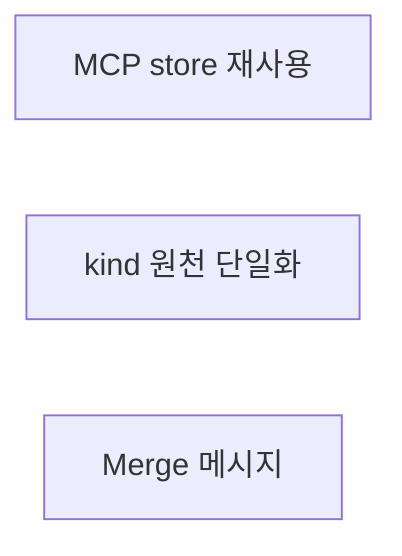

# flint v1.2.4 — 마이너 패치: MCP 효율·원천 단일화

**Goal:** R17·R18에서 보류·후속 과제로 남은 3건. B4(MCP store 재사용)·
kind 원천 단일화·Merge 에러 메시지 정확화.
**Architecture:** 기존 패키지 불변 — lib/mcp·lib/store·lib/db 내 수정.
**Tech stack:** Go, Doltgres(pgx pool), 표준 라이브러리.
**Spec path:** docs/plans/2026-11-14-flint-v1240.spec.md
**Detail:** contracts
**Target-min:** 5

**Global constraints:**
- 모든 태스크 TDD: 실패 테스트 먼저 실증.
- CLI·MCP 외부 계약(인자·출력·exit code) 불변.
- 튜닝값 신규 없음·개인 데이터 금지.
- CI 환경 가정 주의(로컬만의 실증 금지 — R18 교훈).

```mermaid
%% schedule
gantt
  title Predicted schedule (mm:ss)
  dateFormat X
  axisFormat %M:%S
  section lane 1
  T1 MCP store 재사용 :t1, 0, 127s
  section lane 2
  T2 kind 원천 단일화 :t2, 0, 127s
  section lane 3
  T3 Merge 에러 메시지 정확화 :t3, 0, 102s
```

critical path: T1 (2.1 min) · peak width 3 · predicted build 2.1 min · predicted total ≈ 5.6 min (target ✗ 5.0)

전 태스크 독립·병렬.

### T1 MCP store 재사용 · Complexity 5 · Est. context 36k
**Owns:** lib/mcp/tools.go, lib/mcp/store_reuse_test.go(신규), lib/cli/run_store.go(신규 — 주입 변형)
**Components:** 2 · **LOC owned:** 80 · **Tests:** fast · **Model:** sonnet
**배경:** DispatchTool→runCall→cli.Run이 도구 호출마다 store를 연다
(tools.go:234 주석). MCP 서버는 장기 프로세스 — 호출마다 연결 비용 낭비.
**계약:**
- cli.Run에 store 주입 변형 추가: `RunWithStore(cliArgs []string, stdin io.Reader, stdout io.Writer, st wire.Store) int` — 기존 Run은 내부 open 후 RunWithStore 위임(기존 서명·동작 불변).
- lib/mcp: 서버 수명 store를 1회 open해 재사용(패키지 var 또는
  DispatchTool 초기화). runCall이 store를 받아 RunWithStore 경유.
- store open은 기존 공급 경로(dsnFromEnv→db) 재사용. pool이면 재연결은
  풀에 위임.
- store nil·open 실패 시: 기존대로 각 호출이 알아서 실패(조용히 진행
  계약 준수) — nil이면 기존 Run 폴백도 허용(단순화).
**Test code:**
- `TestRunWithStoreReusesInjection`: 주입 fake store가 사용되는지(명령 실행 후 fake 조회 기록).
- `TestRunDelegatesToRunWithStore`: 기존 Run 경로 회귀(서버다운 exit 2 등 기존 계약).
- `TestDispatchToolReusesServerStore`: 도구 2회 호출 시 store open 1회(counting supply seam).
**Review Focus:** 연결 수명(장기 풀), 동시 도구 호출 안전, nil 폴백.

### T2 kind 원천 단일화 · Complexity 2 · Est. context 18k
**Owns:** lib/store/validate.go, lib/mcp/tools.go(kind 상수 블록)
**Components:** 2 · **LOC owned:** 12 · **Tests:** fast · **Model:** haiku
**Kind:** mechanical
**계약:**
- validate.go의 비수출 kindExpect를 수출 상수로 승격(예:
  `KindExpect = "knowledge|session|project"` — 기존 내부 사용처 동일 값
  유지). 상수 값은 불변(문자열 그대로).
- lib/mcp/tools.go의 값 복제(주석 "원천 표시" 블록)를 수출 상수 참조로
  교체 — 원천 단일화.
**Test code:** 기존 kind 검증 테스트 회귀 통과(dispatchWrite bogus
거부·knowledge 통과 — tools_v1230_test.go 불변 green).
**Review Focus:** 문자열 값 불변, 순환 임포트 부재(store→mcp 아님 방향 확인).

### T3 Merge 에러 메시지 정확화 · Complexity 2 · Est. context 16k
**Owns:** lib/db/admin.go(해당 라인), lib/db/admin_merge_test.go
**Components:** 1 · **LOC owned:** 6 · **Tests:** fast · **Model:** haiku
**Kind:** mechanical
**계약:**
- admin.go:546 부근 재병합 거부 에러가 상태를 구분: from이
  invalidated(이미 처리됨)인지 pending 등 active 외(병합 불가 상태)인지
  메시지에 반영. 에러 타입·exit 계약 불변(문자열만 정확화).
**Test code:** `TestMergeTwiceRejected` 메시지 단언 갱신 — invalidated
재시도는 "이미 처리된", pending from은 "active 아님(병합 불가)" 문구
포함. 실패 실증 후 수정.
**Review Focus:** 기존 문구 의존 테스트 회귀.

## Review Focus (전체)
- **state:** store 수명·동시 호출(T1), 메시지 상태 분기(T3).
- **protocol:** CLI·MCP 인자·exit·출력 불변(T1·T2).

**Probe entry:** run=go test ./lib/... ./docs/... -count=1
