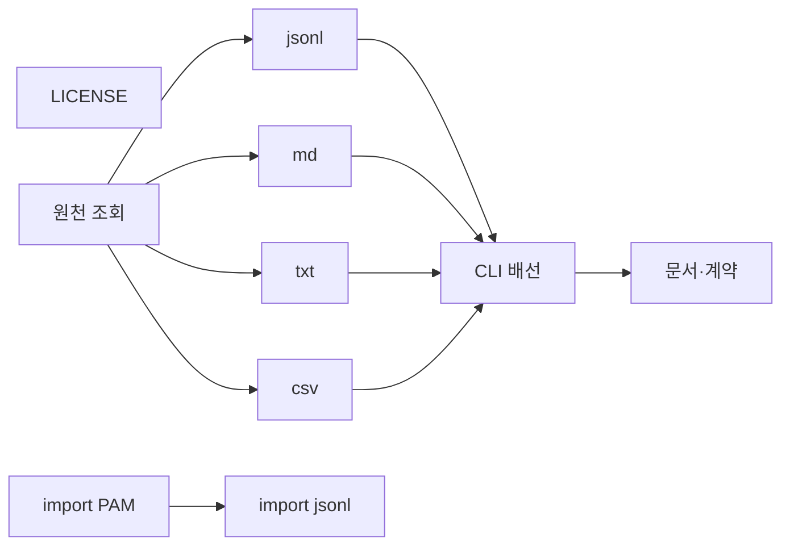

# flint v1.3.0 — LICENSE + 지식 export 4형식

**Goal:** 무라이선스 해소(MIT) + `flint export` 신규 커맨드
(jsonl·md·txt·csv). 데이터 이동성 확보.
**Architecture:** lib/knowledge(export 코어·원천 재사용)·lib/cli(배선)·
lib/render(포맷터 관례 준용). LICENSE는 repo 루트.
**Tech stack:** Go 표준(encoding/json·encoding/csv), Doltgres.
**Spec path:** docs/plans/2026-11-14-flint-v1300.spec.md
**Detail:** contracts
**Target-min:** 9

**Global constraints:**
- 전 태스크 TDD(실패 실증 선행).
- exit 계약: 0 성공·2 서버다운·3 검증 실패(기존 준수). 신규 exit 없음.
- 개인 데이터 금지 — 픽스처는 합성 데모.
- 커맨드 표·docs-sync 계약 갱신 포함. CI 환경 가정 주의.

```mermaid
%% schedule
gantt
  title Predicted schedule (mm:ss)
  dateFormat X
  axisFormat %M:%S
  section lane 1
  T1 LICENSE (MIT) :t1, 0, 102s
  T3 포맷터 jsonl :t3, 102, 102s
  T7 CLI 배선 :t7, 204, 102s
  T8 문서·계약 갱신 :t8, 307, 102s
  section lane 2
  T2 export 원천 조회 :t2, 0, 102s
  T4 포맷터 md :t4, 102, 102s
  section lane 3
  T5 포맷터 txt :t5, 102, 102s
  section lane 4
  T6 포맷터 csv :t6, 102, 102s
```

critical path: T2 → T3 → T7 → T8 (6.8 min) · peak width 4 · predicted build 6.8 min · predicted total ≈ 10.3 min (target ✗ 9.0)

### T2 export 원천 조회 · Complexity 3 · Est. context 22k
**Owns:** lib/knowledge/export.go, lib/knowledge/export_test.go
**Produces:** ExportRows(ctx, st, f ExportFilter) ([]ExportRow, error)
**계약:** 기존 read 경로의 조회 원천 재사용(active_knowledge 뷰·status
필터·--tag). ExportRow는 지식 행의 전 필드(id·topic·content·kind·status·
confidence·tags·entities·domain·source·content_hash·created_at·
updated_at·superseded_by) — source(hook/manual/mcp)는 PAM provenance,
content_hash는 PAM §6 대응(스키마 기보유 열). ExportFilter{Status:
active|all, Tag, Since time.Time} — Since는 updated_at 컷오프(PAM §16
증분 차용, 0값=전체). invalidated는 --status all에만.
**e.g.** ExportRows(ctx, st, {Status:"active"}) -> [{ID:88, Topic:"배포 관례", ...}]
**Test:** 합성 3행(active 2·invalidated 1) — active 필터 2행·all 3행·tag 필터.

### T3 포맷터 jsonl · Complexity 2 · Est. context 18k
**Owns:** lib/knowledge/export_jsonl.go, lib/knowledge/export_jsonl_test.go
**Consumes:** ExportRows (T2)
**Produces:** FormatJSONL(rows []ExportRow) ([]byte, error)
**계약:** 행당 1 JSON 객체·개행 구분. 필드명 snake_case(JSON 계약 준수).
필드 전부 보존 — 재이식 가능한 완전 스냅샷.
**e.g.** FormatJSONL([{ID:1,Topic:"a"}]) -> `{"id":1,"topic":"a",...}\n`
**Test:** 2행 → 2라인·json.Unmarshal 왕복·특수문자(개행·따옴표) 이스케이프.

### T4 포맷터 md · Complexity 3 · Est. context 20k
**Owns:** lib/knowledge/export_md.go, lib/knowledge/export_md_test.go
**Consumes:** ExportRows (T2)
**Produces:** FormatMD(rows []ExportRow) []byte
**계약:** 파일 헤더(flint export · 생성일 UTC · 항목 수) + 항목별 섹션:
`## #<id> <topic>` + 메타 라인(status·confidence·tags·created·
superseded_by 링크 `→ #N`) + 본문(content 그대로). 노트앱 이식 전제.
**Test:** 구조 단언(헤더·섹션 수·메타 라인·계보 링크)·빈 결과.

### T5 포맷터 txt · Complexity 2 · Est. context 16k
**Owns:** lib/knowledge/export_txt.go, lib/knowledge/export_txt_test.go
**Consumes:** ExportRows (T2)
**Produces:** FormatTXT(rows []ExportRow) []byte
**계약:** 구분선 `==== #<id> <topic> ====` + 본문. 메타 최소(id·topic만 —
LLM 주입·grep 용도). 개행 정규화 없음(content 원문).
**Test:** 구분자 라인·본문 포함·빈 결과.

### T6 포맷터 csv · Complexity 2 · Est. context 18k
**Owns:** lib/knowledge/export_csv.go, lib/knowledge/export_csv_test.go
**Components:** 1 · **LOC owned:** 40 · **Tests:** fast · **Model:** sonnet
**Consumes:** ExportRows (T2)
**Produces:** FormatCSV(rows []ExportRow) ([]byte, error)
**계약:** encoding/csv 표준. 열: id,topic,kind,status,confidence,tags,
created_at,updated_at,superseded_by — **content 제외**(장문 개행 셀 회피 —
목록 분석용 인덱스). tags는 `|` 결합. 헤더행 포함.
**Test:** 헤더+2행·개행 포함 topic 이스케이프·열 수 고정.

### T7 CLI 배선 · Complexity 3 · Est. context 24k
**Owns:** lib/cli/export.go, lib/cli/export_test.go, lib/cli/exit_contract_v101_test.go, lib/cli/wire_v08_test.go, lib/wire/registry.go, lib/wire/run.go, lib/wire/usage_registry_test.go(라우팅 배선·계약행 — 소유 확장)
**Components:** 1 · **LOC owned:** 90 · **Tests:** fast · **Model:** sonnet
**Consumes:** ExportRows·FormatJSONL·FormatMD·FormatTXT·FormatCSV
**Produces:** RunExport(st, args, stdin, stdout) int
**계약:** `flint export [--format jsonl|md|txt|csv] [--out FILE]
[--status active|all] [--tag X]... [--since RFC3339]`. 기본 jsonl·
stdout. --out은 파일 기록(기존 파일 덮어씀 — 백업 경고 1행 stderr).
성공 시 요약 1행 stderr(행 수·형식·바이트 — 무결성 정신 최소 버전).
무효 format·status·since 파싱 실패는 exit 3. 스토어 nil·서버다운
exit 2(MapExit 재사용). 커맨드 라우팅·도움말 문구·커맨드 표(lib/cli
내 소유 표) 갱신.
**Test:** 기본 jsonl stdout·--out 파일·각 format 스위치·--since 컷오프·
무효 값 exit 3·서버다운 exit 2.

### T1 LICENSE (MIT) · Complexity 1 · Est. context 10k
**Owns:** LICENSE(신규), README.md·README.ko.md(License 섹션)
**Components:** 1 · **LOC owned:** 25 · **Tests:** fast · **Model:** sonnet
**계약:** 표준 MIT 전문(Copyright (c) 2026 synuns). README EN/KO에
License 섹션 추가(양쪽 대칭 — README 대칭 계약 테스트 통과).
**Test:** README 대칭 테스트 회귀·파일 존재.

### T8 문서·계약 갱신 · Complexity 3 · Est. context 22k
**Owns:** docs/PLAN.md, docs/HISTORY.md, docs/versions_test.go, README.md, README.ko.md(License 외 라인)
**Components:** 1 · **LOC owned:** 60 · **Tests:** slow · **Model:** sonnet
**Consumes:** RunExport (T7)
**계약:** HISTORY v1.3.0 항목(LICENSE+export 4형식·i18n v1.4 이월 명시)·
versions_test 계약행(TestVersion0130Milestone: "v1.3.0","export")·
README export 커맨드 소개(License 섹션과 병행, EN/KO 대칭)·PLAN 마일스톤
v1.4 이월 반영. 버전 동기(VERSION·배지·plugin.json)는 릴리스 시
코디네이터 실행(플랜에 명시만).
**Test:** make docs-sync·versions 테스트 green.

### T9 import jsonl 왕복 · Complexity 4 · Est. context 28k
**Owns:** lib/cli/import_migrate.go, lib/cli/import_migrate_test.go, lib/knowledge/import_jsonl.go, lib/knowledge/import_jsonl_test.go, lib/knowledge/knowledge.go(라우팅 1줄 위임), lib/db/repo.go(SetSupersededRef 최소 메서드 — 가드 준수), lib/knowledge/fake_parity_test.go, lib/knowledge/approve_test.go(fake 동질 — 소유 확장)
**Components:** 2 · **LOC owned:** 110 · **Tests:** fast · **Model:** sonnet
**Consumes:** ExportRow 구조(T2) · wire.Store 기존 write 회로
**Produces:** RunImportMigrate(st, args, stdin, stdout) int · ParseJSONLRows(data []byte) ([]ExportRow, error) · ParsePAM(data []byte) ([]ImportCandidate, error)(T10 구현 — T9는 인터페이스 호출)
**계약:**
- `flint import --format jsonl [FILE]` — FILE 미지정 시 stdin. export jsonl 재이식.
- 행마다 기존 write 경로: content_hash 중복 스킵(duplicate)·신규는 id 보존
  적립(스키마에 id 열 존재 전제 — 없으면 자동 id 할당 후 보고).
  superseded_by 참조가 있는 행은 후처리 maintain --supersede와 동일
  갱신(기존 Supersede 재사용).
- 멱등: 재실행 시 전 행 duplicate 스킵·exit 0.
- 기존 `flint import [path]`(규칙 변환) 불변 — --format 플래그 유무로
  경로 분기. 무효 format·파손 jsonl 행은 exit 3(행 번호 포함).
- --format pam 분기는 ParsePAM(T10) 호출 — T10 미완 시 "미지원" 오류.
**e.g.** RunImportMigrate(st, ["--format","jsonl","f.jsonl"], ...) -> `{"status":"ok","imported":5,"duplicated":2}`
**Test:** 왕복(export→import→행 수 보존·dup 스킵)·멱등 2회 실행·파손 행 exit 3·기존 규칙 import 회귀.

### T10 import PAM v1.0 · Complexity 4 · Est. context 30k
**Owns:** lib/knowledge/import_pam.go, lib/knowledge/import_pam_test.go
**Components:** 1 · **LOC owned:** 120 · **Tests:** fast · **Model:** sonnet
**Produces:** ParsePAM(data []byte) ([]ImportCandidate, error) — ImportCandidate는 ExportRow 호환 구조+원천 메타
**계약:**
- PAM v1.0 memory-store.json 파싱(루트 schema 확인·memories 배열).
- 매핑: type→kind(fact/preference/skill/goal/project 등→knowledge,
  project→project, 기타 custom→kind "knowledge"+metadata 원 type 보존),
  status(active→pending 적립·superseded/deprecated/retracted→기록
  보류하고 스킵하되 보고), confidence.current→confidence(0-1 그대로),
  tags→tags, content+summary→content, provenance.platform→source
  "import:pam:<platform>", temporal.created_at→created_at.
- 적립은 전부 pending(flint 승격 모델 — import --commit 플래그? 아니,
  기존 import 관례 확인: dry-run 기본·--commit 적립이 기존 패턴이면
  준수).
- relations 중 supersedes는 후처리 superseded_by 갱신 대상 목록으로
  반환(재이식과 동일 후처리).
**e.g.** ParsePAM(`{"schema":"portable-ai-memory","memories":[{...}]}`) -> [{Topic:"...", Source:"import:pam:chatgpt", ...}]
**Test:** 스펙 예시 형식 파싱·status 매핑 3종·relations supersedes 추출·파손 json exit 3.

## Review Focus (전체)
- **encoding:** jsonl 이스케이프·csv 인용·md 헤딩 충돌(topic에 # 포함).
- **file:** --out 덮어씀 경고·경로 순회 없음.
- **state:** 대량 export 스트리밍(행 수 상한 없음 — 메모리. 1차원 슬라이스
  전달로 수용, 프롬프트에 명시).
- **protocol:** exit 2·3 매핑.

**Probe entry:** run=go test ./lib/... ./docs/... -count=1
