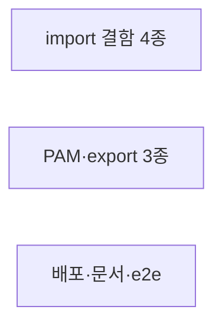

# flint v1.3.1 — R19 감사 발견 수정

**Goal:** R19 2각도 감사 발견 (심각1·중간3·경미9·B경미4) 중 12건 수정.
**Architecture:** 기존 파일 내 수정 — 신규 파일 e2e 1건.
**Spec path:** docs/plans/2026-11-14-flint-v1310.spec.md
**Detail:** contracts · **Target-min:** 5
**Global constraints:** TDD(실패 실증)·exit/출력 계약 불변(발견 지정 예외만)·개인 데이터 금지·CI 환경 차이 주의.

### T1 import 결함 4종+2 · Complexity 5 · Est. context 34k
**Owns:** lib/knowledge/import_jsonl.go, lib/knowledge/import_jsonl_test.go
**Components:** 1 · **LOC owned:** 60 · **Tests:** fast · **Model:** sonnet
**계약:**
- A1[심각] 배치 InsertBatch 실패(23505 등)를 유령 성공(exit 0) 내지 않게 — write.go:289-296 생존 재확인·재시도 승계 원칙 준용. 최소: 배치 실패는 exit 1(부분 성공은 imported 수 보존)·오류 원인 JSON 유지. ErrDuplicate로 감싼 뒤 전체 폐기+exit 0 금지.
- A2[중간] 명시 id 적립 후 `SELECT setval` 시퀀스 동기(스키마 id serial) — max(id)+1. setval 실패는 경고 stderr·exit 불변.
- A4[중간] invalidated 행 재이식: invalid_at=UpdatedAt·ingested_at·valid_at=CreatedAt 보존 적립(불변식 status='invalidated'→invalid_at NOT NULL 유지). 재export 시각 정합(1회차 export 재현).
- A8[경미] SetSupersededRef 0행(기존 참조)은 superseded 계상 제외 — RowsAffected로 판별.
- A9[경미] import 해시를 write payload 전체 키 기준으로(write.go 해시 함수 재사용) — 부가 키 행 왕복 dedup 대칭.
- A7[경미] os.ReadFile 오류 원인(ENOENT/EACCES)을 오류 메시지에 보존(SchemaError 랩 유지).
**Test:** 각 발견 회귀(A1: PK 충돌 시 exit 1·A2: 이식 후 write 성공·A4: 재export 동일성·A8: 요약 정확·A9: 부가 키 행 dedup·A7: 오류 문자열). slow 실DB 포함.

### T2 PAM 방향·export 3종 · Complexity 4 · Est. context 28k
**Owns:** lib/knowledge/import_pam.go, lib/knowledge/import_pam_test.go, lib/knowledge/export.go, lib/knowledge/export_test.go, lib/knowledge/export_csv.go, lib/knowledge/export_csv_test.go
**Components:** 3 · **LOC owned:** 40 · **Tests:** fast · **Model:** sonnet
**계약:**
- A3[중간] PAM supersedes 방향: SupersedePair 치환 — from이 신규(대체)·to가 구(피대체)이므로 계보 갱신은 old=To·new=From. 방향 회귀 테스트(§13.2 인용 주석). 피대체행 미수입(스킵) 케이스는 기존대로 스킵 보고.
- A5[경미] export.go Since 바인드를 time.Time→RFC3339 문자열로(코드베이스 관례·Doltgres 이종 방지 — 쿼리 의미 동일, 인덱스 사용 확인).
- A6[경미] FormatCSV 수식 인젝션 중립화: 셀 값이 =,+,-,@로 시작하면 접두 `'` (CSV 관례). topic·tags·source 전 셀 적용. 회귀 테스트.
**Test:** A3 방향·A5 동일 결과(문자열화 후 쿼리 결과 불변)·A6 중립화 왕복(원본은 import가 아닌 표 형태 보존).

### T3 배포물 LICENSE·문서·e2e · Complexity 4 · Est. context 30k
**Owns:** .goreleaser.yml, flint-plugin/.claude-plugin/plugin.json, docs/versions_test.go, docs/plans/2026-11-14-flint-v1300.md(해당 라인), docs/plans/2026-11-13-flint-v1300.spec.md(있다면 — B1 스펙 라인), tests/e2e/export_import_test.go(신규)
**Components:** 3 · **LOC owned:** 90 · **Tests:** slow · **Model:** sonnet
**계약:**
- B2: .goreleaser.yml files에 `- LICENSE` 추가(글로브 덮어쓰기 해소). plugin.json에 "license": "MIT" + 기존 행갈이 정리. scripts/make_mcpb.sh 번들에 LICENSE 포함(파일 수정 — 소유에 추가).
- B1: tests/e2e/export_import_test.go — 실DB e2e: 합성 seed → export jsonl → fresh 테이블 재이식 → 재export 동일성(행 수·id·계보) + import PAM 최소 문서 왕복(pending 적립). FLINT_TEST_DSN·-tags e2e.
- B3: versions_test.go rebase 주석 잔존 정리.
- B4: 플랜 v1300 T10 문구 정정("project형은 파싱만·적립 스킵 — v1.4 후보") — docs/plans 파일이 T8 소유였던 이전 런 종료 상태라 이번 T3 직접 수정.
- HISTORY v1.3.1 항목 + versions_test 계약행(TestVersion0131Milestone: "v1.3.1","R19") 추가 — Owns에 docs/HISTORY.md 포함.
**Test:** make docs-sync·go test ./docs·e2e 신규 green.

## Review Focus (전체)
- **state:** A1 원자성·A2 시퀀스·A4 불변식.
- **security:** A6 인젝션·B2 배포물.
- **encoding:** A9 해시 대칭·CSV 중립화 왕복.

**Probe entry:** run=go test ./lib/... ./docs/... -count=1
