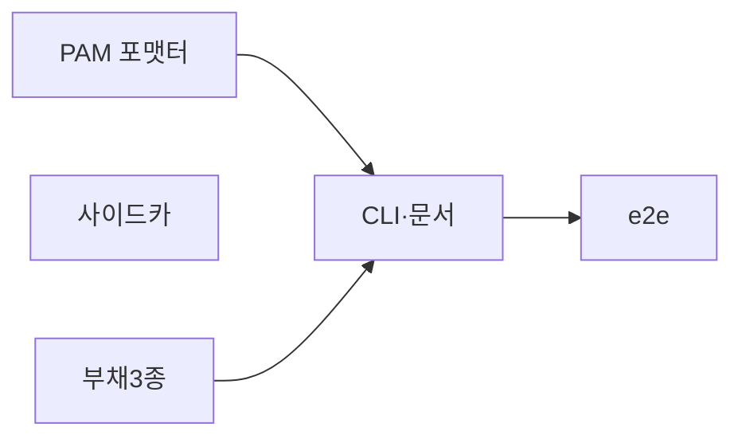

# flint v1.4.0 — PAM 생태계 완결·기술부채

**Goal:** `flint export --format pam`(PAM v1.0 표준 내보내기)·사이드카
체크섬·project형 적립·valid_at 왕복·import 상한. 데이터 이동성 완결.
**Architecture:** lib/knowledge(export_pam·export 확장)·lib/cli(배선)·
lib/store(thresholds 등록). 신규 의존 1: cyberphone/json-canonicalization.
**Spec path:** docs/plans/2026-11-14-flint-v1400.spec.md
**Detail:** contracts · **Target-min:** 6
**Global constraints:** TDD·exit/출력 계약 불변(신규 플래그 예외)·
개인 데이터 금지·PAM 스펙 v1.0 준수(portable-ai-memory.org/spec/v1.0).

```mermaid
%% schedule
gantt
  title Predicted schedule (mm:ss)
  dateFormat X
  axisFormat %M:%S
  section lane 1
  T3 기술부채 3종 :t3, 0, 151s
  T4 CLI 배선·문서 :t4, 151, 127s
  T5 e2e PAM 왕복 :t5, 277, 102s
  section lane 2
  T1 FormatPAM — PAM v1.0 내보내기 :t1, 0, 102s
  section lane 3
  T2 사이드카 체크섬 :t2, 0, 102s
```

critical path: T3 → T4 → T5 (6.3 min) · peak width 3 · predicted build 6.3 min · predicted total ≈ 9.8 min

### T1 FormatPAM — PAM v1.0 내보내기 · Complexity 5 · Est. context 34k
**Owns:** lib/knowledge/export_pam.go, lib/knowledge/export_pam_test.go, go.mod, go.sum
**Components:** 1 · **LOC owned:** 150 · **Tests:** fast · **Model:** sonnet
**Consumes:** (기존 코드 타입 — 플랜 외 의존 없음)
**Produces:** FormatPAM(rows []ExportRow, exportedBy string) ([]byte, error)
**계약 (PAM v1.0 §3·4·7·8·11·13·15):**
- 루트: schema="portable-ai-memory"·schema_version="1.0"·
  spec_uri·export_id(UUIDv4)·exported_by="flint/<VERSION>"·export_date(UTC)·
  memories[]·relations[]·integrity{checksum·total_memories}.
- memories 매핑: id="flint:<N>"(string)·type="custom"+custom_type=<kind>
  (flint kind가 PAM 폐쇄 분류와 무차별)·content·content_hash=**PAM 정규화
  파이프라인**(trim→lower→NFC→공백 collapse→SHA-256 "sha256:<hex>" —
  flint 저장 해시와 별도 산출)·temporal.created_at=CreatedAt·
  status: active→"active"·invalidated→"superseded"(temporal.superseded_by=
  "flint:<N>" when SupersededBy≠nil)·tags·confidence{current}·
  provenance{platform:"flint"}.
- relations: SupersededBy마다 {type:"supersedes", from:"flint:<신규>",
  to:"flint:<구>"} (§13.2 Source replaces target).
- integrity: memories id 오름차순 정렬 → JCS(cyberphone
  json-canonicalization) 직렬화 → SHA-256. total_memories=len.
  **결정성**: export_id·export_date를 제외한 본문은 동일 rows에 대해
  항상 동일 바이트(체크섬 재현성).
- 의존성: go get github.com/cyberphone/json-canonicalization/go (v2 최신).
**Test:** 스펙 §4 형식 단언·content_hash 정규화(공백·대소·NFC 케이스)·
status/superseded 매핑·relations 방향·체크섬 결정성(2회 동일·순서 셔플
rows에도 동일)·빈 rows(첫 검증은 PAM 검증기가 아니면 수기 스키마 단언).
**Review Focus:** JCS 표준 준수·NFC(unicode 정규화)·timestamptz 직렬화.

### T2 사이드카 체크섬 · Complexity 2 · Est. context 16k
**Owns:** lib/cli/export.go, lib/cli/export_test.go
**Components:** 1 · **LOC owned:** 20 · **Tests:** fast · **Model:** sonnet
**계약:** `--out FILE` 기록 시 `<FILE>.sha256` 사이드카 자동 생성(기존
backup --out 관례 준수 — sha256sum 표준 형식 "<hex>  <basename>").
덮어씀 경고와 동일 규칙. stdout 모드는 미생성. PAM 문서 자체
integrity와 별개(파일 전송 무결성).
**Test:** --out 시 사이드카 존재·형식·재실행 갱신·stdout 미생성.

### T3 기술부채 3종 · Complexity 4 · Est. context 28k
**Owns:** lib/knowledge/export.go, lib/knowledge/export_test.go, lib/knowledge/import_jsonl.go, lib/knowledge/import_jsonl_test.go, lib/knowledge/export_jsonl.go, lib/knowledge/export_jsonl_test.go, lib/store/thresholds.go, lib/wire/threshold_meta.go, lib/wire/threshold_meta_test.go
**Components:** 3 · **LOC owned:** 60 · **Tests:** fast · **Model:** sonnet
**계약:**
- **valid_at 왕복:** ExportRow에 ValidAt 추가(schema 기존 열)·jsonl
  필드 valid_at·import 시 보존 적립(A4 경로 확장). md/txt/csv 무관
  (csv 열 추가 — 열 11). 재export 시각 동일성 회귀.
- **PAM project형 적립:** importPAM 스킵 해제 — kind "project"는
  pending 적립(flint kindExpect 준수). 회귀: project 후보 1건 적립.
- **import 상한:** thresholds 등록 export_import_max_rows(기본 100000,
  parseFloatPositive 아닌 int 등록 — 기존 int 등록 관례 확인)·
  meta 오버라이드. 초과 시 exit 3·오류 JSON에 max·count 포함.
  등록표(threshold_meta) 36→37 갱신·frozen 가드 수치 동기.
**Test:** valid_at 왕복 동일성·project 적립·상한 초과 exit 3·등록표
오버라이드 반영.

### T4 CLI 배선·문서 · Complexity 3 · Est. context 24k
**Owns:** lib/wire/registry.go, lib/wire/run.go, lib/wire/usage_registry_test.go, docs/HISTORY.md, docs/versions_test.go, docs/PLAN.md, README.md, README.ko.md
**Components:** 2 · **LOC owned:** 50 · **Tests:** slow · **Model:** sonnet
**계약:** --format pam 도움말·커맨드 표 갱신(사이드카 언급). HISTORY
v1.4.0 항목(PAM 완결·부채 3종·i18n·마케팅 v1.5 이월)·계약행
TestVersion0140Milestone{v1.4.0,PAM}·PLAN v1.5 이월·README EN/KO
--format pam 1줄씩(대칭).
**Test:** make docs-sync·커맨드 표 가드 green.

### T5 e2e PAM 왕복 · Complexity 3 · Est. context 22k
**Owns:** tests/e2e/pam_roundtrip_test.go
**Components:** 1 · **LOC owned:** 80 · **Tests:** slow · **Model:** sonnet
**계약:** 실DB — 합성 seed(계보 포함) → export --format pam --out →
문서 파싱(체크섬 재계산 일치·id 규칙) → 해당 문서를 import --format
pam로 **별도 DB에** 수입 → 행 수·content·계보(supersedes 방향) 정합.
사이드카 파일 존재·sha256 일치.
**Test:** e2e 1케이스 green(FLINT_TEST_DSN·-tags e2e).

## Review Focus (전체)
- **encoding:** JCS 결정성·NFC·csv 열 확장.
- **security:** 상한(메모리)·사이드카 경로.
- **state:** 왕복 동일성(전 필드).

**Probe entry:** run=go test ./lib/... ./docs/... -count=1
