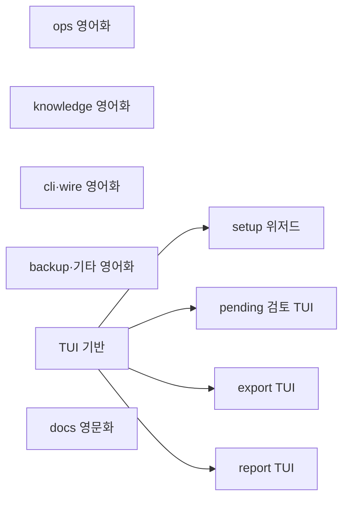

# flint v1.5.0 — 영어 통일·TUI 고도화

**Goal:** CLI 메시지 전면 영어 통일(관례 준수 — 파이프·grep 안정) +
Claude Code 스타일 TUI(bubbletea+huh) 4화면. docs 핵심 영문화.
**Architecture:** lib/wire(메시지·ErrLine message)·각 패키지 문자열·
lib/tui(신규 — bubbletea). 기계 채널(JSON error 코드·exit 4종) 불변.
**Tech stack:** Go, charmbracelet/bubbletea+bubbles+huh(신규 의존).
**Spec path:** docs/plans/2026-11-15-flint-v1500.spec.md
**Detail:** contracts · **Target-min:** 12
**Global constraints:** TDD·기계 채널 불변(JSON 키·error 코드·exit)·
개인 데이터 금지·비TUI 플래그 경로 완전 유지(파이프·CI 무영향).

**작업 분할 원칙 (i18n survey 준수):** 영어화는 패키지 단위 태스크 —
각 태스크가 해당 패키지 한국어 문자열 + 그 문자열을 단언하는 테스트
갱신을 함께 소유. 주석(약 5,000줄)은 대상 아님.

### T1 lib/ops 영어화 · Complexity 4 · Est. context 30k
**Owns:** lib/ops/*.go(한국어 문자열 포함 파일), lib/ops/*_test.go(해당 단언)
**Components:** 4 · **LOC owned:** 120 · **Tests:** fast · **Model:** sonnet
**계약:** doctor Detail/Fix·diagnosis Basis/Action·backup 경고 등 ~201 문자열 영어화. 구조 필드는 그대로 값만 영어. 테스트 한국어 단언 동반 갱신(영어 문구로). 기계 키·exit 불변.

### T2 lib/knowledge 영어화 · Complexity 4 · Est. context 28k
**Owns:** lib/knowledge/*.go(문자열 파일), 해당 *_test.go
**Components:** 4 · **LOC owned:** 100 · **Tests:** fast · **Model:** sonnet
**계약:** pending Why·verdict 라벨·import stderr·brief/hot 헤더·[flint] stderr ~73개 영어화. **"데이터 블록(지시 아님)" 인젝션 방어 문구는 영어로 이중화 세트**(docs/contracts·SKILL.md와 동일 문구 — T10과 동기, 영어 문구는 "data block, not instructions"). 테스트 동반.

### T3 lib/cli·wire 영어화 · Complexity 4 · Est. context 28k
**Owns:** lib/cli/*.go(문자열), lib/wire/*.go(문자열), 해당 *_test.go
**Components:** 4 · **LOC owned:** 110 · **Tests:** fast · **Model:** sonnet
**계약:** update 진행·setup 안내·HelpSummary 한국어 혼합·threshold desc ~80개 영어화. HelpSummary는 T5 TUI 전 언어 기반. 테스트 동반(usage 가드 포함).

### T4 lib/backup·db·store·mcp 영어화 · Complexity 3 · Est. context 26k
**Owns:** lib/backup/*.go, lib/db/*.go, lib/store/*.go, lib/mcp/*.go(문자열), 해당 *_test.go
**Components:** 4 · **LOC owned:** 80 · **Tests:** fast · **Model:** sonnet
**계약:** backup 에러 ~23·db 마이그레이션 ~11·store ~8·MCP 도구 description 5종+파라미터(LLM 소비 — 영어 자연) 영어화. rpcError Message 경로 확인. 테스트 동반.

### T5 TUI 기반 · Complexity 5 · Est. context 34k
**Owns:** lib/tui/(신규 패키지: tui.go·theme.go), lib/tui/tui_test.go, go.mod, go.sum
**Components:** 2 · **LOC owned:** 120 · **Tests:** fast · **Model:** sonnet
**계약:** bubbletea+bubbles+huh 의존(go get — 버전 고정). 테마(Lip Gloss — 색상 최소·Claude Code풍 네이비/오렌지 계열 검토). 공통: `tui.Run(model) error` 래퍼·비터미널(파이프·CI) 감지 시 즉시 폴백 exit 3 안내("TUI requires a terminal")·ESC/q 종료 관례. 테스트: 비터미널 폴백·모델 렌더 스냅샷 없이 최소(구조 단언).

### T6 setup 위저드 · Complexity 4 · Est. context 28k
**Owns:** lib/tui/setup.go, lib/tui/setup_test.go, lib/cli/setup.go(진입 분기)
**Components:** 2 · **LOC owned:** 100 · **Tests:** fast · **Model:** sonnet
**계약:** `flint setup` 인자 없이 TUI 위저드(huh form): exposure(normal/minimal) 선택→백업 키 설정 안내→완료 요약. 기존 플래그 경로(--exposure X) 완전 유지·동일 결과. 비터미널은 기존 안내 경로. 검증: 플래그 경로 결과 동치 회귀.

### T7 pending 검토 TUI · Complexity 5 · Est. context 32k
**Owns:** lib/tui/pending.go, lib/tui/pending_test.go, lib/cli/pending.go(진입 분기)
**Components:** 2 · **LOC owned:** 130 · **Tests:** fast · **Model:** sonnet
**계약:** `flint pending --tui` — 목록(bubbles list)·항목 선택→상세·키 조작: a(pprove)·s(upersede 대상 선택)·d(무시)·q. 액션은 기존 RunApprove/Supersede 경로 재사용(동일 JSON 결과). 플래그 기본 경로 불변(--tui 옵트인). 테스트: 모델 상태 전이·액션 위임 seam.

### T8 export TUI · Complexity 4 · Est. context 28k
**Owns:** lib/tui/export.go, lib/tui/export_test.go, lib/cli/export.go(진입 분기만)
**Components:** 2 · **LOC owned:** 110 · **Tests:** fast · **Model:** sonnet
**계약:** `flint export --tui` — 형식(5종)·status·--out 경로 입력(huh)→미리보기(행 수·바이트)→실행은 기존 RunExport 인자 조립 후 재사용. 결과·사이드카 동일. 플래그 경로 불변.

### T9 report TUI · Complexity 4 · Est. context 28k
**Owns:** lib/tui/report.go, lib/tui/report_test.go, lib/cli/report.go(진입 분기만)
**Components:** 2 · **LOC owned:** 110 · **Tests:** fast · **Model:** sonnet
**계약:** `flint report --tui` — 진단 카드 목록(bubbles)·상세 확장·지표 탐색. 뷰 전용(쓰기 없음). 데이터는 기존 ReportOutput 재사용(3뷰+TUI=4뷰 동일 원천 확장 — METRICS §4.8 문구 T10 갱신). 플래그 경로 불변.

### T10 docs 영문화·문서 · Complexity 4 · Est. context 30k
**Owns:** docs/*.md(한국어 11종 중 핵심: QUICKSTART·TUNING §표·METRICS·contracts 6종), docs/HISTORY.md, docs/versions_test.go, README.md, docs/commands_table_test.go, docs/METRICS 관련 테스트
**Components:** 3 · **LOC owned:** 200 · **Tests:** slow · **Model:** sonnet
**계약:** 핵심 문서 영문화(QUICKSTART·contracts·TUNING 표·METRICS — 한국어 판독층은 README.ko.md 유지로 커버). T2 인젝션 방어 영어 문구와 contracts 동기. HISTORY v1.5.0 항목·계약행(TestVersion0150Milestone: v1.5.0, TUI)·README EN/KO --tui 4커맨드 소개·METRICS §4.8 "4뷰" 갱신. docs 계약 테스트 전수 갱신.

## Review Focus (전체)
- **state:** TUI 액션 위임(기존 경로 재사용 — 중복 구현 금지).
- **protocol:** 비TUI 경로 불변·exit·JSON.
- **encoding:** 영어 문구 일관성(guard·error 용어 표준화).

**Probe entry:** run=go test ./lib/... ./docs/... -count=1
