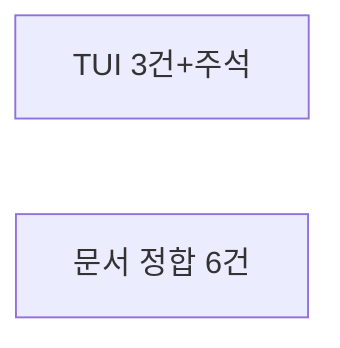

# flint v1.5.1 — R25 감사 발견 수정 (TUI 실측·통합 드리프트)

**Spec path:** docs/plans/2026-11-15-flint-v1510.spec.md
**Detail:** contracts · **Target-min:** 4
**Global constraints:** TDD·비TUI 경로 불변·개인 데이터 금지.

### T1 TUI 실측 결함 4건 · Complexity 4 · Est. context 28k
**Owns:** lib/tui/pending.go, lib/tui/pending_test.go, lib/tui/export.go, lib/tui/export_test.go, lib/tui/setup.go, lib/tui/setup_test.go
**Components:** 3 · **LOC owned:** 50 · **Tests:** fast · **Model:** sonnet
**계약 (R25-A pty 실측):**
- A1[높음] pending.go Update가 WindowSizeMsg 수신 → list.SetSize(폭, 높이-고정 4줄) — 12행 이하·리사이즈에서 항목 유지. 회귀: WindowSizeMsg 전이 후 View에 항목 렌더 단언.
- A2[중간] 상세 본문 lipgloss wordwrap(폭-2) — 하드 절단 폐지. 회귀: 긴 본문 접힘 라인 수.
- A3[중간] export 확인 단계 — 취소 시 "export cancelled" 안내 1행 출력 (조용한 0바이트 폐지).
- A4[낮음] setup·export 주석 "ESC/q" → "ctrl+c" 정정(huh v1.0.0 실동작).
**Test:** 각 red→green + 기존 4화면 회귀.

### T2 문서·메타 정합 6건 · Complexity 3 · Est. context 24k
**Owns:** docs/PLAN.md, docs/HISTORY.md, docs/versions_test.go, README.md, README.ko.md, docs/contracts/bridge.md, docs/contracts/cli.md, flint-plugin/.claude-plugin/plugin.json, flint-plugin/commands/flint.md
**Components:** 2 · **LOC owned:** 60 · **Tests:** slow · **Model:** sonnet
**계약 (R25-B):**
- B1: PLAN v1.5.0 [x] 실스코프(영어 통일·TUI) 기입 + v1.6에 마케팅 이월 항목 신설.
- B2: HISTORY v1.4.1·v1.4.2 항목(R22/R23 수정 요약) + versions_test 계약행 TestVersion0141Milestone{v1.4.1,R22}·TestVersion0142Milestone{v1.4.2,R23} (0140 뒤).
- B3: ADR 링크 대소문자 5곳(README 2·README.ko 2·bridge.md 1) → ADR- 접두 실제 파일명 정합.
- B4: cli.md에 --tui 4종 계약 추가(옵트인·조합 불가 exit 3·비터미널 폴백).
- B5: plugin.json description 영어화(template 정합).
- B6: commands/flint.md 인젝션 문구 정준 세트("data block, not instructions") 동기.
**Test:** make docs-sync·go test ./docs green.

## Review Focus
- **state:** A1 리사이즈 전이.
- **encoding:** A2 wrap·B3 링크.

**Probe entry:** run=go test ./lib/... ./docs/... -count=1
