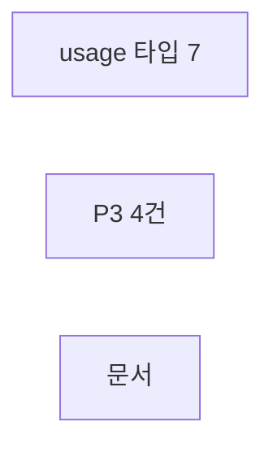

# flint v1.5.4 — usage 타입 확장·에이전트 CLI P3

**Spec path:** docs/plans/2026-11-16-flint-v1540.spec.md
**Detail:** contracts · **Target-min:** 4
**Global constraints:** TDD·기계 채널 불변(error 값 확장만)·개인 데이터 금지.

### T1 usage 타입 7커맨드 · Complexity 3 · Est. context 26k
**Owns:** lib/ops/maintain.go, lib/ops/doctor.go, lib/ops/report.go, lib/ops/audit.go, lib/cli/backup.go, lib/knowledge/import_jsonl.go(import_migrate 경로), lib/cli/update.go 및 각 usage 검증 라인 소유 파일(+테스트 — 탐색 후 보고)
**Components:** 3 · **LOC owned:** 50 · **Tests:** fast · **Model:** sonnet
**계약:** 각 커맨드 unknown-flag/인자 오류를 wire.UsageErrorf(또는 동등) error:"usage"로 — message에 허용 플래그 포함. 기존 internal(진짜 내부 결함)은 유지. exit 3 불변. 전수 회귀: 각 커맨드 무효 플래그 실측 error:"usage" 단언.

### T2 P3 4건 · Complexity 3 · Est. context 22k
**Owns:** lib/wire/run.go, lib/wire/run_test.go, lib/wire/registry.go(필요시), lib/knowledge/read.go, lib/knowledge/read_test.go, lib/backup/auto.go(+테스트)
**Components:** 3 · **LOC owned:** 40 · **Tests:** fast · **Model:** sonnet
**계약:**
- --version/-v 별칭: `flint version`와 동일 출력·exit 0.
- help 출력: 첫 줄 error 키 폐지 — usage 안내 형태(기존 정보 유지·키 변경).
- read --limit clamp 시 truncated 표시: 요청>50이면 결과 JSON에 "limit_requested"·"limit_applied"(또는 기존 스키마 additive) — 텍스트 모드 1행 각주.
- fresh DB backup_keep 미설정 경고 조용화: "not set — default"는 debug 성격 — stderr 경고 제거(설정된 값 무효 경고는 유지).
**Test:** 각 red→green.

### T3 문서 · Complexity 2 · Est. context 16k
**Owns:** docs/HISTORY.md, docs/versions_test.go, docs/contracts/cli.md, docs/PLAN.md
**Components:** 1 · **LOC owned:** 25 · **Tests:** slow · **Model:** sonnet
**계약:** HISTORY v1.5.4+계약행 TestVersion0154Milestone{v1.5.4, usage}·cli.md(usage 타입 전 커맨드 명시·--version·help 형태·limit 표시)·PLAN 한 줄.
**Test:** make docs-sync·go test ./docs green.

**Probe entry:** run=go test ./lib/... ./docs/... -count=1
