# flint v1.6.0 — 성능 3종·PAM 완결·maintain TUI·파서 통합

**Goal:** R30 전수 조사(성능 실측·PAM 전면·전 커맨드·리팩토링) 기반
마이너: [P0] pending/import·[P1] write 성능·PAM 스펙 준수+§18+체크섬+
메모리·maintain TUI·인자 파서 통합·소형 청산.
**Architecture:** 기존 패키지·lib/tui 확장. 신규 의존 0 (Ed25519=x/crypto).
**Spec path:** docs/plans/2026-11-16-flint-v1600.spec.md
**Detail:** contracts · **Target-min:** 14
**Global constraints:** TDD·기계 채널·exit·출력 계약 불변(성능 내부만)·
벤치마크 실측 동반·개인 데이터 금지. **N9 파싱 관례·가드 판정 시맨틱
불변 (R30-D "건드리지 말 것" 준수).**

```mermaid
flowchart LR
  T1[pending O(N+M)]
  T2[import 배치]
  T3[write 배치]
  T4[PAM 스펙+§18]
  T5[PAM 메모리]
  T6[maintain TUI]
  T7[파서 통합]
  T8[소형 청산]
  T9[문서·벤치]
  %% taskgraph
  T1 --> T6
  T4 --> T5
```

```mermaid
%% schedule
gantt
  title Predicted schedule (mm:ss)
  dateFormat X
  axisFormat %M:%S
  section lane 1
  T1 pending O(N+M) :t1, 0, 102s
  T5 PAM 메모리 최적화 :t5, 102, 102s
  section lane 2
  T2 import 배치+청크 트랜잭션 :t2, 0, 102s
  T6 maintain TUI :t6, 102, 102s
  section lane 3
  T3 write 배치 dedup :t3, 0, 102s
  section lane 4
  T4 PAM 스펙 준수+§18 서명+체크섬 검증 :t4, 0, 102s
  section lane 5
  T7 인자 파서 통합 :t7, 0, 102s
  section lane 6
  T8 소형 청산 :t8, 0, 102s
  section lane 7
  T9 문서·벤치마크 보고 :t9, 0, 102s
```



critical path: T4 → T5 (3.4 min) · peak width 7 · predicted build 3.4 min · predicted total ≈ 6.9 min

### T1 pending O(N+M) · Complexity 4 · Est. context 26k
**Owns:** lib/knowledge/pending.go, lib/knowledge/pending_test.go
**Produces:** (내부) 접두 키 map 사전 빌드
**계약:** matchTopicPrefix 행별 active 전체 재스캔(O(pending×active)) →
active 접두 12룬(또는 실제 키 길이 정책 유지) 키 map 1회 빌드로 O(N+M).
**판정 결과 동일성 회귀**: 기존 동작과 100% 동일 단언(경계 접두·유니코드)
+ **벤치마크**: 합성 50k에서 255s→수 초 이하 실측(bench 테스트·CI는
소규모). R30-C C1.
**Test:** 동일성 회귀(다양 접두 셋)·bench.

### T2 import 배치+청크 트랜잭션 · Complexity 5 · Est. context 32k
**Owns:** lib/knowledge/import_jsonl.go, lib/knowledge/import_jsonl_test.go, lib/db/repo.go, lib/db/repo_test.go
**계약 (R30-A P1·P2·P5 + R30-C C2):**
- dedup: 행별 lookupHash SELECT → 해시 배열 `WHERE content_hash =
  ANY($1)` 청크(예 1k) 사전 조회.
- INSERT: insertOne 루프 → pgx Batch 청크(동일 청크). id 보존·RETURNING·
  오류 계약(배치 실패 exit 1·ErrDuplicate 감싸기) 불변.
- 트랜잭션: 단일 5만 INSERT EOF 위험 → 청크 커밋(예 5k) — 부분 성공 시
  imported 수 보존·재시도 멱등(dedup가 회복) 회귀.
- 상한: 전량 파싱 후 판정 → 라인 스캔 1회 카운트 후 상한 초과 시 조기
  exit 3(312MB→경량).
**Test:** 기존 왕복·멱등·계보 회귀 전부 + 청크 경계·부분 실패 재개·
bench(합성 5.6k 25.6s→수 초).

### T3 write 배치 dedup · Complexity 4 · Est. context 26k
**Owns:** lib/knowledge/write.go, lib/knowledge/write_test.go, lib/cli/write_v093_test.go
**계약 (R30-C C3):** InsertBatch의 줄별 lookupHash → ANY($1) 배치.
**T2가 repo.go 공유 — T2 완료 후 순차**(브리프 명시). 단발 write
(1행) 경로 불변·duplicate 감지 동일성·리스트 오버라이드 동일.
**Test:** 회귀(중복·부분·리스트)·bench(합성 배치).

### T4 PAM 스펙 준수+§18 서명+체크섬 검증 · Complexity 5 · Est. context 34k
**Owns:** lib/knowledge/export_pam.go, lib/knowledge/export_pam_test.go, lib/knowledge/import_pam.go, lib/knowledge/import_pam_test.go, lib/cli/export.go(--sign 진입만), lib/knowledge/sign.go(신규)
**계약 (R30-A P4·P8·§18 설계):**
- 스펙 준수: 루트 owner 블록({id: did:key:ed25519 공개키, ...최소})·
  relations 각 {id(ULID 또는 UUID), from, to, type, created_at}(§13.1)·
  conversations_index 생략 유지(옵션). 외부 pam validate 관점 필수만.
- §18: lib/knowledge/sign.go — 키 로드/생성(~/.config/flint/pam-signing-key
  0600·FLINT_CONFIG_DIR 승계·age 관례)·payload{checksum, export_id,
  export_date, owner_id} JCS → Ed25519. `export --format pam --sign` →
  signature 블록. FormatPAM 내부 조립(재직렬화 회피).
- 수입: ParsePAM 후 ① integrity.checksum 재계산 검증(불일치 → 오류
  exit 3·조용히 통과 금지) ② signature 있으면 검증(실패 → 경고 stderr
  1행 후 계속 — §21.4 SHOULD).
**Test:** owner/relations 발행 단언·체크섬 불일치 exit 3·서명 왕복(
  --sign→수입 검증 통과)·변조 → 경고·무서명 → 무경고. 스펙 v1.0 문서
  대조 체크리스트.

### T5 PAM 메모리 최적화 · Complexity 4 · Est. context 28k
**Owns:** lib/knowledge/export_pam.go(T4와 공유 — T4 후 순차), lib/cli/export.go(T4와 공유)
**계약 (R30-A P3·P6):** FormatPAM churn 876MB → ① JCS 체크섬을
marshal bytes 재사용/스트리밍 경로로(jsoncanonicalizer 재파싱 회피 —
인터페이스 트리 없이 bytes 레벨 정규화 or 라이브러리 교체 검토) ②
인덴트 인코딩 버퍼 절감 ③ cli 재 Unmarshal 제거(포맷터가 count 반환 —
v1.5.5 B1 seam 확장). **벤치**: 50k churn 876MB→1/4 이하 목표.
**Test:** 출력 바이트 동일성(최우선 — 체크섬 재현!)·bench.

### T6 maintain TUI · Complexity 5 · Est. context 34k
**Owns:** lib/tui/maintain.go, lib/tui/maintain_test.go, lib/cli/maintain.go(진입 분기만)
**계약 (R30-B 후보1·R30-D 설계):** `flint maintain --tui`(옵트인만 —
적응형 X: 유령 인자 다수): dup-suspects/conflict-suspects/stale 목록
(bubbles list)→상세(양쪽 본문·**"무엇이 보존되는지" 미리보기 — merge UX
원칙)→키: m(merge — maintain --merge 위임)·k(keep — 무시)·i(invalidate
--yes 위임·되돌림 경로 안내)·q. pending TUI 패턴 승계(GlobalIndex·sink
원인·FLINT_NO_TUI). maintain 서브커맨드 인자가 복잡하므로 위임만.
**Test:** 모델 전이·위임 seam·미리보기 렌더·기존 maintain 회귀.
**T1 완료 후 데이터 로더 실측 체감.**

### T7 인자 파서 통합 · Complexity 5 · Est. context 36k
**Owns:** lib/wire/args.go, lib/wire/args_test.go, lib/knowledge/read.go, lib/knowledge/read_test.go, lib/knowledge/write.go, lib/knowledge/write_test.go, lib/ops/maintain.go, lib/ops/doctor.go, lib/ops/report.go, lib/ops/audit.go, lib/ops/backup.go, lib/cli/update.go, lib/cli/profile.go, lib/cli/setup.go, lib/cli/export.go, lib/cli/export_test.go, lib/cli/maintain_tui_test.go, lib/cli/pending.go, lib/knowledge/pending.go, lib/ops/tuning.go
**계약 (R30-D D1):** 사양 테이블 기반 mini-parser(플래그 정의{이름·값
유무·반복}→파싱 결과+unknown 오류 UsageErrorf). **N9 "--" 규칙·"--" 후
전부 위치 인자·값 소비·반복 플래그 시맨틱 100% 보존** — 전환 전후
동작 동일 회귀(기존 버전 테스트가 고정). read부터 3커맨드 파일럿 →
나머지 9. RunRead/RunMaintain/RunWrite cyclo 재측정 보고.
**Test:** 파서 단위 표(N9 포함)·전환 커맨드 전체 회귀(기존 테스트가
검증).

### T8 소형 청산 · Complexity 3 · Est. context 22k
**Owns:** lib/ops/diff.go, lib/ops/diff_test.go, lib/ops/doctor.go, lib/ops/doctor_test.go, lib/ops/maintain_check_next_v1600_test.go, lib/tui/pending.go, lib/tui/pending_test.go
**계약 (R30-B 발견·diff 레거시):**
- diff.go:106 usage 레거시 → wire.UsageErrorf (v1.5.4 누락분).
- doctor --json (기계 판독 — 기존 텍스트 불변).
- maintain --check 응답에 next 키(권장 조치 — pending import 관례).
- pending TUI `e` 액션(maintain --expire-pending 위임).
**Test:** 각 red→green·회귀.

### T9 문서·벤치마크 보고 · Complexity 3 · Est. context 24k
**Owns:** docs/HISTORY.md, docs/versions_test.go, docs/contracts/cli.md, docs/PERF.md(신규), README.md, README.ko.md, docs/PLAN.md, docs/METRICS.md(필요시)
**계약:** HISTORY v1.6.0(성능 수치 전·후 — 합성 벤치 표기)·계약행
TestVersion0160Milestone{v1.6.0, performance}·cli.md(--sign·maintain
--tui·doctor --json·next 키)·**docs/PERF.md 신규**(측정 관례·현재
벤치마크 표·재현 스크립트 안내 — R30 측정값 수록·합성 명시)·README
--sign·--tui 소개·PLAN v1.6.0·v1.7 이월 확정.
**Test:** make docs-sync·go test ./docs.

## Review Focus (전체)
- **state:** 청크 트랜잭션 멱등·파서 시맨틱 보존.
- **encoding:** PAM 출력 바이트 동일성(T5)·§18 서명 벡터.
- **protocol:** exit·JSON 불변·bench 허수치 금지(합성 표기).

**Probe entry:** run=go test ./lib/... ./docs/... -count=1
