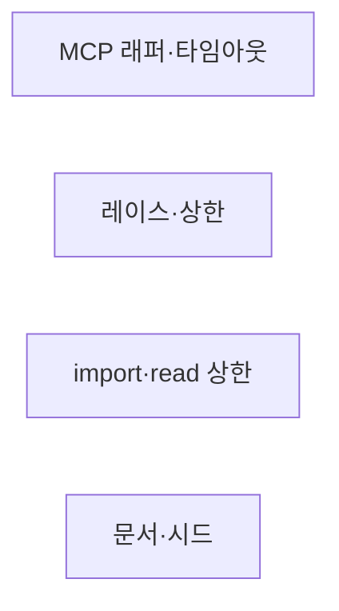

# flint v1.6.2 — R33 4각도 감사 수정

**Spec path:** docs/plans/2026-11-17-flint-v1620.spec.md
**Detail:** contracts · **Target-min:** 6
**Global constraints:** TDD·기계 채널 불변·개인 데이터 금지·문서화 수용분은 코드 불변.

### T1 MCP 래퍼 위임·타임아웃 · Complexity 5 · Est. context 30k
**Owns:** lib/cli/run_store.go, lib/mcp/tools_test.go(신규 store_reuse_real_test.go 포함), scripts/make_mcpb.sh, lib/db/pool.go, lib/db/pool_test.go
**계약 (F1·F2·F3·F4):**
- injectedStore 래퍼에 선택 인터페이스 위임 추가: Approve·DupIDStore(DupIDByHash)·UsageStore·ReadEventStore·HotEventRecorder 등 approve.go·read.go 타입 단언 전수 조사해 전달(또는 Unwrap 패스스루). 회귀: MCP flint_approve 실경로 승격(격리 DB)·duplicate 응답 id/topic/state 포함·read_events source=mcp 계측 부활.
- make_mcpb.sh tools 5종 광고.
- pool.go ConnectTimeout 5s(원격 불통 조기 실패 → hooks 10s 내 exit 2).
**Test:** 래퍼 통과 실스토어 회귀(기존 fake seam 우회 결함 보완 — 실 DB slow)·타임아웃 단위(cfg 값).

### T2 레이스 분류·write 상한 · Complexity 4 · Est. context 26k
**Owns:** lib/db/repo.go, lib/db/repo_test.go, lib/knowledge/write.go, lib/knowledge/write_test.go
**계약 (E1·G1·G2):**
- mapInsertErr에 "constraint violations" unique 오류 분류 추가 → write.go survive 경로(재확인·재시도) 도달. 회귀: 동일 content 동시 write 병렬 실DB — 패자 고유줄 잔존(150행).
- write stdin 행 수 상한: export_import_max_rows 재사용(import 대칭) — 초과 exit 3 {max,count}.
- 단일 payload 필드 바이트 상한(예 1MB — thresholds 등록 or 상수+TUNING 표기): Validate 거부 exit 3.
**Test:** 각 red→green·병렬 레이스 실측 slow.

### T3 import·read 상한 · Complexity 3 · Est. context 24k
**Owns:** lib/knowledge/import_jsonl.go, lib/knowledge/import_jsonl_test.go, lib/knowledge/read.go, lib/knowledge/read_test.go, data/seed.jsonl, lib/knowledge/write.go(T2 공유 — kindColumns만)
**계약 (G3·G4·G5·F5):**
- import 파일 크기 상한(예 512MB): os.ReadFile 전 stat 검사 exit 3 {max,size}.
- read 쿼리 길이 truncate(제안 입력 — ClampLimit 관례): 상한 넘는 쿼리는 제안 빼고 본문 검색만(또는 입력 truncate)·성능 회귀 벤치.
- import id 충돌(기존 동일 id·다른 내용·파일 내 중복): 자동 재할당 remapped 확장(기존 remapped 카운터 승계) — 왕복 주 시나리오 회복.
- seed project note: kindColumns["project"]에 note 등록해 저장(컬럼 존재)·seed 유지.
**Test:** 각 red→green·왕복 id 충돌 시나리오.

### T4 문서·시드·수용 문서화 · Complexity 3 · Est. context 26k
**Owns:** docs/RUNBOOK.md, docs/PERF.md, docs/QUICKSTART.md, docs/TUNING.md, README.md, flint-plugin/skills/flint/SKILL.md, docs/HISTORY.md, docs/versions_test.go, docs/PLAN.md, lib/knowledge/write.go(project 커밋 메시지 라인 — T2 공유)
**계약 (D1~D8·F6·E3·E4·G9):**
- D1 RUNBOOK restore --file F --drill 정정·D2 PERF RealSlow 재현 커맨드·D3 QUICKSTART setup 위저드·D5 cron 경로 $(go env GOPATH)·D7 TUNING 비레지스트리 표기·D8 README EN 각주.
- D4 project 커밋 메시지 name 사용(summary nil "<nil>" 폐지).
- F6 SKILL topic `session[` 표기·G9 오류 라벨(jsonl 파손 exit 3 라벨 정합).
- E3 빈 커밋·해시 보고 의미·E4 LWW 유실률 — RUNBOOK/METRICS에 문서화 수용 명시.
- D6 seed 낡은 사실 2건 갱신(5434·TUI 도입).
- HISTORY v1.6.2+계약행 TestVersion0162Milestone{v1.6.2, mcp}·PLAN 한 줄.
**Test:** make docs-sync·go test ./docs.

**Probe entry:** run=go test ./lib/... ./docs/... -count=1
