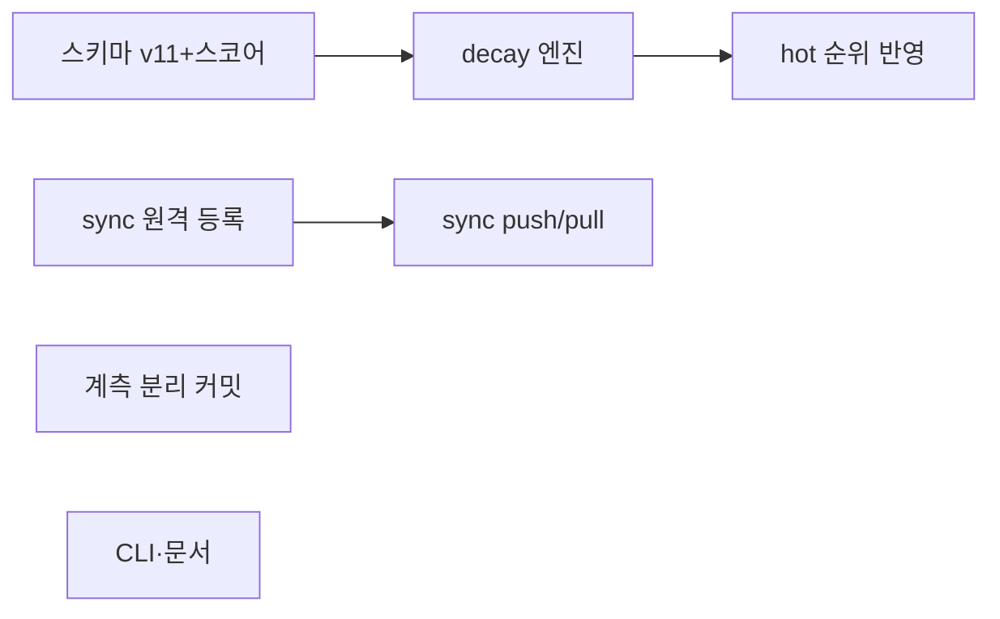

# flint v1.7.0 — 지식 동기화·decay 스코어·계측 분리

**Goal:** A `flint sync`(Doltgres 원격 push/pull — 기기 이동·팀 공유)·
B decay/강화 스코어(회상 시 강화·미사용 감쇠 → hot 순위·archive 제안)·
E 계측 테이블 per-table 커밋(감사 귀속).
**Architecture:** sync는 dolt_remote/push/pull SQL 함수 노출(신규 스토어
메서드)·B는 knowledge 열 추가(스키마 v11)+hot 랭킹·E는 Commit 분기.
**Spec path:** docs/plans/2026-11-17-flint-v1700.spec.md
**Detail:** contracts · **Target-min:** 12
**Global constraints:** TDD·기계 채널·exit 불변·개인 데이터 금지·
원격 접속 정보는 절대 repo/로그 미기록.

### T1 스키마 v11·스코어 열 · Complexity 4 · Est. context 26k
**Owns:** lib/sqlfs/schema.sql, lib/db/admin.go(마이그레이션), lib/db/admin_test.go, lib/knowledge/export.go, lib/knowledge/export_test.go
**계약:** knowledge에 `recall_score`(int 기본 0)·`last_recalled_at`(timestamptz NULL) 추가 — EnsureSchemaV11(v10→v11 무손실·v10 바이너리 역방향 호환 = 열 추가 default라 이전 바이너리 읽기 OK 실증). ExportRow에 RecallScore·LastRecalledAt(원천 파생 아님 — 실열). PAM/jsonl 승계(additive·기존 골든 불변 — 미지원 필드는 폴백 0/NULL).
**Test:** 승격·역방향·왕복(스코어 보존) 실측.

### T2 decay 엔진 · Complexity 4 · Est. context 28k
**Owns:** lib/knowledge/read.go(회상 시 강화), lib/knowledge/read_test.go, lib/ops/maintain.go(archive 제안), lib/ops/maintain_test.go, lib/store/thresholds.go, lib/wire/threshold_meta.go
**계약:**
- **강화**: read 히트 행 recall_score+1·last_recalled_at=now(read_events 기록 경로 재사용 — RecordKnowledgeReads에 결합).
- **감쇠**: 스코어 산식 `score - days_since_recall`(후보: 선형·하한 0). 매 계산 상시 아님 — read/hot 조회 시 SQL 산식 또는 주기 유지.
- thresholds 등록: `decay_rate`(기본 1/일)·`archive_below`(기본 0·비활성)·등록표 37항목 갱신.
- `maintain --decay-audit`: 감쇠 후보 목록 JSON(스코어·마지막 회상·권장 archive). archive 실행은 기존 --invalidate 위임(자동 아님 — 승인제).
**Test:** 강화 회귀(read→score+1)·감쇠 산식 경계(1일·100일·하한)·audit 목록.

### T3 hot 순위 반영 · Complexity 3 · Est. context 24k
**Owns:** lib/knowledge/hot.go, lib/knowledge/hot_test.go, lib/knowledge/brief.go(+테스트)
**계약:** hot 헤드라인 선정 순위에 recall_score 반영(기존 관례 준수 — 최신성 등과 결합 가중: score DESC, ingested_at DESC 안정 정렬). brief 동일. 주입 포맷·바이트 상한 불변.
**Test:** 동일 최신성에서 score 높은 항목 우선·0점 전원 기존 순서(회귀).

### T4 sync 원격 등록 · Complexity 3 · Est. context 22k
**Owns:** lib/db/sync.go(신규), lib/db/sync_test.go, lib/cli/sync.go(신규), lib/cli/sync_test.go
**계약:** `flint sync remote add <name> <url>`·`remote list`·`remote remove` — dolt_remote SQL 함수 래핑. url은 Doltgres 원격 형식(https://doltremoteapi...·file://·postgres://). **url 로그 미출력**(개인 데이터 방어 — list는 마스킹).
**Test:** 등록·목록(마스킹)·삭제·중복명 오류 — 실DB slow(dolt_remote 실측).

### T5 sync push/pull · Complexity 4 · Est. context 28k
**Owns:** lib/db/sync.go, lib/db/sync_test.go, lib/cli/sync.go, lib/cli/sync_test.go(공유)
**계약:**
- `flint sync push <remote>` — dolt_push(remote, 'main') 결과 JSON{status, hash}.
- `flint sync pull <remote>` — dolt_fetch+dolt_merge. **충돌 시**: merge 실패 오류 JSON(exit 1)·안내(수동 dolt CLI로 해결) — 자동 해결 금지(파괴 방지).
- 원격 미등록·도달 불가 오류 계약(exit 1·원인 보존·url 미노출).
- `--dry`: fetch까지만·적용 없음.
**Test:** 로컬 두 인스턴스 간 push/pull 왕복 실측(slow — 격리 2컨테이너·합성 시드)·충돌 시나리오(양측 동일 id 다른 내용).

### T6 계측 분리 커밋 · Complexity 4 · Est. context 26k
**Owns:** lib/db/repo.go, lib/db/repo_test.go, lib/knowledge/read.go, lib/knowledge/hot.go, lib/knowledge/read_test.go, lib/knowledge/done.go, lib/cli/realstore_read.go, lib/cli/run_store.go, lib/knowledge/approve_test.go, lib/knowledge/fake_parity_test.go
**계약 (R33 E2·per-table 실증 기반):**
- write 커밋(Commit)은 `dolt_add('knowledge','projects','meta','-A')` — 계측 테이블 제외... 단 '-A'의 *_id_seq 잔여 이슈(R33 실증) — 검증 후: 계측 테이블은 **별도 커밋** `dolt_add('read_events','hot_events','knowledge_reads','session_starts') + dolt_commit('telemetry')`(read/hot/done 완료 시 1회·기존 커밋과 독립).
- 커밋 실패는 계측 원칙대로 조용(데이터는 이미 커밋됨 — dolt_add는 스테이징만).
- dolt log에서 감사 커밋 순수성 실측(knowledge 커밋의 diff에 read_events 0).
**Test:** read 후 write → write 커밋 diff에 read_events 부재·telemetry 커밋 존재(slow 실측).

### T7 CLI·문서 · Complexity 3 · Est. context 24k
**Owns:** lib/wire/registry.go, lib/wire/run.go, lib/wire/usage_registry_test.go, docs/HISTORY.md, docs/versions_test.go, docs/contracts/cli.md, docs/TUNING.md, README.md, README.ko.md, docs/PLAN.md, flint-plugin/skills/flint/SKILL.md, lib/db/schema_gates.go, lib/knowledge/export_jsonl.go, lib/knowledge/import_jsonl.go
**계약:** usageOrder+sync·maintain --decay-audit(28종). HISTORY v1.7.0+계약행 TestVersion0170Milestone{v1.7.0, sync}. cli.md sync 절(원격·마스킹·충돌 안내)·decay-audit·TUNING 37항목. README sync/decay 소개·PLAN.
**Test:** make docs-sync·go test ./docs.

## Review Focus (전체)
- **security:** 원격 url 미기록(로그·오류·레포).
- **state:** 스키마 v11 역방향·merge 충돌 안전.
- **encoding:** 스코어 왕복 보존.

**Probe entry:** run=go test ./lib/... ./docs/... -count=1
