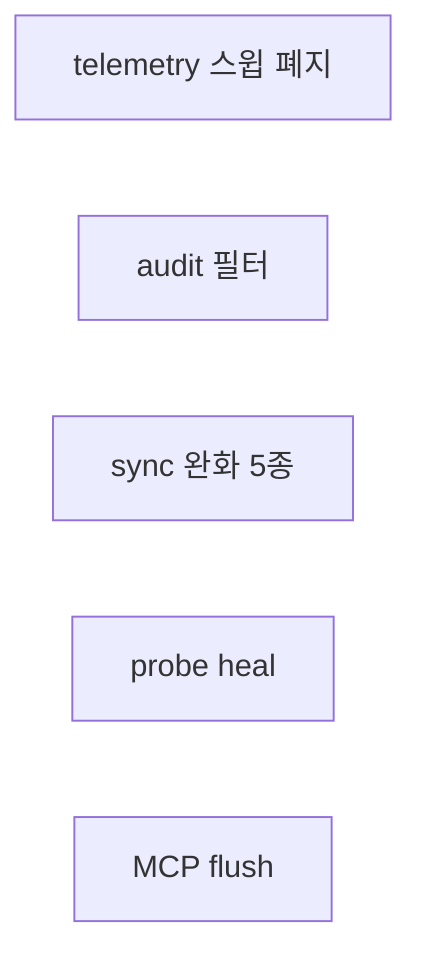

# flint v1.7.2 — R38 감사: sync 완화·telemetry 회귀 수리

**Spec path:** docs/plans/2026-11-17-flint-v1720.spec.md
**Detail:** contracts · **Target-min:** 7
**Global constraints:** TDD·기계 채널 불변·개인 데이터 금지·release-gate 통과.

### T1 telemetry -A 폐지 (C1[높음]+L2) · Complexity 3 · Est. context 22k
**Owns:** lib/db/repo.go, lib/db/repo_test.go
**계약:** CommitTelemetry의 `dolt_add('-A')` 스윕 폐지 — 계측 시퀀스(read_events_id_seq 등 4종·존재 확인 후) 명시 스테이징으로 교체. 주석 정정("스윕은 시퀀스 잔여만" → 실측 정확 서술). 회귀: read 후 감사 테이블 지식 변경이 **감사 커밋**에 귀속되는지 dolt_diff 실측(recall bump UPDATE가 telemetry 커밋 아닌 감사 스테이징 대상이므로 다음 감사 커밋에 — 또는 read 완료 시 감사 커밋 동반 여부 설계 확인 후 최소 변경: recall bump 커밋 귀속을 감사로).
**Test:** read→최신 커밋 dolt_diff에서 knowledge 변화가 감사 커밋 측·telemetry는 계측만(slow 실DB).

### T2 audit telemetry 필터 (C2[중]) · Complexity 2 · Est. context 18k
**Owns:** lib/ops/audit.go, lib/ops/audit_test.go
**계약:** audit 기본 쿼리 `NOT LIKE 'telemetry: %'` + `--telemetry` 플래그로 포함. --stat 동일.
**Test:** read 10회 후 audit 기본 목록에 telemetry 0건·--telemetry 시 포함.

### T3 sync 완화 5종 (S3·S4·S5·S6 + 패닉 안내) · Complexity 4 · Est. context 28k
**Owns:** lib/db/sync.go, lib/db/sync_test.go, lib/cli/sync.go, lib/cli/sync_test.go, lib/cli/exit_contract_v101_test.go
**계약:**
- S3: SyncPush/SyncPull에 ctx 타임아웃 30s(ctx.WithTimeout).
- S4: remote add 성공 행·cli.md에 "file:// 경로는 Doltgres 서버 기준" 명시.
- S5: validRemoteURL 스킴 화이트리스트(https·http·file) — postgres:// add 시점 exit 3.
- S6: no-op push "up-to-date" 보고·분기 push 안내 "flint sync pull"로·문구 정정.
- S1 완화: pull 오류 메시지에 "DoltgresHandler caught panic" 감지 시 전용 안내(다중 기기 동시 사용 제한·단일 활성 기기 권고·dolt_reset 회복 안내).
- S2 완화: `sync reset --to-remote <remote>` — dolt_reset --hard origin/main 래핑·**손실 경고 출력 후 --yes 요구**(teardown 관례).
**Test:** 타임아웃 단위·스킴 거부·no-op 보고·reset --yes 게이트·panic 안내 문자.

### T4 진입 probe heal (L1[중]) · Complexity 2 · Est. context 16k
**Owns:** lib/cli/root.go, lib/cli/root_test.go(또는 probe 소유 파일)
**계약:** schemaVersionFn probe가 42P01 실패 시 st 풀에 `SELECT 1` 1회 실행(세션 카탈로그 재동기) — R38-B probeheal 변형 실증안.
**Test:** fresh DB 첫 커밴드 exit 0(slow 실DB — 신규 DB 생성 시나리오).

### T5 MCP 응답 즉시 flush (C5[낮]) · Complexity 1 · Est. context 10k
**Owns:** lib/mcp/server.go, lib/mcp/server_test.go
**계약:** Serve 각 응답 후 즉시 Flush(bufio.Writer + write 직후 flush) — EOF 전 대기 데드락 폐지.
**Test:** 응답 후 flush 호출 단언(또는 기존 stdio 테스트로 응답 도달).

### T6 문서 (C4 완료·S 제한) · Complexity 2 · Est. context 18k
**Owns:** docs/contracts/cli.md, docs/RUNBOOK.md, docs/HISTORY.md, docs/versions_test.go, docs/PLAN.md, README.md, README.ko.md
**계약:** cli.md — sync 절에 "단일 활성 기기 권고(다중 기기 동시 사용은 엔진 제약으로 미지원)"·--telemetry 플래그·reset 서브커맨드. HISTORY v1.7.2+계약행 TestVersion0172Milestone{v1.7.2, telemetry}. PLAN 한 줄.
**Test:** make docs-sync·release-gate green·go test ./docs.

**Probe entry:** run=go test ./lib/... ./docs/... -count=1
