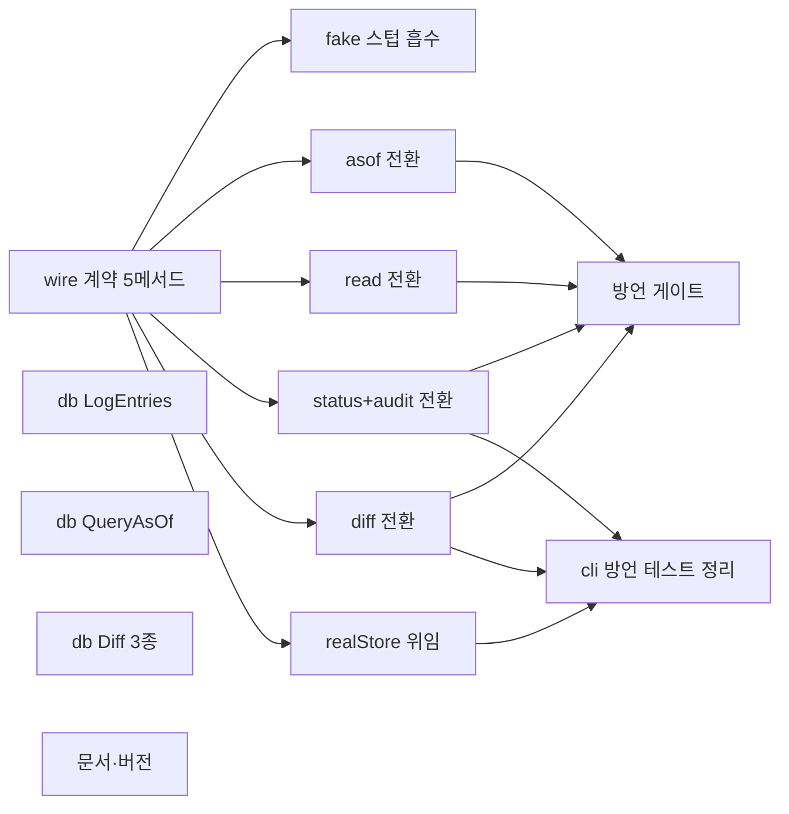

# flint v1.8.0 — Doltgres 방언 절단: Store 히스토리 인터페이스

**Spec path:** docs/plans/2026-11-18-flint-v1800.spec.md
**Detail:** tests · **Target-min:** 12
**Global constraints:** TDD·기계 채널 불변(바이트 동치 리파터링)·개인 데이터 금지·slow 실DB는 격리 DSN+flock(R34)·FLINT_TEST_DSN 하네스 전용.

### T12 realStore 히스토리 위임 (후속) · Complexity 1 · Est. context 16k
**Owns:** lib/cli/root.go, lib/cli/run_store.go
**계약:** realStore 어댑터에 히스토리 5메서드 위임 추가(s.repo 기준 — LogEntries·QueryAsOf·DiffRows·DiffStat·DiffCommits). injectedStore 전파 구조 확인·var _ wire.Store 컴파일 단언(R33 관례). 기존 메서드·주석 불변.
**Consumes:** LogEntries(ctx context.Context, q LogQuery) ([]LogEntry, error) (T1) · QueryAsOf(ctx context.Context, q AsOfQuery) ([][]any, error) (T1) · DiffRows(ctx, fromHash, toHash string) ([]KnowledgeDiffRow, error) (T1) · DiffStat(ctx, hashes []string) ([]TableDiffStat, error) (T1) · DiffCommits(ctx, fromHash, toHash string) ([]DiffCommitSummary, error) (T1)
**Test:** go build ./lib/cli/... green·패키지 기존 테스트 green.

### T13 lib/cli 레거시 방언 테스트 정리 (후속) · Complexity 3 · Est. context 26k
**Owns:** lib/cli/audit_test.go, lib/cli/audit_v08_test.go, lib/cli/diff_test.go, lib/cli/read_v08_test.go, lib/cli/read_v096_test.go, lib/cli/read_fix_v0131_test.go, lib/cli/read_status_v0120_test.go, lib/cli/status_v08_test.go
**계약:** T10 게이트 검출 방언 문자열(lib/cli 8파일 20건) 정리 — 원시 dolt SQL 단언·픽스처를 Store 계약 기반으로 전환, 기존 단언 의미 보존. 방언 게이트 green 기여.
**Consumes:** LogEntries · QueryAsOf · DiffRows · DiffStat · DiffCommits (T1) — 시그니처 T12 참조
**Test:** go test ./lib/cli/... green·게이트 위반 잔여 0건(lib/cli 기여분).

```mermaid
%% schedule
gantt
  title Predicted schedule (mm:ss)
  dateFormat X
  axisFormat %M:%S
  section lane 1
  T1 wire 히스토리 계약 :t1, 0, 102s
  T2 fake 스텁 흡수 :t2, 102, 102s
  T10 방언 폐쇄 게이트 :t10, 204, 102s
  section lane 2
  T3 db LogEntries 구현 :t3, 0, 102s
  T6 asof.go 전환 :t6, 102, 102s
  section lane 3
  T4 db QueryAsOf 구현 :t4, 0, 102s
  T7 read.go 전환 :t7, 102, 102s
  section lane 4
  T5 db Diff 3종 구현 :t5, 0, 102s
  T8 status+audit 전환 :t8, 102, 102s
  section lane 5
  T11 문서·버전 동기 :t11, 0, 102s
  T9 diff.go 전환 :t9, 102, 102s
```

critical path: T1 → T6 → T10 (5.1 min) · peak width 5 · predicted build 5.1 min · predicted total ≈ 8.6 min

**File structure:** lib/wire/history.go(계약·타입·HistoryStubs) · lib/db/history.go·asof_query.go·diff_store.go(방언 유일 소유) · 호출층 전환 4파일 · lib/wire/dialect_gate_test.go(폐쇄 영구 검증).

### T1 wire 히스토리 계약 · Complexity 4 · Est. context 26k
**Owns:** lib/wire/history.go, lib/wire/history_test.go, lib/wire/store.go
**계약:** Store에 5메서드 추가 + 타입. HistoryStubs는 5메서드 기본구현(ErrHistoryUnsupported 반환) — fake 임베딩용. Store 확장은 store.go 인터페이스에(기존 메서드 불변).
**Produces:**
- `type LogQuery struct{ Hash, Prefix string; BeforeOrAt time.Time; Earliest bool; LatestN int; MessageNotLike string }`
- `type LogEntry struct{ Hash, Committer, Message string; Date time.Time }`
- `type AsOfQuery struct{ Hash, Table string; Columns []string; Where string; Args []any; Limit int; FallbackTable string }`
- `type KnowledgeDiffRow struct{ DiffType, ID, Topic string }`
- `type TableDiffStat struct{ CommitHash, Table string; DataChange, SchemaChange bool }`
- `type DiffCommitSummary struct{ Hash, Message string; Date time.Time; DataChange, SchemaChange bool }`
- `LogEntries(ctx context.Context, q LogQuery) ([]LogEntry, error)`
  e.g. `LogQuery{Hash:"abc1"} -> [{Hash:"abc1",Committer:"flint",Date:2026-11-18T00:00:01Z,Message:"audit: demo"}]` · `LogQuery{LatestN:2,MessageNotLike:"telemetry: %"} -> 최근 2건(해당 필터)` · `LogQuery{Earliest:true} -> [첫 커밋 1건]`
- `QueryAsOf(ctx context.Context, q AsOfQuery) ([][]any, error)`
  e.g. `AsOfQuery{Hash:"abc1",Table:"knowledge",Columns:["count(*)"]} -> [[42]]` · `AsOfQuery{Table:"active_knowledge",FallbackTable:"knowledge"} 뷰 비호환 오류 시 base 재시도`
- `DiffRows(ctx, fromHash, toHash string) ([]KnowledgeDiffRow, error)` e.g. `("a1","b2") -> [{DiffType:"added",ID:"k-7",Topic:"demo topic"}]`
- `DiffStat(ctx, hashes []string) ([]TableDiffStat, error)` e.g. `(["a1"]) -> [{CommitHash:"a1",Table:"knowledge",DataChange:true}]`
- `DiffCommits(ctx, fromHash, toHash string) ([]DiffCommitSummary, error)` e.g. `("a1","b2") -> 커밋 순서 내림차순 요약`
- `var ErrHistoryUnsupported errors` · `type HistoryStubs struct{}`(5메서드 기본구현)
**Test:** 타입 컴파일·HistoryStubs가 Store 충족(var _ Store 단언)·e.g. 값 리터럴.

### T2 fake 스텁 흡수 · Complexity 2 · Est. context 22k
**Owns:** lib/cli/exit_contract_v101_test.go, lib/cli/export_test.go, lib/cli/maintain_tui_test.go, lib/cli/pending_test.go, lib/cli/run_store_t1700_test.go, lib/cli/usage_type_v154_test.go, lib/db/sync_test.go, lib/knowledge/done_test.go, lib/knowledge/export_test.go, lib/knowledge/import_jsonl_test.go, lib/knowledge/pending_count_test.go, lib/knowledge/write_test.go, lib/mcp/store_reuse_test.go, lib/mcp/tools_test.go, lib/ops/doctor_test.go, lib/ops/report_bytes_v1110_test.go, lib/ops/report_v1200_test.go, lib/ops/sessionlabel_v102_test.go, lib/tui/maintain_test.go, lib/tui/pending_test.go, lib/cli/cli_test.go, lib/cli/asof_test.go, lib/wire/wire_test.go, lib/wire/cas_args_r12_test.go, lib/wire/meta_kv_test.go, lib/wire/thresholds_test.go
**계약:** 컴파일 깨지는 fake에만 `wire.HistoryStubs` 임베딩 1줄 추가 — 테스트 의미·기존 단언 불변. `go build ./...`·`go vet` green이 완료 조건.
**Test:** go test ./lib/cli/... ./lib/knowledge/... ./lib/mcp/... ./lib/ops/... ./lib/tui/... 기존 전량 green(신규 단언 불요).

### T3 db LogEntries 구현 · Complexity 4 · Est. context 28k · Tests: slow
**Owns:** lib/db/history.go, lib/db/history_test.go
**계약:** 기존 dolt_log 쿼리 4종(asof.go 68·92·102행, audit.go 142행)을 lib/db로 이식. Hash 정확 일치·Prefix LIKE 접두·BeforeOrAt(date≤ ORDER BY commit_order DESC LIMIT 1)·Earliest(ASC LIMIT 1)·LatestN(DESC·MessageNotLike NOT LIKE). date 셀 파싱(parseAuditDate 로직 이관 — time.Time 아닐 때 문자열 파싱). LogEntry 반환.
**Consumes:** LogEntries(ctx context.Context, q LogQuery) ([]LogEntry, error) (T1)
**Test:** 격리 실DB — 커밋 3개 심고 Hash/PREFIX/BeforeOrAt/Earliest/LatestN+필터 각각 e.g. 대응 실측.

### T4 db QueryAsOf 구현 · Complexity 4 · Est. context 28k · Tests: slow
**Owns:** lib/db/asof_query.go, lib/db/asof_query_test.go
**계약:** AS OF 질의 폐쇄. Table 화이트리스트("knowledge"·"active_knowledge" 외 오류)·Columns 식별자 검증(^[a-z_)(* ]+$ 수준)·해시 charset 재검증(소문자 base32 — 위반 시 오류, 인라인 전堤). FallbackTable: 뷰 AS OF 비호환 오류 시 base 재시도 — read.go 704-709행 안내 문구 로직 이관(ErrViewAsOfIncompatible 래핑·안내 유지).
**Consumes:** QueryAsOf(ctx context.Context, q AsOfQuery) ([][]any, error) (T1)
**Test:** 격리 실DB — count(*)·행 조회·화이트리스트 외 테이블 거부·무효 해시 거부·뷰 폴백 안내.

### T5 db Diff 3종 구현 · Complexity 3 · Est. context 26k · Tests: slow
**Owns:** lib/db/diff_store.go, lib/db/diff_store_test.go
**계약:** diff.go 75행(diffCommitsSQL — dolt_log×dolt_diff LEFT JOIN·commit_order 범위·GROUP BY·LIMIT diffCommitsMax 상수 이관)·123-124행(dolt_commit_diff_knowledge to/from 각 1 필터·COALESCE)·audit.go 201행(dolt_diff ANY($1) 배치) SQL을 그대로 lib/db로 이식, 타입 매핑만(DiffType/ID/Topic, TableDiffStat, DiffCommitSummary). 파라미터화 유지($1·$2).
**Consumes:** DiffRows(ctx, fromHash, toHash string) ([]KnowledgeDiffRow, error) (T1) · DiffStat(ctx, hashes []string) ([]TableDiffStat, error) (T1) · DiffCommits(ctx, fromHash, toHash string) ([]DiffCommitSummary, error) (T1)
**Test:** 격리 실DB — 지식 추가/수정/삭제 커밋 후 DiffRows 3종 diff_type·DiffStat 테이블 요약·DiffCommits 범위 순서.

### T6 asof.go 전환 · Complexity 3 · Est. context 22k
**Owns:** lib/wire/asof.go, lib/wire/asof_test.go
**계약:** ParseAsOfSpec·commitAtOrBefore의 QueryOnce 원시 SQL 제거 → st.LogEntries(Prefix/BeforeOrAt/Earliest) 조합. 접두 유일성 판정(다중 행 → ErrInvalidAsOf)은 wire 유지. isLowerAlnumPrefix·오류 문구·ErrInvalidAsOf 계약 불변. Fake 기반 테스트로 전환(캔 해시).
**Consumes:** LogEntries (T1) · e.g. T1 참조
**Test:** fake LogEntries — 접두 유일/모호/미발견·상대시각 경계·첫 커밋 이전 → ErrInvalidAsOf.

### T7 read.go 전환 · Complexity 3 · Est. context 34k
**Owns:** lib/knowledge/read.go, lib/knowledge/read_test.go, lib/knowledge/readhot_render_output_test.go
**계약:** AS OF 인라인(strings.Replace + asOfHashRe 재검증)·dolt_log date 조회(428-432행) 제거 → st.QueryAsOf(뷰+FallbackTable)·st.LogEntries{Hash}. asOfDate 실패 조용히(§13) 보존. 출력·JSON 스키마 바이트 동치.
**Consumes:** QueryAsOf · LogEntries (T1)
**Test:** fake 기반 — as-of 조회·해시 위반 오류 경로(게이트 이관으로 여전히 exit 계약)·패키지 기존 전량 green.

### T8 status+audit 전환 · Complexity 3 · Est. context 30k
**Owns:** lib/ops/status.go, lib/ops/audit.go, lib/ops/status_audit_test.go, lib/ops/audit_test.go, lib/ops/audit_v08_test.go
**계약:** status 221행 dolt_log date·273행 AS OF count → LogEntries{Hash}·QueryAsOf{Table:"knowledge",Columns:["count(*)"]}. audit 142행 dolt_log 목록(telemetry NOT LIKE → MessageNotLike)·201행 dolt_diff → LogEntries{LatestN}·DiffStat. render.Text 재살균 경로·출력 순서·clamp(기본 20·상한 100) 바이트 동치.
**Consumes:** LogEntries · QueryAsOf · DiffStat (T1)
**Test:** fake 기반 — audit 목록/필터/--stat 매핑·status as-of count·기존 단언 전량 green.

### T9 diff.go 전환 · Complexity 2 · Est. context 22k
**Owns:** lib/ops/diff.go, lib/ops/diff_test.go
**계약:** 123행 dolt_commit_diff_knowledge·75행 diffCommitsSQL 제거 → st.DiffRows·st.DiffCommits. diffCommitsMax 상수는 ops 잔류(표시 계약) 또는 이관 — 호출측 LIMIT 의미 보존. JSON 한 줄 출력·exit 3 계약 불변.
**Consumes:** DiffRows · DiffCommits (T1)
**Test:** fake 기반 — 요약 범위·data/schema 필터·행 상세 매핑·기존 단언 green.

### T10 방언 폐쇄 게이트 · Complexity 2 · Est. context 16k
**Owns:** lib/wire/dialect_gate_test.go
**계약:** 테스트가 lib/db 밖 lib/**/*.go(비테스트·테스트 구분 불문, 주석 제외)에서 `dolt_log`·`dolt_diff`·`dolt_commit_diff_knowledge`·`AS OF '` 원시 문자열 스캔 → 1건이라도 발견 시 실패(파일:라인 보고). lib/db·docs는 제외. 주석 라인(// 선행)은 허용.
**Test:** 자기 자신이 게이트 — lib/db 밖 위반 0건일 때만 green(T6-T9 완료 후).
**Review Focus:** file — 스캔 정확성(문자열 리터럴만, 백틱 SQL 감지).

### T11 문서·버전 동기 · Complexity 2 · Est. context 20k
**Owns:** VERSION, README.md, README.ko.md, flint-plugin/.claude-plugin/plugin.json, docs/HISTORY.md, docs/versions_test.go, docs/PLAN.md
**계약:** VERSION 1.8.0·README EN/KO 배지+하이라이트(방언 절단 — Store 히스토리 인터페이스)·plugin.json·HISTORY v1.8.0·계약행 TestVersion0180Milestone{v1.8.0, db-severance}·PLAN 한 줄. `make docs-sync`·`make release-gate` green.
**Test:** go test ./docs · make release-gate.

**Review Focus:** app type CLI(lib)·library(db/wire) — protocol(메서드 계약·exit 코드), encoding(살균 승계·charset), state(해시 해석 순서·폴백), file(게이트 스캔). 위험: 해시 인라인 검증 이관 누락(주입), telemetry 필터·audit 순서 동치, 뷰 폴백 문구, asOfDate 조용히 경로.

**Probe entry:** call=wire.ParseAsOfSpec · run=go run ./cmd/flint audit --limit 3 · run=go run ./cmd/flint diff HEAD~1 HEAD --summary

**Self-review:** 스펙 6요구 → T1(1·5) T3-T5(2) T6-T9(2·3) T10(4) T11(6) 커버. 플레이스홀더 없음. Consumes/Produces 타입 일치. 병렬 파일 충돌 없음(T2/패키지별 배타). 크리티컬 패스 T1→T7→T10 예측 8분(최장 3.5 대비 2.3배). 스펙 섹션 전 대응.

**Ruling:** 조사(#31971)의 4메서드를 5메서드로 정제 — ResolveAsOf는 무상태 조합이라 wire 잔류, Diff 계열 시그니처 명료성 3분리 - 방언 폐쇄 목표는 동일 - 비용: 메서드 1 증가.
**Ruling:** status+audit 단일 태스크 병합 — status_audit_test.go 공유 fake의 파일 배타 원칙 - 병렬 손실 미미 - 비용: T8 문맥 +6k.
