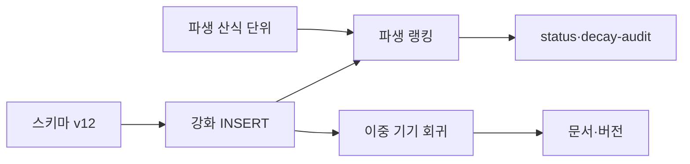

# flint v1.9.0 — 다중 기기 안정화: recall append-only (스키마 v12)

**Spec path:** docs/plans/2026-11-18-flint-v1900.spec.md
**Detail:** tests · **Target-min:** 9
**Global constraints:** TDD·기계 채널 불변(read 완료 감사 커밋·telemetry 분리 승계)·개인 데이터 금지·slow 실DB 격리 DSN+flock·이중 기기 회귀 green이 발행 조건(스펙 요구 6).

```mermaid
%% schedule
gantt
  title Predicted schedule (mm:ss)
  dateFormat X
  axisFormat %M:%S
  section lane 1
  T1 파산 산식 단위 :t1, 0, 102s
  T3 강화 INSERT 전환 :t3, 102, 102s
  T4 파생 랭킹 전환 :t4, 204, 102s
  T5 status·decay-audit 전환 :t5, 307, 102s
  section lane 2
  T2 스키마 v12 :t2, 0, 102s
  T6 이중 기기 회귀 :t6, 204, 102s
  T7 문서·버전 :t7, 307, 102s
```

critical path: T2 → T3 → T4 → T5 (6.8 min) · peak width 2 · predicted build 6.8 min · predicted total ≈ 10.3 min

**File structure:** lib/sqlfs/schema.sql(v12 DDL)·lib/db/admin.go(EnsureSchemaV12·백필)·lib/db/reads.go(BumpRecallScores INSERT)·lib/db/schema_gates.go(v12 게이트)·lib/knowledge/hot.go(파생 랭킹·산식)·lib/ops(status·decay-audit)·lib/db/dual_device_test.go(이중 기기).

### T1 파산 산식 단위 · Complexity 2 · Est. context 18k
**Owns:** lib/knowledge/hot.go, lib/knowledge/hot_test.go
**계약:** 이벤트 카운트 기반 유효 점수 순수 함수 추가 — `EventEffectiveScore(eventCount int, lastRecalled time.Time, now time.Time, decayPerDay float64) int`: max(0, count − rate×경과일수), 미회상(count 0)=0. 기존 EffectiveRecallScore(스칼라 원천)는 T4 전환 시 폐기 — 본 태스크에선 신규 함수+단위 테스트만(경계: 0일·정확히 0되는 날·대량).
**Produces:** `EventEffectiveScore(eventCount int, lastRecalled time.Time, now time.Time, decayPerDay float64) int` e.g. `(3, 2일전, now, 1.0) -> 1` · `(1, 5일전, now, 0.3) -> 0` · `(0, zero, now, 1.0) -> 0`
**Test:** 순수 단위 — 경계 6종.

### T2 스키마 v12 · Complexity 3 · Est. context 26k · Tests: slow
**Owns:** lib/sqlfs/schema.sql, lib/db/admin.go, lib/db/admin_v1200_test.go, lib/db/schema_gates.go
**계약:** ① schema.sql에 v12 섹션 — `CREATE TABLE IF NOT EXISTS recall_events(knowledge_id integer NOT NULL, recalled_at timestamptz NOT NULL DEFAULT now())` + `CREATE INDEX IF NOT EXISTS idx_recall_events_id_time ON recall_events(knowledge_id, recalled_at DESC)`(신규 DB 경로). ② EnsureSchemaV12 — v11 DB 무손실 승격: recall_events 생성 → 백필 `INSERT INTO recall_events SELECT id, COALESCE(last_recalled_at, now()) FROM knowledge WHERE recall_score > 0`(스코어 연속성: 합성 이벤트 주석 명시) → 컬럼 폐기 `ALTER TABLE knowledge DROP COLUMN recall_score`·`last_recalled_at`(Doltgres IF EXISTS 미지원 — 정보스키마 사전 확인 가드). ③ schema_gates.go에 {12, EnsureSchemaV12} 등록. meta.schema_version=12.
**Test:** slow — v11 상태 DB(합성 지식+recall_score 3) 승격 → 이벤트 3건·컬럼 부재·버전 12·재실행 멱등.

### T3 강화 INSERT 전환 · Complexity 2 · Est. context 20k · Tests: slow
**Owns:** lib/db/reads.go, lib/db/reads_v1900_test.go
**계약:** BumpRecallScores 구현 교체 — `UPDATE knowledge SET recall_score...` → `INSERT INTO recall_events(knowledge_id) SELECT unnest($1::int[])`(빈 ids no-op 유지·실패 조용히 계약 유지). wire.RecallBumper 시그니처·read 완료 감사 커밋("read: recall bump")·telemetry 커밋 분리 불변(realstore_read.go 주석 갱신만).
**Test:** slow — read 히트 후 recall_events 적립·knowledge 행 무변경(감사 스테이징 확인)·기존 read 패키지 green.

### T4 파생 랭킹 전환 · Complexity 4 · Est. context 30k · Tests: slow
**Owns:** lib/knowledge/read.go, lib/knowledge/read_test.go, lib/knowledge/hot.go, lib/knowledge/hot_test.go
**계약:** 랭킹 질의 전환 — k.recall_score·k.last_recalled_at 직접 참조(174-188·420-434행 부근)를 recall_events 파생 조인으로: `LEFT JOIN (SELECT knowledge_id, count(*) cnt, max(recalled_at) last_at FROM recall_events GROUP BY knowledge_id) re ON re.knowledge_id = k.id` + T1 EventEffectiveScore 동등 SQL 산식(또는 SQL 내 산식+Go 정렬 승계 — R36 인덱스 정렬 원칙 준수). 스킨 sqlColumns에 유효점수 열 유지(출력 스키마 불변). hot/brief/read 랭킹·tuning decay_rate 오버라이드 경로 불변. 기존 EffectiveRecallScore 스펙라 참조 정리. docs/PERF.md에 파생 랭킹 벤치(합성 1만 이벤트·3회 중앙값) 기록 — v11 직접 열 대비 p95 2배 미만 실측.
**Consumes:** EventEffectiveScore(eventCount int, lastRecalled time.Time, now time.Time, decayPerDay float64) int (T1)
**Test:** slow — 이벤트 적립→랭킹 감쇠 반영·미회상 하단·출력 JSON 스키마 동치·R36 부분정렬 회귀(다른 초기 순서 검증).

### T5 status·decay-audit 전환 · Complexity 2 · Est. context 20k
**Owns:** lib/ops/status.go, lib/ops/maintain.go, lib/ops/maintain_test.go
**계약:** status·maintain --decay-audit의 recall_score/last_recalled_at 참조를 파생 조인으로 전환(서식·승인제·출력 불변). meta 계열 카운트 무변경.
**Consumes:** T4 파생 조인 패턴
**Test:** fake/단위 — 감사 리포트 동치·승인 플래그.

### T6 이중 기기 회귀 · Complexity 4 · Est. context 26k · Tests: slow
**Owns:** lib/db/dual_device_test.go
**계약:** R38 치명 시나리오 회귀 하네스 — 격리 DB A·B 각각 생성(마이그레이션 완료 상태): ① A에서 지식 3건 커밋+push → B pull ② A·B 양측에서 독립 read(강화 이벤트 적립)+각기 신규 지식 쓰기 커밋 ③ A push → B pull(또는 역방향) — **패닉 없이 성공**·양측 recall_events union(B 이벤트+A 이벤트 공존)·동일 랭킹 조회 결과·knowledge 행 충돌 없음을 실측 단언. dolt_remote file:// 스킴(R34 격리 관례·sync 화이트리스트 승계). 실패 시 스펙 요구 6 미달 — 발행 불가.
**Test:** 자기 자신(수용 기준)·slow 2DB.

### T7 문서·버전 · Complexity 2 · Est. context 20k
**Owns:** VERSION, README.md, README.ko.md, flint-plugin/.claude-plugin/plugin.json, docs/HISTORY.md, docs/versions_test.go, docs/RUNBOOK.md
**계약:** v1.9.0 동기 — 배지·하이라이트(다중 기기 동기화 지원 — 회상 이벤트 append-only)·HISTORY(치명 2건 근본 처방 서술·합성 백필 명시)·계약행 TestVersion0190Milestone{v1.9.0, multi-device}·RUNBOOK sync 절 "단일 활성 기기 권고" → "다중 기기 지원(쓰기 충돌은 기존 계약)" 갱신. make docs-sync·release-gate green.
**Test:** go test ./docs·release-gate OK v1.9.0.

**Review Focus:** CLI+library — state(스키마 마이그레이션 무손실·동시 회상·union 병합), numeric(감쇠 산식 경계·카운트), protocol(출력 스키마 동치·exit), file(이중 DB 정리). 위험: 백필 합성 이벤트의 랭킹 왜곡·DROP COLUMN 가드 누락·파생 조인 N+1·R36 재발.

**Probe entry:** run=go run ./cmd/flint read 데모 --limit 3 · run=go run ./cmd/flint maintain --decay-audit · run=go run ./cmd/flint sync remote list

**Self-review:** 스펙 7요구 → T2(1·2) T3(3) T1·T4(4) T5(5) T6(6) T7(7). 플레이스홀더 없음. 병렬 충돌 없음(패키지별 배타·T4가 knowledge 3파일 단독). 크리티컬 패스 T2→T3→T4→T5→T6→T7 순차 — 스키마 마이그레이션 특성상 필수 순서.

**Ruling:** 백필은 score수 합성 이벤트 - 랭킹 연속성이 이력 정밀도보다 우선(이벤트 원천은 v12부터 정확) - 비용: 마이그레이션 이전 이력 부정확.
**Ruling:** 계측 read_events 재사용 불허·전용 recall_events - telemetry 커밋 분리 원칙(v1.7.0)과 회상 원천 독립성 보존 - 비용: 테이블 1증.
