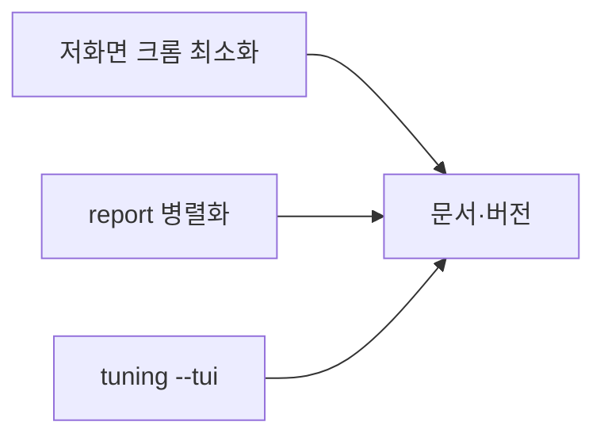

# flint v1.9.1 — 소형: TUI 저화면 크롬 최소화·report 병렬화·tuning --tui

**Spec path:** docs/plans/2026-11-18-flint-v1910.spec.md
**Detail:** tests · **Target-min:** 5
**Global constraints:** TDD·기계 채널 불변(JSON·exit·12행 이상 레이아웃)·에이전트 기존 경로 불변(적응형 진입 확대 금지)·개인 데이터 금지·release-gate 통과.

```mermaid
%% schedule
gantt
  title Predicted schedule (mm:ss)
  dateFormat X
  axisFormat %M:%S
  section lane 1
  T1 TUI 저화면 크롬 최소화 :t1, 0, 102s
  T4 문서·버전 v1.9.1 :t4, 102, 102s
  section lane 2
  T2 report 수집 병렬화 :t2, 0, 102s
  section lane 3
  T3 tuning --tui 옵트인 :t3, 0, 102s
```

critical path: T1 → T4 (3.4 min) · peak width 3 · predicted build 3.4 min · predicted total ≈ 6.9 min

**File structure:** lib/tui/pending.go·lib/tui/maintain.go(크롬 배분)·lib/ops/report.go(병렬 수집)·lib/cli/tuning.go(신규 진입 분기)·lib/tui/tuning.go(신규 huh 폼)·VERSION·docs/HISTORY.md.

### T1 TUI 저화면 크롬 최소화 · Complexity 2 · Est. context 18k
**Owns:** lib/tui/pending.go, lib/tui/maintain.go, lib/tui/pending_test.go, lib/tui/maintain_test.go
**계약:** pendingListHeight(높이−6)·maintainListHeight(높이−7)에 저화면 분기 추가 — 창 높이 < 12면 선택 크롬(비대화 안내 nonInteractiveHint·구분 여백·축약 가능 status)을 View에서 생략하고 배분 공식이 줄어든 크롬 행수를 반영(하한 clamp 1 유지). q/ESC 탈출 안내는 최소 화면(8행)에서도 유지. 12행 이상 레이아웃은 바이트 불변. 임계 12는 상수로(tui.go — 공통 상수 관례).
**Test:** WindowSizeMsg{Width, Height} 키 필드 주입 단위 — 높이 8·11에서 목록 배분 증가·크롬 생략, 높이 12·24에서 기존 배분·뷰 동치.

### T2 report 수집 병렬화 · Complexity 3 · Est. context 24k · Tests: slow
**Owns:** lib/ops/report.go, lib/ops/report_parallel_v1910_test.go
**계약:** collectCuration·collectStats·collectCounts·collectEffect의 독립성(각 out 필드 상호 배타)을 조사해 주석으로 문서화, 독립 구간만 errgroup 동시 실행. collectDaily(Days 원천 — 후속 산출 입력)은 선행 유지, out.DupPct·합산 등 후처리는 전 완료 후 순차(기존 순서). 오류는 기존 순차 우선순위(collectDaily > stats > counts > effect)로 결정적 선택 — 복수 실패 시에도 순차 경로와 동일 exit·ErrLine. JSON 출력 바이트 불변(report_bytes·parity 계약 승계). 전·후 wall-clock 실측(격리 DSN·합성 시드·3회 중앙값) 주석 기록.
**Test:** 병렬 경로 JSON 바이트 동치(순차 산물 대조)·오류 주입 시 순차와 동일 exit/ErrLine·slow 실측 회귀.

### T3 tuning --tui 옵트인 · Complexity 3 · Est. context 26k
**Owns:** lib/cli/tuning.go, lib/cli/tuning_tui_v1910_test.go, lib/tui/tuning.go
**계약:** lib/cli/tuning.go(신규) — cli init이 "tuning" 재등록(report 재등록 패턴 승계): --tui 명시 + 터미널 → TUI, 그 외 전부 ops.RunTuning 바이트 불변 위임. 적응형 진입 없음(무인자는 JSON 유지). lib/tui/tuning.go(신규) — huh 폼: 키 목록(TuningKeys 단일 소스)→값 편집→set/reset, 검증은 기존 loadThresholds→ParseThresholds 실경로(폴백 시 거부·안내). FLINT_NO_TUI·비터미널 --tui exit 3(ErrTerminalRequired 관례). TUI 확정 결과는 기존 set/reset JSON 1행 출력으로 표준 경로 재사용(중복 구현 금지).
**Consumes:** TuningKeys (lib/ops tuning 등록표 — 읽기 전용)
**Test:** 무인자·기존 플래그 경로 바이트 동치·--tui 비터미널 exit 3·FLINT_NO_TUI 차단·폼 확정 시 기존 set 경로 위임 단언(fake seam).

### T4 문서·버전 v1.9.1 · Complexity 1 · Est. context 14k
**Owns:** VERSION, README.md, README.ko.md, flint-plugin/.claude-plugin/plugin.json, docs/HISTORY.md, docs/versions_test.go
**계약:** v1.9.1 동기 — 배지·하이라이트(저화면 TUI·report 병렬화·tuning --tui)·HISTORY(read TUI 제외 근거 한 줄·병렬화 실측 수치는 합성 데모 값만)·계약행 TestVersion0191Milestone{v1.9.1, tui-perf}. make docs-sync·release-gate green.
**Test:** go test ./docs·release-gate OK v1.9.1.

**Review Focus:** CLI+library — protocol(JSON 바이트·exit·12행 이상 뷰 동치), state(폼 편집 후 thresholds 반영), numeric(목록 배분 공식 경계 8·11·12·24), perf(병렬화 실측·오버헤드 역전 여부). 위험: 병렬화 중 out 공유 쓰기·오류 우선순위 변동·폼 검증 우회(직접 UPDATE).

**Probe entry:** run=go run ./cmd/flint report --days 3 · run=go run ./cmd/flint tuning · run=go test ./lib/tui/ ./lib/ops/ ./lib/cli/ -count=1

**Self-review:** 스펙 4요구 → T1(1) T2(2) T3(3) T4(4). 플레이스홀더 없음. 파일 소유 배타(T1 tui 기존 파일·T2 ops report·T3 신규 파일·T4 문서). read TUI 제외는 스펙 비목표+HISTORY 기록으로 처리 — 태스크 없음(근거 확정).

**Ruling:** tuning은 --tui 옵트인 한정·적응형 진입 없음 - 에이전트·스크립트의 무인자 JSON 경로 보장이 관리자 편의보다 우선 - 비용: 사람은 플래그를 명시해야 한다.
**Ruling:** 병렬화 오류 선택은 순차 우선순위 보존 - 기계 채널(ErrLine·exit) 불변이 처리량 향상보다 우선 - 비용: 전체 대기 후 판정(지연 미미).
