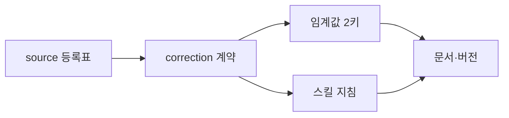

# flint v1.11.0 — 지식화 파이프라인 1단계: 사용자 교정 채널

**Spec path:** docs/plans/2026-11-20-flint-v1110.spec.md
**Detail:** tests · **Target-min:** 6
**Global constraints:** TDD·기계 채널 불변(기존 write 회로 재사용·변경 최소)·개인 데이터 금지·튜닝값은 thresholds 기본+meta 오버라이드.

```mermaid
%% schedule
gantt
  title Predicted schedule (mm:ss)
  dateFormat X
  axisFormat %M:%S
  section lane 1
  T1 source 등록표 확장 :t1, 0, 102s
  T2 correction 계약 :t2, 102, 102s
  T3 임계값 2키 :t3, 204, 102s
  T5 문서·버전 v1.11.0 :t5, 307, 102s
  section lane 2
  T4 스킬 지침 :t4, 204, 102s
```

critical path: T1 → T2 → T3 → T5 (6.8 min) · peak width 2 · predicted build 6.8 min · predicted total ≈ 10.3 min

### T1 source 등록표 확장 · Complexity 2 · Est. context 18k
**Owns:** lib/knowledge/write.go, lib/knowledge/write_test.go
**계약:** validSources(hook|manual|mcp)에 `correction` 추가 — 등록표 단일 소스화(validSources 슬라이스에서 usage·ErrInvalidSource 메시지 파생으로 정합)·동질 가드 테스트(usage 문자열이 등록표와 불일치 시 실패).
**Test:** correction 유효 통과·미등록 값 거부·usage/에러 메시지 파생 정합.

### T2 correction 계약 · Complexity 3 · Est. context 22k
**Owns:** lib/knowledge/write.go, lib/knowledge/write_test.go, lib/cli/write_v1110_test.go, lib/store/thresholds.go, lib/wire/threshold_meta.go, lib/wire/thresholds.go, lib/wire/threshold_meta_test.go, lib/db/usage.go
**계약:** --source correction 경로 — payload에 confidence 미지정 시 기본 0.7 적용·태그 `correction` 자동 부착(기존 태그 보존 병합)·4연산·dedup·pending 회로는 전부 기존 재사용(분기 최소 — confidence 기본값만 신규). T3 thresholds 키 완성 전까지 상수 임시값 금지 — T1과 같은 커밋 웨이브에서 T3 의존.
**Consumes:** T1 등록표
**Test:** 단위(기본 confidence·태그 부착·dedup 회로 승계) + e2e slow(격리: 적립→pending→approve→read 회상 태그·confidence 확인).

### T3 임계값 2키 · Complexity 2 · Est. context 18k
**Owns:** lib/store/thresholds.go, lib/wire/threshold_meta.go, docs/TUNING.md, lib/store/thresholds_test.go
**계약:** `correction_confidence`(기본 0.7)·`correction_daily_max`(기본 20) 등록(39→41항목) — T2가 correction_confidence 소비·일일 상한 초과 시 조용히 skip+경고 1행(warning 계약 승계). TUNING §2 행 2건.
**Consumes:** T2 경로
**Test:** 기본값·오버라이드·상한 초과 skip 단위.

### T4 스킬 지침 · Complexity 1 · Est. context 14k
**Owns:** flint-plugin/skills/flint/SKILL.md, docs/RUNBOOK.md, docs/correction_v1110_test.go
**계약:** plugin 스킬(flint-plugin/skills/flint/SKILL.md)에 교정 지침 추가 — "사용자 교정 인지 시 즉시 `flint write knowledge --source correction` 적립(교정 내용 최소·추측 금지·전체 발언 캡처 금지)". RUNBOOK에 파이프라인 1단계 서술. (개인 ~/.claude/skills/flint은 repo 밖 — repo는 plugin 스킬만.)
**Test:** 문서 정합(docs-sync)·수동 검토.

### T5 문서·버전 v1.11.0 · Complexity 2 · Est. context 18k
**Owns:** VERSION, README.md, README.ko.md, flint-plugin/.claude-plugin/plugin.json, docs/HISTORY.md, docs/versions_test.go
**계약:** v1.11.0 동기 — 하이라이트(knowledge pipeline step 1 — user-correction channel)·HISTORY(pipeline 초안 링크·B안 룰링 서술)·계약행 TestVersion01110Milestone{v1.11.0, correction-channel}. release-gate green.
**Test:** go test ./docs·release-gate OK v1.11.0.

**Review Focus:** protocol(채널 계약·exit)·state(dedup·pending 회로)·numeric(confidence 기본)·file(등록표 파생). 위험: 기존 write 회로 우발 변경·confidence 기본 적용 조건(payload 미지정 시만).

**Probe entry:** run=go run ./cmd/flint write knowledge --source correction · run=go run ./cmd/flint read 데모 --tag correction

**Self-review:** 스펙 6요구 → T1(1) T2(2) T3(3) T4(4) T2 계량+T3(5) T5(6). 플레이스홀더 없음. T2가 write.go에서 T1과 같은 파일 — 순차(T1→T2) 필수.

**Ruling:** 감지 경로 B안(에이전트 계약 유도) — 구현 최소·하네스 무관·기존 스킬 계약 패턴 승계, A안(훅)은 프라이버시 표면·후속 조사 - 비용: 에이전트 순읜도가 품질 상한.
**Ruling:** 교정 계열도 pending 유지(비목표 원칙)·confidence 0.7은 사람 신호 반영(hook 0.5·수동 명시 0.8 사이) - 비용: 승격 대기 1단계.
