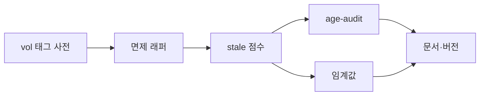

# flint v1.13.0 — 낡은 지식 감지·변동성 계층 (age-audit)

**Spec path:** docs/plans/2026-11-21-flint-v1130.spec.md (요구 3 `--stale-audit`은 **`--age-audit`으로 명칭 변경** — 기존 --stale 접두 충돌·리서치 룰링. 처분은 신규 --commit 대신 **기존 --invalidate 승인 위임**. 신호 ⑤근원변화는 필드 부존재로 비목표 확정.)
**Detail:** tests · **Target-min:** 7
**Global constraints:** TDD·무SQL자동처분(no-SQL-auto-verdict)·스키마 무변경(태그·meta 기반)·기계 채널 불변·개인 데이터 금지·주석 영어.

**리서치 근거** (v113-research): Zep식 무효화 보존(invalid_at=처분)·Mem0 감쇠=접근기반 재랭킹(flint 동형)·TTL은 경보용(자동삭제 아님)·stale benchmark 교훈 "감지만으론 부족·처분 승인 루프가 본체". 기존 --stale(90일·never_read 리포트)·--invalidate-stale 승인제 선례. policy.go 사전 미등록 태그 거부.

### T1 vol 태그 사전 등록 · Complexity 2 · Est. context 16k
**Owns:** lib/store/policy.go, lib/store/policy_test.go, docs/CONTENT.md
**계약:** 태그 사전에 `vol:immutable`·`vol:conditional`·`vol:volatile` 3종 등록(:tags: 콜론 포맷·strpos 승계). **콜론 충돌 가드**(게이트): 사용자 입력 태그 토큰에 콜론 포함 시 거부(vol:*는 사전 등록 태그로만 존재 — 우연 면제 오탐 폐지). CONTENT.md §4 동기화(변동성 3계층 — immutable 감쇠 면제·volatile 기존 배율·conditional 기존+문서화).
**Test:** 3태그 등록 통과·기존 어휘 불변·사전-CONTENT 동질 가드.

### T2 면제 래퍼 · Complexity 2 · Est. context 18k
**Owns:** lib/knowledge/hot.go, lib/knowledge/hot_test.go, lib/knowledge/brief.go, lib/knowledge/brief_test.go
**계약:** `EffectiveScoreFor(eventCount int, lastRecalled, now time.Time, decayPerDay float64, tags string) int` 신규 — tags에 :vol:immutable: 포함 시 감쇠 면제(count 반환·순수 EventEffectiveScore 불변). 소비자 3곳 **hot 랭킹(hotRankedSQL에 tags 컬럼 조인 추가 필수)·brief(brief.go rankRowsByEffectiveScore)·maintain decay-audit** 전환 — 호출부 확장 최소(read는 감쇠 미사용).
**Produces:** `EffectiveScoreFor(eventCount int, lastRecalled time.Time, now time.Time, decayPerDay float64, tags string) int` e.g. `(3, 100일전, now, 1.0, ":vol:immutable:") -> 3` · 동일 조건 tags 없음 -> 0
**Test:** immutable 면제·비면제 동치·경계 태그(조건부).

### T3 stale 점수 · Complexity 3 · Est. context 24k · Tests: slow
**Owns:** lib/ops/maintain.go, lib/ops/maintain_test.go
**계약:** **점수 신호 2종**(게이트 룰링 — 활성 후보에서 구조적 0 방지): ①TTL 경과일(last_recalled_at 없으면 ingested_at — listStale 관례)②correction 태그 수. 가중합 0-100 정규화·가중치·산식 주석 명시·모집단 캡 LIMIT(decay-audit LIMIT $1 선례). **참조열(비가중)**: 회상 후 무효화 이력(bad_recall 파생 — report.go 승계)·동일 topic supersede 이력 — 리포트 정보 제공만. `:vol:immutable:` strpos 서버측 제외.
**Test:** slow — 신호별 시드(합성)로 점수 단조성·immutable 제외·4신호 독립 반영.

### T4 age-audit · Complexity 3 · Est. context 22k
**Owns:** lib/ops/maintain.go, lib/ops/maintain_test.go, lib/cli/maintain_tui_test.go
**계약:** `maintain --age-audit` — stale 점수 상위 목록 JSON 리포트(id·topic 절단·점수·신호 내역·점수 임계 초과 마킹)·dry-run 기본·파서 --stale 접두 무충돌 단언. 처분은 리포트 안내로 기존 `--invalidate` 승인 위임(신규 --commit 없음). decay-audit 서식 승계.
**Consumes:** T3 점수 산출
**Test:** 리포트 스키마·임계 마킹·--stale 무충돌·dry-run 무변경.

### T5 임계값 · Complexity 2 · Est. context 16k
**Owns:** lib/store/thresholds.go, lib/wire/threshold_meta.go, lib/wire/threshold_meta_test.go, docs/TUNING.md
**계약:** `stale_score_threshold`(기본 70)·`stale_ttl_days`(180) 등록(43→45) — 가중치는 코드 상수(튜닝 아님 — 산식 일부)·임계만 thresholds.
**Test:** 기본·오버라이드·frozen.

### T6 문서·버전 v1.13.0 · Complexity 2 · Est. context 18k
**Owns:** VERSION, README.md, README.ko.md, flint-plugin/.claude-plugin/plugin.json, docs/HISTORY.md, docs/versions_test.go, docs/RUNBOOK.md
**계약:** v1.13.0 동기·RUNBOOK age-audit 절(변동성 태그 안내·--invalidate 위임·신호 4종)·계약행 TestVersion01130Milestone{v1.13.0, age-audit}.
**Test:** go test ./docs·release-gate OK v1.13.0.

**Review Focus:** numeric(점수 산식·정규화)·state(신호 조인 정확·immutable 제외)·protocol(파서 무충돌·dry-run)·privacy(리포트 살균). 위험: 점수 가중치 자의성(주석·문서 명시)·--stale 파서 회귀·대량 지식 점수 성능.

**Probe entry:** run=go run ./cmd/flint maintain --age-audit · run=go run ./cmd/flint read 데모 --limit 3

**Self-review:** 스펙 5요구 → T1(1) T2(1 감쇠차등) T3(2) T4(3·4) T5(4) T6(5). 플레이스홀더 없음. maintain.go T3→T4 순차·T1→T2 순차.

**Ruling:** --stale-audit→--age-audit — 기존 --stale·--invalidate-stale 접두 충돌 회피(리서치) - 비용: 스펙 명칭 변경.
**Ruling:** 처분 신규 --commit 폐지·기존 --invalidate 위임 — no-SQL-auto-verdict·승인 루프 단일화(stale benchmark 교훈) - 비용: 2단계 사용자 조작.
**Ruling:** 신호 ⑤근원변화 비목표 확정 — 근원 URL/해시 필드 부존재(신규 스키마 필요) - 비용: 근원 변동 감지 지연.

**Ruling:** 점수 신호 2종 축소(TTL·correction) — 신호 ①②(모순·bad_recall)는 활성 후보에서 구조적 0(supersede/invalidate 동시 설정·회상 후 무효화 판정)·참조열로 강등 - 비용: 모순 민감도 상실(후속 재설계 과제).
**Ruling:** 임계 2종+가중치 코드 상수 — 가중치는 산식 일부로 튜닝 노출 불필요·스펙 "등 신호별 임계" 축소 - 비용: 신호별 조정 불가. 스펙 명칭(--age-audit·TestVersion01130·신호 4종) 개정 스탬프: 플랜 우선.
